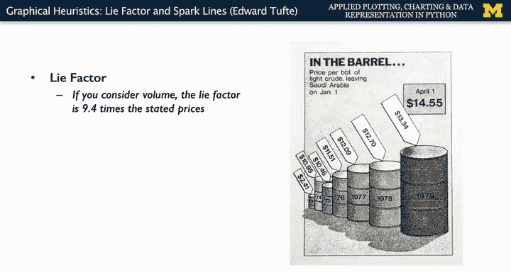

# 密歇根大学《Python用于数据科学实践（1-3课／共5课）｜Applied Data Science with Python 》deepseek翻译 - P36：6_图形启发式：谎言因子与火花线（Edward Tufte）.zh_en - GPT中英字幕课程资源 - BV1U64y1L7VJ

Edward Tuftty's emphasis on simplicity and minimalism has grown a great following。

 He is largely seen as one of the most influential writers on the topic of visualizations for charts and graphs。

In his book， Beautiful evidencevidence， he introduced the idea that took minimalism in charts to a new level。

 Instead of making a chart a separate artifact to be studied on his own。

 he suggested that it be reduced and embedded within the context of discussion。

 He argued that a small graph， say a time series line graph could convey so much more information quickly that it would be invaluable to readers。

 He called these items spark lines and referred to them as data words。

 an intriguing way to bridge the gap between text and figures。

He suggested that spark lines could not only be represented directly in text。

 but also could be embedded in tables， along with the data they describe。

 This thought became so natural that it's even been picked up by one of the most common pieces of spreadsheet analysis。

 software， Microsoft Excel。Here's a picture of tabular data from the Nasdaq Stock Exchange。

 showing the opening price of four technology stocks over a one month period。

Take a moment to consider this data。 Which stock has had a bad month with a downward trend and which has had a good month with an upward trend。

Where if I added spark lines in the cells below。Here you can see immediately that Apple has had a poor month with decreased stock price。

 and IBM has had a good month with increasing stock prices。With Amazon and Intel。

 it's a little less clear and we see some spikes throughout。Now。

 these spark lines don't help us answer who has the highest stock price or who had the greatest wins or losses。

 but they do give us a general feeling for the trend behind the data。And actually。

 spark lines are used for data where trends or distribution characteristics are important。

Here's another example of spark lines used in Google Finance's website。

Not how you can actually quickly zoom in on pieces of the distribution with these spark lines。

 so they're not just a representation of the data， but a method of interacting with it。

There have been lots of different uses of spark lines， and customized interfaces。

 such as video games are a great example。 A modern take on spark lines。

 which I think of is kind of neat， is called the Sp T。

 where Uniode block characters are used to display a bar graph inside the hundred and 40 characters allotted by Twitter。

😊，For instance， here， a users tweeted her hours of sleep over the month of April as a bar graph。

The last tufty principle that I want to share with you is one called lie factor。

 Li factor is the size of an effect shown in the graphic divided by the size of the effect。

 actually in the data。It's often done unconsciously to try and help tell a narrative， However。

 it's misleading to the observers。 There are lots of different examples of lie factor。

 This one from Time magazine in 1979 provides a great example， I think。In it。

 various barrels of oil are shown showing the price of oil over six years。

 but it's unclear to the viewer what the size of one barrel means in relation to the others。 In part。

 because there is an element of perspective here。 Are the barrels different sizes or do they just appear to be so because some are in front of the others。

Is it the volume of the barrel that represents the growth of the cost or the height of the barrel。

Spark Lines and Life Act are just two more tools that Edward Tufty has given us to understand and communicate data。

