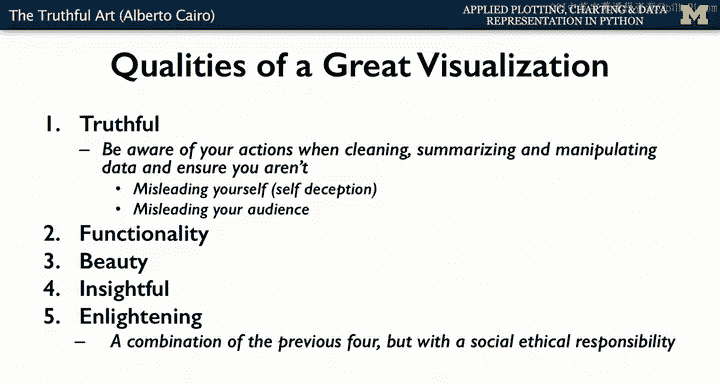

# 密歇根大学《Python用于数据科学实践（1-3课／共5课）｜Applied Data Science with Python 》deepseek翻译 - P37：7_《真相的艺术》（Alberto Cairo）.zh_en - GPT中英字幕课程资源 - BV1U64y1L7VJ

I consider Alberto Cairo's book the truthful art to be required reading for any data scientist。

 In one book， he has managed to pack in a plethora of references to experts in the field while still distilling down details into memorable lessons。

While we won't have an opportunity to cover everything he talks about。

 I want to talk in this lecture about the foundation of the book in particular。

 which is a five part framework for considering the qualities of an information graphic。Importantly。

 Cairo says that these qualities are not independent of one another and that they're interrelated。

 So while I tend to be prone to reductionism， keep in mind that the different qualities interact with one another as we go through the lecture。

The first quality of a good visualization is that it's truthful。 Now。

 Cairo admits that truth could be considered subjective and is certainly on a continuum with some things being more truthful than others。

 and that it might be impossible to establish an absolute truth。But as data scientists， he argues。

 we have two obligations when it comes to protecting the truth。First。

 we have to be honest with ourselves when we clean and summarize data are the activities we're engaging in likely to obscure a message because of the limitations that we've applied。

We should consider explicitly each modification that we're making to the data and make sure we aren't ptising what he calls self deception。

Skeptticism is an important skill for data scientists。

 and we often get so focused on looking for patterns that we reduce or represent data in ways which are inaththentic to the phenomena being described。

The second obligation is to our audience。That is， there are techniques in data science and information visualization。

 which we can use to shine light on specific pieces of data。 Indeed。

 this is generally the point of the fields。But if we omit the ability of the reader to explore the phenomena more fully。

 this will generate doubt and cast distrust。Ciro gives us a great example of this using a chart inspired by one put out by the Loying Association。

 the National Cable and Telecommunications Association。

This association lobbies on behalf of US cable companies and provided a graphic which suggested that after regulations were relaxed。

 cable companies invested four times as much in the industry。

Now the original chart has been taken down， but Cairo provides an example of what was visualized。

And we can see here the title of the chart alone was intended to draw the reader to the conclusion。

 Less regulation means more industry investment。If there are some immediate problems with this graphic。

 first， it's unclear whether the monies are adjusted for inflation。

 which is a big issue in providing charts of financial data。Second。

 the time spans for the two bars are different。 One covers a span of three years。

 while the other covers a span of four years。Think of this through the lens of Tufty's lie factor analysis。

 The bars have the same width， but don't represent the same period of time。

This is a completely unforgivable design choice。And finally。

 there seems to be a bunch of missing data from years 1997 and 1998。

 and the chart stops in the year 2003， but the information was tweeted in 2014。

What does a more honest view of the data look like Well。

 Cairo tracked this down and provided a line graph。We can see that after regulation， there were。

 in fact， years of sustained industry investment。We see a slight drop after deregulation then a massive spike in spending and then a significant fall from the period post 2002。

 much of which is excluded from the original chart。

While it's unclear whether the dollar values are in fact corrected for inflation。

 it seems pretty unreasonable to suggest from this data alone that regulation stems cable company investment and infrastructure。

The lesson here is that while there is maybe no absolute truth。

 there are ways of displaying data which are more truthful than others。

The second quality of a visualization to consider is whether it is functional or not。

This again is a continuum， and we saw an example previously where the slides on data inN crat provided by dark Course analyticstic。

If you expect your audience will want to compare to data series。

 direct labeling of them is one way to increase comprehension。

While there are many heuristics for increasing functionality。

 I would like you to remember the user test we did with Char junkunk。

I think now is an exciting time for understanding situated human behavior。

The web has dramatically increased our ability to test social and behavioral hypotheses at scale across diverse populations。

 and Cdflower and mechanical Turk are just two examples of this。

Understanding how functional a given approach to a visualization is doesn't necessarily require expensive ethnographic research。

 It's now much easier to test hypotheses directly with crowd sources。

The third quality of visualization Cairo shares is whether it is beautiful or not。

I think that this requires knowing a great deal about your audience。

 There are different perceptions based on people's lived experiences and aspects about themselves such as gender and culture。

 There's a lot to building a beautiful information， visualization experience。

 which depends on situational and contextual factors， too。😊，For instance。

 if you're building a chart for a report， the colors and styles that you might choose。

 even down to the font choice might be more related to beauty than， for instance， function。

But the interplay of these elements is something which is difficult to ignore。I wonder。

 is this broad topic of beauty one of the conflary factors of the chart junk memorability issue。

Whereas Tufty argue that the duck junk is distracting and misleading。

 The study by Bateman at all showed that it can make visualizations more memorable。

 Is this disconnect an issue of beauty in information graphics。

Here's one parting thought on beauty and information that perhaps drives home this quality。

One of the most popular tech magazines， well known for its full page information graphic spreads。

 is Wired magazine。 On Wired's website， they tag these articles as infofo porn。

 a reference to the visceral reaction that they hope readers will view when viewing the articles。

The fourth quality of visualization from Cairo is that information graphics should be insightful。

They shouldn't just replicate data and tables， but they should draw the viewer in such that the viewer has an aha or eureka moment。

I think about this largely in the context of academic papers where I do most of my work。

A common issue that novice writers have in this area is the inclusion of a figure for every piece of data they have。

 This is really unnecessary and adds bloat and contributes to reader fatigue。

 but the right figure drives home the results of a study quickly。

 Scific peer review is common in my field， but readers don't have the large amounts of time that they need to do full reviews。

 When flipping through a submitted paper The reviewer sees an image which jumps off the page and gives them immediate insight。

 This sets them up to understand the more nuanced story to be told throughout the rest of the paper。

The final quality of visualization which Cairo proposes is information graphics should be enlightening。

This is different than insightful。 In fact， Cairo argues that this quality is composed of the previous four truthful。

 functional， beautiful and insightful， but is separate in that it adds a social responsibility dimension mention。

I don't think there's an obvious answer to this question。 But without a doubt。

 Cairo's five qualities of great visualizations， being truthful， functional， beautiful。

 insightful and enlightening are well worth considering Cairo has more great work。

 And following this lecture， I've assigned a reading of his。

 as well as a discussion question to encourage you to weigh in on the ammorality of information visualization as it relates to data science。

😊，And this ends the week of the course。 We've covered a lot of material very quickly。

 but I really do believe that these two authors， Alberto Cairo and Edward Tufty are fundamental in building a strong foundation for the applied data science skills we'll focus on in the second week of the course。

