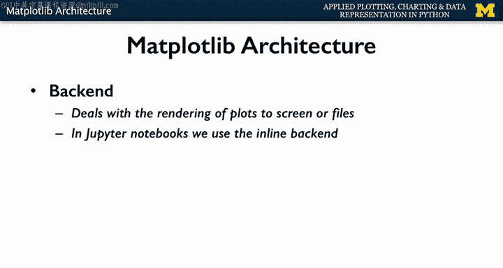
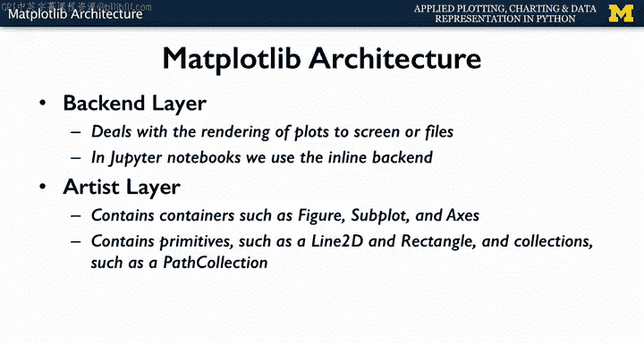
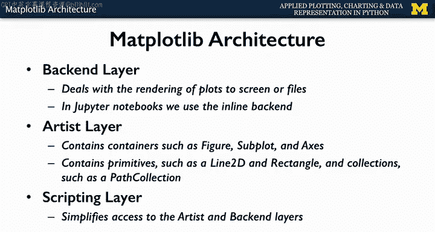

# 密歇根大学《Python用于数据科学实践（1-3课／共5课）｜Applied Data Science with Python 》deepseek翻译 - P39：9_Matplotlib架构解析.zh_en - GPT中英字幕课程资源 - BV1U64y1L7VJ

We're going to use Matplloot Lib within the Jupiter Notes， just like we did with Padas。

Jupiter is some specialized support for Matplloot Lib。

 and this is enabled by using the i Python Magic Pre Maplot Libb Note。

Remember that in the Jupiter notebook， the i Python Mags are just helper functions which set up the environment so that the web based rendering can be enabled。

Matpllootlib itself can work well outside of the Jupiter environment。

 but for this course we're going to focus on its use within the web environment。

 in part because of how popular Jupiters become in data science practice。

So what actually has happened when you run the magic function Matplloot Libb with the inline parameter is that MatplotLi has been configured to render into the browser。

This configuration is called a backend， and MaPplot live as a number of different backends available。

ABack end is an abstraction layer， which knows how to interact with the operating environment。

 whether it's an operating system or an environment like the browser and knows how to render mappllib commands。

 In fact， there's a number of different interactive back ends。

 but there are also back ends called hard copy back ends。

 which support rendering to graphics formats like scalable extragraphs， SvGs or pings。

So not all back ends support all features， especially interactive features。

 which we'll touch on later in this course。

Let's import the Matplloot Lib Library， which we'll do as NPL and call get Backend to make sure we're using the NBAA backend Great。

You'll notice that Matplloot Libb has a lot of non Pythonic naming conventions。In particular。

 you'll be accessing variables using the get and set。

 which is an accessor pattern which is more common in languages like Java。

This is just something you have to get used to， but remember that you can hit tabab for T Hi auto completion in the Jupiter notebook。

 so this can help you find the functions that you're looking for。Now。

 we're not going to spend much time with the back end layer。

 but it's important to be aware of if you're on Mac OS， for instance。

 your default back end when using Matplotlib is one system。 while on Linux。

 G TK is my default back end。The next layer is where we'll spend most of our time， though。

 And that's called the artist layer。 The artist layer is an abstraction around drawing and layout primitives。

 The root of visuals is a set of containers， which includes a figure object with one or more subplots。

 each with a series of one or more axes。This last object。

 the axes is the most common one you'll interact with。

 changing the range of a given axis or plotting shapes to it。And just a brief aside。

 especially since this is a global classroom with people from around the world enrolled。

 where English might not be their first language。Maaplootlib relies heavily on the aes object。

 which is the plural form of a。 But Matlootlib also has an axis object as well。

 and an aes is actually made up of two axis objects。 One for the X。

 horizontal dimension and one for the Y or vertical dimension。

 So you might hear me pronouncecing these two words。

 aes and axis a bit more intentionally than I wouldnt regular speech in order to help make things easier to follow。

The artist's layer also contains primitives and collections。 These are base drawing items。

 Things like a rectangle， ellipse or a line， and collections of items such as a path。

 which might capture many lines together into a polygon shape。

Collections are easy to recognize as their name tends to end in the word collection。

It's worth taking a moment to look at the kinds of artists which are available。

Here's an image from the Matpllootlib documentation on artists。

You'll see that there's lots of child objects of the artist object。

 and that one of them is called patches dot patchch。

This name comes from the Matlab roots of the project and attach patch is any two dimensional object which has a face color and an edge color。

And children of the patch class are the primitives， as we've discussed。Okay。

 so Maplt Lib has two layers， a back end layer， which knows how about low level graphics routines and can render to the screen or to a file。

 will'll use the inline back end for most of our work。And the artist layer。

 which describes primitives， collections and containers。

 It knows how figures are composed of sub figures and where objects are in a given axes coordinate system。

So with this， we could actually get started building figures and rendering them。

But there's one more layer which is extremely important for us as data scientists in particular。

 and this is called the scripting layer。You see， if we were writing an application to use Maplotlibb。

 we might never care about the scripting layer， but this layer helps simplify and speed up our interaction with the environment in order to build plots quickly。

It does this， frankly， by doing a bunch of magic for us。

 and the difference between someone who is effective with Maplotlibb and someone who isn't is usually based on their understanding of this magic of the scripting layer。

The scripting layer we use in this course is called pie plot。

So that describes the mapplot Lib layer cake。There's a back end which deals with actual drawing。

 a bunch of artists on top of the back end， which describe how data is arranged and a scripting layer。

 which actually creates those artists and choreographs them all together。

I just want to address one more topic before we move on。

 And that's the difference between procedural and declarative visualization libraries。 and well。

 user interfaces more generally。The P plot scripting layer is a procedural method for building a visualization。

 and that we tell the underlying software which drawing actions we want it to take in order to render our data。

There are also declarative methods for visualizing data。 Hm L is a great example of this。

 Instead of issuing command after command to the back end rendering agent。

 which is the browser with H。 H documents are formatted as models of relationships in a document。

 often called the Dom or document object model。These are two fundamentally different ways of creating and representing graphical interfaces。

The popular jascript library， for instance， D3 Js is an example of a declarative information visualization method。

 While Matplotlib's pie plot is an example of a procedural information visualization method。

In the next lecture， we're going to get dirty and start making some graphs， but before we do that。

 I wanted you to check out an article by John Hunter and Michael Dttenbaum。While now a bit dated。

 this article was published in the second volume of the book Architecture of open source App and provides a little more context for the architecture of Mapplotlibb。

