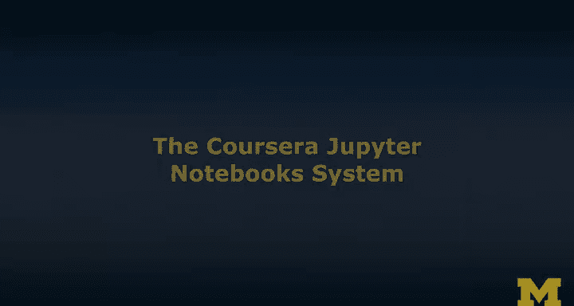
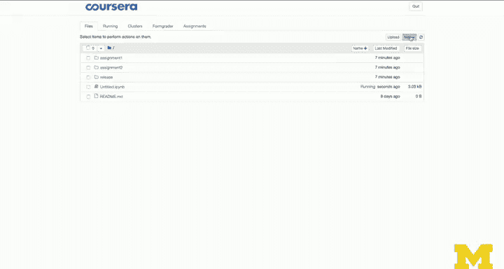
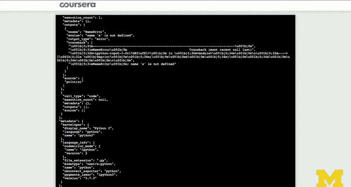
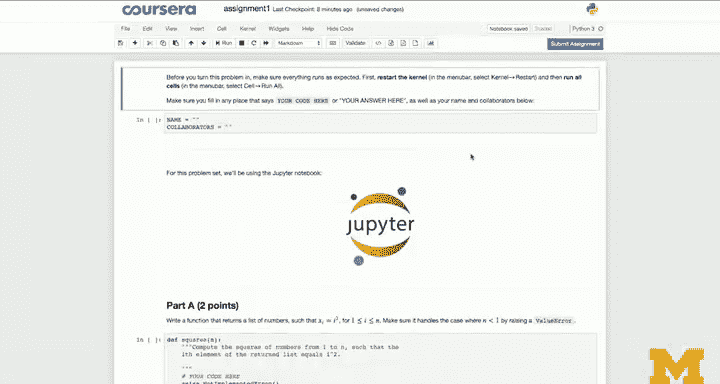
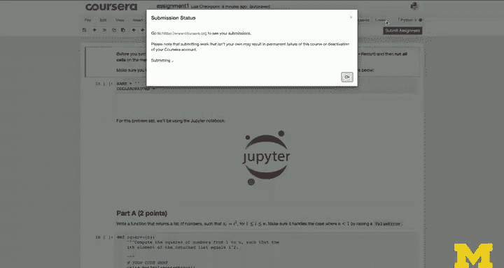
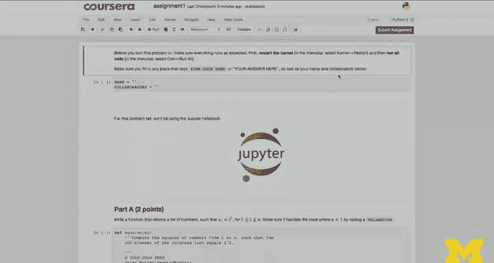
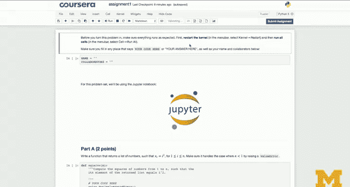
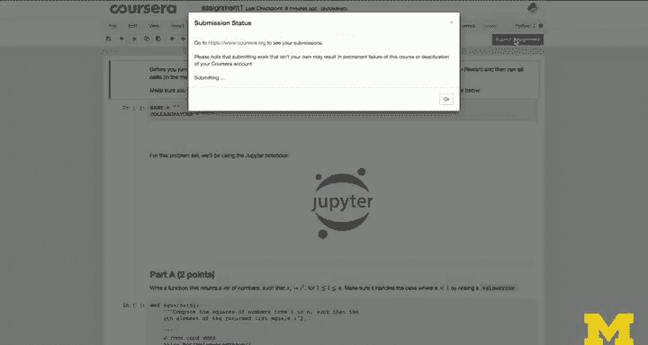

# 密歇根大学《Python用于数据科学实践（1-3课／共5课）｜Applied Data Science with Python 》deepseek翻译 - P3：2_Coursera Jupyter笔记本系统.zh_en - GPT中英字幕课程资源 - BV1U64y1L7VJ

Hi， I want to show you a little bit about the Jupiter notebook system that we've built with Coursera into this course。

 It's a great feature。 It lets you explore your assignments and your programming。

 the lecture content， even all within the Web browser。

 I think it's really quite a wonderful addition to the degree to our platform and your experience。

 So let's take a look。 So this is what the Jupiter notebook will look like when you log into it on Coursera。

 And at any time， you can get back to this screen by clicking on the Coursera logo。

 And this is called the tree or the directory tree。 And you can see here it's at slash。

 which means we're at the root of it。 And in this one， I've got three folders created。

 And I've actually got a text file here， read me markdown file。😊，Now。

 if you want to create a new Jupiter notebook， you just go over to the new button。

 click the little down disclosure triangle， and you can create a folder， text file。

 a terminal we'll talk about that or a new Python 3 notebook。

 so let's go ahead and create a Python 3 notebook。So this is the core of the Jupiter system。

 the Python 3 notebook。This single line here is called a cell。You can have two kinds of。

 you can have code cells and markdown cells。 so let's just say x equals5 print。

XJust something simple。 so we could just write our Python in here。

 and then you can run this cell by hitting the button up here。

And you can see we get the output right below the cell。

 You can move cells around us we can move them up or down。 You can delete， cut。

 copy and paste and so forth。 cells。 So it's really handy。

 What's happening underneath is actually all of the code that your writing is being sent to a virtual server that Corsera hosts and it's being run against a Python interpreter there。

Now， after you run a statement， it's not like just finished running a program。

 That interpreter still exists。 And so the state still exists。 So if we print， for instance， X plus1。

 that interpreter still knows what the value of x was。 And so now we have 6。

Up here in the upper right hand corner， you'll actually see a reference to your Python interpreter state。

 It tells you here the kernel is idle Let's try something else for I en range。0 and 1000。嗯。I equals。

 well， we won't do that。 We'll just say M equals I times。系。Mus。One， and we'll just run this。 Now。

 watch that little circle in the upper right as we run this。You see it very quickly flashed black。

 and that shows you that the interpreter is working。 And so if you're looking at your system。

 wondering why nothing is responding， take a look at that interpreter working。 In fact， why don't we。

 why don't we do something really nasty here。 So why don't we just say for I。Less than。Less than 100。

啊。I equals 1。Or to set I。One right above that。And will'll run this cell。

This is a great example of some syntax error that comes up right here。啊。Chnge just to a while。

Allright， So this is an infinite loop， right。 And we can see here that the asterisk here by the output actually tells us that the kernel is running。

 And we can see here the little black circle is filled in showing that the kernel is running。

 If you get into this kind of state， you can just interrupt that kernel。

 It's like hitting control C on the keyboard。 You just say kernel interrupt。

 and it will just stop at any time。Other things you can do， you can restart the kernel。

 this is just like restarting Python， so actually if we restart the kernel。

And then we try and print X。We see that we get an error。You can clear the output。

 you can restart and run all。And so forth， theres lots of cell functions that you can do too。

 I often use this one。 cell run all above。 So I'll restart the kernel。

 And then I want to run all of the content of my notebook book up until this point。

If you want to switch to a cell to markdown， you can do that and then this is just regular text with a few extras。

 so if you want a big heading and then you can do things like special text to bold。

And then when you run that cell， it'll actually render what the text looks like。

 and you'll see that in the notebooks throughout this course。Let's go back to the tree。In the tree。

 one of the other things you can do is actually open up a terminal。 and this is pretty powerful。

 So you， you now have a terminal。 you're logged in as the user Jovian。

 And this is just a Linux machine underneath。 It's actually a virtualized Linux machine。

 a dockerized one。 And so you can do things like LS to take a list of the file system。

 you can do things like look， what is this untitled notebook。

 So if we wanted to look at that cat untitled。

And we can look， oh， it's just a giant Jason string and so forth。

We can install new packages as well as needed so you can use Conda or Pip to install new packages。

Now you probably won't have to use the terminal much， certainly not in this first course。

 but you should know it's there and be aware of its functionality。

So we'll go back to the tree last thing that I wanted to show you in just this quick overview of the notebook is what an assignment might look like and so if you load this assignment here。

 so this is just a sample assignment you'll see that there's actually a Bed blue button here that actually submits it to Coursera when you when you press it。

 so that's how you'll submit the programming portion of the assignments。

Now， we built into the assignments some unit tests to help you。 and so as you're doing an assignment。

 you can hit the validate button and it'll actually run some of those unit tests for you and give you an idea that wait there's a couple of cells here that need some work。

Of course， when you go in and submit the assignment。

 you're also given this URL to go back and to look at the status of the assignment。

So that's a really quick overview of the Jupiter notebook system。 Now there's a lot of shortcuts。

 key commands， there's plugins that you can get for Jupiter。

 you can absolutely install Jupiter on your home PC or work PC or wherever you're doing this course from。

 but I think using it in this capacity built into the course is really powerful。The folder。

 the storage for your Jupiter Docker instance is on a course by course level。

 but you can download those files just from that tree。

 So there's an option to download files and move them around to other courses as well。

 I hope you enjoy this added feature of the course and the courseursera product and look forward to hearing from you what you think of it。

