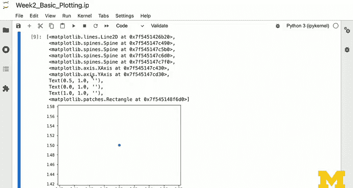

# 密歇根大学《Python用于数据科学实践（1-3课／共5课）｜Applied Data Science with Python 》deepseek翻译 - P40：10_Matplotlib基础绘图.zh_en - GPT中英字幕课程资源 - BV1U64y1L7VJ

Now， in previous versions of Matplotlib， we would use a back end style for Jupiter called NB A。

 but things have changed。 And now we use an inline back end engine。 Now。

 you don't really need to know the details of this。

 but it's helpful to know that you can investigate this if you want to。

 So let's import Matplotlib and check which back end we're going to be using today。

So here I'm going to import Matplloot Libb as MPL and then I'll just run get backend and you see it tells me which module I'll be using and today we're using this backend inline module。

 which is the normal one that you would use in Jupiter right now。Okay。

 we're going to start our plotting journey by making a graph using the plot function。

 A plot is two axes， and x axes along the bottom and a y axisx， which runs vertically。 First。

 let's import the pi plot scripting layer。 PLt。 All of the functions。

 which we're going to run against the pi plot module。

 are part of the scripting layer of the architecture。

 Let's take a look at the plot function by looking at the dock string。😊。

So here I'll just import as PLT and remember we can look at the dock string of any function we want just by adding a question mark afterwards。

Now， when we run this command， Jupiter's actually going to go and look up that dog string for us and show it here。

 And so you can see this is the method signature plot dot plot。 and we've got a star Arg， scale X。

 scale Y。 and we see this star star KW As， keyword as。

 and then it gives us whatever the developers have written here for the dog string。 And for this one。

 it's actually quite extensive。 And it mirrors what you would find in the online documentation as well。

Okay， that's a lot of documentation。 If you're not used to seeing it。

 this Python function declaration with two arguments。

 the star args and the double star keyword as can be a bit obscure。

 What's being said here by the star args is that the function supports any number of unnamed arguments。

 The double star keyword as also means that it supports any number of named arguments。

 This makes the function declaration very flexible since you can pass in basically any number of arguments named or not。

 But it makes it difficult to know where there is an appropriate argument that you should be using。

 Read on， we see that the arguments in this case are going to be interpreted as X， Y pairs。

 So let's start there。So let's try with just one data point at position 3 comma 2。

 The return value is the plot itself。 and Jupiter La is going to actually display this automatically on its own and render it in the notebook。

 Okay， we don't see any data points， though， which is a bit odd。

 It turns out that the third argument to plot should be a string。

 which signifies how we want that data point to be rendered。 Let's use a period。 This means a dot。

 And we'll see that our data point now shows up。And so the dogss tell us what the different characters will render like and here we're just going to use this full stop or period for the marker。

You'll notice that the subsequent calls to plot have not updated our previous visualization。

 The back end that we're using is not interactive。 so these subsequent calls create new plots as new cells in the notebook。

 and this is a handy way to iteratively explore your data。

Here's where some of the confusion with Matteplot Lib as a library tends to come from。

 In the last lecture， I explained that there's this artist layer and that it has figures with subplots and axes and data points。

 and they're all rendered as patches on these axes。 But we haven't actually seen any of that here。

 Instead， we've just got one function on a module named plot。 So what's going on。

While the Pi plot scripting interface is managing a lot of these objects for you。

 it keeps track of the latest figure of subplots and of the axes objects。Moreover。

 it actually hides some of the details of these methods on its own。

 So the pie plot module itself has this function called plot。

 but is redirecting calls to this function to the current a object。

 This makes for a significant learning curve， and you'll see many discussions and web tutorials and on stack overflow where people are confused about these two different approaches to make figures show up。

😊，In data science workflows， I think it's much more common to use this scripting layer like we just did。

 but it's worth it to take a moment at the alternative object oriented approach that's a bit more verbose。

Actually， while some would call this the Mattplot Lib object API。

 I think it's more accurate to actually think of this as directly interfacing with the artist layer instead。

So I'm going to do a little demonstration here。 first I'm going to import a new backend called the figure Can Ag and then bring in the figure object and this is the top level object that we're going to be using。

 I'll just create a new empty figure and you can just call figure with empty parentheses and then I'm going to associate this figure with the canvas backend and so I could do that just by calling figure Cans A and passing in the Fig。

Then we can add a subplot directly to this。 We're going to talk more about subplots in a future lecture。

 But this number here， this 1，11。 That actually just means that we want to add one plot。

 The return value for a subplot is the axes object， which contains methods for plotting。

 and we usually call that Ax。 and you'll see that that's pretty common。 All right。

 now we can actually get to plotting。 And we can plot on the axes as per usual。

 So we just call Ax dot plot and we pass in the parameters there。 And then finally。

 we have this figure， but our back end isn't actually able to render this directly within Jupiter lab。

 Remember， our back end here is this figure canvas a。 So we actually have to save this to a Png file。

 a ping file。 And so I'm just going to call canvas do print ping。So after you execute that。

 you don't really see anything。 All these objects have been created。

 but they haven't been rendered anywhere， except for in a file。

 So what we could do is use this quick Hl cell magic and execute that to see the rendered image。

 This is a lot more work than using the scripting layer。

 But you can see here that the effect is the same。 So to use an Hml cell magic here。

 we just put percent% Hl at the beginning of the cell。

 that tells Jupiter to render the rest of this code as H。 And here I'm just saying。

 create a single image element and render it。 And we can see that that image is exactly the same as our previous one。

😊，It's important to note that the scripting layer isn't magic。

 It's just doing some of the behind the scenes work for us。 For example。

 when we make calls to Pilo's plot， the scripting layer actually looks to see if there's a figure that currently exists。

 and if not， it creates a new one。 And then it returns the ax object for this figure。😊。

We don't have to store any of that though， because we can always get access to the current figure using this GCF function。

 which stands for get current figure。 Similarlyly， we have another function called GCA get current axes。

 which will return to us the current axes to render upon so let's create a new figure with Pilo。

 grab the axes and set some XY limits。So just as we did previously。

 I'm going to call plot dot figure， this is going to create a brand new figure object for this cell。

 then I'm going to plot here three comma to that point and this time I'm going to use a circle marker just to show you you know how this syntax changes。

Now， if I want to get access to the axes there， I call plot do Gca。

 That's going to get the current axes of the current figure and return。 we usually call that ax。

 and then I'm going to set some properties of that just for a demonstration。

 So the function that I'm going to use is called a。 There's a lot。

 by the way of aes axis in this lecture。 So hopefully you'll be able to follow here。

 But this function actually takes four parameters， a minimum value for x。

 which we're going to put a0， a maximum value for x。

 I'm going to put that as6 and a minimum and maximum for y values。

And so we can see here that the dot now is rendered， it looks a little bit different。

 and we can see if you look back your axis values for both the x and y have been constrained。

Allright， One more demonstration on the fundamentals of putting together a plot。

 You can add artists to an axes object at any time。

 Pi plot is actually doing this for us when we call the plot function。

 It's determining what shape we want from the string， the location associated with that shape。

 and it's creating a patch object and adding that to the axes。

 If we make subsequent calls to the plot function before we render it。

 the data is actually going to be added as a different series and colored appropriately。

So I'm going to create a new figure， I'm going to plot 1 point here at 1。5，1。

5 with the circle marker， and then I'm going to add two more points right underneath。

 so I'm just calling subsequent calls to these this plot dot plot。Alright。

 so you can see here that we now have three different points all in a line and that our axes are constrained to fit this data。

A lot of complexity is hidden from you， but you can go even further with the axes object to the point where we can actually get all of the child objects that the axes contains。

We can do this with this get children function and I just want to show you what this looks like because I think it's pretty interesting to know that this exists。

 even if you're not going to be using it all that often。

So if we want to get the current ax of the current image， we can say plot do GCA in this case。

 a new a object is being created。 This is a new cell， and then I'm going to add a point at 1。51。5。

 and then I want to take a look at that axis and see what all of the children look like。Okay。

 so you can see that for this image， we actually have a number of things。 We've got a line 2D。

 a bunch of splines， an X axis， a y axis object。 And you can look up every single one of these in the documentation。

 So in this case， our line 2D object contained in the axes。 This is actually our data point。

 We also have these splines， which are actual renderings of the borders of the frame。

 including all the tick markers， two access objects and a bunch of text。

 which are the labels for the chart。 There's even a rectangle。

 and that's actually the background for the axes。😊。

Alright， so that was a whirlwind tour of how to be productive with Matplot Lib and make your first chart。

 Now， in truth， you're not going to spend a lot of time getting individual artists or interacting with splines。

 probably， but you can， if you want to。 the system isn't magic。

 and we've walked through how you can investigate a bit better to understand what's actually happening underneath。

😊，In the next lecture， we're going to go through some of the different built in charting options which are available to us in Matplotlibb。

