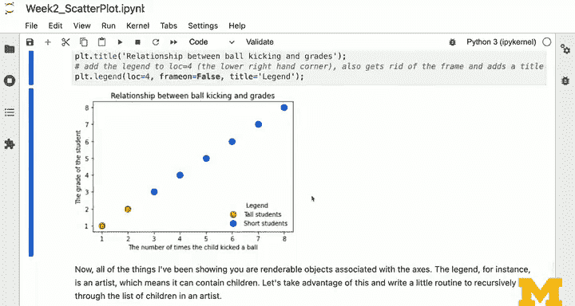

# 密歇根大学《Python用于数据科学实践（1-3课／共5课）｜Applied Data Science with Python 》deepseek翻译 - P41：11_散点图绘制.zh_en - GPT中英字幕课程资源 - BV1U64y1L7VJ

In the previous lecture， I introduced the plot function。

 which generates a series of points which get rendered against an axi object。

Maplolib actually has a number of useful plotting methods in the scripting layer。

 which correspond to the different kinds of plots we might want to actually use。 Now。

 we're not going to go through all of them here， but we're going to touch on a few of the major ones。

Regardless， there's a few things to keep in mind that we learned about in the previous lecture。

 First， Pilo is going to retrieve the current figure with this function GF。

 Get current figure and then get the current axis with the function GCA。

 Pilo is keeping track of all of these axis objects for you。 But don't forget that they're there。

 and we can get them when we want to to do something with them。Second。

 P plotot just mirrors the API of the A objects， so you could call the plot function against the P plot module。

 and this is just calling the A plot functions underneath。Finally。

 remember that the function declaration from most of the functions in Mattepl Lib and with an open set of keyword arguments。

 there's a lot of different properties you can use to control these keyword arguments。

 and you're not going to find them described for each function in the doccks。

 This can be a bit frustrating because you end up just having to learn from examples。

I'm going to start peppering in some of these arguments this week to demonstrate the MApllootlib documentation and the value of it。

 and you can take a look at that documentation for each function using this question mark。

With that in mind， let's move on to talk first about scatter plots。

A scatter plot is a two dimensional plot similar to the line plots that I've shown previously。

 The scatter plot function takes an X axis value as the first argument and a y axis value is the second。

If the two arguments are the same， we have this nice diagonal alignment of points。So just as before。

 I'm going to bring in Matplotlib。 Pi plot as plot and bring in that scripting interface。

I'm also going to bring in numerical Python and we're going to use this later。

 Mapl Lib is actually really based on these NumpI arrays and so you see a lot of examples with this。

First thing I'm going to do is create some fake data， I'm just going to create this。

 I've got this list of eight data points， one through8， and I'm going to create an array out of it。

 and then I'm just going to make it symmetrical， so I'll just have this y value。

 which is the same as x。Then I want to create a brand new figure for this cell。

 and then I want to get Matplotlib to produce a scatter plot。

 and this is similar to the plot dot plot function。

 but underlying objects in this case are not line2Ds。Okay。

 so we can see this nice arrangement of points， symmetrical， nice diagonal， 1， two，3。

 the X axis and the Y axis have been constrained automatically by Matplotlibb to fit our data。

Now scatter doesn't represent items as a series as plot did。

 instead we actually can pass at a list of colors which correspond to given points。

 let's use some basic list arithmetic to create a new list just short of the number of data points we need and set all of those values to green then we'll make the final point red。

Okay， so we use the same data  one through8。 Now I want to also make this list here， green， green。

 green all the way。 and then the last one red。 Now I could have just hardcoded this list in here。

 I wrote it in the docs so you'd be able to see it but you could also take just a list of one element green as a string and times that by the length of our data minus-1。

 and that's going to create seven of these green elements here。

 and then I can just append to it a red。 So I just want to show you。

 you can use the normal numerical Python arguments here。

Then we're going to create a new figure and then when we call scatter this time we're going to put in the X and the Y。

 I'm going to show a new parameter here， S for size。

 and then I'm going to pass in our list of colors that we want for those points。Al right。

 so we see that we've got all of those points。 They're a little bit bigger。 They're all green。

 except for the last one， which is red。 The separation of data points into lists is actually a pretty common pattern in Matpl Li。

 You have some set of items， but they're actually described as the same slice across many different data sources。

Those who are familiar with object oriented programming might expect that each data point is actually represented with its own instance。

 which encapsulates all of its properties。 For instance。

 a point has an x value and a y value and a color and a size。 that's not the case here。

 This is where it's useful to have some knowledge of list comprehensions in Ladas as we talked about in the first course。

 also important is the zip function and list unpacking。

 and because this is so common in the Python data science world。

 I'm going to take a brief aside and talk about that here。

Recall that the zip method takes a number of iterables and creates tuples out of them。

 matching elements based on the index。 So if we have two lists of numbers。

 zipip will take the first from each and create a tuple and then take the second from each and create a tuple and so on。

Also remember that zip has lazy evaluation because it's actually a generator in Python 3 and that means we need to use the list function if we want to see the results of iterating over a zip。

 we call this realizing the generator。So let me demonstrate that here we're going to create a new zip generator with a zip function passing in two lists of numbers。

 When we convert this generator to a list， we'll see that theres a list of pairwise tubs。

So I've got two lists here， one through5 and6 through 10。

 and I'm passing them into zip and the return of this is actually a generator and then here I'm going to print the list of that generator and this realizes the generator it actually runs through the generator and creates the new list and it will create this output。

Now， we can do that again。 But this time， we can use unpacking instead of lists。

 So I've got the exact same generator function。 I've created the exact same generator。

 but this time I'm calling print， and I'm taking zip generator star。 In this case。

 it actually unpacks that collection into positional arguments。

 You see that we get all of those same twos 1，6，2，7，3，8。 but they're not a single list。

 They're individual arguments。 Let's take a look。Storing point data as tuples is common and you should be familiar with being able to convert data to and from this form。

If we want to turn the data back into two lists， one with the X component， one with the Y component。

 we can use the parameter unpacking with zip。When you pass a list or an iterable to a function and pre it with an asterisk。

 each item is actually taken out of the iterable and passed as a separate argument。Okay。

 so that's a brief aside on a valuable tool which you'll see a lot when manipulating and cleaning data in the wild in Python。

Now let's get back to plotting， let's take these two lists and plot them as a new figure using scatter。

 instead of plotting them as one data series， we'll slice the lists and plot them as two data series。

Instead of setting a color per data point， like I did previously。

 we can color each series with a single value if we want to。

 we can also do things like change the color or transparency of an entire series。

 and we can add descriptive labels of course as well。

So in this example I'm going to create a new figure。

 then I'm going to plot a data series tall students in red using the first two elements of X and Y。

 so I just take our x variable and our y variable from before and remember this is the slicing notation it just takes out two elements。

 the first two elements I'm going set the size to 100 I'm going to set the color to red this is going to color all of the items to red if you pass it in just a single item like this and then I've set a label tall students and then I'm going to do the same thing for the short students here but it's actually from the second element onward so that's actually the third position right because we index it zero and I'm going to make it blue let's execute that。

Okay， so we can see here in the image that we have two tall students that are red and then we have all of these short students that are blue。

 You'll notice that the label didn't show at the moment。

 it's actually just held internally for each series， and I'm going to get to that in a minute。

 but let's talk a bit more about the properties of an axis instead。

The axes generally have labels to them to explain what they represent or the units that they describe charts tend have titles as well。

 So let's put this in place。 since Plo mirrors much of the API of the axes object。

 we can make these calls directly on the P plot object。So I'm going to do the exact same thing。

 create a new figure。I'm going to create our two scatter points and now if I just want to add a label。

 I'm going to add the label the X label。And so that'll appear at the bottom。

 The number of tiles a child kicked the ball is what I wrote here。

 And then we can add a label to the Y axis as well。 And so we could just use plot dot X label。

 plot dot Y label and plot dot title for of these underneath what's happening is plot is calling G C A get current axes。

 And then calling the set X label and set Y label。Okay， let's add a legend as well。

 You'll see that Matplotlib is going to place our legend in the upper lefthand corner。

 and it's going to put a little bit of visual information there about our students。

 So we have the exact same code here of just copy and pasteed it。

 But here I'm going to add the legend。 And to do that， all we do is called plot dot legend。

 And it indicates that we should add that legend and use the labels that already exist on the date underneath。

 So if you have those labels there， Matplotlib is going to use them。

If you go to the docks for the legends， you'll see that there's a number of different parameters and one of them is called location and a value of four will actually put it in the lower right hand corner of the axes。

 Now we can also get rid of the frame and add a title and do any number of different visual transformations。

So I've taken the exact same code here， and now for the plot dot legend。

 instead of telling Matplotlib to just do whatever with it， I'm setting the lock for it to4。

 I'm saying I want the frame off， so frame on equals false and I'm setting it a title for the legend。

Now， all of the things I've been showing you are renderable objects associated with the axes。

 The legend， for instance， is an artist， which means it can contain children。

Let's take advantage of this and write a little routine to recursively go through the list of children and an artist。

So this is a fun activity I like to do to really demonstrate how Mapllootlibb is working underneath。

 So we're going to import the artist class from Matpllootlib。 And again。

 you're not going to do this when you're doing your regular data science。

 but sometimes you want to debug essentially a chart or a figure and you want to really understand how it's being built underneath。

 and I think this is really powerful。 So we're just going to make this recursive function called Re GC It's going to take in some artist and some depth parameter。

 It's going to check if the object that's been passed in is an artist and if so it's just going to print out its name and then it's going to recursively call itself using get children。

 and so we're using some fun stuff here。 we're printing out a couple of spaces and then the depth and then whatever the artist's name is。

 So we'll get this nice indented list。Okay， so finally。

 let's call this function on the legend artist and see what the legend is actually made up of。

So you can see that that simple little legend， a little title， a little box。

 and a couple of dots that as an artist， is actually made up of a number of different offset boxes for drawing。

 as well as text areas and path collections。What I want you to take away from this is that there's nothing magical about what Matplotlib is doing。

 Calllls to the scripting interface just create figures， subplots and axes。

 Then they load those axes up with various artists。

 which are the back end renders put to the screen or some other medium like we looked at as a file。😊。

Now， while you're going to spend 95% of your time at the scripting layer happily creating charts and graphs。

 it's important to understand how the library works underneath for the other 5% of the time。

And the time that you're going to use this is when you want to have really fine grain control over and to create your own charting functions。

 and you're going to have a chance to do that by the end of this course。In the next lecture。

 we're going to go back to line plots and create a few more and then onto bar charts。

