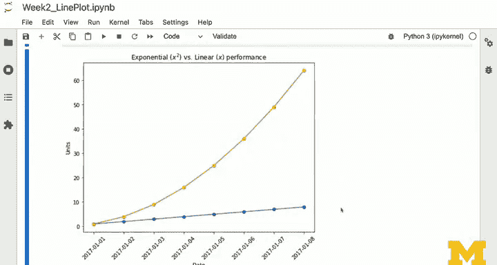

# 密歇根大学《Python用于数据科学实践（1-3课／共5课）｜Applied Data Science with Python 》deepseek翻译 - P42：12_折线图绘制.zh_en - GPT中英字幕课程资源 - BV1U64y1L7VJ

Okay， on to line plots。 Now， we've actually seen line plots a couple of times。

 but they looked like scatter plots。 In fact， the very first plot I showed you was a line plot because we create a line plot with the plot function。

 And it renders a number of different series of data points and connects each one in a series with a line。

 In the very first 1 I showed you only at one point。 So you didn't see any lines。

 Let's jump right into this。 There's a couple of things which are new about this versus the scatter plots we just saw。

😊。

First， we only gave Y axis values to our plot column no X axis values。 Instead。

 the plot function was smart enough to figure out what we wanted and to use the index of the series as the X value。

 This is pretty handy when you want to make quick plots。Second。

 we see that the plot identifies this as a two series of data and that the colors of data from the series are different。

 including the data points and the lines between the data points。

 this is different from the scatter plot which required us to label those lines directly。Okay。

 so I'm going to import Matplot Lib Pi plot。Now we can use Numpie to create a linear series of data points 1 through 8。

 We'll also create a number of quadraically increasing values as the second series just for a demonstration。

 remember， you can use broadcasting in Numpy to do this。

 so you'll often see this and want to do this for quick demos。

 This is just our nice little array here of eight points。

 and then here we're just going to square it to create that exponential data。

This time I'm going to use the mini formatting language to describe how I want those markers and lines to be rendered。

 So previously you saw me use this O， and it just made this circle marker。

 but we can propend that with a dash to use a solid line between the circle markers。

Note that I'm passing the data followed by the formatting for each series。

 So we're going to see the result as a two data series。

 the linear one at the bottom and the quadratic one at the top。

 So this looks a little odd and a little different， and it's worth studying this for a moment。

 here I'm calling plot。 I'm passing in our data。 I'm telling our plot how it should render our data。

 Then I'm passing in another piece of data， and I'm telling it how to render that。

 And we can just keep doing this for as many series of data that we have。Alright。

 so we can see those two pieces of data， the quadratic and the linear being plotted there。

 Now it's pretty easy to extend this and add an arbitrary new line。 So， for instance。

 I'm going to use this dash dash R， which tells plot to add a dashed line in red。

 So here I'm going to have the exact same plot called linear data exponential data dash O dash O But then I'm going actually make a subsequent call to plot。

 And I'm going to pass it in these three points。 And I'm going to say dash dash R。

 Do I have to put this on a subsequent line。 No， I could have just added these as extra parameters here。

 I just wanted to show you that you can do that。Right。

 and so now you can see that we've got our two first series of data points。

 but now we have this third series that has essentially no markers and it's just got dashed。

 dashed lines throughout。Did you notice what I did there， though。

 I didn't call plot dot figure by default， Pi plot scripting interface will call plot dot GF when you try and do something。

 If there's no figure， then it's going to create one for you。

 The way Jupiter lab is configured by default， it will automatically close a figure after each cell is executed。

 So this means that Pi plot is going to create a new figure for us each and every time。

 This is a great time saver。 Good by plot dot figure。

We can use the regular axis functions creating labels for the a in the figure as a whole as well。

 and we can create a legend2， but since we didn't label the data points as we did with the scatter plot。

 we need to create legend entries when we add the legend itself。

So I like to label my data points when I actually add the series directly。

 but you don't have to do that so I want to show you because you'll see lots of different examples with this and of course。

 the ordering for most of these it doesn't really matter because it's setting these axis object before it's actually rendering So here I'm going to create an X label。

 a Y label and a title before I actually have any data。 In fact。

 the very first one here is going to create a new figure and a new axis object and set the label before we've done anything。

Then I'm going to add a legend and I'm going to say， well。

 the legend's got three things in it baseline， competition， and us。

 and then I'm going to do the exact same plot calls that you just saw。

And you can see it renders here nicely and we've got the some data。

 we've got some other data and we've got the title。

This is a good time to introduce the fill between function of map plot Lib。 Now。

 this function isn't specific to line plots， but you can see it commonly used with line plots to highlight an area。

 So I want to introduce it here in this context。😊，Let's imagine that we want to highlight the difference between the green and the blue curve somewhere we could tell the axes to paint a color between these series using the fill between function。

So I can have that same code， X label， Y label， title legend， plot。

 and then now we actually need to grab that current axis object and then call fill between。

Now we didn't specify any X values that our called a plot。 Remember by default。

 it's just going to use the indexes of your lister or your array that's passed。

 So I'm actually just going to use the same range of data points that it's already using。

 which is symmetrical。 And then we're going to put this as our lower bounds and our upper bounds with the color that we want painted。

 And for fun， I'm going to add a transparency。 So here I'm saying pipe plot， get me the current axis。

 then call on it filled between I want you to create a range from the linear data。

 So a bunch of numbers。 that's our x values。 here's our then linear and exponential data。

 And I want you to set the color of this fill between to blue and I want you to set the alpha to 0。

25 and the linear and the exponential data are going to show the upper sorry the lower and upper bounds of this respectively。

Okay， so that renders nicely， we've got this blue line， we've got the orange line。

 we've got the points and we've got this nice fill between shaded area。

 and we have all of our title and so forth。 Our charts are really becoming a little bit more sophisticated in how they work。

So let's try working with dates， most likely you can have a series of x values and y values which you're looking at plot often with line plots。

 this comes in the form of a date time on the X axis Now in earlier versions of Maplotlib it was painful and you could go back to maybe a previous lecture video that I taught on this but actually I've been able to shorten this quite a bit because Matplotlib is growing quite a bit。

 so let's change our X axis here to a series of eight datetime instances in one day intervals。

So I'm going to use the NumpI Ar function here， which we saw previously and you'll commonly see this in stack overflow questions or textbooks or just example videos like this。

 and I'm going to ask for an arrangement of dates at daily intervals and so I give it the start date and the end date as a time and then I set the D type to be date time 64 and then arrange is going to create that arrangement there。

Now I'm just to re plotot our linear and exponential dates， so we have our observations。

 our linear date， our observations and our exponential date again。

 this can be very unfamiliar for people who are not used to positional parameters previously we had data formatting and then data formatting now because we want to have these dates along the bottom we have those dates。

 data formatting， dates， data formatting， so the position of the argument to plot is changing with the number of arguments that we specify in the format of those arguments is very unorthodoxed in a lot of programming languages and including in a lot of Python but it's supported in Python and it speaks really to Matpllootlibs roots in MatLap。

Okay， this produces a pretty decent looking figure with the date that we want。

The dates overlap pretty heavily Now there's a couple of things that we could do here， for instance。

 everything's from 2017 so we could take the easy way out and just iterate through and change the labels by stripping off the year and then add an X axis label which clarifies this is all for 2017。

 This is pretty reasonable but I want to show you a couple of features of Matplot live and how we can deal with text instead。

There's lots of interesting properties of the Axi object and you should use some of them in the assignment and I encourage you to go to the docks and explore them now that you're starting to pick up some of the skills and understand how to build those basic plots。

For instance， you can get the grid lines， the tick locations for both major and minor techs。

 and so forth。Just like all artists， an A has a bunch of children， which are themselves artists。

In fact， if you're following along in the Jupiter Lab notebook in Coursera with this lecture。

 why don't you just pause the video and run that ReGC function we wrote earlier to explore what kind of artists are on this X access object and what it actually contains。

What I want to show you， though， is that you can access the text of the ticks using the get tick labels function。

 Each of the tick labels are a text object， which itself is an artist。

 and this means you can use a number of different artist functions and one specific to text is to be able to set the rotation function。

 which allows the rotation to be set in degrees。 So let's iterate through the ax labels and change each one to rotate it。

Okay， so here's just our plot data as normal now I want to grab that X axis so I just grab the aes object。

 that's plural of axis and then grab the X axis and then for each item inside of there I want to get the tick labels and I want to set that rotation to 45 degrees。

All right， so that looks pretty easy。 It was quick， pretty fluid to do。

 and you can imagine how we could customize this further if you wanted。

 So let's add back in our headings now。So the exact same thing。

 but now I've added to the bottom are labels， X， Y and title， I tend to add my labels at the bottom。

 but that's just habit， as you saw earlier， you can add those whenever you would like to。Allright。

 there we go， wonderfully readable dates in MaplotLib。

 and while we're talking of text and readability， let me share two other insights。

 the first dealing with equations。MatPot Libb has a fairly strong connection to LatAC。

 a type setting language used by mathematicians and scientists。

 This means that you can use a subset of LatX directly on your labels and Matplloot Lib is going to render them as equations。

Here， for instance， we could set the title of the axy so that there's an X squared directly in it to do this。

 we escape to latetx math mode with dollar signs。 Note that this works regardless of whether you've got Latx installed or not for a long time you wouldn't have Latx installed on Mac OS or Windows。

 but with a full Lax installation， you actually have significant control over the text formatting。

For the second insight， I want to talk about the size of the figure itself。

 Why are we looking these small postage stamp figures？ Well。

 that depends on your screen size and resolution。 But the point is we can tell that plot lived that we want the figure to be a certain size by passing in parameters when we first make that figure。

So in this next example， I'm going to specify it in inches。

 but there's various other dimensions that you can use。

 you can set them as centimeters or DPI and so forth。

So I'm going to create a new figure this time explicitly。

 but I'm going to pass in this fig size keyword argument as a tuple and I'm going to make it 8 comma 6。

 which means8 inches by6 inches。Then I'm just going to put in my usual data here from above。

 so this is basically copy and placed from above， but I wanted to show the title here when you want to escape into latetX math mode。

 you can just put the dollar sign and then put inside of any text formatting string and then put what you want。

 So this in LoX means X to the power of two you don't have to do this right and LoX itself is a huge learning curve in and of itself。

 but for basic formula it's quite nice and you can of course do much more extensive things if you're in a scientific industry。

That's been a pretty successful look at Maplloot Lib basics， I think。

 from the architecture overview to creating clean charts we could include in a report or just on our own through data explorations。

I want to show you one more thing this week in the next lecture， the bar chart。

