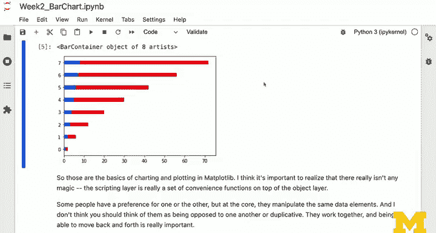

# 密歇根大学《Python用于数据科学实践（1-3课／共5课）｜Applied Data Science with Python 》deepseek翻译 - P43：13_柱状图绘制.zh_en - GPT中英字幕课程资源 - BV1U64y1L7VJ

Maplalib has support for several kinds of bar charts in the most general case。

 we can plot a bar chart by sending in a parameter of x components and a parameter of the height of the bar。

 so let's do this now with a little bit of linear data。Okay。

 so we bring in our regular libraries for Pilo and nuy， and then I just create our linear data。

I'm going to generate a list of the X labels。 And in this case。

 I'm just going to have a whole bunch of numbers here， just the exact same as the data。

 but you can make these whatever you want。 Then we pass this in with the linear data as the bar heights。

 So we have the x values。 these are going to be the actual values along the X axis。

 the linear data is actually the height of the bar。

 So in this case is going to be this increasing step size from1 to 8。 and then the width of the bar。

 and I'm going to set that width to 0。3。Okay so we could see here that we get nice little blue bars。

 they start zero and they go all the way up and we could see that the zeroth item is actually a number one in its height right because the array that we made is one through8。

 but then we used a range and Ny range looks at the size because we used this range function and so it did zero through7 for our x axis labels。

To add a second bar， we simply call this bar plot again with new data。

 keeping in mind that we need to adjust the X component to make up for the size of the first bar that we plotted。

 So you'll get to feel my frustrations around this shortly。 So let's get some new x values。

 and then I'm just going make this exponential。 I'm going take our linear data and square it。

 And then for the new values， I'm going to add these items plus 。

03 right so I'm building in this little offset for each one of those。

 then I just call two calls to bar plot dot bar。 So the first one is going to be our original data。

 The second one is going to be the new data。 the new values。

 but I'm going to use this same width of 0。3 and the color is red。Okay。

 so we see our same our linear data， and then we see our exponential data。So the plot looks okay。

 but not great。 All of the X labels are to the far left of the items being described and not centered。

 Now， we could center them with a given bar using this align parameter。

 but it's a bit frustrating when you have to have multiple bars and then you have to calculate it all by yourself。

 and it's a pain to go through and add new data series manually。 This actually gets worse。

 We actually have to manually iterate through and adding dates if we want them as well。

 because otherwise we wouldn't be able to set the left bar location properly。 I'm going to be honest。

 bar charts are one of my least favorite things to create in Matplotlibb。

 I feel like the foundation is there， but in some of the ways I want to use the API。

 such as just plotting several series of data and groups across time。 These are sadly missing。😊。

There' are some other nice features of bar charts though。 For instance。

 you can add error bars teach bar as well using this Y error parameter。 For example。

 each of the pieces of data in the linear data might actually be a mean value computed from many different observations so we could just create a list of error values that we want to render as well and show those as error bars。

 Let's take a look。So I'm just going to import this random function R in。

 it's going to generate random integers， and then I'm going to use a list comprehension here。

 Now you'll see list comprehensions a lot in examples and it's good to make sure that you know how to read that syntax in Python So this says when we use the indexing operator in this way or the square brackets it says create me a list and inside is our algorithm if you will for the list So call R in one comma force So create a random integer between one and4 for x in range and then we set the size of our range here。

And this is going to plot now the error bar， so we just have our x values。

 our linear data just like before our width， and then here we can just set the Y error and to this linear error。

 so that's going to be the numbers between one and4 inclusively here。 let's take a look。

So that's kind of nice right and you can see actually in the example that I ran and of course yours might be different right because we're using random numbers in the example I ran。

 one of the error bars actually goes beyond the bottom of our chart。

 the zero in the X axis and that's fine Mattplloot Live just adjusts things for us automatically。

Now we can do stacked bar charts as well and this actually works better because you don't have to deal with all the fidgety positioning arguments。

 so for instance， if we want to show cumulative values while also keeping the series independent。

 we could do this by setting the bottom parameter of the second plot to be equal to the first set of data to plot so you plot one piece of data and then you plot the second piece and you can just use one parameter set the bottom for each of those bars as the heights of the previous one。

So here I've got this range of values， I plot our first data。

 the linear data and here I'm going to color it B。 and then for the next set， the exponential data。

 I'm going to use this bottom keyword and set it to the linear data。

 remember these linear data These are the heights right in order and the X vowals are the first parameter。

 So the X vowals are the same for these two series。

 the linear value heights and the exponential heights are different and for the exponential data I want their heights to start at the bottom of the linear data on an item by item basis and I'm going to make that one red。

Finally， we can pivot this bar graph into a horizontal bar graph by calling the bar H function instead。

 But note that we've got to change the bottom to a left and the width to a height， right。

 So our language changes as we pivot things to the size。So to switch to horizontal bar charts。

 we just use bar H as a function， and now we just change our height to width。

 or rather our width to height here， and we change our left to the linear data instead of the actual bottoms。

Okay， and so that's a very basic stacked horizontal bar chart。All right。

 those are the basics of charting and plotting and map plotot Lib。

I think it's important to realize there really isn't any magic going on here and that's one thing I think you'll be able to take away from my lectures the scripting layer is really just a set of convenience functions on top of this object layer。

Some people have a preference for one or the other。

 but at the core they manipulate the exact same data elements。

 and I don't think you should think of them being as opposed in one way or duplicative they work together and being able to move back and forth is really important。

I would say that in general， a data scientist is going to be using that scripting layer regularly。

 it's certainly what I do。Now， we've talked about some fundamental charts in this module。

 scatter plots， line graphs and bar charts。 There are more。

 And we're going to dig into some of those in the next module， more advanced ones。

 But I think these are a good base for consideration。 The assignment for this module is a tough one。

 It's meant to show you real world data visualization problems。

 You're going to have to leverage your knowledge of the pandas library from the first course and couple it with your new knowledge of mapplot Lib to come up with an elegant solution。

😊，But the final result should be a portfolio ready piece。

 so I'll see you in the forums for discussions and for help。

