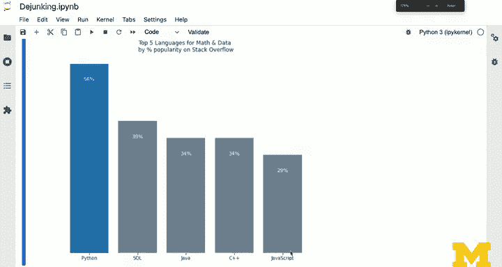

# 密歇根大学《Python用于数据科学实践（1-3课／共5课）｜Applied Data Science with Python 》deepseek翻译 - P44：14_图表去冗余处理.zh_en - GPT中英字幕课程资源 - BV1U64y1L7VJ

In this lecture， I want to walk you through the process of taking a regular matpllib plot and applying Tufties' principles of data ink ratio and chart junk to make it just a little bit better。

 I'm going to walk through all of the steps using the Jupiter notebooks and you're welcome to follow along。

 But if you want a bit more of a challenge。 I'll be including in video quizzes along the way with prompts to help you consider the problem。

 and you can solve it before I address it。Now I think that the chart junk and data ink ratio are incredibly important and so do the Matplotlib designers。

 In fact， Matplotlib has evolved significantly and you've heard me mention this before from the first time I taught this course into the current iteration that you're seeing now and a lot of what I had to do then I don't have to do anymore because there's new what we call sensible defaults and we good defaults but still there's some things that we can do and your knowledge of the axi objects。

 your knowledge of the scripting and the object layer。

 your ability to go to the documentation and problem solve and identify what components you want to change really gives you a lot of power to customize a plot in the way that you want So let's get started we're gonna to use a plot of data on the popularity of programming languages from stack overflow and I'm actually using the data from 2016。

 which is the data I originally used when I was teaching this course five years ago。Alright。

 so we're gonna import mapplotlib p plot as plot and import nuy。

 So there's actually five different languages that are being considered here。

 Python Sql ja C plus plus and jascript you can go to the URL and find their positions and we're going to use that as a rank in nuy as the range function and you've seen me do this in some of the examples。

 and I've hardcoded here， the popularity values。 So the first one is 56。 the second ones 39。

 the next one's 34 and so forth。 So I'm gonna have the languages， these are my labels。

 I'm going have the positions。 This is the xposition arrangement， and then I've got the popularity。

 Now I'm just going create a bar chart based on the rank so I'm creating a new figure in this case I've decided I want my figure 10 by8 I'm creating a bar。

 So I pass in the first the x value positions。 then the height。

 which is the popularity and then because I only have a single bar and I don't have multiple series。

 I can align the text underneath， which is kind of nice。 and then I can。My Xts， my Y label。

 and my title， just basic good chart things。Allright。

 So that's what you get when you run it just out of the box。 So here's the first challenge。

 Our plot has this frame around it， but it's not really necessary。

 and it seems a little heavy weight。 So let's follow this data ink ratio of Tufties。

 And let's remove that ink。 This is a bit more involved。

 But you tell me how you would try and do it and try and do it on your own。Alright。

 the way I'm going to solve it is to get the current axes。

 Then I'm going to iterate through all of the splines。

 and I'm going to set their visibility to false。 They're still going to be there， just not be found。

 They'll still be there as objects。 They'll not be rendered。 So I'm not setting it to transparent。

 And that's another way you could approach this actually， that would be kind of interesting。

 I think you'll find that already this is going to make the chart look a little bit more lightweight。

Okay， so we've got the exact same code and then just at the bottom here。

 I'm going to go get the current axis。 I'm going to get the splines for the axis object。

 remember this is both the X and the Y axis right， GCA is a plural。

 I'm going to go through the splinees， I'm going to take their values and I'm going to set the values there to false。

 the set visible to false。Okay， so that's good。 but not really a huge change。 but the blue。

 it's going be nice。 I like the blue， but it doesn't really help us differentiate between the bars at all。

 I mean， we're comparing all of these bars together， but they're all blue。

 So how about we soften all of the hard blacks to gray。

 And then we change the bar colors to gray as well。 But let's keep Python the top language here。

 the same blue that it was originally to make it stand out。😊。

So I'm going to do the exact same code as before， but the changes right here。

 I'm going to take that very first bar right Now， when I do plot dot bar。

 it's going to return to me this collection。 and I can grab that first item in there and I can set its color to this nice bright blue a Python blue。

 if you will。 And you'll note that I've set the color of the other bars automatically to slate gray here。

 And then， of course， I want my titles。 I want my alpha transparencies。

 and I want my spline values here。😊，Okay， so that's what that looks like right we can see clearly one is being compared to everything。

 but we can still see all the heights of everything and we can reference both on the X axis and the Y axis and it feels nice and light。

 nice and airy， it's got a low ink for data ratio。But let's tackle that Y axis。

 Why don't we just remove it and why don't we directly label those onto individual bars。

 And you saw that was one of the principles that we could be using to better label our data。

 No need for a person to have to look at the Y axis and try and scan over and try and guess at the height。

 Why don't we just move that value directly there， So how would you go about doing it。

 Why don't you pause the video and take a shot。Here's how I'm solving it。

 So I've got the exact same code here。 I've got my X ticks。

 but here I'm just going to get rid of the Y ticks。

 There's not much I actually have to do to hide the Y tick values。

 I just pass in this empty list and it's going to set those values to nothing。

 And so it's just going to get rid of them。So removing that label is easy， but changing the bars。

 that's a little bit more of a pain。 So for this， I actually want to iterate over each of the bars and grab its height。

 Then I want to create a new text object with the data information in it and render it to the screen。

😊，So it's easy to get the height from the bars。 I mean we already know that we fed that in。

 but this means that we have to play a little bit with padding and anytime you have to deal with text。

 unfortunately， there's a little bit of annoyance with that。

 So you have to be cautious and you have to be willing to decide how much pixel peeping you actually want to do here I'm going to set the X location to the bar x plus the width divided by2 and the y location to the bar height minus5。

So there's a lot of this that goes on when you want to massage your charts in MapllootLib。

 you have to do a lot of this math to render things in your layout yourself。

Now it might seem weird to get the middle of the bar in the X dimension。

 but that's because I'm actually setting the label to center itself horizontally。Okay。

 so I get the bar height， I get the current access， I create text。

 I take the the bar that I'm dealing with。 remember we're iterating through the bars。

 I get its X location plus itss width divided by2。So that's my parameter for x。

 Then I get its height。 and I'm going to just bump it down a little bit，-5。

 Then I'm going to create a label of the string of the integer of the height。

 because that's actually the data value that I want to have rendered there。

 right the height of the bar。 And then I'm going to add a percent sign after it because it was all in percentages。

Horizontally aligned to center， color it white， because we know our bars are either gray or blue and set the font size to 11。

 So one line of code to create a piece of text that going to get dropped on the bar。

 But there's a lot of thinking that has to go on and a little bit of experimenting to make that happen。

😊，I think you can agree though， that this chart looks lots better than the very first one we did。

 we can clearly see that there's a comparison of Python to the other languages。

 the languages are all being represented and everybody can see what the different values are for each one of those languages directly。

 it's very lightweight， very easy to embed into a report or like。

That's all there is really to it。 A simple series of steps to make your bar charts a little bit more usable。

 When you were watching this video， did you find a different way to do it。

 Did you tackle this in different ways， Perhaps there were other elements from Taftti or Cairo that you think could be used to make this visualization even simple as it is just a little bit more readable and intuitive。

Feel free to go into the discussion forums and share them with me and your classmates。

