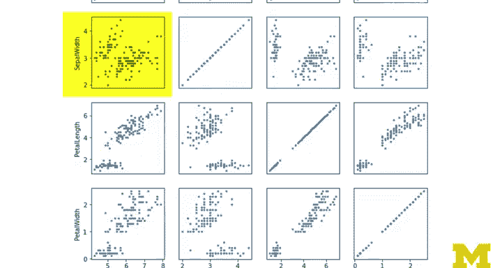

# 密歇根大学《Python用于数据科学实践（1-3课／共5课）｜Applied Data Science with Python 》deepseek翻译 - P45：15_子图系统.zh_en - GPT中英字幕课程资源 - BV1U64y1L7VJ

In module 1， we talked about principles which under good visualizations。

 and we pulled from work by Cairo and Tufty。 In Mo 2， we opened up this Matplot Lib Python library。

 and we started with the architecture， and we worked our way through some of the most common kinds of plots。

 scatter plots， line graphs and bar charts。In this module。

 we're going to do a bit more of a deeper dive and talk about multiple plots with the same figure。

 interaction， animations， and a few more different kinds of plots that you're going to find useful in your data science journey。

Now， if you've been doing the assignments， you've undoubtedly been visiting the course discussion forums。

 going to stack overflow and reading the MAplloot Libb API documentation。

I want to point you to the Matplud Lib mailing list is another great resource for support。

There is going to be a resource posted in the course on how to browse that list。 Now。

 it's pretty common with open source projects to have two different mailing lists。

 one for developers and one for users。 The users places where we would go to ask most of the questions about how to use the toolki。

 But I really encourage you to take a look at the developer archives， too。

 to get an idea of how this project sort of evolves and get a look behind the scenes。Okay。

 let's start this module with a deeper look at subplots。 thus far。

 we've been using a single axis object。 plot a single graph or figure。

 Sometimes it's useful to show two complex plots side by side to visually compare and let the viewer come to their own understanding。

 Maplotlibb handles this within a single figure object。

 So let's first set our rendering back into the notebook and then import our pi plot module and nuy。

 as we're going to need them both。 Okay， so I'm going to import mapplotlib Pi plot scripting interface and nuy。

 we're going to use nuy a lot for and we'll use pandas as well in this module for generating some data。

 And then I just want to look at and show you what the documentation looks like。 So remember。

 you can always just put a question mark like I have here after a function。

 if you want to know in line a little bit more what it's about。😊。

So we see that rendered here and we can see that we've got plot dot subplot。

 takes in Args and keyword args， and we've got the doc string。

 and then we can see all sorts of information about the different parameters and what they mean and how to use them。

 And this should be the same as the web documentation。

 but it'll be very specific to whichever one you've got installed。

 so you don't have to try and figure out which version you are using。

If we look at the subplot documentation， we see that the first argument is the number of rows。

 the second argument， the number of columns， and the third is the plot number。In matplot Lib。

 a conceptual grid is being overlaid on the figure。

 and a subplot command allows you to create an access to different portions of this grid。

 For instance， if we wanted two plot side by side， we would call subplot with the parameters one comma2。

 And then one is the third parameter。 So would allow us to use one row with two columns and set the first axis to be the current axises。

 So let's do that。 Let's create a new figure And then a new subplot with one row and two columns。

 the first axis object that pi plotot will plot against is the lefthand side。

 So I'm just going to go plot figure to create a new figure。

 And then here I'm going to make a subplot。 And this is the number of rows。

 This is the number of columns。 And then this is the axis in that set that we're interested in in working with。

 And then I'm just going plot some fake data here。 So this is just a linear array of data。

 You'll notice I'm using a nuy array。 So matplot Libs uses nuy arrays for almost all of the data。

 And that's important that are not。😊，Of data。 I'm actually creating an array。

 And then we'll just plot this data。 Okay， great。 So we' got the skinny plot on the lefthand side。

 Now if we made a second call to subplot， we could indicate that we also want to plot on the right hand side。

 So let's do that。 So you see here， I've just copy and pasted things。

 So remember from our earlier lecture that at the end of every cell。

 the figure is actually closed automatically by Jupiter。

 that might be a little different than some of the docs that you see online， which are showing。

 for instance， how to use mapplot lib in a traditional application or in a different kind of editor or on the command line。

 So here I'm going to create that same subplot， same data， and I'm going to plot it。

 But now I'm going to get a reference。 I'm going to set the active subplot to the second one。

 that's the right hand side that I'm just going to make our data exponential and I'm going to plot it as well。

 Okay， that's nice。 Now we've got two plots Each with their own axis object。 Now。

 the norm with mappllib is you're going to store that axis object that you get back。😊。

The subplot but then you can call subplot again and at any time the parameters that you're interested in you can get back to that access so you can move back and forth between the a objects in your scripts if you would like you don't have to do everything with one axis then everything with the next and everything with the let's say the third fourth and so forth Take a look at this figure though Do you notice anything odd about this image thinking in particular of our first week of the course。

The two images have different y axis values。 Now， this would be a problem and potentially mislead the reader if we didn't find a way to lock these a between the two plots when you create a new subplot。

 you're actually able to indicate that you want to share the x and y or both aes using the share x and share y parameters So let's clean this up and try that。

 Okay so I'm just going to plot the first figure and this time I'm actually going to get that axis back。

 So each time plot do subplot is actually going to return to you the a that you're referencing sometimes you want it。

 sometimes you don't care about it。 this kind of the magic of working with both the object and the pi plot scripting interface。

 So I just want to take that axis， I'm going to plot on it。 this linear data。

 But then down here what's really interesting here is that I'm actually going to indicate that we want to share the y axis between this。

 So I've got this other call to plot do subplot that's going to return the righthand side axis object。

AX2 I'm actually not going to use that variable anywhere， I could just get rid of it if I wanted to。

 but I've indicated when I set that up that I actually want to share why that let's take a look at what that looks like。

Okay， there we go。 Two plots side by side。 and we've locked the Y axis。

 So you actually see the left hand side plots been squish down a little bit。

 and it makes it much more clear that the date on the right hand side goes much higher。 Now。

 those of you who have been paying close attention。

 will note that I used the subplot function a second time， but I didn't pass in three parameters。

 I just passed in one。😊，The mat plotlib developers allow you to specify the row columns and number of the plot that you want with either three parameters like we did at the beginning。

 one comma 2， comma1， or a single parameter like I did now，1，2，2 or 122。 In this case。

 the hundreds value， the first is the first argument。

 the10s value will be taken to be the second argument and the one's value， the third argument。Now。

 frankly not a big fan of this second syntax， it feels pretty hacky and it really saves on typing two commas。

 but it actually limits us to a single digit for each one of those。

Computer science folks might feel a little twitch inside like there's something wrong with this notation。

 and I'll say that I certainly get bugged by it every time I see it。But I want you to be aware of it。

 so you'd be able to read it when you come across it in the wild。

 whether it be on stack overflow or in the docks。An important fact to remember is that the plot location in the matrix of items is indexed starting at1 and not zero。

 as would be the convention if you are using something like nuI。

 so if you're iterating through a matrix or a list， create subplots。

 remember to start at position plus one。Now there's a nice function called subplots。

 a note here the plural， which allows you to get many a objects at once。

 and I actually think this is great。 you can set up all the subplots you want。

 you can get references to all those axes and then you can start filling them in。

 So if we wanted to get a three by three grid with all of the aes X and y ranges locked we can do this actually pretty simply so I'm going to create a three by three grid of subplots using tuple unpacking and it looks a little complex so let me just walk through it。

😊，I want the figure， and then I want a sequence of items， and I actually want three items in it，1。

2 and3。 And each one of those items is are themselves a sequence。 So when I call plot do subplots 3。

3 indicating three rows and three columns。 I want them to share all of the same X axis and y axis。

 I could of course， change this back and forth。 What actually comes back to me is the figure object always as my top item。

 And then a three tuple of three items in each one being the a objects。

 this will become a little bit more clear。 I'm going to grab。This one， Ax5。

 I'm just going to plot that linear data on it so that we can see it。Okay。

 so the syntax looks a little goofy， maybe since we're unpacking the results of these subplots functions directly。

 but it's really an effective way to build a grid where everything shares in axes。

 The results look really nice。 But note that this method turns off the Y and X labels。

 except for the plots， which are on the left hand side or on the bottom of the figure。

 This is actually intentional。 You're sharing the axes。

 So matplot libs trying to make it a little bit more readable give you a little bit more space in each one of your plots。

😊，Of course， we can actually just iterate through a list and plot one plot at a time。

 and we don't have to store a reference to the axes if we don't want to。

 So I'm going to create a new figure。 I'm going to call plot dot Gf。 Remember。

 that's get current figure。 And if the figure doesn't exist。 a brand new figures created for us。 Now。

 I'm going to iterate over6 potential spots in our figure。

 and I'm going to create a plot with two rows and three columns。 So here。

 I've intentionally set I to be in the range of one through 7。 instead of 0 through through 6。

 And we talked a little bit about how we index unfortunately， matpllib plots starting at one， not 0。

Now， for this demo， I've just decided that we're not going to plot something if we're in position five or three。

 I'm just going to leave these as whole so you can see where they show up。

So if we're our I is not a5 or a3， then I'm going to add a subplot。 Now， in the subplot。

 we're going to specify the first two arguments as the structure we're expecting the figure to take。

 So two rows and  three columns。 the third argument is this floating one。

 It's the position of the item in the figure。 In this case， it's I。

 And while we're iterating linearly， this is going to be mapped into that2，3 column space， right。

 So even though I is going 1，2，3，4，5，6，7， it actually gets pushed into the 2。

3 space that we've identified that we want our subplot to be。Once I've added that。

 I just store the result in AX and then I'm just going to add some text to the figures to make it more clear which item actually went went where and you can look at the lecture on annotation to read more about that。

 but I'm just going to。Essentially， just convert I into a string value and and throw it into our plot。

 Let's take a look。 So we can see here that we have two rows。 We have three columns。

 and we have numbers in the 1，2，4， and 6 plot spots， not the five or the three。 Those are just blank。

 And here we haven't shared any of the axes。 So everybody has their own axes values。

 So we now understand why there are abstractions of axes in a figure。

 because a figure might have several aes objects， which show multiple views of data。

A common data science visual exploration technique is called the splolum。

 which stands for scatter plot matrices。 These are particularly useful for getting the relationship between a number of different variables from a quick glance。

 Now， splolums actually similar to what Edward Tufty called a small multiple。

 A set of visuals that look at related data， but slice that data into different small visuals so that you could see both the trees and the forest all at once。

Let's take a look at a splob， I'm going to make it by hand and I'm going to use some data from the IIS data set。

Okay， let's first capture a list of the variables we're interested in， I'm going to bring in pandas。

 I'm going to read in the iris。csv file into a data frame and I've decided that there's four columns that I'm interested in I want to see if there's a relationship between the sepel length the sepel width。

 the petal length and the petal width and these are all portions and features of a plant flower in particular。

So now we need to create a grid of subplots of the size and width height equal to the number of different variables that we want to explore。

 and in this case it's a 4 by4 grid， So I'm going to call plot do subplots。

 I'm going to say length of columns， length of columns and fig size of 1010。

 I can pass that fig size in right to set how big I want my figure because we take that star star keyword as。

Now， we want to iterate through each column in our data frame and compare it to each other column in our data frame。

 I'm going to do this with a couple of nested loops。

 I'm going to do that by saying for I and range La calls for J and range L calls。

 And so this is just our4 by4。 And now I just want to plot a scatter plot comparing the columns I and J。

 Sometimes this is going to be the same column。 so we'd expect to see a diagonal line trend there。

 and I'm going to set the marker size to 5 just to make things a bit more clear。 So again。

 I can just pass that in and you can check the docs for scatter to take a look。 Remember。

 I've got this axis object back。 So I can just say I want this row and this column and these are the values that I actually want to plot in there。

Also we've seen that we can plot multiple axisx things and it can tend to get cluttered with the axis tick marks and labels so I'm just going to turn those off just so that we visually don't have to take a look at those so we can not we don't have to share the axis to shut those off。

 I can just get the X axis or the y axis at any time and set the label visibility to false Okay then I'm going to turn them back on only in that last row so that we can see them along the bottom and so I'm just going to look for when I is equal to the L calls minus1 and do the same thing for the first column So let's take a look。

Okay， great。 We have a nice example of a spwn， and we can easily compare the length and width of sepals and petals and look for trends at a glance。

 One that jumps out to me is that the pal width。 the bottom row has a pretty linear relationship with the pal length。

 the third scatter plot over。😊，This doesn't seem to be true if you compared the sepel with to the sepel length by looking at the second row and the first column。

 For instance， in the next module， I want to exploit our new knowledge of subplots while introducing you to a pretty fundamental data science chart。

 the histogram。

