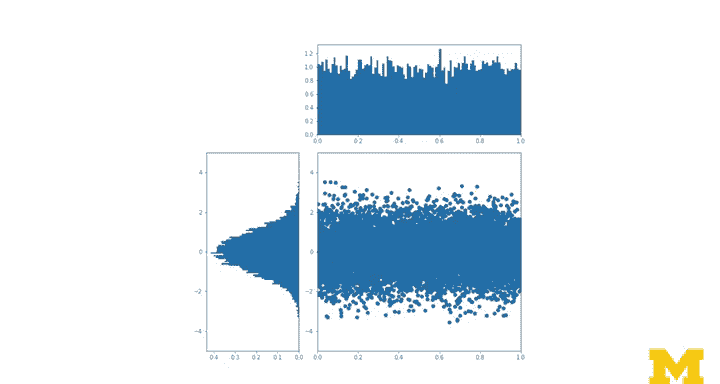

# 密歇根大学《Python用于数据科学实践（1-3课／共5课）｜Applied Data Science with Python 》deepseek翻译 - P46：16_直方图绘制.zh_en - GPT中英字幕课程资源 - BV1U64y1L7VJ

A histogram is a bar chart， which shows the frequency of a given phenomenon。

 A great example is a probability distribution。 For instance。

 in the first course of this specialization， we touched on the difference between the random。

 uniform， normal and chi squared distributions。Probability functions can be visualized as a curve where the y axis holds the probability a given value where to occur。

 and the x axis is the value itself。 This is called a probability density function。

The Y axis's values are limited to between0 and1， where zero means there's no chance of a given value occurring。

 and one means that the value will always occur。The X axis values are labeled in terms of the distribution function。

 in the case of a normal distribution， this is usually in terms of standard deviations。

A histogram is just a bar chart where the X axis is a given observation and the Y axis is the frequency for which that observation occurs。

So we should just be able to plot a given probability distribution by sampling from it。Now。

 recall that sampling means that we're just going to pick a number out of a distribution。

 like rolling a die or pulling a single card out of a deck。As we do this over and over。

 we get a more accurate description of the distribution。

Let's quit talking about this and do a bit more coding to see this in action。

So I'm going to bring in matteplotlib and numpy like usual。 Now。

 I'm going to pull some samples out of the normal distribution and plot four different histograms as subplots。

 First， I'm going to create our two by two grid of a objects。 In this case。

 we don't want to share the y axis between the plots since we're intentionally looking at the number of different sizes of samples。

 But I do want to share that X axis。 So I've got that in my subplots function。

 The share x equals true。 And then I've got this nice collection of a objects。

Now we're mostly interested in how uniform the distribution looks。

 So we're going to iterate through a list of four different values，10，1001000 and 10000。

 and we're going to pull samples from NI。 Remember that the normal function of random just creates a list of numbers based on this underlying normal distribution。

 So if you don't feel confident in distributions for this demonstration that's okay。

 Just assume that there is this distribution function that's created and we're just going to experiment。

 We're just going to pull some samples out of it。All right。

 so I'm just going to iterate through each axis， so zero to length of ax。

 remember I'm grabbing from zero because that's what our actual list is here right we index a list with zero even though when we're talking about subplots。

 we started at one。I'm going pull out a number of samples。

 and we're going to get exponentially bigger each time。

 So this is 10 the first time than 100 then 1000 and so forth。

 And then I'm going to plot that sample on that axis object。

 And then I'm going of course set something useful for a title。

 I'm just going to use that sample size。 Let's take a look。 Okay， there we go。

 The first plot only has 10 samples。 So it looks pretty jagged。 in my version here。

 I don't think anyone would say this is obviously a normal distribution。

 But when we jump it up to 100 samples。 it gets better。 but still， I don't know。

 it looks like it's leaning to the right for me。 Yours might look slightly different。

 right because this is a random process。 So you should be running this notebook on your own and comparing。

It then seems to smooth out a bit on the plots for 1，000 and 10，000 samples。But if we look closely。

 we could see that the bar of the 10，000 plots are actually wider than those of the 10 or the 100 plots。

 So what's going on here， Why does the bar along on the bottom axis， Why does that change。By default。

 the histogram in matte plotlib uses 10 bins， and that's 10 different bars。 Here。

 we created a shared x axisx。 And as we sample more from the distribution。

 we're more likely to get outlier values that are further from our means。 Thus。

10 bins for n equals 10 is at best capturing 10 unique values。 While for n equals 10000。

 Many values have to be combined into a single bin。

 So let's do the same function with the bin width being set to 100。

 So that we're actually going to have 100 different bins。 So the code here all looks the same。

 The only thing I'm changing is right here。 when I actually plot each of our histograms。

 I'm actually going to say the bins， I want 100 bins along that axis。Okay。

 so now we see the 10000 sampled plot looks much smoother than all the others and the10 sample plot shows that each sample is basically in its own bin。

 we only have 10 samples， but we have10 different bins we're willing to look at here so they basically all fall in the same bin。

 so I think this brings up an important question of how many bins should you plot when using a histogram。

I'm afraid that the answer isn't actually all that clear。 Both of these plots are true。

 One is a visual of the data， at a coarse granularity and one at a more fine grain granularity。

 When we look at the finest grain granularity in our data， plotting with 10000 bins。

 then the histogram becomes basically useless for decision making。

 Since they aren't showing any trends between samples as much as they're just actually showing the sample sizes themselves。

 This is similar to using aggregate statistics like mean in standard deviation to describe a sample of a population。

 These values are coarse and whether they are appropriate。

 It depends highly on your questions and on your interests。

Now I want to use our newfound knowledge of histograms and subplots to introduce you to the more flexible grid spec layout for subplots。

The grid spec allows you to map a over multiple cells in a grid so you can make some really custom looking visuals。

For instance， let's create a scatter plot here where the y values are going to come from the normal distribution and the x values come from a random distribution。

Okay， so I'm just going to create some random data here。

 Our y values are coming from the normal distribution and then our x values are coming from random and I'm getting lots of data 10000 of these and I'm just going for each one and then I'm just going to plot that scatter plot Now it's not totally clear from looking at this plot what the actual distributions are for each of the axes。

 but we could actually add two smaller plots each histograms to make this a bit more clear。

Let's just dive right into doing this。 I'm going to define a 3 by three grid。 So 9 cells in total。

 I want the first histogram to take the upper top right space and the second histogram to take the left bottom two space is rotated on its side。

 The original scatter plot that can then take up the two by two square in the bottom right。Okay。

 so to use this grid spec， we first have to import it and then create this new grid spec of the overall shape we want。

 So I'm going to bring it in from grid spec。 I'm going to set my figure size to a little bit bigger 10 by 10。

 and then I'm going to create this new grid spec as a three by three grid。😊。

When we add new items within the subplot， instead of specifying the three numbers。

 row column and position， we're going to pass in the elements of the grid spec object which we wish to cover。

And very important here， because we're using the elements of a list。

 all of the indexing starts at zero， so it's very reasonable to use slicing for the beginning or the end of lists。

The grid spec is indexed as rows and columns using this indexing operator， the square brackets。

 So we'll create the first subplot and histogram in row 0， covering off the first element。

 the middle position， and then go to the end of the row。

 So here I've decided that it's going to be a histogram along the top。

 And I'm going to say plot subplot。 And I want to pass in the grid spec elements that that should cover。

 And so it's0， the very first row。 And I want to take one till the end of whatever is left in the grid spec。

😊，Now when I want to create that side histogram， I want to start at row1。

 but I want to actually continue all the way down to the end of the row elements。

 but I want to limit it to the zeroth column， so here the side histogram is going to run top down and so I want it to cover from one down as far as the row so all of the rows from one on remember row zero is up here in the top histogram。

 but I only want to look at the first column so that's a zero on as the second input to that indexing operator。

Finally， this scatter plot I want to be in the lower right。 When we execute this。

 we'll be able to see all of our plots， but I want the scatter plot to be from row1 down and from column one over。

 Let's take a look。Okay， that gives you a sense as to the layout。

 But now we got fill this with some data。 First， we want to deal with the scatter plot。

 and then I'm going to go to the top histogram， which is for the x values of the scatter plot。

 and then the side histogram for the Y values。 We want that side histogram to be lined up。

 So I'm going to rotate the layout by setting the orientation。

 And there's actually a few ways of doing this。 But since it's so common matplot lib actually has an orientation parameter。

 so I can twist all of the values in that plot just sideways。Okay。

 so' going to create some this new fake data X and Y。

 our figure and our grid speck are just copied from above and same with our top side and our lower right subplots for our histograms and scatter plot Then in the lower right I'm just going to call scatter and I'm going to toss it all the data for the top I'm going to give it the x values and indicate that I want the bins to be 100 and for the side I want the bins to be 100 and the y data and I'm just going to set that orientation to horizontal so it shows up sideways So with this it becomes immediately clear that we've actually got two different distributions。

Now we don't really care about the value of the y axis for the top histogram or the value of the X axis for the bottom histogram。

 Since these are probability density histograms， we only care about the relative values in a matpllib we can do this indicating our histograms our density equals true。

 So this cares less about the actual frequency observations and more about the probability or the ratios of those frequencies。

 we can also invert the x axis subplot for the histogram on that lefthand side。

 which makes it maybe a little bit more clear because it represents the data on the righthand side so this makes it look like it's sort of growing out of that scatterpl data and we can use this directly using the invert x axis function on the axes。

 Finally， we can see if we look back there that we've got a little bit of white space on the axis and a little bit of padding in there that's added automatically and it seems unnecessary and maybe a little bit more confusing so we can get rid of this by changing our a limits so you see here in my approach to do。

This is to iteratively build up the data， the investigation of the data and a little bit of how I'm going to plot that data or look at that data。

 It really is this iterative process where I don't sit down and I know exactly what I want to see necessarily but as I discover things or think about things or look at things I can use matpllib to change how it's happening and this works really well in the Jupyter notebooks So the data the fake data is the same same with the grid spec same with our subplots and same with all of our side histogram top histogram in lower right。

 but then I want to take that side histogram and I want to invert the x axis and then I just want to change the axis limits to get rid of the white space so I'm going iterate here for all of the axises in top histogram and lower right I'm going to set the xlims to0 and one so I'm hard codinging those and here I'm going to set the y limbs to minus5 to plus5 there we go We can see that our top histogram is。

Random， pretty uniform and that the histogram for the Y values indeed looks like a normal distribution。

 In fact， this image sort of crudely looks like the image we looked at in the first module of this course from the MIT and Harvard study onOC engagement and it should be pretty clear to you now how we might adjust various aspects of this plot so that if we wanted to look make it look even more like that engagement image we could actually why don't you try it do you think you could add titles to these subplots and that are a little bit more similar to the ones from MIT and the Harvard publication or maybe change the individual point sizes because we're dealing with pretty big data So instead of it being so big make it nice and small or how about the styling。

 could you change the colors of the plots to mimic the ones from MIT and Harvard give your newfound mapplotlib skills a try。

 grab the API documentation and see what you can create。

