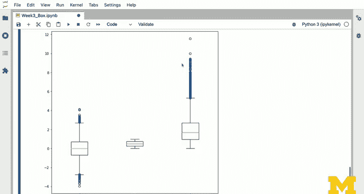

# 密歇根大学《Python用于数据科学实践（1-3课／共5课）｜Applied Data Science with Python 》deepseek翻译 - P47：17_箱线图绘制.zh_en - GPT中英字幕课程资源 - BV1U64y1L7VJ

A box plot， sometimes called a box and whiskard plot。

 is a method of showing aggregate statistics of various samples in a concise manner。

The goal of the box plot is to summarize the distribution of your data through a visualization of what's called the five number summary。

 the extremes， often the minimum and maximum values， the center， usually the median of the data。

 and the first and third quartiles of your data。The quartiles of your data break it into roughly four different similar sized buckets。

 and so the first and third quartile markers， these are sometimes called the hinges。

 show you that middle 50% of your data。Through the box plot。

 we can get a sense of the weighting of the data in a fairly concise， Comp visual representation。

 and it's extremely common in data science。 Let's take a look at box plots in Matplot Li。Okay， first。

 we're going to bring in our libraries， panndas Matpllibb and Nmpy。 Now。

 I'm going to create three different samples from Ny， one for a normal distribution。

 one for random and one from the gamma distribution。

 So we can actually just look at these distributions。

 and how they differ with respect to this five number summary。

 And I'm just going to stuff those into a data frame and name them normal random and gamma。

 let's take a look at what this looks like。 Okay， so we've got 10000 points in each one of these。

 We can see all of our samples for normal in this one。

 random in the next and then our gamma distribution in the far right。 Now。

 pannda has this handy function called describe that allows us to see this five number summary。

 Some of those summary statistics that we're interested in。

 So let's call describe on that data frame and take a look。

 So we could see here that the mean actually varies quite a bit between these the normal distribution mean is very close to0。

 That's because when we don't parameterize it。 That's exactly what it's。

Calling from is a distribution function at 0 for random， it's very close to 0。5。

 Similarlyly when we don't parameterize。 it's going between 0 and 1 and picking random values at random。

 So you' would expect with enough values that we get close to 0。5。

 but we see the gamma is up around 2。 We can also see the standard standard deviations。

 the minimum the maximuma， and then we can see these hinge values， the 25% at the bottom。

 the first 50% and then the 75% value。 So this function described shows those minimum and maximum values in the 3 different percents。

 These percentage values make up what's called the inter quartile range。

 there are four different quarters of data。 The first is between the minimum and the first 25% of the data。

 And this is the value of 25%。 This is called the first quartile。

 The second quartiles between the 25% mark and the 50% mark of the data。 The third between 50 and 75。

 And you got it。 the 75。AndTo the top is the fourth quartile of data。Like standard deviation。

 the inter quartile range is a measure of the variability of the data。

 and is common to plot this's using a box plot In a box plot。

 the mean or the median of the data is plotted as a straight line。 Two boxes are formed one above。

 which represents the 50% to 75% data group and one below。

 which represents the 25% to 50% data group。 then thin lines are drawn out to the minimum and the maximum values appropriately。

 Let's take a look。 Of course， to see a box plot is really only a simple line。

 It takes me way longer to describe it than to actually see it。 Here。

 we're just going to choose one column that we're interested in and pass it to the pi plots box plot function。

 Remember that mappllib uses nuy arrays for data， but actually， pandas is built on top of nupyy。

 So things actually work fluidly。 you can pass in a pandas column because it is actually an N D array underneath。

You'll see that Matplloot Libb actually prints out a bunch of information about artists。

 often we don't really want to see this， but it can be handy at times to get an idea of how that plot's being built underneath。

But if we want to suppress this， we simply put a semicolon at the end of our last statement。 Now。

 this is actually a Jupiter notebook trick that I've used a few times here and haven't told you about yet。

 It suppresses printing the last variable in a cell。 Be warned， though， it's not standard Python。

 Okay so I'm doing the exact same thing。 But this time I've added this sneaky little semicolon to the end。

 that's going to display our box plot still， but it's going to suppress printing the object。

 which is all of the information about the artists。This gives us a basic box plot。 Now。

 let's add the other two samples to it。 Unfortunately。

 we can't just pass the whole panda's data frame to Matplot lid。 Instead。

 we've got to pull out these columns and put them in as a list of values。 It's not too much work。

 but it's a little more than I'd like。So to do that I'm going to just make a new list for the box plot so that's this syndax here。

 and then I'm going to put in our normal， our random and our gamma and I've got this other argument here with and I'm going to talk about that in a minute。

 but let's just take a look at what this looks like okay。So we can see our three distributions。

 Now we didn't normalize the scale。 So that's a little wonky， I mean， to be honest。

 but if we look at the gamma distribution， for instance， we could see the tail of it very， very long。

 So the maximum values are very far out。 let's take a look at this by itself in a histogram。

 So this is how I would if I had some data and I saw the box plot summary like that。

 I might actually then decide， oh， well， I should actually get a better sense of what that distribution looks like。

 It wasn't quite what I was expecting。 And so that's why I would plot it now in a histogram。

Interesting， we see it starts at a moderate level， then spikes up。

 then drops off much more gradually and does indeed have this very long tail。

 Let's add this to our box plug。 And I'm going to take this as an opportunity to demonstrate something called an inset axes。

😊，Recall that we've got one figure and inside of it one subplot。

 since we didn't do anything fancy with subplots， that means we only have one axi object。

We can actually overlay an axes on top of another within a figure。

 and we can do this by calling the Inset a function on the figure itself and sending in the details of the new axes that we want to create。

The details that we send in are the position in Xy space of the original figure and the width and the height of this new axes plot。

Okay， so I'm going create a new figure here。 And in this main figure is actually the box plot that we just created。

 So I'm just going to call that box plot just again here。 Now let's plot on that axis。

 a new axis object。 And this wasn't something that you could do in matplot Lib a couple of versions ago。

 This was new in matplot Lib3。 Actually you could use toolkits to do it。

 And I showed I used to lecture on how to do that。 but it's a lot more annoying right now。

 it's actually quite easy to do。 So this is actually going overlay on the top。

 and we're going provide a bounding box of 0 to 0。6。 This is going to be our bottom left corner。

 So 0 is the x position in 0。6 is from the bottom of the figure to the top of the figure how high as a ratio between0 and1。

😊，And then I'm going to use 0。6 and 04 as the width and the height。

 not the x and the y of the right hand corner or something， but it's the width and the height。 again。

 these are ratios of that underlying object。So I just call plot dot Gca， right。

 That's gonna pull back our current axis dot inset axis。

 And then I just pass in all these parameters as a list。 And that creates me a new inset axis object。

 Ax 2。 So now with A X 2， I can do whatever I want。 In this case。

 I just want to plot that histogram of gamma。 I'm going set the the bins to 100 density equals true。

 And since that histogram is right up against the left side there at0。

 The tick labels are going be kind of annoying。 And they're gonna to clash with the main figure。

 So I'm just going show you how you can flip them to the right。 So I can take an axis。

 I can access the axis the axis Y axis object and hit tick right。

 There's a lot of different words I'm using in there that all sound the same。

 should be interesting to see how the transcript looks for this。😊，Okay， pretty cool， Is't it。

 So here in one figure。 We have our box plots of three different distributions。

 And then we've got this nice little inset image showing the histogram of that far right box plot。

 Remember， again， that each box plot is our five number summary。 A median line in red in the middle。

 And then the two boxes on either side of that， which represent 25% of the population respectively。

 And then these whiskers， which run out to the maximum and to the minimums of the data。

 This would be a great time to pause the video and play with the notebook book to clean up this figure by adding titles。

 legends and the like。 How would you make it clear to the reader， for instance。

 that this inset histogram is about the box plot on the far right。 Now。

 we often want to look at a box plot， not by seeing the minimum and the maximum values。

 but instead by emphasizing the outliers。 How outliers are detected really depends。

 And there's various mechanisms to determine whether an observation is an outlier or not。😊。

If we look at the documentation， though， the default format plot Lib。

 which I actually showed right at the very beginning without telling you about it。

 is that outliers are all the data points， which are either greater than or less than the distance between the hinge。

 that's the bottom of the top of the box or the first and third quartile。And 1。

5 times the inter quartile range， the IQR。The inter quartile range is the distance between those two hinges。

 so that captures 50% of the data。 so if we omit this wis parameter that I've been adding to the box plot call。

 we'll see the outliers using this method。Okay， so I'm just going to do that。

 I'm going to plot that box plot in a larger figure and show those outliers。

 So each circle in the box plot is a single outlier observation。

 The box plot is one of the these more common plots that you're going to use is a data scientist and mapplotlib has significant support for different kinds of box plots Here。

 the mapplotlib documentation is key。 and you can find links in the course resources to the API。

 which describes how to use this box plot functionality。

 I've got one more plot to show you this week。 A twodimenional histogram。

 which is better known as a heat map。 Then we're going to take a look at a couple more advanced features of mapplotlib。

😊。

