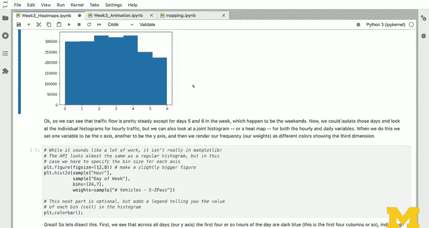
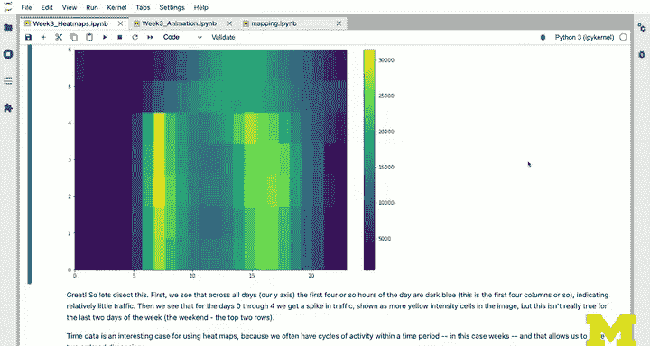

# 密歇根大学《Python用于数据科学实践（1-3课／共5课）｜Applied Data Science with Python 》deepseek翻译 - P48：18_热力图可视化.zh_en - GPT中英字幕课程资源 - BV1U64y1L7VJ

Heat mapps are a way to visualize three dimensions of data and to take advantage of spatial proximity of those dimensions Now in making revisions to this course。

 I was really tempted to get rid of the section on heat maps as I've seen enough bad heat maps to last me a lifetime The problem is heat mapps are really quite powerful when you have the right data weather data is a great example you have two dimensions。

 latitude and longitude and that we can overlay on top of this a third dimensions。

 say temperature or rainfall amounts and use color to indicate this through intensities of color。

In fact， anything with two dimensional spatial aspects can be a natural for a heat map。As an example。

 eye fixation points through gaze detection is used regularly by researchers and marketing experts to understand what people are looking at on websites。

But where heat maps break down is when there's no continuous or at least no ordinal relationship between dimensions。

 U a heat map for categorical data， for instance， is just plain wrong。

 It misleads the viewer into looking for patterns and ordering through spatial proximity。

 and any such patterns would be purely spurious。But I decided to keep this into the course because it can be useful and I put together a new example using order data。

 so let's talk about the techniques anyway in MapllootLi。

 a heat map is simply a twodisional histogram where the X and y values indicate potential points and the color plotted is the frequency of the observation。

So let's bring in Matpllootlibb and NumpI as well as pandas and some datetime functionality In this example I want to show you some traffic data from New York City which is all available from the New York City Open data portal so I'm going to read that into a data frame and then I'm going to convert out the date column into a date and time so I'm going to take this PD。

2 date time that's a function inside of pandas that'll convert that column for me and apply it across the date and let's look at that data。

Okay that might take a little bit of time to load if you're following along on Cosera it's actually quite a big data set Now let's take a look here we've got these Plaza identifiers so these are the different areas where they've got the traffic camera set up and then we've got dates and it's actually broken out by hour of the day so for each plaza each hour in the data is broken out and I think there's probably about probably 10 years of the data here and then they have two different directions incoming which we see here is an eye and outgoing for the plazas and then two different numbers one is the counts of the easy pass that's our density we'll call it eventually and then the Vtoll that's a different tolling system so these are two different tolling systems。

All right， let's pare this down and do some basic exploratory data analysis with histograms。

 so let's say I'm interested in a single plaza one camera location and some of the dates for the early part of 2017 so I'm going to write a pandas query here to pull that data out so I'm going to say DF。

 query where the Plaza ID is5 I just pick that identifier and the date is greater than the end of December in 2016 but it's less than the fifth month of 2017。

Now this syntax might look a little bit different to you from our first course。

 This is an alternative way to query a data frame and it uses a library called num expertt to take a query in as a string and apply it to a data frame It's a bit like SQL in its syntax if you're familiar with that but it has a lot of little caveats with it I wanted to expose you to it so that you are aware。

 but it's completely possible for you to use the regular Boolean masking method I showed you in course 1 actually now would be a great time to pause the video。

 open the notebook and see can you rewrite this query based on what I said in what you see there using the knowledge you already have on Boolean masking。

We have the hour of day here， so let's take a look at a histogram of activity over day。

So since we've got 24 hours in the day I'm going to set the bins there and I want to see our frequency that's the weights for each bin as the number of vehicles just that have used this easy pass system This system automatically builds drivers for using the road and it's already been aggregated that is summed up for us from the individual observations in the data So here to do this we just say plot dot hist I'm going to indicate an array or a column in pandas because of pandas is built on top of N arrays of hour so those will have numbers from 0 to 23 I want 24 bins in it because I know there's 24 hours in a day and I'm going to set the weights is equal to this other column the vehicles in the easy pass。

I see two spikes， mornings around 730 and afternoon starting around three and going until6 o'clock。

 so this is kind of rush hour traffic in New York and this is what we might expect。In this example。

 our hours are ordered， starting at zero and going till 23 throughout the day。

 so it makes sense to view the data in this way as this continuous histogram。

But we also have days of the week， those are ordered as well Monday through Sunday。

 so let's extract the day of the week and look at a histogram of that。

So we can extract the day of the week from the date column using this pandas datetime feature doDT so remember a single column in pandas is a series object。

 it actually has this attribute doDT on it which stores numerous datetime transformations for us because it's actually such a common need in this case we want to take this date column we want to access these datetime functionalities and we just want to get out of it the day of the week。

I'm going to assign that into a new column just called Day of the week。

 this will return to us a number between0 and6 depending on the day and then once we have this we can just tweak our histogram a little bit here。

 set our bins to seven， indicate we're interested in days of the week and we'll still keep looking at the easy pass numbers。

Okay so we can see that the traffic flow is pretty steady except for days five and6 in the week。

 which happened to be the weekends Now we could isolate those days and look at the individual histograms for hourly traffic。

 but we could also look at a joint histogram or a heat map for both the hourly and the daily variables when we do this we set one variable to be the x axis。

 another to be the y axis and then we render our frequency our weights using different colors showing this third dimension while it sounds like a lot of work。

 it really isn't in map plotlib the API looks almost the same as a regular histogram。

 but in this case we have to specify the bin size for each axisxes and make the figure a little bit bigger here so it's easier to read and then we just call this hist 2D instead of hist we pass in our x and our y So on the x axis I want to look at our on the y axis I want to look at days of the week and then for bins we have to tell them well there's 24 bins for the hours and seven for the days of the week and we leave our weights the same。

Now this next part is actually optional， but it actually tells Mapllootlib to show us a color bar。

 a legend telling us what those weights mean。Okay， great。 let's dissect this a bit。 First。

 we see that across all days our wire access。 the first four or so hours of the day are dark blue。

 This is the first four columns or so。 indicating that there's relatively little traffic。

 That makes sense， not a lot of people driving at that time。

 Then we see that for the day 0 through four。 we get these spikes in traffic。

 And those are shown as more yellow intensity cells in the image。

 but this isn't really true for those last two days as the weekend， the top two rows。😊。

Time data is an interesting use case for heat maps because we often have cycles of activities within a time period。

 in this case we had days and we had weeks and that allows us to have these two different ordered dimensions。

Now would be a great time for you to grab control and see if you can look at a different dimension months。

 Could you plot a heat map where one axis is months and the other is， say weeks of the month。

Give it a try。