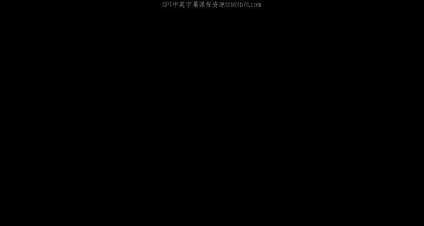
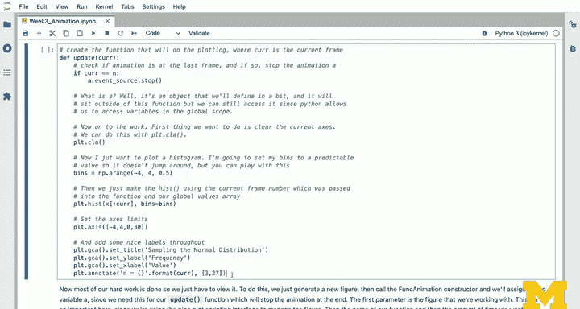
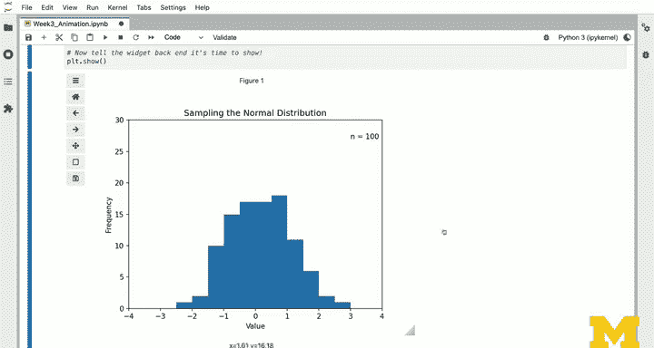

# 密歇根大学《Python用于数据科学实践（1-3课／共5课）｜Applied Data Science with Python 》deepseek翻译 - P49：19_动画制作.zh_en - GPT中英字幕课程资源 - BV1U64y1L7VJ

So far we've focused on static images， but MaPot Lib does have some support for animations。

 this requires a separate library to use in the Jupiter notebook called IML and I've installed that for you here。

Animation depends on this library because it provides a new backend for us， the widget backend。

 so let's turn that on。So to turn on a new backend in Jupiter we use the Maplotlib Magic function it's called。

 so this is actually just a function that's been written for us called Matpllootlib and we start with a percent sign there so it's a cell function and we just say widget and this tells us to initialize Matplotlib using the widget backend you've got to do this at the very beginning of your notebook or before you've used Maplotlib you can't change it once you've said it so be aware of that。

I'm also going to bring in a number of other libraries we're going to need， so Piloot nupi。

 and I'm also bringing in this mapplot Lib dot animation as animation and we're going to use that。

The MaPlib animation module contains important helpers for building animations and for our discussion today the most important object we're going to use is called funk animation This builds an animation by iteratively calling a function which you get to define the function's job is to clear the axis object and redraw the next frame of the animation。

 then these frames are all stacked together into a playable video。

I like to use this demonstration in my class here at Michigan to show students how distributions can be sampled from so we're going to build a basic animation which is going to pull out 100 samples from the normal distribution。

 let's generate that data now。Okay， so I'm going to set n equals to 100 here。

 that's the number of samples， and then I'm going to make x are just list of a samples as。

 and we're just going to pull them out of the random normal distribution。Okay。

 next what we want to actually do is create that function that's going to do the plotting I'm going to call this function update。

 you can call it whatever you want Now the mapplotlib fun animation object is going to call this every few milliseconds and pass in the frame number we're starting with starting with a frame of zero so we can use this actually as an index into our array of values which we've called x。

The very first thing we want to do is see if the current frame is actually at the end of our list。

 if so we're going to tell the animation to stop and we do this by calling the stop object on the event source object attached to this funk animation object。

 Let's take a look。

So I'm going to create the function that's going to do the app ploting so it's called update and it's going to pass incur where occur is the current frame so it's going to be an integer value starting with zero。

 The very first thing I'm going to do is check if the animation is actually at the last frame and if so I'm going to stop the animation so if curve is equal to n 100 then I'm going to call a do event source dot stop What's this a Well it's actually an object that we're going to define in a minute and it will sit outside of this function but we can still access it since Python allows us access to variables in the global scope。

Okay， now on the actual work， first thing we want to do is clear the current axes。

 we can do this by calling plot。cLla clear axes。Now I just want to plot a histogram。

 but I'm going to set my bins to a predictable value so it doesn't jump around。

 so you can play with this， I'm going to use MP range from minus4 to4 and I'm going to set these in half sized steps。

Then we're just going to make this hist call2 pi plot using the current frame number which was passed into the function。

 so here I'm just going to slice data out of x whatever data we have up until the current so the first time through is only going to be one item the second time through it'll be two items the third time through it'll be the first three items and so forth and I'm always going to set my bins to 100 so I'm always going to use full hundred bins so that doesn't jump around and then I want to set my axes limits as well all right finally I'm just going to add some nice labels here to make it look a little pretty。

Okay， most of our hard work is done， but now we have to view it to do this we want to just generate a new figure and then call this funk animation constructor and we're going to assign this to variable A since we need to be able to stop it in that update function we just wrote。

The first parameter is the figure that we're working on。 This isn't really important。

 so we're just going to use the pi plot scripting interface to manage the figure。

 then the name of our function and the amount of time we want between updates。

 and I'm going to set that to 100 milliseconds， which should be fast but not too fast。

So once we've got it all set up， it's actually quite quick to start。

 I'm going to say animation do funk animation and I'm going to pass in a figure so remember plot do figure is just going to create a new figure I could have used plot do GCf get current figure because that will also create us a new figure there if we wanted to or I could have created the figure stored in an object and then pass in that object。

 lots of options here and pass in a reference to the function that we're using in this case update the one we wrote maybe you changed the name so you can change it here and then our interval in milliseconds and then all we do is tell the widget backend that it's time to start the show。

And so we can see that we pull out these values from our X and we're slowly building up what that distribution looks like Now if you run this on your system。

 you should see something different， it should be roughly the same as this。

 but it might be different it's likely to be different because I didn't set a seed value so we're all getting different random values and this really demonstrates how as you sample from a distribution as the number gets bigger it becomes more clear that it looks like that traditional bell curve shape。

We see that there's some other functionality here that this backend gives us， we can save the image。

 we can pan around the image and so forth， and those are useful in various different circumstances。

Okay， there we go。 a nice example of how sampling from a distribution can be used with an animation Funk animation。

 like most other classes in the animation package is a subclass of the animation object。

The animation object has a handy function， which allows you to write the image to a file。

 a save function。This requires additional thirdpart libraries though like FFMPG and that can take a bit to install and set up the result though is that you can fairly easily export your animations directly from the Jupiter web programming environment to M4Vs。

 MOVs， animated GIs and so forth。You know， a figure animation with four subplots。

 one for each kind of distribution we might be interested in understanding could be actually pretty neat to see I imagine we could plot the samples for normal distribution in one for let's say gamma distribution in another。

 maybe another couple of parameterized distributions like a normal distribution with different levels of standard deviation。

This would actually be a great way to practice the skills that you've learned in this module as it would require that you manage multiple subplots with an animation using histograms If you want to tackle that challenge。

 I'll put a link in the course shellll to an optional practice notebook for you to take a look at。

