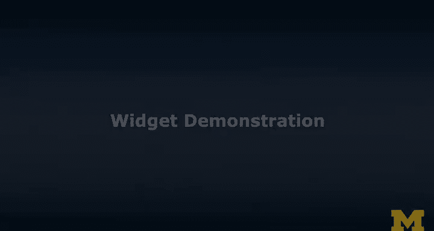
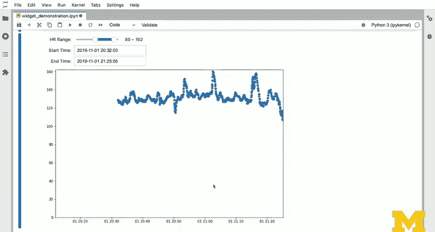

# 密歇根大学《Python用于数据科学实践（1-3课／共5课）｜Applied Data Science with Python 》deepseek翻译 - P50：20_交互组件演示.zh_en - GPT中英字幕课程资源 - BV1U64y1L7VJ

This lecture is a bit different。 It's an extended topic that looks at the interactivity functions which are available within inside Jupiter。

 Jupiter has this notion of widgets that allow you to build simple dashboards within notebooks to aid in your investigation。

 Now， you could read more about Jupiter widgets here。

 And please keep in mind that while everything I'm showing you should work fine in the Cosera system。

 It's quite likely that this fast moving world is already a bit of out a day with what I'm showing you。

😊，We're going to be using the interact function， which comes as a decorator in Python。

 So I tend to bring this in from i widgets。 So i Python widgets。

 Jupiter is built on top of interactive Python i Python。 So that's where the name comes from。

 So from i wgets， I'm going to import Interact。 And then I'm actually going to bring in all of i widgets as widgets。

 And I'll show you a couple of the different ones。 A widget is just a little thing that's on the user experience like a button or a dropdown or a scroll bar。

 if you're not familiar with the word。Now I'm going to look at a small data set of real data that I collected of my own biking so I'm going to bring in pandas and Matplot Libs Pipl This data is actually pretty important to me because while I was biking in 2019 I went into a roundabout it's a traffic circle a little too fast and it's just completely bied it and so this makes it actually a great thing to visualize so let's read that into a data frame I know that there's a timestamp in there so I'm going to set that as the index and let's take a look at what that data looks like。

Okay， so here's what that data looks like， the data sets made up of time and a set of the sensors that I was wearing while I was writing。

 these sensors picked up details such as my position， my elevation， my speed， my heart rate and more。

 I assume now everybody's kind of going for bike rides like this and it's really quite nice to be able to reflect on your ride。

 not just the things you saw or the physical exercise， but of course in the data。

So pandas has some built in support for plotting， but it needs to be able to talk matpl lib。

 We do this by indicating that we want our pandas plots to convert automatically for us。

 So from pandas plotting， I'm going to import register mat plotlib converters and then just run that function。

 And that'll allow pandas to convert data types back and forth。

 Not all of the columns in my data frame are actually all that good to visualize in a line plot。

 And that's what I want to show you here。 So I'm going to iterate through my data frame and just keep a list of the columns。

 which are not of type object。 That is the column is a number。 Now。I don't have to do this。

 I could have just picked the columns that I wanted to use， but I'll be honest。

 I actually write this quite a bit when I just load in a big Y data set and I want to look at one of these sps or I want to look at some relationship。

 sometimes I just want to like get out everything that I could plot against one another and look at those。

 And so this is sort of a little bit of a recipe I use。

 It's just iterating across all the columns and pulling out everything that is not an object which means I've got to do some string processing or the like with it。

Okay， now I want to write a plot wrapper function。 This function is actually going to plot one or two columns。

 but never more。 If there's a single column passed in。

 it's just going to plot that in the default blue color。

 but if there are two it's going plot the one column of data on top of the other with the second column being in red and I'm going use the plot do twin X function here to ensure the x axis is the same。

 it's going to be time in this case， the data frame index。

 but that the y axisxes can be unique for each series of data。

 So all I do is call plot dot figure with the figure size I want。

 I get the current figure I set the title I'm just going to set it to the column names。

 and then if there's two columns set in， I'm going plot twin the axis and then plot with a different color。

 otherwise I'm just going to plot in the default。 Now let's just look at one example of the two columns of data。

 and in this case， I'll just choose cadence versus speed。Okay， it's pretty messy。

 but we can see that there's a moment maybe down around 2105 where the cadence in the speed did drop together。

 Anyway， let's go into the interactive part to make this interactive。

 We can wrap this function with the interact decorator。

 a decorator and python is just a function which wraps another function and the i Python team has written this one for us。

 It allows us to provide a new widget。 in this case。

 a select multiple widget and use whatever is selected there as a parameter that's going to be sent to plot data。

 We can set this up by putting the decorator in front of the plot data function definition。

 So I'm going to do a little copy and paste here。 The select multiple widget actually has three parameters。

 The set of options that are legal。 So in this case it's going to be our potential column names。

 This is what will be shown to the user for their affordance It's called The values that we want passed in。

 So time always going to be our first value that we want passed in our Xaxxes followed by whatever other values are selected and then some。

😊，scriptive stringSo here I've got the interact decorator， so the decorator in Python。

 we just use the a sign and then the name of the function that's actually written as a decorator。

I say the column names， so that's actually mirroring what's in our function that we've written the plot data function called call names。

 so we have to set that， and then I just assign that to the widget and that means that the widget values are actually going to be passed in as the column names。

For the widgets I'm going to use the select multiple。

 so that's actually a dropdown list that allows you to select multiple items。

 I'm going to say that the options it should show are potential columns。

 this is that list of columns that we built up everything but the object and that the value is going to be the potential columns sub0 so that's our time and then followed by any number of other items that are selected and then the English word that I just want to describe this that is columns。

Our plot data function doesn't change， so this I just copy and pasted before。

 you have to put the decorator right in front of your function so we have to put this definition in there。

Otherwise， it's just copied from before and a reminder that what it really does is it looks if there's two column names。

 then it's going to plot a blue and a red。 Otherwise it's just going to plot what there is。

 Let's run this。 Okay， so you can see what Jupiter's done here for us。

 It's actually put that widget in front of our chart and then it called that chart with cadence in it。

So here is that select multiple widget and it's given us all all of the things that are potentially in our column and so we can choose one like distance and we'll see that that chart just updates right So this is actually really nice。

 You can kind of look at a nice big visual of some of the things that you might be interested in。

So then you could select something like speed and cadence here， two items。

 and you can see the two items being plotted against one another here。

 which is really quite interesting right， it gives you the ability to you know just make up a little hypothesis of what you're seeing at any time and then plot it Now splos allow us to do this with small multiple。

 so you shouldn't discount that technique but sometimes a dashboard can engage your reader in a different way and let them see a slightly larger view of that data。

Let's look at one more example here I'm going to use a widget called an inch range slider。

 which allows the reader to set a lower and upper bounds for something。

I've written a lot here and you could check the docs for more。

 but in this case I'm going to look at a plot of my heart rate where the reader gets to see all the places between 80 and 100。

 but they can actually change this to filter based on values that they're interested in。

I'm also going to create a text widget so I'm going to use that one as well that allows them to set the start and end time so that you can zoom in on a time of interest so again the interactact has to be called that decorator right before the function in this case I call it plot heart rate you'll see that plot heart rate has a heart rate bounds parameter。

 a start and an end and if we go back to the interact we'll see that there's a heart rate bounds。

 that set to some widget。We'll see that there's a start that's set to a different kind of widget。

 the text widget and an end that's set to a third text widget。

 So we're going to have three widgets and the values of those widgets that the user chooses are going to be passed in as parameters and that plot function will be called dynamically the in range slider has a minimum and a maximum value or default values 80 to 100 is what I've chosen。

 as well as that min max and a step count and a description。

 You're going to look at all of the details of this inside of the documentation for the plot heart rate All I'm going to do is take the heart rate bounce the start in the end。

 I'm going to create a new figure。 I'm going to set the x limb and the y limb values as appropriate with respect to the heart rate so you could see the x limb is going to be set to that left and right。

 and the y limb is going to be the max of the heart rate and then I'm going to filter my data frame。

And plot that scatter plot。 So my actual plotting function is quite small。Okay。

 so here we can see the effect。 I've got my heart rate and you can see it's got this nice slider and the min and the max has been set and my 80 to 100s been set and it's telling me that here and I've got the start time and the end time as was set in my data frame and you can see that there's a whole bunch of points here between 80 and 100 and then they sort of disappear here now because you know it's cycling data and it's likely that my heart rate increased。

 I can actually drag this out， let go and then we'll start to see more data appear。

 So I'm allowed to filter based on that。You can see that I could also change the data here so for instance。

 it looks like if I wanted to jump maybe 20 minutes more into my workout。

 I could do this and then we can see the data has actually been pruned。

 It's not going to show me the data from before that time Now you can imagine that we could do all sorts of things with these widgets。

 we could draw reference lines， we could change reference lines。

 you can actually have somebody select on the plot itself regions of interest as well。

Okay， so that was a pretty whirlwind demo of Jupiter widgets。

 The ecosystem for widgets is far from finished， but the functionality is being added all the time。

 I wanted to include this here because it's starting to get a bit more mature。 And honestly。

 its visuals like plots and charts that people want these widgets for。

 I hope you'll take a look and poke around with what's available。

 and maybe share your findings and creations with myself and the other students in the class。😊。

