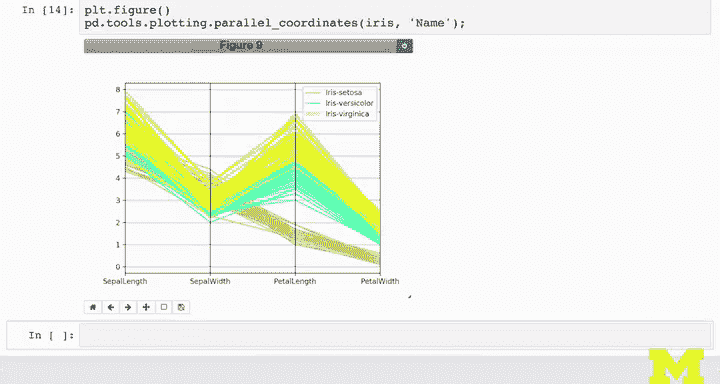

# 密歇根大学《Python用于数据科学实践（1-3课／共5课）｜Applied Data Science with Python 》deepseek翻译 - P51：21_Pandas绘图方法.zh_en - GPT中英字幕课程资源 - BV1U64y1L7VJ

Hi， everyone。 Welcom to today's tutorial， where we'll be looking at visualization in pandas。😊。

Paands uses Matpllib under the hood and provides some convenient functions for visualizing data。

Before we dive into visualization in pandas， let's take a look at the mappllib style package。

Matplotlib comes with a number of predefined styles which we can choose from to change the default look of our plots。

Because pandas is using mat plotlabe under the hood。

 this will change the default style of our pandas graphs as well。We can use PLT。

t styleyle available to see the predefined styles provided。Let's use the seaborn colorbl style。

 which will change the default colors of our plots to use a color palette that is more color vision deficiency friendly。

Now where the built in visualization in pandas really shines is in helping with fast and easy plotting of series and data frames that can help us explore the data。

Let's make a data frame。First， we'll set the seed for the random number generator。

 which will allow us to reproduce the data。Next， let's add three columns of random time series data。

We can generate the random data by cumulatively sumling up random numbers。

Numpai has a great function for this called Cum sum， which cumulatively sums an array。

Let's do this for three columns， A， B， and C。And also offset the B column by plus 20 and the C column by -20。

Using date range， we can set the index to be every day in 2017。Now。

 let's see what this data looks like a little more visually。To plot this data。

 we can use the plot method on the data frame。The plot method on series and data frame is just a simple wrapper around PLT dot plot。

So when we call DF dot plot， we get a line graph of all the columns in the data frame with labels。

Notice how the colors are slightly different from the default mat plot lip colors because of the style we used。

Also， notice this cool Jupiter notebook trick。 If you add a semicolon to the end of the plotting call。

 this will suppress unwanted output。 and this works with regular mat plotlib  too。

Data frame dot plot allows us to plot a number of different kinds of plots。

 We can select which plot we want to use by passing it into the kind parameter。

Let's try and create a scatter plot that takes the A and B columns of Df。

We pass and scatter to the kind parameter to change the plot type。

This is what we'd get if we called PLT。 plot on the A and B columns with the point marker parameter。

Passing scatter into the kind keyword argument， change the plot type to a scatter plot。

You can also choose the plot kind by using the methods data frameplot。

 kind instead of providing the kind keyword argument。Now。

 let's try this and create something a little more complex。 This time。

 we want to make a scatter plot with points varying in color and size。We'll use df。plot。catter。

Pass in columns， A and C。And set the color C and size S to change based on the value of column B。

Finally， we can choose the color palette used by passing a string into the parameter color map。Here。

 I'll use verrius， which is particularly pleasing to the eye。

Here we can see the A and C columns plotted against one another with the size and color changing based on the values of the B column。

Because Df。plot。ca returns a mapplotlibb Ay subplot。We can perform modification on this object。

 just like objects returned by matplotlib plots。For example。

 let's see what it looks like when we change the aspect ratio of the Xy subplot to equal。

Setting the aspect ratio to equal allows the viewer to easily see that the range of series A is much smaller than series C。

Using pandas， we can also easily do box plots。Histograms。And kernel density estimate plots。

Which are useful for visualizing an estimate of a variable's probability density function。

Colonnel density estimation plots come in handy in data science applications where you want to derive a smooth。

 continuous function from a given sample。Paandndas also has plotting tools that help with visualizing large amounts of data or high dimensional data。

Let's explore a couple of these tools by loading in the Iis Fer data set。

The Iis dataset set is a classic multivariate dataset set， which includes the sepal length。

 sepal width， petal length and petal width for hundreds of samples of three species of the iris flower。

😊，Pands has a plotting tool that allows us to create a scatter matrix from a data frame。

A scatter matrix is a way of comparing each column in a data frame to every other column in a pairwise fashion。

Let's use it to visualize the IIS data frame and see what insights we can gain from our data。

The scatter matrix creates scatter plots between the different variables and histograms along the diagonals。

This allows us to quickly see some of the more obvious patterns in the data。

Looking at the scatter plots， it appears that there are some distinct groupings of the points。

 which might indicate that there could be some clustering going on。

And while this looks impressive and is certainly useful。Realize that in the last two weeks。

 you have gained all of the skills to manually build these kinds of plots if you want to。

This is nothing more than a 4 by4 grid of subplots with some plots。

 histograms and the other scatter plots。Let's look at one more plotting tool in pandas。

 which will help us visualize multivariate data。Paandndas includes a plotting tool for creating parallel coordinates plots。

Parallel coordinates plots are a common way of visualizing high dimensional multivariate data。

Each variable in the dataset set corresponds to an equally spaced parallel vertical line。

The values of each variable are then connected by lines between， for each individual observation。

Coloring the lines by class in this example of the species of flower allows the viewer to more easily see any patterns or clustering。

For instance， looking at our Iis data set， we can see that the pal length and petal width are two variables that split the different species fairly clearly。

 with Iis Viica having the longest and widest petals and Iis Sctoa。

 having the shortest and narrowest petals。😊。

Well， that's it for visualization in pandas。 In the next video， we'll look at Seaborn。

 a powerful package for statistical plotting。