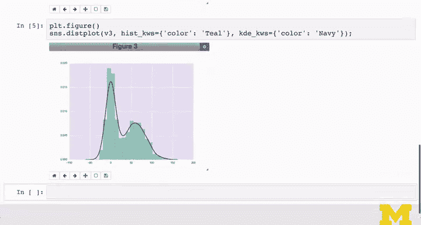
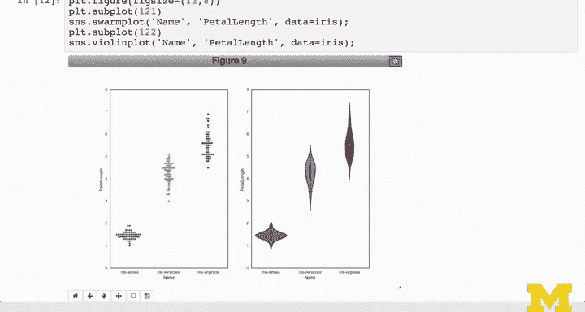

# 密歇根大学《Python用于数据科学实践（1-3课／共5课）｜Applied Data Science with Python 》deepseek翻译 - P52：22_Seaborn可视化库.zh_en - GPT中英字幕课程资源 - BV1U64y1L7VJ

Hi， everyone Today will be looking at Seaborn， a Python visualization library based on matpllib。😊。

Seabornne is really just a wrapper around myplt lib。

It adds styles to make default data visualizations much more visually appealing。

And makes creation of specific types of complicated plots much simpler。To get us started。

 I've imported seaborn as S N S。Now， let's set the seed for the random number generator。

 which lets us reproduce the data。Next， let's make a panda series V1， that's 1。

000 numbers drawn from a normal distribution with a mean of0 and a standard deviation of 10。

Let's also make a second pandaace series V2， which is2 times v1 plus 1000 numbers drawn from a normal distribution with a mean of 60 and standard deviation of 15。

Now， let's see what the histograms of these two variables look like when we plot them side by side。

We can set alpha equal to 0。7， so the histograms don't cover one another up。For the bin parameter。

 instead of an integer denoting the number of bins we want。

 we can also pass in a specific sequence using NP do a range to specify the specific bins we want to use。

This is useful for when we want to plot two histograms in the same figure to make sure the bin sizes are equivalent for both histograms。

We also add labels so we can see which histogram belongs to which variable using a legend。

Looking at the histograms， we can quickly see that V1 has a lower mean than V2。

 and that V2 has a larger spread than V1。Even though up to this point。

 we've only used mappltlib for plotting， we see that even just importing seaborn has changed the aesthetics of the plot to a different style from the mappltlib default。

Let's visualize these histograms again， but in a different way。First。

 let's pass in both of the series V1 and V2 in a list。And set the hist type to barst。

Setting norm to true will normalize the histogram to form a probability density。Next。

 let's create a variable V3， which is the combination of V1 and V2。

We'll use V3 to plot a kernel density estimate plot over the stacked histogram。

The kernel density estimation plot estimates the probability density function of the variable V3。

Plotting it on top of the stacked histograms of V1 and V2 allows us to see the relationship between these two visualizations。

Seeaborn provides a convenient function for these type of plots。 S， And S dot disk plot。

Let's take a look at how it works。We can pass in the variable we want to visualize。

 along with keyword arguments for each of the individual components of the plot。

Let's set the histogram color to teal。And the K D E color to Navyvy。

Now let's look at an example of one of the types of complex plots that Seabornoure provides a convenient interface for。

 the joint plot。

The joint plot creates a scatter plot along the histograms for each individual variable on each axis。

You've actually seen joint plots in module2 and created them manually yourself。

To create a joint plot， we just type S and S。jo plot and pass in the two series， V1 and V2。

Setting alpha to 0。4 will help with visualizing overlapping points。

The joint plot allows us to visualize the distribution of the two variables individually。

 as well as relationships between the variables。Using joint plot。

 we can see that v1 and V2 appear to be normally distributed variables that are positively correlated。

Because Cborn uses Matplotlib， we can tweak the plots using mappllib tools。

Some of the plotting functions in Cborne return a matpltlib aes object。

 while others operate on an entire figure and produce plots with several panels。

 returning a seaborne grid object。In both cases， mappl lid can be used to further tweak the plots。

For example。S， N S dot joint plot returns a seaborn grid object。From this。

 we can pull out a mat plotlib axy subplot object using grid dot x joint。

Then we can set the aspect ratio to be equal using set aspect equal。

Hexspin plots are the bivariate counterpart to histograms。

Hexpin plots show the number of observations that fall within hexagonal bins。SNS。

 joint plot includes a hex bin style we can use by passing in hex to the kind parameter。

The Hexpin style of Plat works well with relatively large data sets。

Another good option for visualizing the distribution of data sets is kernel density estimations or K D E plots。

You can think of two dimensional K D E plots as the continuous version of the hexpin joint plot。

First， let's tell Seaborn to use a different style using SNS do set style white。

All of the following charts will have the gray grid turned off。

nNow we'll create a joint plot just like before except this time let's set the kind to k d e。Finally。

 let's set space to 0， which will plot the marginal distributions directly on the border of the scatter plot。

😊，We can see that Seaborn has some built in options for easy customization and provides us with easy to create and beautiful plots for exploring the distributions of your data。

😊，For the last part of this tutorial， let's load in the iris data set to see how Seaborn handles visualizations of categorical data。

😊，Similar to pandas， Seaborn has a built in function that creates a scatterpl matrix。

We pass in the iris data frame。Tell it to map name to different colors， using the hue parameter。

And tell it to use a K D E along the diagonals instead of the default histograms。

Looking at the pair plot， it's clear there are some clusters in the data set。

It looks like pedal length and pedal width are good options for separating the observations。

 whereas sepel width is not a strong separator。😊，Using Pepl to look at your data frame can be a very useful tool in exploratory data analysis。

One final plot I'd like to show you is called the violin plot。

You can think of a violin plot as a more informative version of a box plot。To demonstrate。

 let's plot a violin plot next to a swarm plot， which you can think of as a scatter plot for categorical data。

First， let's create a new figure and a subplot。Next。

 we'll create the swarm plot passing in name and pal length， and the data。

 which is the IIS data frame。For the next subplot， we'll create the violin plot again。

 passing a name， pal length and the rs data frame。Looking at the swarm plot。

 each species has its own column， and each observation's petal length is shown with more common values appearing as the wider parts of the cluster。

 much like a histogram。The violin plot is like a box plot with a rotated kernel density estimation on each side。

Violin plots convey more information than box plots and are able to show particular phenomena within the distribution that box plots are unable to convey。

 such as multimodality。

Sbornourne is a library that not only adds new styles and visual aspects。

 but also introduces new functionality such as joint plots， scatter matrix plots， and violin plots。

Sbornourne is being actively developed and is easy to install。

 which makes it an indispensable part of a data scientist toolkit。But keep in mind。

 this is functionality built on top of Maplottlib。And these are largely mat Platlibb artists being used。

 So if you have any ideas for a new statistical visualization or you read about one in a publication or journal。

You should have the ability to create your own visualization toolkits。That's it for Seaborn tutorial。

 Thanks for watching。 Happy plotting。😊。

