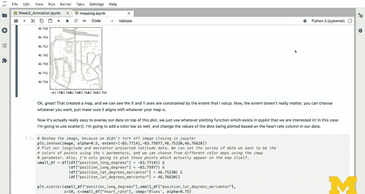

# 密歇根大学《Python用于数据科学实践（1-3课／共5课）｜Applied Data Science with Python 》deepseek翻译 - P53：23_地理信息与地图绘制.zh_en - GPT中英字幕课程资源 - BV1U64y1L7VJ

Captturing physical landscape traits in a written form is perhaps one of the oldest and most common examples of information visualization that's still in use today。

 geographical information systems Gs are highly specialized and complex made up of a myriad of unique techniques and tools。

 In this lecture， I want to just dip our toes into this world and show you how you can leverage Gs to lead it to insight in computational narratives。

We're going to start by bringing in a few of our common libraries， Pandas。

 Numpy and Matplloot Libs Ppl interface。And we'll set some Matpllootlib defaults by setting these defaults in the RC PRs list。

 we can be certain that our figure size will be the same throughout our investigation When you do this make sure to do it at the top of your notebook before you actually start using Mapllootlib so I'm going to import Matpllootlibib the modules NPL and then I'm going to set the figure size to be 16 by 8 that's an inches on my system。

Okay， now I'm going to bring in some data on cycling。

 so this is actually an interesting data set called wipeout。csv。

 I'm going to read that in with pandas and let's take a look at this。Okay。

 so this data is made up of latitude and longitude。

 a timestamp on what looks to be about second frequency。

 as well as measurements such as heart rate and beats per minute and enhanced altitude。

 probably in feet， speed， all sorts of things in here。

The first thing we need to consider when mapping is longitude and latitude Now cartographers for thousands of years have come up with different ways to take a mostly round globe and turn it into a twodimenional rectangle and these methods are called projections if you're going to work a lot with cartography data then you're undoubtedly going to have to learn some of these projections。

 I'm not an expert at all in these different kinds of projections and the way mapping coordinates are stored but even in this simple example it looks odd to me why do we just have a single number I'm used to seeing in some periods in there or decimal places from when I use Google Maps。

It turns out that this particular data source is trying to capture the maximum precision possible in an unsigned integer。

 so we first need to convert these to a more traditional decimal format。To do this。

 you're going to have to go to the docks and identify how to do the transformation。

 but I'm saving you that step here because I actually already know what it is。Okay。

 if we multiply by 180 degrees， then divide by 2 to the power of 31。

 we get to convert our units into something a bit more meaningful。

 the kind of thing that you would see as GPS coordinates。

But it turns out that that doesn't really do everything we need， you see the earth is kind of round。

 it's not quite round， but it's pretty round and we're going to try and look at it on a screen and the screen is pretty flat actually my screen in front of me is quite curved。

 but we're still going to look at it in this twodial projection。

Because we're going to plot on top of a twodial image we're going to want to use the Mercanter projection I'm going share with you the code to convert from latitude in degrees to a flat Mercanter projection and this actually comes from the OpenStreetmap effort and I've got the URL here and so I just wrote this function La to Y here and I'm going to apply that function to the latitude degrees and I'm going to start it in a new one called position Lat degrees Mercanter。

Lastly， I want to drop anything with missing values now this is a simplification for the moment and might not be actually what you would want to do in practice。

 but I'm going to just try and reduce it down a little bit。

The first approach to plotting I want to show you is probably the most simple。

 The gist is that we're going to render an image behind an a object。

 and then we're just going to use our regular plotting on top of the a object。 For this to work。

 it means we need an image and we need to know the coordinates of the image bounds。

 Then we can set what's called the extenttant， which represents the bounds of the map。

 This means that our image behind the axis object will use the same coordinate system as the axis object itself and the plot will be locked。

So first the image I got mine through an export from OpensStreetmap and I just saved it here in Coursera as map。

pNG and you can get a map directly from Openstreetmap to display this we're going to use the Pplot I am read image read function and pair it with IM show image show so we just do plot。

 IM read and that reads it in a nice binary object here and then when we call plot。 IM show。

 we can pass in the image and then we can set that extenttant what the bounds are in that image as reference for our dataset set later。

Okay， great， that created a map and we can see that the x and the y axes are constrained by the extent that I set up Now the extent doesn't really matter。

 you can choose whatever you want， just make sure it aligns with whatever your map is In this case。

 I know what it is from my map what I exported from OpenStreetmap and so you can see that the axes labels for the x and the y axes are actually being added because of the extent I set automatically by mapplot lip。

Now it's actually really easy to overlay our data on top of this plot。

 we just use whatever plotting functions exist in pi plotot that we're interested in using in this case I'm going to use the scatter function and I'm also going to add a color bar as well and change the values of the dots being plotted based on the heart rate column in our data。

Okay， so first I'm going to reshow the image， remember after each cell in Jupiter by default。

 it closes the image， we could actually change that inside of Jupiter。

 we can set some RC parameterss for that， but I'm just going to reloot the image。

Now I want to take our longitude and Mercaner projected latitude data。

 we insert the series of data we want to be the colors of points using the C parameters and we can choose from different color maps using the C mapap parameter Also I'm only going to plot those points which actually appear on the map itself。

So this is a little long here， but here I'm taking our data frame and I'm just going to look and slice it up by position longitude between these values and position latitude degrees more caner between these values。

 and they kind of match my extent values up here。And then I just call scatter。

 just like we did previously， I indicate my X and my Y， I indicate how big I want the points to be。

 what I want the color to be derived from and so in this case it's the heart rate value and what color mapping I want to use in this case I'm going to use blues。

Then to add a color bar， we can just say plot。colorbar。

 set label and we can give it a little bit of a useful label。

 and then we can indicate the title for our plots as well。Nice。

 we've got a map and we have some points plotted on the map showing the various heart rate measurements。

 If you look at this， you'll notice that the lighter more transparent circles are closer to 100 beats per minute while the dark full circles are close to 135 beats per minute a bit of insider knowledge since it was me on the bike I can tell you that the street in the lower left corner here is actually a hill that I would cycle up and that this part here is actually a hill that I'm cycling down or coasting down and so my heart has not got as much work to do here。

Now this method of creating a map using an image with exs is simple and reliable。

 but it's not really fast or seamless if we just tossed our full data framework on there。

 it become apparent that we need to go find a map with the right exs to do the plotting and we're constantly looking up different maps that we want to export to make in as part of this background image。

So。Let's see that exact same code， but with all of the data。

 so that's actually easier for us to do because I first just show the image and then I just scatter plot everything。

 I don't have to have that big Boolean mask。So now we get to see my whole cycling route。

 but we only have this tiny portion of the map right down here。

An alternative approach taken for maps in most web systems is to use what's called a tile server tile servers actually create a matrix of maps different zoom levels and then they serve up portions of the map the tiles as requested from the client this is how Google Maps for instance works and it creates a responsive experience at the cost of being a bit more fragile as the network access is needed。

This paradigm is actually also available in the Jupiter notebooks as well through a project called Foium。

 this project is all client side JavaScript and does the map requesting and rendering。

To connect this to our Python backend， we can use the Foliium project。Be warned though。

 this is a new library， it takes us out of the map plotot Lib world。

 but I think you might find it pretty usable， pretty natural。

 and something that you might want to use if you're actually going to start looking at maps and doing plots on top of maps。

So I'm going to import the folium package。Now we want to render a spot from our previous data so for this I just picked the center point of the map and then we set a zoom level。

 there's different zoom levels you can choose here and you'll be able to scroll up and down in them here and a key I is going to notice that I had to reverse our longitude and latitude for this library and I'm not using the Mercanterchan values for longitude。

 so welcome to GIS systems where each system is done just a little bit differently。

After I create that map， I'm just going to display it here。Okay。

 so you'll notice immediately that the user experience is nice。

 you can still see the data once we plot it， but you can actually zoom in and out。

 you can move around the map， just like you could in Google Maps and you when you move off and see tiles that aren't there。

 they actually get picked up automatically by the system bring that map back here。

So we can add callouts to the map using the marker class let's set this for our start and end so here I'm going to create our map again and then I'm going to create some markers。

 the first one here I'll call start I just set the pop up as the start and I'm going to take the IL zero so that's the very first item inside of our data frame inside of that column for both the latitude and the longitude and then I'm going to do the exact opposite or rather the same thing but with a minus one so I'm taking the last item for the latitude and the longitude for the stop。

These are going to put these little pins up that indicate what the start and the stop of the route was。

But I also want to map the whole cycling route the dockspher foleum point to a polyline is the appropriate class to use The polyline takes a list of locations as tuples。

 which means we have to combine our latitude and longitude values pairwise。

 and this is actually easily achieved through the use of Python's zip function So when I take zip here。

G it two different columns， it's going to item by item。

 marry those things together and turn it into a sequence or an iterable at least of topples that have the two values in there。

 and so that's what the polyline's looking for is the locations as X Y positions or rather it says latitude longitude positions and then I'm setting the weight to be5 and the color to be blue and then I'm adding it to the map and let's just render this。

Okay， well that's a nice rendering so you can see here my cycling route。

 you can zoom out of my cycling route， you can see the little pins here is start and stop and you can see where I went off to it's really quite a nice and a very fluid approach when you want to start looking at data and each one of these even though we're using a polyline。

 each one of these is actually all of those data points are directly plotted on there and then joined automatically for us as part of that polyline。

The docs really demonstrate how to use leaflet， which is part of this folium world to do interesting things and they've been well optimized for the browser and the JavaScript world。

 including setting colors through HTML color codes and events so that you can capture interactivity This is just the tip of the iceberg when it comes to using foum and leaflet。

 and I would encourage you to dive into those docs and play around with them a bit more to learn。

In this lecture， I've just touched on some of the information mapping that you can do mixing GIS structures and data we've seen several different approaches from rendering a simple data plot superimposed on a map to drawing on top of a JavaScriptbased map with foium GIS systems are a huge area。

 but it's helpful to know a few things about spatial representations of data for those times when the physical is part of your investigation。

