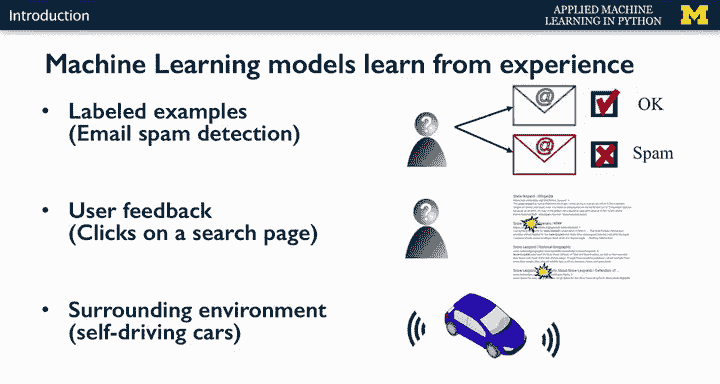
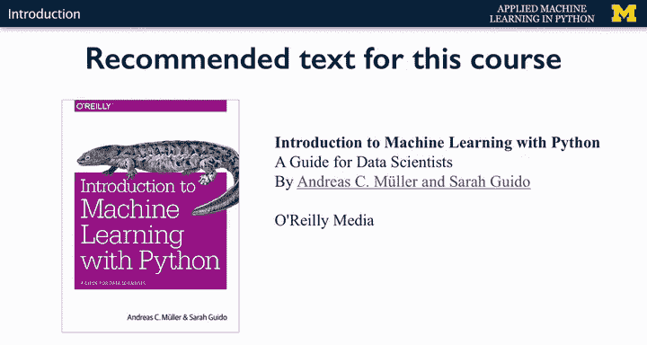

# 密歇根大学《Python用于数据科学实践（1-3课／共5课）｜Applied Data Science with Python 》deepseek翻译 - P55：0_导论.zh_en - GPT中英字幕课程资源 - BV1U64y1L7VJ

Hi and welcome to the applied machine learning component of the University of Michigan's online course in Applied data science。

 My name is Kevin Collins Thompson， and I'm an associate professor of information and computer science at the University of Michigan。

 I'll be your instructor for this part of the course。😊。

I have about 20 years of research and development experience in applying machine learning to a wide variety of problems in both academia and industry。

 everything from language tutoring software to commercial search engines。

This is an incredibly exciting time to be involved in machine learning。

 and I hope this part of the course inspires you to look more deeply into this fascinating world。

This week， you'll learn what machine learning is and why it's important to data science。

How machine learning is applied to key problems in our information economy and how to set up your first machine learning application in Python。

Okay， so what defines the field of machine learning。Well， in a lot of cases。

 when a computing problem needs to be solved， for example。

 storing and retrieving data from a database。The way we often address it is to write a program that manually specifies a series of programming steps that need to be run to solve that particular problem。

This works great for the vast number of computer science problems that are out there。However。

 not all problems lend themselves to being solved effectively by writing a handcrafted program or a set of rules。

For example， how would you write down a set of rules in a programming language？

For accurately converting human speech to text a process known as speech recognition。

Which is now available on millions of smartphones or used in customer support systems all over the world。

I mean， given how subtle and complex human speech is with a huge variety of different pronunciations。

 vocabulary， accents， and so forth。Writing a set of program rules by hand。That could recognize。

Portions of an audio signal and decide which words were in the signal and so forth would be a gargantuan task。

And even then， it would still likely be inflexible and not very robust at recognizing different types of speech。

Moreover， if we needed to customize the system so it could recognize new words or other features that we hadn't encoded in our existing rules。

We'd have to write a whole new set of rules， which would be a prohibitively difficult task。

Machine learning， on the other hand， gives us the technology that allows us to automatically learn these complex rules efficiently。

From labeled examples called training data in a way that is much more accurate and flexible than attempting to program all the rules by hand。

Moreover， since it's unlikely any future examples we see would match exactly what was in the training set。

 a primary goal of effective machine learning algorithms is to be able to generalize。

 to correctly predict or recognize new objects that weren't seen during training。

So the basic problem of machine learning is to explore how computers can program themselves to perform a task and to improve their performance automatically as they gain more experience。

Now this experience can take the form of data in a lot of different formats or situations such as label examples that are used to train the system's initial structure like an email span detection。

A system could get feedback from the user， for example。

 a search engine gets clicks on the search page， or a system could get data from the surrounding environment that's gathered over time。

 for example， self driving cars that can detect nearby objects and events and learn to move more reliably。

To accomplish this goal effectively and efficiently。

 machine learning draws heavily on statistics and computer science。

These statistical methods give machine learning algorithms ways to infer conclusions from data and to learn from data。

And also， to estimate how reliable those conclusions are。Computer science methods， on the other hand。

Give machine learning algorithms the computing power to solve problems。

 including effective large scale computational architectures and algorithms for capturing。

 manipulating， indexing， combining and performing predictions with data。

Think about how quickly a commercial search engine can match your query against billions of web pages and almost instantly return a set of useful results。

That's an ideal illustration of the power of combining statistical methods with computer science。

There are also growing connections between machine learning and other fields that are really fascinating。

 For example， the problem of how someone or an individual or a system can optimize their performance in a given environment is also shared somewhat with research that people have done in biology on how organisms forge for food。

It also connects to research and economics on how optimal pricing and market structures can be computed。

And even psychology， especially psychology， where we have models and factors of human learning and are using those to influence。

For the design and machine learning techniques。So this evolving field of machine learning really brings together insights across multiple scientific fields。

And that's one of the things that I find so fascinating about it。

Machine learning algorithms are now involved in more and more aspects of everyday life。

 from what you read and watch to how you shop， to who you meet and how you travel。

Here are just a few examples。 for example， fraud detection。

Every time you buy something using a credit card， machine learning algorithms immediately check your purchase。

To verify whether or not this might be a fraudulent transaction to do this。

 these algorithms look at features of the current transaction that you've just made。

 such as the time， location and amount。And they make a prediction of whether it's fraudulent or not。

 based on whether that purchase is consistent with the features of your previous purchases。

The system also records any user feedback on whether the transaction was， in fact fraudulent。

And uses that feedback to make better predictions in the future。

Search and recommendation systems are also a huge area of application for machine learning。

 and the fact， those machine learning algorithms are at the heart of how commercial search engines work。

Starting with the moment， you begin typing in a query。

So one algorithm might monitor your keystrokes to predict the best queries to autocomplete while you're typing。

And then once you've finished your query， some other machine learning algorithms will be applied to determine the selection and ranking of the web pages that you see for that query。

Still， other machine learning algorithms will determine which ads， if any， you see on the page。

 which related queries the system suggest for you and so forth。In addition。

Search engines typically use data about how you interact with the search site。

 such as which pages you click。How long you read the pages to improve their future effectiveness？

In a similar way， movie recommendation sites use machine learning algorithms to model what you liked in your past reviews based on your past reviews and your interaction patterns with the site and how your preferences relate to those of other users。

 and it uses this data to learn a model for your personal taste。

To hopefully give you better choices that keep you more engaged with the site or that leads you to make more movie purchases over time。

And then finally， a third example area that's。Really seen a significant improvement in the past several years in terms of。

Recognition， quality。Speech and image recognition。 So although researchers have been working on speech and image recognition for decades。

Recently， the development of increased computing power， better algorithms。

 including the use of deep learning。And vastly increased volumes of data have all LED to a significant jump in accuracy and flexibility of recognition algorithms in the last five years or so。

Now， recognition technology is reliable enough and fast enough that it's used as an essential feature of smartphones and home devices that can act on spoken commands or questions。

Computer vision and image recognition can now give increasingly accurate identification of objects and actions in images or video。

Even for a while now， over 85% of handwritten mail is sorted automatically with very high accuracy by the United States Postal Service。

Theyre very exciting advances in the medical domain where image recognition algorithms are being developed to classify cancer cells as malignant orbinnign。

Estimate the best course of personalized treatment or to find hard to detect tumors in medical images。

And of course， self driving or autonomous vehicles make extensive use of real time image recognition and video processing。

As well as other technologies such as reinforcement learning。Now。

 these examples only scratch the surface of how machine learning is being applied in today's society。

And will encounter and work with some other examples during the progression of this course。

The name of this course module is actually applied machine learning。

 So what does the applied part mean？While when we designed this data science series。

 we felt there was a need for a course that focused more on how to properly apply and interpret the results from machine learning algorithms at a high level。

 and less on the technical details of exactly how these algorithms work internally。

There are a number of excellent existing core machine learning courses that already provide that deeper level of technical detail。

And that detailed knowledge is always necessary to work with machine learning algorithms and to use them for specific applications。

In fact， is's a very exciting trend happening where ready to use machine learning algorithms for speech recognition。

 language translation， text classifications and many other tasks。

Are now being offered as web based services on cloud computing platforms。

Greatly increasing the audience of developers that are able to use them。

And making it easier than ever to put together solutions that apply machine learning at a high level。

The following book， introduction to machine learning with Python。

Is not required to complete the course， but we recommend it as an additional resource that may be useful to you as you progress and for later reference。

 Like this course， the book focuses on the practical details of building your own solutions to machine learning tasks using psyit learnn in Python。

It provides further background on machine learning concepts。

More depth on specific topics covered in this course， as well as a number of additional topics。

And some additional coding examples。