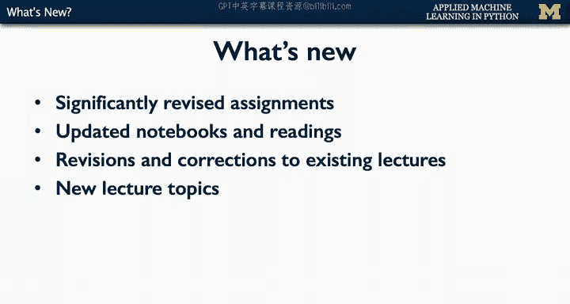

# 密歇根大学《Python用于数据科学实践（1-3课／共5课）｜Applied Data Science with Python 》deepseek翻译 - P56：1_更新说明.zh_en - GPT中英字幕课程资源 - BV1U64y1L7VJ

Since we first released the S data science with Python specialization。

 we've been thrilled to see how it's helped hundreds of thousands of learners around the world pursue their interest in data science。

Along the way， we got a lot of helpful feedback and we've done our best to incorporate that into this new iteration of the machine learning course as well。

We've put in a lot of work to bring you a lot of new things in this updated version。

 We've significantly revised the assignment content and also updated the quizzes。

 We've revised the course readings and updated all the notebooks to work with recent versions of Psyit Learn and other libraries。

 which have evolved a lot in the past few years as well。Last but not least。

 we made a pass over the existing lectures to clarify certain points， add more examples。

 and make some revisions and corrections here and there。

We hope you find this new iteration of the course useful。

 let us know how it goes and good luck on the next steps of your data science journey。

