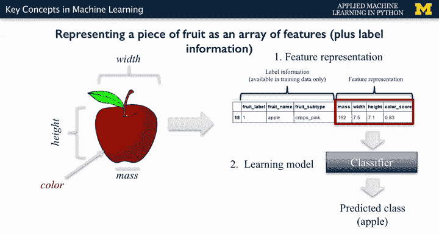

# 密歇根大学《Python用于数据科学实践（1-3课／共5课）｜Applied Data Science with Python 》deepseek翻译 - P57：2_机器学习核心概念.zh_en - GPT中英字幕课程资源 - BV1U64y1L7VJ

Machine learning tasks， including the ones I've described as examples， credit card fraud detection。

Movie recommendations， speech recognition， and so on。Can be categorized into two main types。

The first type is known as supervised learning。And here。

 our goal is to predict some output variable that's associated with each input item。

So if the output is a category， a finite out number of possibilities。

 such as a fraudulent or not fraudulent prediction for a credit card transaction。

 or maybe it's the English word associated with an audio signal for speech recognition。

 we call this a classification problem within supervised learning。

 and the function that we learn is called a classifier。

If the output variable we want to predict is not a category， but a real valued number。

 like the amount of time in seconds， it would it would likely take a car to accelerate from 0 to 100 kilometersm per hour。

We call that a regression problem， and we're learning something called a regression function。

More formally。We typically denote a table of data items using capital letter X。

And there's one data item per row， and the labels that we associate with each item are stored in a variable Y。

 and our goal is to learn some function that maps a data item in X to a label in Y。And to do this。

 the systems given a set of labeled training examples。

Of inputs x x subi and outputs y subi and this set of label training examples。

Is what's used to identify the function that best maps the input to the desired output。For example。

 if the supervised learning problem is image recognition。

This involves building a classifier where the input X sub I could be a set of pixels that describe a single image。

And the desired label， why sub I might be the label of the object in the image。Now。

 there are many algorithms。That scientists have developed。

 that can do supervised learning that could be used to estimate this function F from the training data。

 and we'll cover a number of those algorithms in the course。

Supervised learning needs to have this training set with label objects。

In order to make its predictions。But if the whole point is to predict these labels。

 where does this initial set of label items come from。

The answer is that the training labels are typically provided by human judges。Now。

 obtaining labels for some problems can be easy or difficult。

 depending on how much labeled data is needed。The level of human expertise or expert knowledge that is needed to provide an accurate label。

And the complexity of the labeling task， among other factors。Now。

 the use of crowdsourcing platforms like Amazon's Mechanical Turk or Cdflower or others。

Have been a significant source of explicitly provided labels from human workers where。

Customers with machine learning tasks that need labeling can connect with groups of workers that can provide labels using human intelligence。

So those are more explicitly obtained labels。 we can also obtain implicit labels。 so for example。

 if a search engine detects a user clicking on a result link and then sees no more activity for another minute or two before the user comes back to the search engine。

The system might use that activity。As a kind of implicit label for that page， in other words。

 if the user took some time to visit the page， it was more likely that that page was relevant to their query。

The second major class of machine learning algorithms is called unsupervised learning。In many cases。

 we only have input data and we don't have any labels to go with the data。And in those cases。

 the problems we can solve involve taking the input data and trying to find some kind of useful structure in it。

Now， what do I mean by structure？While， typically， this means finding interesting clusters or groups within the data。

 So once we can discover this structure in the form of clusters， groups or other interesting subsets。

The structure can be used for tasks， like producing a useful summary of the input data。

Maybe visualizing the structure， for example。If you run an e-merce site that sells products to customers。

 let's suppose you've got many thousands or even millions of customers。

You might want to know if you can categorize or group the customers into different into different types。

 For example， there might be power users who use more advanced features of the site。

 There might be quick browser typed users who only look for a cheap discount and stay for very little time on the site itself。

There could be sort of careful researcher type users who spend a lot of time comparing different items。

And if you could take your data of how people interact with the site and use unsupervised learning to discover these different groups。

You can imagine then maybe tailing your site's offerings to each group so they improve the chance that a user from that group would maybe purchase a product or have a better experience using your site。

Now， you don't know how many groups there are out there ahead of time or even what they look like。

And you， you don't have any labeled examples。 And so this is。

A classic example of an unsupervised learning problem。

Another type of unsupervised learning problem that is very important is something like flying abnormal access to a web server。

 so for security reasons。You might want to be notified if a website user is making requests that could be a cyber attack。

Or it's somehow very different from typical user behavior on your site。

Since there can be many different types of hacking or intrusion attempts to break into the server or exploit it in some way。

We don't have reliable training labels that we could use to train a classifier using supervised learning。

Instead， we need an unsupervised approach that allows us to perform something called outlier detection。

That doesn't assume future attacks will be of the same form as previous attacks。

But that does assume some features of attacks on the site will look different somehow than average user behavior。

Okay， so suppose you have a situation where you think machine learning might be applicable either using a supervised or an unsupervised approach。

How would you apply machine learning to solve your problem？Well， there are three basic steps。

 and I'm going to use classification as my typical machine learning scenario。

 so I'll often just use the term classifiers as an example of a machine learning task。

But what I'm about to describe applies to other forms of supervised learning。

 like regression that we'll cover later or unsupervised learning， like clustering as well。

So the first step in solving a problem with machine learning is you have to figure out how to represent the learning problem in terms of something the computer can understand。

You need to be able to take your data or even formulate a description of your object that you're interested in recognizing。

 for example。In a way that you can use this input to an algorithm。

And you also need to decide what type of learning algorithm to apply to this data。For example。

 there are many different ways you could represent an image。 Tpically。

 it's represented as an array of colored pixels。There could also be metadata associated with the image you can think about how you might represent a credit card transaction if you want to do fraud detection。

 so that might be represented by the time， the place and the amount of a transaction。

So you need some way， some representation of the data you have and the choice of what kind of algorithm you want to apply to the data。

The second thing you need to do is decide on an evaluation method that provides some type of quality or accuracy score。

For the predictions or the output that is coming out of the machine learning algorithm， typically。

 let's say， a classifier。So if you have an evaluation method。

 this allows you to assess and compare the effectiveness of different classifiers。

 so you can tell what classifiers are doing well， which are the good ones and which are the bad ones for your particular problem。

For example， a good classifier will have high accuracy。

 That is it will make a prediction that matches the correct true label a high percentage of the time。

The third thing you need to do in applying machine learning to solve a problem is。

Once we've decided on how to represent the input data。

 the type of classifier and an evaluation method。We need to then search for the optimal classifier that gives the best evaluation outcome for that problem and willll go into all three of these areas。

In this course， and then we'll use Python in this course as well to solve some specific examples and we're about to see a concrete example of how we use machine learning at libraries in Python to solve a classification problem。

So let's go through these three steps in a little more detail now。

Let's first talk about what it means to convert the problem into a representation that a computer can deal with。

This involves two things you need to convert each object， each input object。

Which we often call a sample。Into a set of features that describe the object。Second。

 we need to pick a learning model， Ty the type of classifier that you want the system to learn。

So let's look more closely at what we mean by a feature representation for an object。

Each data point in your data set represents something， some object or situation。Or event。

 some entity that's being represented by a list of properties。For example。

 an email might be represented as a list of words that are in the message。

pictureture might be represented by a matrix of color values for the pixels that make up an image。

A piece of fruit like this apple。Could be represented by its color， its shape。

 its texture and so forth。So these attribute values for an object are called features。

You can think of the input data containing this feature representation。As the input to your function。

You can visualize it easily as a table。Where each row of the table represents a single data instance。

And where the columns of the table represent the features of the object。

There could be many different choices for how to represent an object using features。So for example。

 I showed you a piece of fruit， let's pick up a lemon。ALe has a shape， a width to height。

 it also has mass taste。And I guess if you buy lemons in the store these days。

 they also come with a handy barcode。Identifies the type of。Fruit that it is。

 So there are lots of different types of information we could gather about a thing。

And in a form that a computer could understand。 So this problem of trying to figure out。

How to represent an object for a machine learning algorithm is actually can not。 it's a challenge。

 and it's known as feature engineering or feature extraction。

 and we'll cover that in week  four of the course。The other key part of representing a machine learning problem is choosing the type of classifier that's appropriate for the problem and will cover many different types of classifiers in this course。

They all have different trade offs in terms of their accuracy， their interpretability。

 and their speed， and so forth。And we'll cover those in the second week of this course。

So often the process of addressing a machine learning task is a cycle。

 it involves an iterative process as I show here。Where we make an initial guess about what some good features are for the problem。

And the classifier that might be appropriate， we then train the system using our training data。

Produce an evaluation， see how well the classifier works。

 And then based on what worked and what didn't work。

 which examples get classified correctly or incorrectly。

 we can do a failure analysis to see where the system is still making mistakes。

And then with the results of that failure analysis。

We typically will always refine the set of features。

 we may discover that an important feature is missing that would help fix some of the mistakes。

 for example。

So in my experience， this iterative process is very common， in fact。

 it's very typical of solving problems with machine learning。

 typically you might want to go through this cycle several times to continually refine the features and assess their effect on accuracy。

Or look at try different types of classifiers based on the evaluation method that you've chosen。

In order to determine if you have the right approach for your problem。

