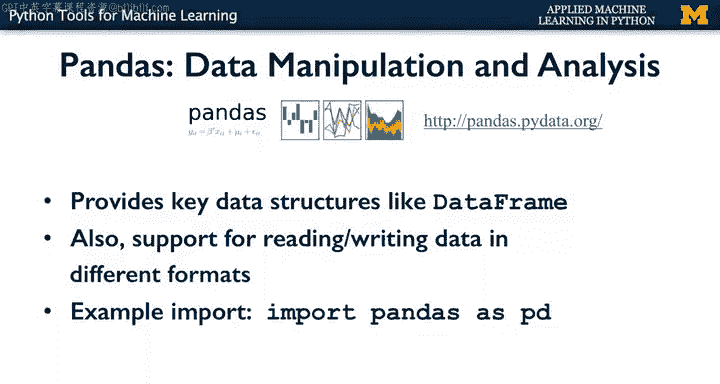

# 密歇根大学《Python用于数据科学实践（1-3课／共5课）｜Applied Data Science with Python 》deepseek翻译 - P58：3_Python机器学习工具.zh_en - GPT中英字幕课程资源 - BV1U64y1L7VJ

Okay， now that we've covered a little bit of background on what machine learning is and some of the major types of machine learning problems。

 There's nothing like getting started with our own machine learning application in Python。

And we're going to get started on that right now， so to do that。

We're going to make use of several important Python libraries that will support our work。

These includesit Learn。Sai pie， num pie， pandas， and mattepllib。

We recommend installing all of these using the Anaconda Python distribution。

 since it comes with all the libraries we'll need in this part of the course。

If you have some other existing Python installation。

 you can install the libraries we'll be using from the command line using Pip。

The most important library we'll be using for machine learning is called Psyit Learn。

syit Learnn is the most widely used Python library for machine learning。

 and it will be the basis for this course。It's an open source project that's under continual development and improvement and supports a very wide array of important machine learning algorithms。

It has excellent online documentation and a very active user community。

Because of this broad adoption， PsyCitt Learn has many sample applications。

 tutorials and code examples that are available online。

So one valuable reference that we recommend you use while you take this course is the Psyit Learn Use guide。

And the API documentation， which contains further details on the different algorithms that are in the library。

 along with details on the various options that these algorithms support。

Pyit learnn makes use of two other Python scientific computing libraries calledsi Pi and Numpy。

Si PiI is a Python library that supports data manipulation and analysis methods that are commonly used in scientific computing。

So this includes support for statistical distributions， optimization of functions， linear algebra。

 and a variety of specialized mathematical functions。In some parts of this course。

 we'll make use of s pieibility to provide what are called sparse matrices。

 which are our way to store large tables that contain mostly zeros。 So more on that later。

Numpy is a Python library for scientific computing that contains support for some fundamental data structures used by Psyit learn。

 such as multidisional arrays。Typically， data that's input to psychic learn will be in the form of a nuy array。

Paands is a Python library for data manipulation and analysis。

And if you took course  one in this series， you've already had experience with what pandas can do。

The key data structure pandas supports that we'll be using is called a data frame。

 which is basically like a spreadsheet table with rows and named columns。

So unlike the arrays supported by Ny， the columns in a data frame can be of all different types。

 You can have one column holding string values， another column holding a date。

 another column holding a floating point number and so on。

Pands also has great support for reading and writing data in a variety of formats。

 everything from comma separated CSV files to SQL， the structured query language used by databases and more。

Matpllootlibb is a widely used Python 2D plotting library。

That produces high quality figures in a variety of formats and interactive environments across platforms。

Matplotlibb can be used in Python scripts， the Python and iPython Shell， web application servers。

 and a variety of different graphical user interface toolkits。

If you've taken course two in this data science series。

 you'll already have some experience with using Maplotlibb。

Here well primarily be using matpllib dot pi plot for data analysis， since it can create histograms。

 bar charts，arrow charts， scatter plots and so forth with just a few lines of code。

Here are the versions of the main libraries used in this course。

 Please make sure the versions of psyit Learn and other libraries you're using are the same or greater than what's listed here。

If you're not sure which versions you have， here's some example code that shows you how you can check which versions of Psyit learned Numpeyy and pandas you have。

You can use similar code to check the versions of other libraries。

