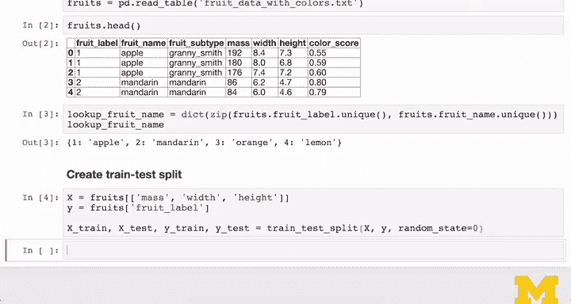

# 密歇根大学《Python用于数据科学实践（1-3课／共5课）｜Applied Data Science with Python 》deepseek翻译 - P59：4_机器学习问题实例.zh_en - GPT中英字幕课程资源 - BV1U64y1L7VJ

For our first machine learning exploration， we're going to build an extremely simple form of object recognition system。

Now， although the example we'll use is very simple。

 It does reflect many of the same key machine learning concepts that go into building real world commercial systems。

 The data set we're going to use is a small， very simple example data set。

Derived from one originally created by Doctor Ian Murray at the University of Edinburgh for the task of training a classifier to distinguish between different types of fruit。

So to create the original data set， Dr。 Murray went to a nearby store， but a few dozen oranges。

 lemons and apples of varieties。And recorded their measurements in the table。 So he SAT down and he。

Look at the height and the width estimated their mass and so forth。

So we've reformatted his original data slightly and added one or two extra simulated features such as a color score。

For instructional purposes。This data set is called Fruit data with Col。 TXT。

 and it's included in the folder of materials that you downloaded for this course。Now。

 you might think that fruit prediction is a sort of silly and impractical scenario。

 And given the limited nature of this data set， it is a bit of a toy example， but actually。

 food companies do indeed now rely on machine learning systems that aren't all that different in concept from the ones we're about to build so they can do automated quality control。

And in fact， there do exist， for example， real systems used by fruit shipping companies that screen for roten oranges during processing。

Now， they're the features that they use。In building these systems are a little more sophisticated than the ones we look at here。

 So for example。呃。Quality control systems for， for orange。

 rotten orange detection use ultraviolet light that can detect interior decay。

 which is often less visible than just by looking on the surface anyway。

To solve machine learning problems， you can think of the input data as a table where each object。

 so in our case， a piece of fruit is represented by a row。And the attributes of the object。

The measurement， the color， the size， and so forth in our case， for a piece of fruit。

 the features of the fruit are represented by the values that you see across the columns。

In a supervised learning problem， the dataset set will also typically contain a special column with the label of the object if the data set does not have such a field already。

 sometimes you can derive it from information that's in one or more columns。

So to make sure you're ready to continue， make sure you've run the following code snippet that loads the proper libraries we're going to need to proceed and we'll show those here now。

So the first thing we're going to do is to load the F data set file using the very handy read table command in pandas。

Now this will read the data set from disk and store it into a data frame variable that we'll call fruits here。

Okay， let's look at this data set and dump out the first few rows of the data frame。

So here we can see that each row of the data set represents one piece of fruit as represented by several features that are in the table's columns。

So in order， the columns that we see are fruit label。 So this is the training label that we'll use。

 it's a number that corresponds to the general type of fruit。 So， for example， one is an apple。

2 is a manin orange，3 is a regular orange， and so forth。

So this label was supplied by the human creator of the dataset set。

The fruit name and fruit subtype columns contain text descriptions of the general and specific fruit categories。

And the fruit name corresponds。 It's a text form of the。

Of the corresponding fruit label in the same row。Now we won't be using these name columns as features。

 I've just included them here to make the data set a bit more readable for our purposes。After that。

 the features in this representation include measurements for each fruit that capture its mass in grams and its width and height in centimeters。

And finally， there's a feature。Starttored in a column called Col score。

That's meant to be a single number that captures a rough idea of the color of the fruit。

 So in a real system， this would actually be something more sophisticated。

Like a histogram of the distribution of colors or maybe the pixels from an actual image or video of the fruit。

But for our purposes， we're going to just summarize the color along。A spectrum scale。

That'll be a handy summary that we can use that will just be easy to visualize。

So scores close to one mean the fruit is red， scores around 0。7。Indicate yellow and so forth。

So looking at this data frame， we can see that it contains 59 rows corresponding to 59 different pieces of fruit that have been measured and entered into the table。

So our goal here is to build a classifier from this data。

That can predict the correct type of fruit for any given。

Any given observation of features such as mass， height， width and color score。 So， for example。

Can we tell based on the color score and the dimensions of the difference between an orange and a lemon and have the classifier predict the type of piece of fruit correctly just from its observed measurements？

Now， assuming for the moment that we already had a classifier ready to go。

How would we know if its predictions were likely to be accurate？Well。

 we could choose a fruit sample called a test sample for which we already had a label so we could feed the features of that piece of fruit into the classifier。

And then compare the label that the classifier predicts。With the actual true label of the fruit type。

Here's a very important point though， if we use one of our labeled fruit examples in the data that we use to train the classifier。

 we can't also use that same fruit sample later as a test sample to also evaluate the classifier。

Why is that？A key ability that our classifier needs to have。

Is that it needs to work well on any input sample， any new pieces of fruit that we might see in the future。

Not just on the ones that we have in our training set。

Because our classifier could simply memorize every sample in the training set。

It'd be pretty trivial to just give back the correct label for any one of the same samples later。

 right So measuring the classifier performance later。

Using the same samples that we've used to train it in the first place doesn't tell us anything about how well the classifier is likely to work for fruit that we haven't seen before。

 It will only tell us what we already know about what's in the training set。

So since our only source of label data is the data set we've been given。

To estimate how well the classifier will do on future samples。

What we'll do is split the original data set into two parts。

We'll have an array of labeled samples called the training set that will be used to train the classifier。

And then we'll hold out the remaining labeled samples and put them into a second separate array called the test set that will be used to then evaluate the trained classifier。

So to create training and test sets from an input data set。

sciit learnn provides a handy function that will do this split for us， called not surprisingly。

Train test split。 And here's an example of how well use it。

This function randomly shuffles the data set and splits off a certain percentage of the input samples for use as a training set and then puts the remaining samples into a different variable for use as a test set。

So in this example， we're using a 75，25% split of training versus test data。

 And that's a pretty standard。Relative split that's used。 It's a good rule of thumb to use in。

Deciding what proportion of training versus test might be， be helpful。As a reminder。

 when we're using PsyitLn， we'll denote the data that we have using different flavors of the variable x。

 capital X。Which is typically a two dimensional array or data frame。

And the notation will use for the labels will be typically based on lowercase Y。

 which is usually a one dimensional array or a scalar。Now。

 note the use of the random state parameter in the train test split function。

 So this random state parameter provides a seed value to the function's internal random number generator。

If we choose different values for that seed value， that will result in different randomized splits for training and test。

So if we want to get the same training and test split each time。

 we just make sure to pass in the same value of the random state parameter。

And so here we're going to set that parameter to0 for all our examples。

The training test split function will put the training set here into X train。

 the text test set into X test。The training labels into Y train and the test labels into Y tests。

 So this is a 75，25 partitioning of the original data into these two parts。

And this is the variable name and convention we'll use for pretty much all of our coding。

We'll put the rows of the data without the label， the training instances into this capital X variable。

 and the list of corresponding labels for those rows into a variable called lowercase Y。

When using the training set and a test set。We'll then use an X train that holds the training inss to train the classifier。

An X test to evaluate the classifier after it's been trained。

And we're going to show a short s of code here now that illustrates how to do that。

So here we can see。The results of the function applying this train test split function。

You can see that it has indeed split our fruit data set into training and test sets with the correct proportion of samples。

Now that we have a training and a test set。We're ready for the next step。

And we'll look now into more depth。At the data itself。

 before we proceed with giving it to a machine learning algorithm。

