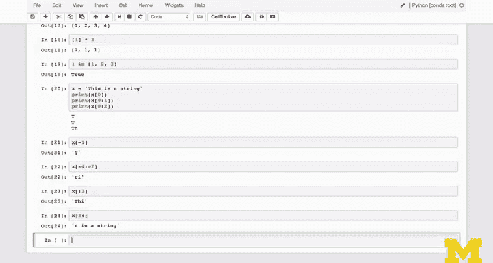
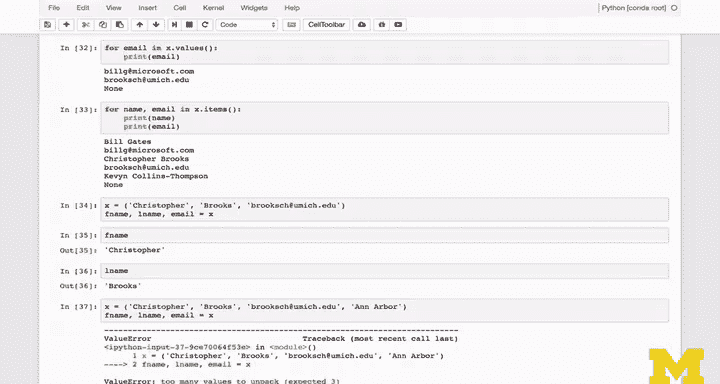

# 密歇根大学《Python用于数据科学实践（1-3课／共5课）｜Applied Data Science with Python 》deepseek翻译 - P5：4_Python类型与序列.zh_en - GPT中英字幕课程资源 - BV1U64y1L7VJ

The absence of static typing in Python doesn't mean that there aren't types。

 The Python language has a built in function called type。

 which will show you what type a given reference is。 Some of the common types include strings。

 the nun type as we've discussed， integers and floating point variables。 As we've seen。

 you can have references to functions as well， as a function type also exists。

Tyd objects have properties associated with them， and these properties can be data or functions。

 A lot of pythons built around different kinds of sequences or collection types。

 And there's three native kinds of collections that we're going to talk about。 Tples。

 lists and dictionaries。A tuple is a sequence of variables， which itself is immutable。

 That means that a tuple has items in an ordering， but that it cannot be changed once created。

 We write tus using parentheses， and we can mix types for the contents of the tuple。 Here's a tuple。

 which has four items。 Two are numbers and two are strings。

Note here that I've used single quotes for a string， whereas previously。

 I've used double quotes in Python， either single or double quotes can be used to denote string values。

Lists are very similar， but they can be mutable so you can change their length。

 number of elements and the element values。A list is declared using the square brackets。

 There are a couple of different ways to change the contents of a list。

 One is through the append function， which allows you to append new items to the end of the list。

Both lists and tus are iterable types， so you can write loops to go through every value they hold。

The norm， if you want to look at each item in a list， is to use a for statement。

 This is similar to the for each loop in languages like Java and C sharpp。

 but note that there's no typing required。Lists and tus can also be accessed as a array might in other languages by using the square bracket operator。

 which is called the indexing operator。The first item of the list starts at position 0。

 And to get the length of the list， we use the built in L function。

There are some other common functions that you might expect， like men and max。

 which will find the minimum or maximum values in a given list or tuple。

Python lists and tus also have some basic mathematical operations that can be allowed on them。

The plus sign concatenates lists， for instance。And the asterisks repeats the values of a list。

A very common operator is the in operator。This looks at set membership and returns a boolean value of true or false。

 depending on whether one item is in a given list。We're going to dive more into operators in special kinds of sequences in a future week when we look at a technique called broadcasting。

Perhaps the most interesting operations you can do with lists are called slicing。

 While the square bracket array syntax for accessing an element might look fairly similar to that。

 which you've seen in other languages in Python， the indexing operator allows you to submit multiple values。

😊，The first parameter is the starting location。 If this is the only element。

 then one item is returned from the list。 The second parameter is the end of the slice。

 and it's an exclusive end。 So if you've sliced with the first parameter being 0。

 the next parameter being  one， then you only get back one item。

This is much easier to explain with an example。 One handy aspect of Python is that all strings are actually just lists of characters。

 So slicing works wonderfully on them。 Here's an example。 When we run x sub 0 or x sub 0 colon 1。

 we get just the first character of the string。😊，But when we run x sub 0 colon 2。

 we get the first two characters of the string。Our indexing values can also be negative。

 which is really cool， and this means to index from the back of the string。

So x sub -1 gets as the last letter of the string and x sub-4。

 comma-2 reads in all of the characters from the fourth last to the second last positions。Finally。

 if we want to reference the start or end of the string implicitly。

 we can by just leaving the parameter empty。 So X sub colon 3 starts at the first character and goes until position 3。

 and X sub 3 colon starts at the fourth character because indexing always begins with 0 and goes to the end of the list。

😊。

Slicing is core to the Python language and is a big part of the scientific computing with Python as well。

 especially if you start manipulating matrices。 We're going to talk more about slicing in the next module。

 But here's a question to get you started。Now， I'm taking a bit of an aside here to talk about manipulating strings。

 Slicing isn't the only way to manipulate strings。 And a common activity is to split strings based on sub strings。

 that is to go through the string， looking for patterns and segmenting it as appropriate。

This is called regular expression evaluation， we're going to cover this in detail in the section of the specialization which deals with text mining since it's a very common operation。

But Python has some basic tools for text analysis， and I'm going to show you them here。As we saw。

 strings are just lists of characters。 So operations you can do on a list， you can do on a string。

This means that you can concatenate two strings together using the plus operator。

 and multiplying strings will repeat a given string。 You can also search for strings。

 using the in operator。The string type has an associated function called split。

 This function breaks a string up into substrs based on simple pattern。Here， for instance。

 I'll just split my full name based on the presence of a space character。

The result is a list of four elements。 We can choose the first element with the indexing operator to be the first name and the last element to be my last name。

We'll touch on strings just a bit more。 But before we do， I want to talk about dictionaries。

 Dictionaries are similar to lists and tus in that they hold a collection of items。

 but they're labeled collections， which do not have an ordering。 This means that for each value。

 you insert into the dictionary， you must also give a key to get that value out。In other languages。

 this structure is often called a map。 And in Python， we use curly braces to denote a dictionary。

Here's an example where we might link names to email addresses。

 You can see that we indicate each item of the dictionary when creating it using a pair of value separated by colons that you can retrieve a value for a given label using the indexing operator。

The types you use for indices or values in the dictionary can be anything。

 and this can be a mixture of types if you prefer。We can add new items to the dictionary using the same indexing operator we are used to。

 just on the left hand side of a statement。You can iterate over all of the items in a dictionary in a number of ways。

First， you can iterate over all of the keys and just pull the contents out as you see fit。

Or you can iterate over the values and just ignore the keys。Finally。

 you can iterate over both the values and the keys at once using the items function。

This last example is a little bit different， and it's an example of something called unpacking。

In Python， you can have a sequence， that's a list of a tu of values。

 and you can unpack those items into different variables through assignment in one statement。

Here's another example of that where we have a tuple that has my first name。

 last name and email address。I declare three variables and assign them to the tuple。Underneath。

 Python has unpacked the tuple and assigned each of these variables in order。

 We can see that if we had a fourth item to the tuple， Python isn't sure how to unpack that。

 So we have an error。

That's an overview of built in types with Python。In the next lecture。

 we're going to revisit strings briefly， then start working with some data files。

