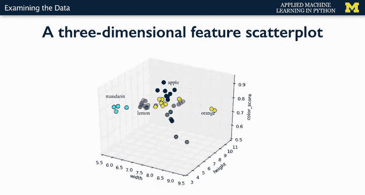

# 密歇根大学《Python用于数据科学实践（1-3课／共5课）｜Applied Data Science with Python 》deepseek翻译 - P60：5_数据探查方法.zh_en - GPT中英字幕课程资源 - BV1U64y1L7VJ

In general， if you're thinking about applying machine learning to a data set。

It's a really good first step to actually look at the data set first。

 maybe using some simple visualization methods。Or even simply scrolling through to look at the various values in the different rows before proceeding。

 and there are several reasons for doing this。First。

 it's helpful to simply get a sense for what's actually in the data set。

Because it may be that in inspecting the features of each object。

 you might get a better idea of what type of cleaning or preprocessing still needs to be done to the data and of the range of values or the distribution of values that is typical for each attribute or each feature。

This initial exploration can be especially valuable when youre dealing with complex objects like text that may be represented by many features that are extracted using a series of several pre processing steps。

For example， you might discover that the data set you got has a single column with a person's name that still needs to be split into two separate first and last name columns as know。

 for example， if you're using the name as one of the prediction features that might be important。

Second， you might notice missing or noisy data， or maybe some specific inconsistencies。

 such as the wrong data type being used for a column。

 incorrect or inconsistent units of measurement for a particular column， particular feature。

Or maybe you'll notice that there aren't enough examples of a particular labeled class。

You might notice， for example， that some measurements of a person's weight if you're。

 let's say you're doing a。AHe application with a patient record for each row。

If some might accidentally have the weight in grams instead of kilograms and so forth。

 that can make a。Obviously， a huge difference in in how how accurate your， your results are。

 So inspecting and visualizing the data will help you detect and understand these potential sources of noise or errors。

And finally， it might turn out that for your data set。

 your problem is actually solvable without machine learning， Now， this doesn't happen all that often。

 but if it does， you can save yourself considerable time by simply looking at what data exists in your data。

 so in one scenario。You know， your data set might actually contain a feature that。

Is clearly a strong indicator of the label that you want to predict。For example。

 if your goal was to predict whether a house's location was in New York City versus San Francisco based on attributes like its sales price。

 its elevation above sea level， it's how big its rooms are and so forth。

It could be that your data might also include， let's say， a URL to a photo of the house。

And that image might， you know， contain， you know， GPS coordinates to the house within its metadata or maybe the URL encodes。

Location in a slightly non obvious but human recognizable way that you can pick out and。

You solve your problem just by looking at the data， so as I said。

 this scenario isn't all that common， but it does happen。

 and so a brief check of your data set could save you a lot of unnecessary work。Okay。

 so we'll make sure we've got a training set from our original data set unit using train test split。

And we'll do all our initial visualization and feature analysis on this training set。

And we're only going to use the test set for actually evaluating the classifier once it's trained。

This complete separation of training and test sets is very important。

And we'll go into more depth later about some specific reasons why it's important in later class。

So now that we have a training set selected。Let's create some simple visualizations to look at how the features of the objects in the training set。

 in our case， different fruits relate to each other and to the labels。So with these visualizations。

 we get at least two major benefits。First， we can get an idea of the range of values that each feature takes on。

 and we can immediately see any unusual outliers that are very different from other points。

 And that might indicate noise or a missing feature or other problem with the data set。And second。

 we may be able to get a better idea of how likely it is that a machine learning algorithm could do well at predicting the different classes by seeing how well clustered and well separated the different types of objects are。

In feature space。 so feature space refers to the representation of an object using specific features that are in certain columns of the data that we have。

So， for example， if the features for objects with the same label， For example。

 all the lemons have similar feature values， we should see a well defined cluster appear in the visualization。

While if the features for objects that have different labels tend to be quite different。

 we should see these well separated into visibly。Different areas of the plot。

So having objects whose classes are well defined and well separated in feature space。

Is a good indication that suggests the classifier。Is likely to be able to predict the class label from the features with good accuracy。

Now， the visualization techniques that I'll be showing here work well when you have a relatively small number of features。

 let's say less than 20。Later， when we cover unsupervised learning。

 you'll learn how to create visualizations of data sets that use a very large number of feature dimensions。

 So hundreds or even thousands or millions to represent each object。But for now。

 the first visualization tool we'll use is called a feature pair plot。 And that's shown here。So。

 this plot。Shows all possible pairs of features and produces a scatter plot for each pair。

Showing how the features are correlated with each other or not。

Each point in the scatter plot represents a piece of fruit coloured。

 according to the class it belongs to and positioned using the pair of features assigned to that scatter plot。

Along the diagonal。Is a histogram showing the distribution of feature values for that feature。

So in this pair plot， the dimensions shown here in order are the height width。

 mass and color score of。Of the fruit examples in our training set。

So the upper left corner of the histogram here shows the distribution of the height feature for all samples in the training set。

And the scatter plot to its immediate right plots the width of each sample on the x axis and the height of the sample on the y axis。

Now just by looking at this pair plot， we can already see that some pairs of features like the height and color score in the top right corner here。

Are good for separating out different classes of fruit。

And this suggests that a classifier that was trained using those features could likely learn to classify the various fruit types reasonably well。

Here's the code that we'll use to create this plot。 And let's run this now on our training set。

Note that a pair plot like this does not show interactions between all features that might exist just between pairs of them。

So the plot itself may not show all the interesting relationships that do exist between the features。

But it does give you a rough idea of what of some of the interactions that might exist。

We can also look at feature spaces that use a subset of three features by creating a three dimensional plot。

And here is the code that we can use to do this。So in this example。

 we plot different fruits using three coordinates。 So here we'll show the width。

The height and the color score。Here again， each point represents a single piece of fruit and its colored。

 according to its fruit label value。So in this 3D plot。

 you can actually rotate the plot in along the various axes by holding down the mouse button and then dragging。

 And you can clearly see that the different fruit types are in pretty well defined clusters that are well also well separated in feature space。

So now that we've taken a look at the data， next we'll look at a simple prediction task for this data set in a bit more detail。

