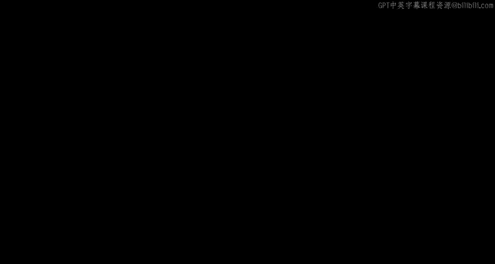
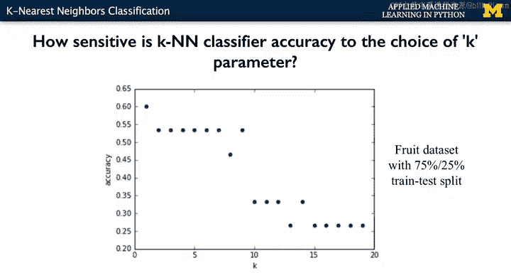

# 密歇根大学《Python用于数据科学实践（1-3课／共5课）｜Applied Data Science with Python 》deepseek翻译 - P61：6_K近邻分类算法.zh_en - GPT中英字幕课程资源 - BV1U64y1L7VJ

Now that we've gotten a sense for what's in our data set as a simple example to get started。

 we're going to use this data set to train a classifier that will automatically identify any future pieces of fruit that might come our way based on the features available to the classifier。

 such as the object's color， size and mass。To do this。

 we'll use a popular and easy to understand type of machine learning algorithm known as K nearest neighbors or KNN。

The K nearest neighbor's algorithm can be used for classification and regression。

Though here we'll focus for the time being on using it for classification。

KN N classifiers are an example of what's called instance based or memory based supervised learning。

What this means is that instance based learning methods work by memorizing the labeled examples they see in the training set。

And then they use those memorized examples to classify new objects later。

The K in K N N refers to the number of nearest neighbors the classifier will retrieve and use in order to make its prediction。

In particular， the canon algorithm has three steps that can be specified， first of all。

When given a new previously unseen instance of something to classify。

A canon classifier will look into its set of memorized training examples to find the K examples that have the closest features。

 and we'll talk about what closest means in a minute。Second。

 the classifier will look up the class labels for those K nearest neighbor examples。

And then once it's done that， it will combine the labels of those examples to make a prediction for the label of the new object。

 typically， for example， by using simple majority vote。

Let's look at a visual example of a Canon classifier。That's based on our fruit data set。

So what I've done here is taken our training set。And plotted each piece of fruit using two of its features。

 the width and the height。These two features together form what is called the feature space of the classifier。

And I've shown each data points label using the colors shown in the legend。 So as you can see。

 there are four different colors here that correspond to the four types of fruit that are in our data set。

These broad areas of color。Show how any point given width and height could be classified。

 according to a one nearest neighbor rule。 So in other words， I've set K equal to one here。 So。

 for example， a data point over here that had a height of 6 cm and a width of 9 cm would be classified as an apple because it falls within。

This red area here that the can N classifier has decided map to。

Objects that are apples based on the dimensions， or for example。

 if I saw if the classifier saw a piece of fruit that had a height of four centimeters and a width of seven centimeters。

 it would be classified as a mandarin orange because it falls within this decision area that's assigned to Mandarin oranges。

So what does it mean to have a one nearest neighbor rule， Where did it come up with these different。

Class assignments in the first place。Well， let's take a look at the Apple example over here。

The object that has a height of 6 cm and a width of 9 cm， we。If you give the classifier that point。

 what it will do is search within all the different training examples that it's seen。

 So it will look at all these points and see which one is closest。 So we're， we're looking at the。

The nearest single neighbor。 So we're looking at K equals1。

 We're trying to find the one point that's closest to our what's called the query point。

 This is the point we want to classify。So in this case。

 we can see probably that this point over here is the nearest neighbor。

Of the query point in feature space。Similarly， if we look at the Mandarin example over here。

The closest training。Set object to the query point is one of these。

 probably maybe this point right here。Okay， so that's the nearest neighbor of that query point。

So for any query point in the feature space。Let's say we're over here。In the the lemon zone。

 the nearest neighbor to this query point would be this training set。Point right here。

And because the training set points are labeled， we have the labels for those。

In the one nearest neighbor case， the classifier will simply assign to the query point。

 the class of the nearest neighbor object， so。Because the nearest neighbor here。Is an apple。

The query point here will get classified as an apple and if we look at the Mandarin orange point over here。

 the nearest data point is a Mandarin orange， so it will get classified in that region and if we do that。

For every possible query point， we get this pattern of。Class regions。

The the zones where we transition from one class to another。

 this line right here is called the decision boundary because。

Qury points that are on one side of the line get mapped to one class and points that are on the other side of the line get mapped to a different class。

So I want to note that in this example， we've been finding nearest neighbors using an ordinary Euclidean distance function that gives both features equal weight。

We could instead use what's called a weighted Euclidean distance function that gives different features different weights in the distance calculation。

 which might improve the accuracy in some applications。

Using a way to distance function can change the behavior of the classifier significantly。

 And here's an example of what I mean。So on the left， we have our standard setup。

 the Euclidean distance with equal feature weights for both the height and the width features。

On the right， I've changed the distance function to give the width feature。

 the Y axis measurement 10 times。The weight。Of the height feature。

So I haven't changed the training data。 You can see all the training points are still in the same positions。

 What we've changed is the distance definition between the points。

A small change in the width feature。Now has a much larger effect on the classification decision。

Than it did before。Because of that 10 times multiplier factor when the distance is computed。

And you can see that on the right， this results in decision boundaries and regions that are now quite skewed。

And sort of compressed in the wide direction， compared to the original。

The original clear distance with equal feature weight。

Whether or not this is the effect you want will depend on your specific application。

Some of the facts I've mentioned about canan using ordinary Euclidean distance may also change if you change to a weighted Euclidean distance measure。

 for example， using a weighted distance measure。The decision boundaries between classes can change significantly。

 They may no longer lie。Along equidistant lines perpendicular to the line joining training points of different classes。

 So I'll show you what I mean。In the original Euclidean distance with equal weights on the features。

When we had decision boundaries。Between will。Points of different classes。

We could draw a line through these two points。And then the decision boundary would be equidistant。

 perpendicular。To the line joining these two points， you can see that happens here。And here。

And these examples。But once we switch to a weighted Euclidean distance。

 like you can see that the decision boundary here。Is no longer。

No longer perpendicular to the line bisecting。These two points of different classes it's now sort of skewed。

So this is one example of how。Certain facts might change with weighted Euclidean distance。

On a related note。KNN can be sensitive to features that have values on very different scales。

If that's the case with your data， you should consider normalizing the training data before fitting the classifier to ensure that all features are on the same scale。

We'll cover how to do that to normalize your data in week two as part of the module on regression。

So because this is a K nearest neighbor classifier and we're looking at the case where k equals 1。

We can see that the class， the boundaries here， the decision boundaries。

Let let's take an example over here。 We have a point over here。 That's an orange。

 another point that's a lemon here。 And we can see the decision boundary because it's based on Euclidean distance and we're waiting。

Points equally that the decision boundary goes exactly。At a distance， equid to these two things。

 It's exactly halfway between these two points， right， Because if it were any closer。To this point。

 it would be mapped to the orange class。 And if for any closer to the lemon instance over here will be mapped to the lemon class。

 So you can see this。This pattern。For all the decision boundaries here。This line is equidistcent。

To these two nearest points。So this is basically how the K nearest neighbor classifies new instances。

 so you can imagine with points query points where k is larger than one。We might。

Is a slightly more complicated decision rule。Let's take this example over here。

Suppose we have a query point that's an orange。And we're doing two nearest neighbor classifications。

 So in that case。The two nearest points are these two points here。

And in cases where K is bigger than one， we use a simple majority vote。

We take the class that's most predominant in the。Labels of the neighbor examples。 So in this case。

 the labels happen to agree。 They're both oranges。 And so this class this point in a。

Two nearest neighbor situation would be classified as an orange。

When you get points that are closer to' say point over here。

The two nearest neighbors in that case might be these points here。

In which case you could choose randomly between them to break the tie。

 Ty the value of k is is odd so that we can simply in k equals3， it might look like this。

And so you can see that the three nearest neighbors here are a red point an apple， a blue point。

 an orange and another red point in an apple。 So in the K equals three case。

 the vote would go towards labeling this as a。As an apple。And that's basically all。

There is to the basic mechanism。For canon classifiers。More generally。

To use the nearest neighbor algorithm， we specify four things。First。

 we need to define what distance means in our feature space。

 so we know how to properly select the nearby neighbors。

In the example that I just showed you with the fruit data set。

 we use the simple straight line or Euclidean distance to measure the distance between points。Second。

 we must tell the algorithm how many of these nearest neighbors to use in making a prediction。

This must be a number that is at least one。Third， we may want to give some neighbors more influence on the outcome。

 for example， we may decide that neighbors that are closer to the new instance that we're trying to classify should have more influence or more votes on the final label。

Finally， once we have the labels of the K nearby points。

 we must specify how to combine them to produce a final prediction。

Here's a specific example of some typical choices we might make for these four things。

The most common distance metric and the one thatsKt learn uses by default is the Euclidean or straight line distance。

So technically， if you're interested， the Euclliidean metric is actually a special case of a more general metric called the Menkowski metric。

Where there's a parameter P that's set to two that will give you the Euclidean metric。

 and you'll see this in the notebook when you look at the actual settings。

 they're done in terms of the Menowski metric。We might choose to use the five nearest neighbors。

 let's say， for our choice of K。And we might specify that there's no special treatment for neighbors that are closer。

 so we have a uniform waitinging。Also by default， Psyit learnn will apply for the fourth。P criterion。

 a simple majority vote and it'll predict the class with the most representatives among the nearest neighbors。

We'll look at a number of alternative classifiers in next week's class on supervised learning methods。

For now， let's take a look at the notebook to see how we apply a K and nearest neighbor classifier in Python to our example F data set。

As a reminder， you can use shift tab to show the documentation pop up for the method as you're entering it to help remind you of the different parameter options and syntax。

So recall that our task was to correctly classify new incoming objects in our example case。

 pieces of fruit。So our newly trained classifier will take data instances input and give us a predicted label as output。

The first step in Python that we need to take is to load the necessary modules as well as load the data into a panda's data frame。

After we've done that， we can dump out the first few rows using the head method to check the column names and get some examples of the first few instances。

Now， what I'm doing next here in the notebook is defining a dictionary that takes a numeric fruit label as the input key and returns a value that's a string with the name of the fruit。

 And this dictionary just makes it easier。To convert the output of a classifier prediction to something a person can more easily interpret the name of the fruit in this case。

So for this example， we'll define a variable capital X that holds the features of our data set without the label。

And here I'm going to use the mass， width and height of the fruit as features。

So this collection of features is called the feature space。We defined a second variable， lowercase y。

 to hold the corresponding labels for the instances in x。

Now we can pass X and Y to the train test split function in Psyit learnn。

Normally the splitting into training and test sets is done randomly， but for this lecture。

 I want to make sure we all get the same results， so I set the random state parameter to a specific value in this case I happen to choose0。

The results of the train test split function are put into the four variables you see on the left。

And these are marked as X train， x test， Y train， and Y test。

We're going to be using this X and Y variable naming convention throughout the course to refer to。

Data and labels。Once we have our train test split， we then need to create an instance of the classifier object。

 in this case， a KNN classifier。And then set the important parameter， in this case。

 the number of neighbors to a specific value to be。To be used by the classifier。

We then train the classifier by passing in the training set data in X train。

And the labels in Y train。To the classifier's fit method。

Now the canon classifier that I'm using in this case is an example of a more general class called an estimator in psychic learn。

So all estimators have a fit method that takes the training data and then。

Changes the state of the classifier or estimator object to essentially enable prediction once the training is finished。

In other words， it updates the state of the K&N variable here。

Which means that in the case of Can nearest neighbors。

 it will memorize the training set examples in in some kind of internal storage for future use。

And that's really all there is to training the Canan classifier。

 And the first thing we can do with this newly trained classifier is to see。

How accurate it's likely to be on some new previously unseen instances。To do this。

We can apply the classifier to all the instances in the test set that we've put aside。

Since these test instances were not explicitly included in the classifier's training。

One simple way to assess if the classifier is likely to be good at predicting the label of。

A futureture previously unseen data instances is to compute the classifier's accuracy on the test set data items。

Remember that the KNN classifier did not see any of the fruits in the test set during the training phase。

So to do this， we use the score method for the classifier object。

So this will take the test set points as input and compute the accuracy。

 and now which the accuracy is defined as the fraction of test set items whose true label was correctly predicted by the classifier。

We can also use our new classifier to classify individual instances of fruit。 In fact。

 this was our goal in the first place was to be able to take。

Individual instances of objects and assign them a label。So here， for example， I'll enter the mass。

 width and height for a hypothetical piece of fruit that is fairly small。

And if we ask the classifier to predict the label using the predict method。

We can see the output is that it predicts it's a mandarin orange。I can then pass a different example。

 which is maybe a larger， slightly elongated fruit that has a height that's greater than the width and a larger mass。

In this case， using the predict method on this instance。

Results in a label that says the classifier thinks this object is a lemon。

Now let's use a utility function called plot Fruit CanNN that's included in the shared utilities module that comes with this course。

This will produce the colored plots I showed you earlier that have the decision boundaries。

You can then try out different values of k for yourself to see what the effect is on the decision boundaries。

The uniform parameter that I pass in here as the last parameter is the waitinging method to be used。

So here I'm passing in the string uniform， which means to treat all neighbors equally when combining their labels。

If you like， you can try changing this to the wordd。If you want to try a distance weighted method。

You can also pass your own function， but we'll leave that for later。

We can also see how our new classifier behaves for different values of K。So in this series of plots。

 we can see the different decision boundaries that are produced as K is varied。From one。To 5。To 10。

We can see that when K has a small value like one， the classifier is good at learning the classes for individual points in the training set。

But with a decision boundary that's fragmented with considerable variation。

This is because when K equals1， the prediction is sensitive to noise， outliers。

Mislabeled data and other sources of variation in individual data points。For larger values of K。

 the areas assigned to different classes are smoother and not as fragmented and more robust to noise in the individual points。

 but possibly with some mistakes， more mistakes than individual points。

This is an example of what's known as a bias variance trade off and we'll look at that phenomenon and its implications in more depth in next week's class。

Given the changes in the classifiers decision boundaries we observe when we change K。

A natural question might be how the value of k， how the choice of k affects the accuracy of the classifier。

We can plot the accuracy as a function of K very easily using this short snippet of code。We see that。

 indeed， larger values of K do lead to worse accuracy for this particular data set and fixed single train test split。

Keep in mind， though， these results are only for this particular training test split。

To get a more reliable estimate of likely future accuracy for a particular value of k。

We would want to look at results over multiple possible train test splits。

 We'll go into this issue of model selection。Next week as well。In general。

 the best choice of the value of K。 that is the one that leads to the highest accuracy can vary greatly。

 depending on the data set。In general， with K N neighbors。

 using a larger K suppresses the effects of noisy individual labels。

 but results in classification boundaries that are less detailed。

So we've taken several steps in this。Course so far， we've looked at a data set。

 plotted some features。We then took the features and learned how to compute a train test split。

 use that to train a classifier， and use the resulting classifier to make some predictions for new objects。

So congratulations you've just created and run your first machine learning application in Python。

In next week's class， we'll go into some supervised learning methods in more depth and look beyond Kate nearest neighbors to learn how and why to apply other types of classifiers to machine learning problems。

