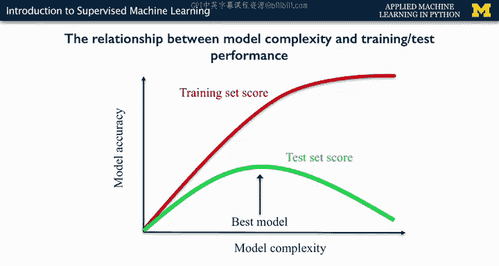

# 密歇根大学《Python用于数据科学实践（1-3课／共5课）｜Applied Data Science with Python 》deepseek翻译 - P62：7_监督式机器学习导论.zh_en - GPT中英字幕课程资源 - BV1U64y1L7VJ

In the previous module， you saw a basic example of supervised machine learning using a Can nearest neighborigh's classifier。

 classifying different types of fruit based on their various physical properties。

Machine learning algorithms of this type are called supervised learning algorithms because they use labeled examples in a training set to learn how to predict the labels for new previously unseen examples。

The supervised aspect refers to the need for each training example to have a label in order for the algorithm to learn how to make accurate predictions on future examples。

This is in contrast to unsupervised machine learning where we don't have labels for the training data examples。

 and we'll cover unsupervised learning in a later part of this course。

This week we'll explore supervised learning in a bit more depth。

 going beyond K Nur neighbors classifiers to several other widely used supervised learning algorithms。

Because this is an applied machine learning course。

 we're not going to cover too much of the mathematical derivation or the detailed inner workings of these algorithms。

For that， you can check out a number of more technical machine learning courses such as Andrew Eng's excellent course on Mach learning on Courseair。

Instead， we'll focus on some higher level goals， how to apply a number of specific supervised machine learning algorithms and how to interpret their results for important tasks。

This will include understanding how supervised learning algorithms estimate their parameters from data。

How the train model makes predictions for new instances。The strengths。

 weaknesses and best scenarios to apply a particular method and how to use the method with its parameter settings in Python programs using Psyit learn。

Across all of these algorithms， we'll discuss some general principles that are critical to machine learning。

 like the issue of overfitting。And how overfitting relates to a model's complexity。

 in which parameters typically can be used to control model complexity in order to obtain good performance on previously unseen data。

In this module， we won't have time to cover all the different parameters available for the various supervised learning methods。

 so we'll focus on a small number of the most important parameters。

The full details of all the supervised algorithms we'll cover this week are in the excellent online documentation that's provided with SyKit Learnn。

 which we've included links to in the supplemental material for this course。Before we continue。

 let's review some basic terms。So on the right here。

I'mS a dump of the first few rows of the fruit data set that you worked with last week。

The first term that we'll be using a lot is feature representation。 And as you might recall。

 what that means is taking an object like a piece of fruit and converting it into numbers that the computer can understand。

So in this data set， the feature representation for a piece of fruit consists of these columns。

 the mass， width， height and color score。These are the things that will be used as the features in the various machine learning algorithms。

That we'll be applying to try to predict the label of a piece of fruit。So typically。

 each column in the data set here corresponds to a different feature。

That's associated with each instance。So I use the term instance or sample or example。

Somewhat interchangeably， most of the time I'll be talking about instances or samples。

 So each row of this data set。Corresponds to one piece of fruit or one specific data instance or sample。

When we work with these。Instances in Python。The convention will be using is that will'll put the。

All the variables that represent the features。In this variable capital x。Here。

 so capital X refers to all the。Feature columns that will be going into the as the inputs for the predictor。

And then we have the very important concept of a label， so each insense here。

 each piece of fruit has a label that's what was assigned by a human in this case。

And the label is an example of a target value。 so in classification。

 the target value is the label of an object and in regression。

It's the particular continuous value you might want to predict from the inputs。

And we use lowercase Y。In Python for the variable name， to hold the。

Target values associated with each instance。So if you look at the data set as being。

 say this big block here。Typically， they'll be。A column of labels。 and then。A matrix。

Of multiple columns， holding the。The features that we'll be using。

 And then we have a couple of columns in here， the fruit name and the fruit subtype。

That are used only for labeling purposes to make things like plots more readable for humans。

The things that go into the actual machine learning algorithms are the the label。For training。

Through the y variable and the features， the mass， width。

 height and color score that are in the X variable。

Another concept that we saw from our first example。With the concepts of training and test sets。So。

By that， we mean。Just to recap。If we think of the entire data set here as a rectangle。

So this could be the fruit data set we just showed previously。We typically assign。

 we take a chunk of the original data set。And make that the training set， and then we reserve。

Typically， a smaller portion as the test set。 So the default split in。sychit learn is typically 75。

 25。The function train test split here is a very handy function in psic learn that takes。

The original set of features X and the labels Y。And does this partitioning into a training and test set？

The variables that we'll be using to denote training and tests that are。X train for the。

Training set features and why train for the training set labels。

And then X test for the test set features and Y test。For the。Test set labels。

Once we pass the training data into a classifier， so as you recall。

 we can create here a Can nearest neighbors classifier by invo this constructor。

And passing at the number of neighbors that we want the algorithm to use。

The training set is used to estimate the parameters for a model。In Psychic learn。

 there's an object called an estimator which is either a classifier or regressor， for example。

And the goal of this estimator， this model is to。Learn how to。

Classify or predict target values for new data instances。

So the procedure where we pass in a training set。To learn those parameters that are internal to the estimator。

It's called model fitting， and the result of model fitting is a trained model。

So an example of that in the code here。Is when we。After we create the K and N variable。That has the。

Kay nearest neighbors classifier object。We use the fit method。

On the training data and the training labels。To update the internal state of the KNN object。

 and that's that's the training process。 So after that line of code is finished running。

The internal state of the canon classifier has been updated to reflect the training datas。

Influence on the internal parameters of the canon classifier and now it's ready to be used。So。

Evaluation methods。Are typically the next step where after we've fit the model。

We want to see how well it actually does do on the test data。In week four of the course。

 we're going to cover in detail。Different ways of evaluating classifiers and regressions。But。

For now we look at accuracy。The score method applied to the classifier will take the test data in X test and Y test。

And output the accuracy of this particular classifier on the test set。And then finally。

 we can also apply the predict method。To the K N N object。

 to get the label for previously unseen instances。So these are the terms that we'll be using throughout the course。

And we'll also be maintaining a fairly consistent use of these variable names。

Throughout all the Python code that we use。Supervised learning can be divided into two different types of tasks。

 classification and regression。Both classification and regression take a set of training instances and learn a mapping to a target value。

For classification， the target value is a discrete class value。For example。

 a binary classification problem has two types of target values， zero。

 representing the negative class， or one representing the positive class。

An example of binary classification might be trying to detect a fraudulent credit card transaction。

The transactions either valid or invalid。A second type of classification problem is known as multi class classification。

 where the target value is more than just a yes or no or one or 0。

 It could be one of a set of discrete values。 For example， the。

Labeling fruit example that we saw from the first part of the course。

Is an example of multi class classification。The object that we're trying to predict the label for can only have one of the possible label types。

 something couldn't be， for example， both an apple and an orange。

 A third category of classification is called multi label classification。

 where there are multiple target values。For example。

 we might want to take a web page and label all the different topics discussed on that page。

 as shown in this example。Here we see a page from Microsoft Research where the multi label classification has decided that the labels。

Computing， science， and so forth are applicable。In contrast to classification， for regression。

The target we're trying to predict is a continuous value。For example。

 a model that predicts the market price of a house， given how many rooms it has， where it's located。

 the size of the land that it sits on and so forth。

Would be a regression problem because the market price is continuous。

 otherwise known as a real valued。Very variable。You can tell what type of supervised learning method you should apply to a given problem by thinking about the meaning of the target value。

Does the target value represent something that's one of a set of mutually exclusive class values is in the case of assigning a label to a piece of fruit？

Or whether or not a transaction is fraudulent， if so， it's a classification problem。

On the other hand， if the target is a real valued quantity like cost or income or height。

Then it can be treated as a regression problem。Finally。

 we'll see that many supervised learning methods come in both flavors of classification and regression。

For example， support vector classifiers which we'll cover shortly。

Also has a regression version called not surprisingly， support vector regression。In this course。

 we'll cover both classification and regression methods。

 although we'll spend the majority of our time on classification。

Since that represents a big set of important machine learning tasks。

 and because classification involves some additional concepts and methods。

 especially in areas like evaluation that aren't needed as much for regression。To start with。

 we'll look at two simple but powerful prediction algorithms。Keen nearest neighbors。

 which we saw in week 1。And linear model fitting using least squares。

These two prediction methods represent two complementary approaches to supervise learning。

K nearest neighbors doesn't make a lot of assumptions about the structure of the data and gives potentially accurate。

 but sometimes unstable predictions。 and by unstable， I mean that。

It can be sensitive to small changes in the training data。On the other hand。

 linear models make strong assumptions about the structure of the data。 In other words。

 that the target value can be predicted just using a weighted sum of the input variables。

 a linear function。It can give stable， but potentially inaccurate predictions。

In addition to k nearest neighbors and linear models。

 we'll cover a variety of widely used supervised learning methods for classification and regression。

Including decision trees。Colonnalize support vector machines and neural networks。For each method。

 we'll explore how it works at a high level without going into too much mathematical detail。

We'll also look at what kind of feature pre processing is typically needed。

And for almost all of the supervised learning algorithms we'll look at。

 there are one or more parameters that control its model complexity。

 So we'll see how to set these parameters to help avoid under and overfitting。Finally。

 we'll discuss the positives and negatives of each supervised learning approach to help understand what are the best scenarios in which to apply or not apply that particular method。

One consistent pattern you'll see as we look at all these different methods。

Is the relationship between model complexity and model accuracy， as shown in this plot。

The relationship is different， depending on whether the classifier performance is measured on the training set。

What is labeled here as training set score。Or on the test set。Labeled here as test set score。

When measuring performance against the training set。

The same one that was used to train the classifier。

This plot shows that as a model's complexity increases。

 So think of the can and classifier with K decreasing。

And with more and more highly variable and detailed decision boundaries。

The model's accuracy on the training set trends upward as the more complex models fit the training data better and better。

However， when the same trained model is evaluated on the held out test set。

There's typically an initial accuracy gain from the increasing model complexity up to some optimal point。

But then a decrease in test set accuracy as the increasingly complex models began to overfit too specifically to the training data。

And don't capture more global patterns that help it generalize well to unseen test data。Now。

 the specifics of these trends will vary from situation to situation， but overall。

 we'll see this pattern across the supervised learning methods that we'll examine。

You'll be hearing a lot about models in this course。 What is a model， Well。

 it's a specific mathematical or computational description that expresses the relationship between a set of input variables。

And one or more outcome variables that are being studied are predicted。In statistical terms。

 the input variables are called independent variables。

And the outcome variables are term dependent variables。In machine learning。

 we use the term features to refer to the input or independent variables。

And target value or target label to refer to the output， dependent variable。

Moels can be either used to understand and explore the structure within a given data set。

 as we'll see in unsupervised learning。Or in the case of supervised learning methods。

 our goal is to develop predictive models that can accurately predict the outcome。In other words。

 the target value or label for previously unseen input data。

