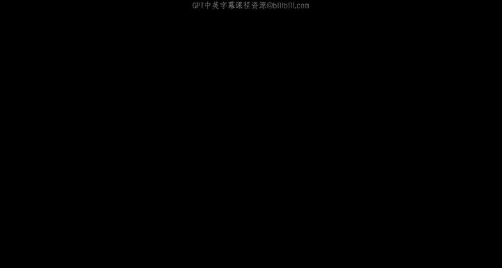
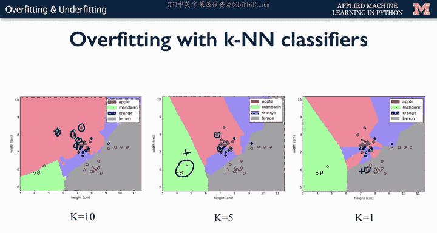

# 密歇根大学《Python用于数据科学实践（1-3课／共5课）｜Applied Data Science with Python 》deepseek翻译 - P63：8_过拟合与欠拟合问题.zh_en - GPT中英字幕课程资源 - BV1U64y1L7VJ

When we build the supervised learning model， whether it's for classification or regression。

It's not only important for the model to make correct predictions on the examples it saw in the training data。

 If that were the only definition of success， then supervised learning algorithms could simply memorize all of the training data。

And always have 100% accuracy。Of course， that's not what happens in the real world。

What we actually want from a supervised machine learning algorithm is the ability to predict the class or target value correctly on a test set of future examples that haven't been seen before。

This ability to perform well on a held out test set is the algorithm's ability to generalize。

How do we know that our trained supervised model will generalize well？In other words。

 perform well on an unseen test set。While typically。

 machine learning makes an important assumption that the future test set has the same properties or more technically is drawn from the same underlying distribution as the training set。

This means that if we observe our model has a good accuracy on the training set。

And the training set and test sets are similar。 We can also expect that it will do well on the test set。

Unfortunately， this sometimes this doesn't happen due to an important problem known as overfitting。

Informally， overfitting typically occurs when we try to fit a complex model with an inadequate amount of training data。

An overfitted model uses its ability to capture complex patterns by being great at predicting lots and lots of specific data samples or areas of local variation in the training set。

But it often misses seeing global patterns in the training set that would help it generalize well on the unseen test set。

It can't see these more global patterns because intuitively there's not enough data to constrain the model to respect these global trends。

As a result， the training set accuracy is a hopelessly optimistic indicator for the likely test set accuracy if the model is overfitting。

Understanding， detecting and avoiding overfitting is perhaps the most important aspect of applying supervised machine learning algorithms that you should master。

There are serious real world consequences to overfitting。

The reading for this week contains one example from the medical world you might find interesting。

To understand the phenomenon of overfitting better， let's look at a few visual examples。

The first example that we'll look at for overfitting involves regression。In this chart on the X axis。

 we have a single input variable。That might be， for example， the size of a piece of property and。

We have a target variable on the Y axis， for example。

 this might be the market selling price of a house that sits on that piece of property。

So in regression， we're looking to find the relationship between the input variable and the target variable。

And we start off with the idea of a model that we want to fit that might explain this relationship。

So one example of a model that we could try to fit would be a linear model。

 so trying to predict that there's a linear relationship between the input variable and the target variable。

So the Russian model might fit。A straight line to these points。In this case。

 the model has underfi the data。The model is too simple for the actual trends that are present in the data。

It doesn't even do well on the training points， so these blue points would represent the training points。

 the input to the training process for the regression。And when we underfi。

We have a model that's too simple， doesn't even do well in the training data。

 and thus is not at all likely to generalize well to test data。On the other hand。

 if we pick a better model， for example。The idea that this might be a quadratic relationship。

We might actually be able to。Apply that and get what looks like a much better fit。

 So this would be example of a reasonably good model fit。 We've captured both。

The general trend of the points。while also ignoring the little variations that might exist due to noise。

The third example might be we might。Hypothesize that。

The relationship between the input variable and the target variable is a function of。

Several different parameters， let's say。A polynomial， so something that's very bumpy。

If we try to fit a more complex model to this set of training data。

 we might end up with something that looks like。Looks like this。

So this more complex model has more parameters， so it's able to capture more subtle behavior。

But is also much higher variance here， as you can see。 So it's more focused on capturing the。

More local variations in the training data， rather than trying to find the more global trend that we can see as humans in the data。

 So this is the example of overfitting。In this case。

 there's not enough data to really constrain the parameters of the model enough so that it can recognize the global trend。

This second example will look at overfitting in classification。

So this diagram shows a simple two dimensional classification problem where。

Each data instance is represented by a point。And where there are two features associated with each data instance。

This is a binary classification problem， so points are labeled either red over here。Or blue。

And the problem with in classification is to find a decision boundary。

 So as we saw with K nearest neighbors， we want to take this。

Feature space and find regions that are associated with。The different labels。

So one type of classifier that we'll look at shortly is called a linear classifier we try to find。

A decision value that's。Essentially， a straight line through the space。So just as in regression。

 we can have underfitting。Models， good fitting models， and overfitting models。

So an example of an underfitting model would be something that。Really didn't look much at the。Data。

Maybe something like this。That only looked at one feature， for example。So again。

 this is an overly simplistic model， it doesn't even capture the patterns。

 the division between the classes and the training data well。

And so it would be unlikely to generalize so this is an underfitting model。A reasonably good。

Model would， that fits well， would be。A linear model that finds this。General difference between。

The positive class over here and the negative class over here。 So you can see that it's。

Aware of this sort of global pattern of having most of the blue negative points in the upper left and most of the red positive points more toward the lower right。

And it's robust enough in the sense that。It ignores the fact that there may be occasionally a blue point in the red region or a red point in the blue region。

Instead， it's found this sort of more global separation。Between these two classes。

So this is a reasonably。Well fitting model。An overfitting model on the other hand。

 would typically be a model that has lots of parameters so it can capture complex behavior。

And so it would try to find something very clever where it tried to。

Completely separate the red points from the blue points。In a way that。

Resulted in a highly variable decision boundary。So this has the advantage that a questionable advantage that it it does。

Capture the training data classes very well。 It predicts the training data classes almost perfectly。

 but as you can see。If the， if the actual。Division between the classes does is captured by this this linear model。

The overfit model is going to make lots of mistakes。呃。

In the regions where it's trying to be too perfect in some sense。

You'll see this typically with overfitting。The overfit model is highly variable。And again。

 it's trying to capture too many of the local fluctuations and does not have enough data to see。

The global trend that would result in better overall generalization performance on new unseen data。

This third example shows the effect of modifying the K parameter in the K nearest neighbors classifier that we saw previously。

The three plots shown here show the decision boundaries  for k equals 10。K equals 5 and K equals 1。

And here we're using the fruit data set again with the height of a piece of fruit on the X axis and the width on the Y axis。

So the K equals 10 case， as you recall， K equals 10 means that for each query point that we want to。

Get a prediction for。Let's say over here。We have to look at the 10 nearest points to the query point。

And we'll take those。We won't go through all 10 here， but let's just say there are several here that。

嗯。Are nearby and will average or combine their votes to predict the label for this point。

 So in the K equals 10 case， we need。The votes from 10 different data instances in the training set to make our prediction。

And as we reduce k， so when k equals 5， we only need。Five neighbors。To make a prediction。

 so for example， if the query point was here。We'd look at these four and then possibly whatever was the closest。

嗯。Closesest in this set。 Let's say that one or this one。And then finally， in the K equals one case。

That's the most unstable in the sense that。For any query point。

 we only look at the single nearest neighbor。To that point。

And so the effect of reducing K in the K in nearest Nas classifier。Is to increase the variance。

Of the decision boundaries， because the decision boundary。

Can be affected by outliers if if there's a point far， far away。

 it might have it has much greater effect on the decision boundary in the K equals one case。

Than it would in the K equals 10 K when， when the votes of 9 other neighbors are also needed。And so。

You can see that by adjusting the value of k for the canest neighbors classifier， we can control。

 in some sense the degree of model fitting。That's appropriate for a data set。Now。

The actual value of k that works best can only be determined by evaluating on a test set。

But the general idea is that as we decrease k for canon classifiers。

 we increase the risk of overfitting。Because for the reason I mentioned before， where K equals 1。

 for example， we're trying to capture。Very local changes。

In the decision boundary that may not lead to good generalization behavior for future data。

