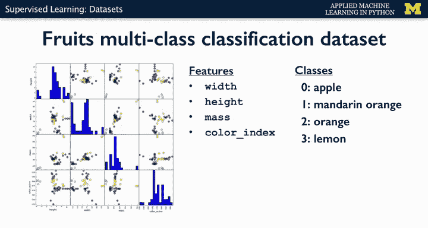

# 密歇根大学《Python用于数据科学实践（1-3课／共5课）｜Applied Data Science with Python 》deepseek翻译 - P64：9_监督学习数据集.zh_en - GPT中英字幕课程资源 - BV1U64y1L7VJ

To explore different supervised learning algorithms， we're going to use a combination of small。

 synthetic or artificial data sets as examples， together with some larger real world data sets。

PsyCitLn has a variety of methods in the SKLearn datasets library to create synthetic datas。

The synthetic data set willll use for illustration purposes。

Theyre typically low dimensional examples because they only use a small number of features。

 typically one or two。This makes them easy to explain and visualize。Many real world data sets。

 on the other hand， have a higher dimensional feature space。 In other words， they have dozens。

 hundreds or even thousands or millions of features。

So some of the intuition we gain from looking at low dimensional examples。

ItDoesn't always translate to high dimensional data sets， and we'll discuss that a bit more later。

For example， high dimensional data sets， in some sense。

 have most of their data in corners with lots of empty space。

 and that's kind of difficult to visualize。 We'll go through some examples later in the course。

But the low dimensional examples are still useful so that we can understand things like how a model's complexity changes with changes in some key parameters。

So for basic regression， we'll start with a simple problem that has one informative input variable。

 one noisy linear output， and 100 data samples。Here's a plot of a data set using a scatter plot with each point represented by one dot。

The X axis shows the feature value， and the y axis shows the regression target。To create this。

 we use the make regression function in SKLn datasets。Here's the code in the notebook。

To illustrate binary classification will include a simple two class data set with two informative features。

Here's a scatter plot showing each data instance as a dot with the first feature value corresponding to the x axis and the second feature value corresponding to the Y axis。

The color of a point shows which class that data instance is labeled。

I'm calling this data set simple because it has only two features。Both of which are informativeative。

In this case， these two classes are approximately linearly separable。

 which means that a basic linear classifier placed between them does a pretty good job at discriminating the points in the two classes。

So turning to the notebook to create this data set。

 we used the make classification function in ScalR datasets。Creating 100 points that roughly group。

The data samples into one cluster per class with here。

 a 10 per cent chance of randomly flipping the correct label of any point just to make it a little more challenging for the classifier。

We'll also look at a more complex binary classification problem。That uses two features。

 But where the two classes are not really linearly separable。Instead。

 forming into various clusters in different parts of the feature space。

This data set was created in two steps。 First， using the make blobs function in S K and dataset sets to randomly generate 100 samples in eight different clusters。

And then by changing the cluster label assigned by make blobs。

 which is a number from one to8 to a binary label by converting it using a modular 2 function。

Assigning the even index points to class 0 and odd index points to class 1。

To illustrate multiclass classification。We'll use our familiar fruits data set， which。

 as you may remember， has four features and four possible target labels。Here on the left。

 I'm showing the array of scatter plots that we saw in week 1 that shows the relationship between all possible pairs of features and the class labels with the distribution of values for each feature along the diagonal。

To illustrate a real world regression problem， we'll use a data set derived from the communities and crime data set in the UCI repository。

Our data uses a subset of the original features and target values。

 which were originally created from combining several US government data sources。Like the US。

S census。Each data instance corresponds to a particular geographic area。

 typically a town or a region of a city。Our version of this data set has 88 features that encode various demographic and socioeconomic properties of each location。

With 1，994 location data instances。The target value that we'll try to predict is the per capita violent crime rate。

To use this data， we use the load crime data function that's included with the Share utilities module for this course。

