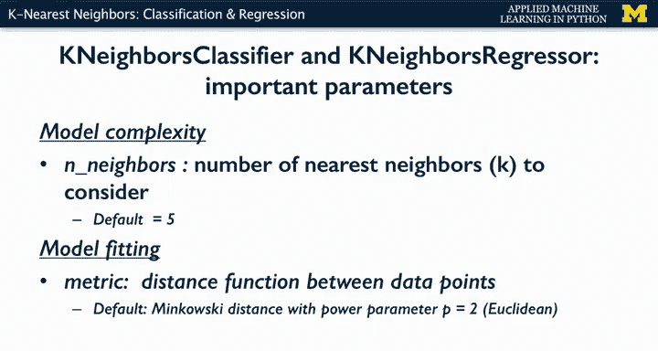

# 密歇根大学《Python用于数据科学实践（1-3课／共5课）｜Applied Data Science with Python 》deepseek翻译 - P65：10_K近邻分类与回归.zh_en - GPT中英字幕课程资源 - BV1U64y1L7VJ

Let's revisit the first example of machine learning we encountered in week 1。

K nearest neighbors models。Those are a good starting point to continue our exploration of supervised learning because they're simple to understand and can be used for both classification and regression。

Let's recall that for classification。 The Can nearest neighbor classifier simply memorizes the entire training set。

And then to classify a new instance does three steps。First its the K nearest。

 most similar instances to the new instance in the training set。

Then it gets the labels of those training instances。

And then it predicts the label of the new instance as a function of the nearby training labels。

 typically by a simple majority vote。Here's how a K nearest neighbor classifier using only one nearest neighbor that is with K equal to1。

 makes its predictions for the simple binary synthetic data set。So as you might recall from week one。

 where we applied a nearest neighbors classifier to our multi class fruit data set here we're applying the nearest neighbors classifier。

To our simple binary classification problem， where the points in class 0 are labeled。

With yellow dots and the points in class one are labeled with black dots。

And just as we did for the week one problem with fruit classification。Here。

 we're also showing how the entire feature space。Is broken up into different decision regions。

 according to the predictions that the key nearest neighbors classifier would make at each point in the decision space。

 So， for example。A point out here。In the yellow region。Represents。

A point that the classifier we classify as class 0 and a point let's say over here。

The classifier would classify as class one。So because this is a one nearest neighbor's classifier。

To make a classification prediction for any given query point。

 the classifier simply looks back into its training set。

 so these points here represent all the points in the training set。So for any given point。

 let's say here。The classifier will simply find the training point that's closest， namely this one。

 and assign the predicted class to simply the class of the nearest point in the training set。

 Likewise， if we have a point over here。The nearest point in the training says， actually， this。

Point right here that has a class 0 label。 And so that point would get assigned a class 0。

 and in fact。This whole region right here represents all the points that are closer to the class 0 training point。

Than any of the other class one training points。 So this whole region here represents one nearest neighbors。

Prediction of class zero。So the K nearest neighbors classify with k equal to1。

 You can see that the decision boundaries that it that derive from that prediction are quite jagged and quite have high variance。

And this is an example of a model， classification model that has high model complexity。And in fact。

 you can see that the one nearest neighbor's classifier is overfitting the training data in this case。

Trying to。Get correct predictions for。Every single training point， while ignoring the general。

This trend between the two classes， namely that most of the yellow points are。And this side of the。

Feature space。 and most of the black points are in this side。

So the one nearest neighbor classifier can be said to be。Overfitting in this case。

And here's what happens when we increase K from 1 to 11。Now。

 the classifier must combine the votes of the 11 nearest points， not just one。

So single training data points no longer have as dramatic an influence on the prediction。

The result is a much smoother decision boundary， which represents a model with lower model complexity。

 where the decision boundary has much less variance。Actually。

 if we increased K even higher to be the total number of points in the training set。

The result would be a single decision region where all predictions would be the most frequent class in the training data。

And as we saw for the fruit data set， K nearest neighbors classifiers can be applied to any number of classes。

 not just two。The code for this example in the notebook uses a special function in the shared U library for this course called Ploot2 Class KNN。

If you run this code and compare the resulting training and test scores for k equals 1， 3， and 11。

Which are shown in the title of each plot。 You can see the effect of model complexity。

On the model's ability to generalize。In the K equals1 case， the training score is a perfect 1。0。

But the test score is only 0。80。As K increases to 3， the training score drops to 0。88。

 but the test score rises slightly to 0。88。Indicating the model is generalizing better to new data。

When K equals 11， the training score drops a bit further to 0。81。

 but the test score is even even better at 0。92。Indicating that this simple model is much more effective at ignoring minor variations in the training data and instead capturing the more important global trend in where the classes tend to be located。

With the best overall generalization performance as a result。

The nearest neighbor's approach isn't useful just for classification。 You can use it for regression。

 too。So here are three plots that show the same simple regression problem with one input feature and the corresponding target values in the training data。

The leftmost plot here。This one。Shows just the original。Training data points。

And the middle and right plots show the predictions made by a K N regression algorithm when K equals 1 and K equals 3。

So in these plots， you can see the training points are actually in green。

 these green circles are the training points。And the blue triangles。

Are the output of the K and nearest neighbor regression for any given input value of x。 So。

 for example， the K and N regression prediction for this point here。Is this y value here？

So how did the nearest neighbors aggressor？Compute these values。 Well。

 it did it in a similar way to what we saw for classification。So， for example。

 if the query point we're interested in is predicting the value associated with。This x value。

We simply find the training point that has the x value that's closest to this query point。

 so in this case， that would be this training point。

And because this is a one nearest neighbor problem。

 we simply take the target value associated with this training point and use that as the output。

The target for the query point。Similarly， if this were the query point here。

Then the nearest neighbor in the training set would be this point here。And so。

 the output prediction for。This particular x value will be。The target value of the nearest neighbor。

 or。This value that's just above 100。And so if we do that for all these different x values。

 we'll get these different。Predictions。Using the one nearest neighbor approach。Similarly。

 if we look at the K equals 3 case， where now we look at three nearest neighbors。

Let's take this example here of negative 1。25， let's say。Well。

 what are the three training points that have x values closest to negative 1。25。

 they would be this training point。That training point and this training point。Now with regression。

 what we do。Is instead of taking a majority vote， we don't have class values here as targets。

 we have continuous values。So we can average these three target values。 And if we do that。

 we find that the output。When the query point is this x value is going to be。

The average of the y values of the three nearest training points or。This value here。Similarly。

If we have a training point， sorry， a query point that is here。

Then the three nearest neighbor points are。Here， here。And here， and the average target value。

Of these three training points is。Something。Something like this。

Here's the corresponding code in the notebook that produced these regression plots。

These use the K neighbors Regressor class， which like the classification case。

 takes the N neighbors setting as a key parameter。Because the target values in a regression problem are continuous as compared to the discrete values that we see。

For classifier target labels。To assess how well a regression model fits the data。

 we use a regression score called R squared that's between 0 and 1。

We'll cover some additional types of regression evaluation scores later in the course。

For the R squared value， a value of one corresponds to the best possible performance。

 a model that makes perfect predictions。A value of 0 corresponds to a model that makes a constant value prediction that's always just the mean value of all the training target values。

The R squared value is sometimes known as the coefficient of determination。

Just as we did for classification， let's look at the connection between model complexity and generalization ability as measured by the R squared training and test values on this simple regression data set。

The series of plots in the notebook book shows how the K and N regression algorithm fits the data for K equals 1。

3，7，15。And in an extreme case of K equals 55， it represents almost half the training points。

We can see the same pattern in model complexity for K N regression that we saw for can N classification。

 namely that small values of K give models with higher complexity。

And large values of K result in simpler models， with lower complexity。

Starting on the left when K equals 1， the regression model fits the training data perfectly with an R squared score of 1。

0。But it's very bad at predicting the target values for new data samples。

As reflected in the R squared test score of only 0。155。As the value of k increases。

Which we can see Xs to smooth out these local variations to capture more of the global trend。Again。

 the training set score drops， but the model gets better at generalizing to new data。

 and the test score goes up as K increases。Finally， in this series。

 the model with K equals 15 has the best test set performance with an R squared score of 0。485。😊。

Increasing K much further， however， to K equals 55。

Results in both the training and test set scores dropping back down to lower levels as the model now starts to underfi。

 In other words， it's too simple to do well， even on the training data。

The pros of the nearest neighbor approach are that it's simple and easy to understand why a particular prediction is made。

A k nearest neighbor approach can be a reasonable baseline against which you can compare the performance of more sophisticated methods。

When the training data has many instances or each instance has lots of features。

 this can really slow down the performance of a K nearest neighbor's model。So in general。

 if your data has hundreds or thousands of features。

You should consider alternatives to k nearest neighbors models， especially if your data is sparse。

Meaning that each instance has lots of features， but most of them are zero。

So to sum up and as a review of what we saw in week1。

 the two key parameters for both regression and classification in nearest neighbors models。

Are naturally and neighbors， which controls the value of the number of neighbors to consider。

And thus， the model complexity， as we saw。And the metric。Prameter。

 which controls the distance function between points。

 and thus which points are considered as nearest when finding neighbors。

We didn't explore the metric parameter here。 And that's beyond the scope of this course。

 but in most cases。The default Euclidean setting works pretty well with most data sets。

