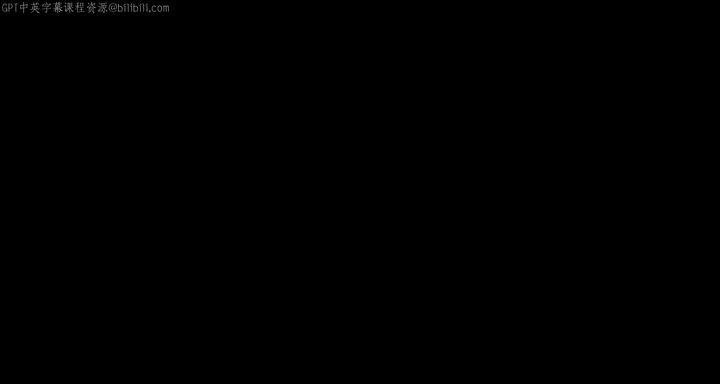
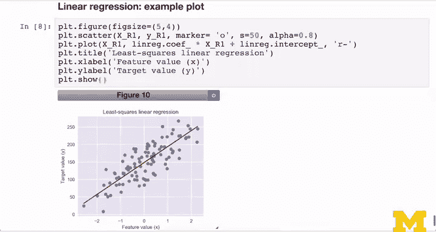

# 密歇根大学《Python用于数据科学实践（1-3课／共5课）｜Applied Data Science with Python 》deepseek翻译 - P66：11_线性回归：最小二乘法.zh_en - GPT中英字幕课程资源 - BV1U64y1L7VJ

One of the simplest kinds of supervised models are linear models。

A linear model expresses the target output value in terms of a sum of weighted input variables。

For example， our goal may be to predict the market value of a house。

Its expected sales price in the next month， for example。Suppose we're given two input variables。

 how much tax the properties assessed each year by the local government。

And the age of the House in years。You could imagine that these two features of the house would each have some information that's helpful in predicting the market price。

Because in most places， theres a positive correlation between the tax assessment on a house and its market value。

Indeed， the tax assessment is often partly based on market prices from previous years。

And may be a negative correlation between its age in years and the market value。

 So older houses may need more repair and upgrading， for example。One linear model。

 which I've made up as an example。Could compute the expected market price in US dollars by starting with a constant term here。

212000。 And then adding some number， let's say，109 times the value of tax paid last year。

And then subtracting 2000 times the age of the house in years。 So， for example。

 this linear model would estimate the market price of a house。Where the tax assessment was $10，000。

And that was 75 years old as about $1。2 million US dollars。Now。

 I just made up this particular linear model myself as an example。But in general。

 when we talk about training a linear model， we mean estimating values for the parameters of the model or coefficients of the model。

 as we sometimes call them。Which are here， the constant value 212000， and the weights，109 and 2000。

In such a way that the resulting predictions for the outcome variable Y price for different houses are a good fit to the data from actual past sales。

We'll discuss what。Good fit means shortly。Predicting house price is an example of a regression task using a linear model called not surprisingly linear regression。

More generally in a linear regression model， there may be multiple input variables or features。

 which will denote x0， x1， etc ce。Each feature， X， I has a corresponding weight， W I。

The predicted output。Which we denote why hat。Is a weighted sum of features， plus a constant term B。

 hat。I've put a hat over all the quantities here that are estimated during their Grian training process。

The W hat and B hat values， which we call the train parameters or coefficients。

 are estimated from training data。And Y hat is estimated from the linear function of input feature values and the train parameters。

 For example， in the simple housing price example we just saw。

W 0 hat was 109 X 0 represented tax paid。W1 hat was negative 20。X1 was house age。

 and B hat was 212000。We call these WI values， molecule coefficients or sometimes feature weights。

And B hat is called the biased term or the intercept of the model。

Here's an example of a linear regression model with just one input variable or feature x0 on a simple artificial example data set。

The blue cloud of points represents a training set of。X 0， Y pairs。In this case。

 the formula for predicting the output Y hat is just W 0 hat times x 0 plus B hat。

 which you might recognize as the familiar slope intercept formula for a straight line。

Where a W 0 hat is the slope and B hat is the Y intercept。

The grand red lines represent different possible linear regression models that could attempt to explain the relationship between x 0 and y。

You can see that some lines are a better fit than others。

The better fitting models capture the approximately linear relationship。 Where， as x 0 increases。

 y also increases in a linear fashion。The red line seems especially good。 Intuitively。

 there are not as many blue training points that are very far above or very far below the red linear model prediction。

Let's take a look at a very simple form of linear regression model。

That just has one input variable or feature。To use for prediction。In this case。

 we have the vector x is just has a single component， we'll call it x0， that's the input variable。

 the input feature。And。In this case， because there's just one variable， the predicted output。

Its simply。Product of。The weight W 0 with the input variable x 0 plus a bias term B。

So x0 is the value that's provided， it comes with the data。

 and so the parameters we have to estimate are W0 and B。In order to。

Obtain the parameters for this linear regression model。So， this formula。May look for。 It's the。

Formula for。A line in terms of its slope。 In this case。

 slope corresponds to the weight W 0 and B corresponds to the y intercept。We call the bias term。

So here the job of the model is to take as input。 let's think let's pick a point here。

Along the x axis。 So W 0 corresponds to the。The slope of this line。And B。Corresponds to。

The y intercept of the line。 And so by finding these two parameters。

These two parameters together define a straight line in this feature space。Now。

 the important thing to remember is that there's a training phase and a prediction phase。

 so the training phase using the training data。Is what we'll use to estimate W0 and B。

So one widely used method for estimating W and B for a linear regression problem is called least squares linear regression。

 also known as ordinary least squares。L square is linear regression。

Finds the line through this cloud of points that minimizes what is called the mean squared error of the model。

The mean squared error of the model is essentially the sum of the square differences between the predicted target value and the actual target value for all the points in the training set。

This plot illustrates。What that means。The blue points represent points in the training set。

The red line here represents the least squares model that was found through this cloud of training points。

And these black lines。Show the difference between。The y value that was predicted for a training point based on its exposition。

And the actual y value of the training point。So for example， here。This point， let's say。

 has an x value of negative 1。75。And if we plug it。Into。The formula for this linear model。

We get a prediction。Here at this point on the line， which is somewhere around， let's say 60。

But the actual observed value in the training set for this point。Was maybe closer to 10。

 so the in this case， for this particular point。The square difference between the predicted target and the actual target。

Would be 60 minus 10 squared。So we can do this calculation for every one of the points in the training set。

We can compute this squared difference between。The Y value we observe in the training set for a point。

And the y wire that we be predicted by the linear model。Given that training points x value。

So each of these can be computed as the squared difference can be computed。

And then if we add all these up。And divide by the number of training points， take the average。

That will be the mean squared error of the model。So the technique of least squares。呃。Is designed to。

Find the slope， the W value， and the B value， the Y inter intercept。That minimize this squared error。

 this mean squared error。One thing to note about this linear。

Agression model is that there are no parameters to control the model of complexity。

No matter what the value of WMB， the result is always going to be a straight line。

This is both a strength and a weakness of the model， as we'll see later。When you have a moment。

 compare this simple， linear model to the more complex regression model learned with K nearest neighbors regression on the same data set。

You can see that linear models make a strong prior assumption about the relationship between the input X and output Y。

Linear models may seem simplistic， but for data with many features。

 linear models can be very effective and generalize well to new data beyond the training set。Now。

 the question is， how exactly do we estimate the linear models W and B parameters so the model is a good fit。

Well， the W and B parameters are estimated using the training data。

And there are lots of different methods for estimating W And B。

 depending on the criteria you'd like to use for the definition of what a good fit to the training data is and how you want to control model complexity。

For linear models， model complexity is based on the nature of the weights W on the input features。

Simpler linear models have a weight vector W that's closer to0 I。e。

 where more features are either not used at all and have zero weight。

Or have less influence on the outcome， a very small weight。Typically。

 given possible settings for the model parameters， the learning algorithm predicts the target value for each training example and then computes what is called a loss function for each training example。

 that's a penalty value for incorrect predictions。A predictiondiction is incorrect when the predicted target value is different than the actual target value in the training set。

For example， a squared loss function would return the square difference between the target value and the actual value as the penalty。

The learning algorithm then computes or searches for the set of WB parameters。

That minimize the total of this loss function over all training points。

The most popular way to estimate W And B parameters is using what's called least squares。

 linear regression， or ordinary least squares。Lee squares finds the values of W And B that minimize the total sum of square differences between the predicted y value and the actual y value in the training set。

Or equivalently， it minimizes the mean squared error of the model。

Lase squares is based on the squared loss function mentioned before。

This is illustrated graphically here， where I've zoomed in on the left lower portion of the simple regression data set。

The red line represents the least squares solution for W&B through the training data。

And the vertical lines represent the difference between the actual y value of a training point， X。

 I comma Y。And its predicted y value， given X I， which lies on the red line。Where x equals Xi。

Adding up all the squared values of these differences for all the training points gives the total squared error。

 and this is what the least squared solution minimizes。Here。

 there are no parameters to control model complexity。

The linear model always uses all of the input variables。And always is represented by a straight line。

Another name for this quantity is the residual sum of squares。

The actual target value is given in Y I， and the predicted Y hat value for the same trading example is given by the right side of the formula using the linear model with a parameters W and B。

Let's look at how to implement this in Psyit Learn。

Linear regression in psychic learn is implemented by the linear regression class in the S K learn dot Linear model module。

As we did with other estimators in psychic learn， like the nearest neighbor's classifier。

And the regression models， we use the train test split function on the original data set。

And then create and fit the linear regression object using the training data in X train and the corresponding training data target values in Y train。

Here， note that we're doing the creation and fitting of the linear regression object in one line。

By chaining the fit method with the constructor for the new object。

The linear regression fit method acts to estimate the future weights W。

 which it calls the coefficients of the model， and it stores this in the Co F underscore attribute。

And the bias term B， which is stored in the intercept underscore attribute。

Note that if a psyit learn objectss attribute ends with an underscore。

 This means that these attributes were derived from training data and not say quantities that were set by the user。

If we dump the coF underscore and intercept underscore attributes for this simple example。

We see that because there's only one input feature variable。

 there is only one element in the coF underscore list， the value 45。7。

The intercept attribute has a value of about 148。4。And we can see that， indeed。

 these correspond to the red line shown in the plot， which has a slope of 45。

7 and a y intercept of about 1，48。4。Here's the same code in the notebook with additional code to score the quality of the regression model in the same way that we did for K nearest neighbors regression using the R squared metric。

And here's the notebook code we use to plot the least squares linear solution for this data set。

Now that we've seen both K N neighborigh's regressiongression and Lee square's regression。

It's interesting now to compare the least squared linear regression results with the K nearest neighbor results。

Here we can see how these two regression methods represent two complementary types of supervised learning。

The key nearest neighbor agressor doesn't make a lot of assumptions about the structure of the data。

And gives potentially accurate， but sometimes unstable predictions that are sensitive to small changes in the training data。

So it has a correspondingly higher training set R squared score compared to least squares linear regression。

Can N achieves an R squared score of 0。72， and least squares achieves an R squared of 0。

679 on the training set。On the other hand。Linear models make strong assumptions about the structure of the data。

In other words， that the target value can be predicted using a weighted sum of the input variables。

And linear models give stable， but potentially inaccurate predictions。 However， in this case。

 it turns out that the linear model's strong assumption that there's a linear relationship between the input and output variables happens to be a good fit for this data set。

And so it's better at more accurately predicting the Y value for new X values that weren't seen during training。

And we can see that the linear model gets a slightly better test set score of。492 versus 。

471 for Can nearest neighbors。 And this indicates its ability to better generalize and capture this global linear trend。

