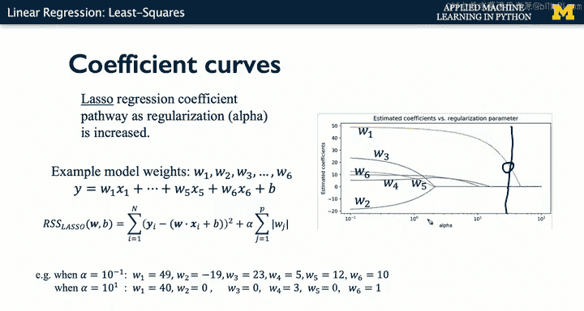

# 密歇根大学《Python用于数据科学实践（1-3课／共5课）｜Applied Data Science with Python 》deepseek翻译 - P67：12_线性回归：岭回归、Lasso与多项式回归.zh_en - GPT中英字幕课程资源 - BV1U64y1L7VJ

Now， we'll look at another way to estimate W And B for a linear model called ridge regression。

Rid regression uses the same least squares criterion， but with one difference。

During the training phase， it adds a penalty for feature weights， the W I values that are too large。

 as shown in the equation here。You'll see that large weights means mathematically that the sum of their squared values。

Is large。Once ridge regression has estimated the W And B parameters for the linear model。

 the prediction of y values for new instances is exactly the same as in least squares as you just plug in your input feature values。

 the X I's。And compute the sum of the weighted feature values plus B with the usual linear formula。

So why would something like ridge regression be useful。

 This addition of a penalty term to a learning algorithm's objective function is called regularization。

Regularization is an extremely important concept in machine learning。

It's a way to prevent overfitting and thus improve the likely generalization performance of a model by restricting the model's possible parameter settings。

Usually， the effect of this restriction from regularization is to reduce the complexity of the final estimated model。

So how does this work with linear regression？The addition of the sum of squared parameter values that shown in the box。

To the least squares objective means that models with larger feature weights， W。

Add more to the objective functionss overall value。

Because our goal is to minimize the overall objective function。

 the regularization term acts as a penalty on models with lots of large feature weight values。

In other words， all things being equal。 If ridge regression finds two possible linear models that predict the training data values equally well。

 it will prefer the linear model that has smaller overall sum of squared feature weights。

The practical effect of using ridge regression is to find the feature weights W。

 I that fit the data well in a least square sense， and that set lots of the future weights to values that are very small。

We don't see this effect with a single variable linear regression example。

 but for regression problems with dozens or hundreds of features。

The accuracy improvement from using regularized linear regression， like ridge regression。

 can be significant。The amount of regularization to apply is controlled by the alpha parameter。

Larger alpha means more regularization and simpler linear models with weights closer to 0。

The default setting for alpha is 1。0。Notice that setting alpha to 0 corresponds to the special case of ordinary least squares linear regression that we saw earlier that minimizes the total squared error in psychit learnn。

 you use ridge regression by importing the ridge class from S K learnn dot linear model。

And then use that estimator object just as you would， for least squares。

The one difference is that you can specify the amount of the Rige regressiongression regularization penalty。

 which is called an L2 penalty using the alpha parameter。Here。

 we're applying Ri regression to the crime dataset set。Now。

 you'll notice here that the results are not that impressive。

 The R squared score on the test set is pretty comparable to what we got for least squares regression。

However， there's something we can do in applying ridge regression that will improve the results dramatically。

So now is the time for a brief digression about the need for feature pre processingces and normalization。

Let's stop and think for a moment intuitively， what Rige regression is doing。

It's regularizing the linear regression by imposing that sum of squares penalty on the size of the W coefficients。

So the effect of increasing alpha is to shrink the W coefficients towards 0 and towards each other。

But if the input variables， the features have very different scales。

Then when this shrinkage happens of the coefficients。

Input variables with different scales will have different contributions to this L 2 penalty。

Because the al2 penalty is a sum of squares of all the coefficients。

So transforming the input features。 So they're all on the same scale means the rich penalty is。

 in some sense， applied more fairly to all features without unduly waiting some more than others。

Just because of the difference in scales。So more generally。

 you'll see as we proceed through the course that feature normalization is important to perform for a number of different learning algorithms beyond just regularized regression。

This includes K nearest neighbors， support vector machines， neural networks and others。

The type of feature prepros and normalization that's needed can also depend on the data。For now。

 we're going to apply a widely used form of feature normalization called minm scaling。

That will transform all the input variables。 So they're all in the same scale between 0 and 1。

To do this， we compute the minimum and maximum values for each feature on the training data and then apply the min max transformation for each feature as shown here。

Here's an example of how it works with two features。

 Suppose we have one feature height whose values fall in a fairly narrow range between 1。5 and 2。

5 units。But a second feature width has a much wider range between 5 and 10 units。

After applying min max scaling， values for both features are transforms。 They are on the same scale。

 with the minimum value getting mapped to 0 and the maximum value being transformed to one and everything else getting transformed to a value between those two extremes。

To apply Minmac scaling in psyic learn。You import the Minmax Scalar object from S K learnn dot preprocessing。

To prepare the scalar object for use， you create it and then call the fit method using the training data X train。

This will compute the Min and max feature values for each feature in this training data set。

Then to apply the scar， you call its transform method and pass in the data you want to rescale。

 The output will be the scaled version of the input data。In this case。

 we want to scale the training data and save it in a new variable called X train scaled。

And the test data， saving that into a new variable called X test scaled。

Then we just use these scaled versions of the feature data instead of the original feature data。

Note that it can be more efficient to perform fitting and transforming in a single step on the training set by using the scalealar's fit transform method as shown here。

Theres one last but very important point here about how to apply Minmac scaling or any kind of feature normalization in a learning scenario with training and test sets。

You may have noticed two things here first， that we're applying the same scalar object to both the training and the test data。

And second， that we're training the scalar object on the training data and not on the test data。

These are both critical aspects to feature normalization。

If you don't apply the same scaling to training and test sets。

 you'll end up with more or less random data s， which will invalidate your results。

If you prepare the scalar or other normalization method by showing it the test data instead of the training data。

This leads to a phenomenon called data leakage， where the training phase has information that is leaked from the test set。

For example， like the distribution of extreme values for each feature in the test data。

Which the learner should never have access to during training。This， in turn。

 can cause the learning method to give unrealistically good estimates on the same test set。

We'll look more at the phenomenon of data leakage later in the course。

One downside to performing feature normalization is that the resulting model on the transformed features may be harder to interpret。

Again， in the end， the type of feature normalization that's best to apply can depend on the data set。

 learning task and learning algorithm to be used。We'll continue to touch on this issue throughout the course。

Okay， let's return to Rige regression after we've added the code for min Max scaling of the input features。

We can see the significant effect of Minmac scaling on the performance of Rige regression。

After the input features have been properly scaled。

 Ri regression achieves significantly better model fit with an R squared value on the test set of about 06。

Much better than without scaling and much better now than ordinary least squares。In fact。

 if you apply the same minmac scaling with ordinary least squares regression。

 you should find that it doesn't change the outcome at all。In general。

 regularization works especially well when you have relatively small amounts of training data compared to the number of features in your model。

Regularization becomes less important as the amount of training data you have increases。

We can see the effect of varying the amount of regularization on the scaled training and test data using different settings for alpha in this example。

The best R squared value on the test set is achieved with an alpha setting of around 20。

Significantly larger or smaller values of alpha both lead to significantly worse model fit。

This is another illustration of the general relationship between model complexity and test set performance that we saw earlier in this lecture。

Where there's often an intermediate best value of a model of complexity parameter。

That does not lead to either under or overfitting。Another kind of regularized regression that you could use instead of Rige regression is called lasso regression。

Like ridge regression， Lassso regression adds a regularization penalty term to the ordinary least squares objective that causes the model W coefficients to shrink towards 0。

Lassso regression uses a slightly different regularization term， called an L1 penalty。

Instead of ridge regressions， L 2 penalty， as shown here。

The L1 penalty looks kind of similar to the L2 penalty in that it computes a sum over the coefficients。

 but it's sum over the absolute values of the W coefficients instead of a sum of squares。

 and the results are noticeably different。With Lassso regression。

 a subset of the coefficients are forced to be precisely0。

 which is a kind of automatic feature selection。Since with a weight of 0。

 the features essentially ignored completely in the model。This sparse solution。

 where only a subset of the most important features are left with non0 weights。

 also makes the model easier to interpret in cases where there are more more than a few input variables。

Like ridge regression， the amount of regularization for the lasso regression is controlled by the parameter alpha。

 which by default， is 1。0。Also like Rige regression。

 the purpose of using Lasso regression is to estimate the W andB model coefficients。Once that's done。

 the prediction model formula is the same as for ordinary least squares。

 You just use the linear model。In general， less over regressiongression is most helpful if you think there are only a few variables that have a medium or large effect on the output variable。

Otherwise， if there are lots of variables that contribute small or medium effects。

Ridge regression is typically the better choice。Let's take a look at Lasso regression in Psyit learned using the notebook。

Using our communities in crime regression data set。To use Lasso regression。

 you import the Lasso class from S KLn dot linear model。

And then just use it as you would use an estimator like Rige regression。With some data sets。

 you may occasionally get a convergence warning， in which case you can set the max underscore inner attribute to a larger value。

 So typically at least 20000。Or possibly more。Increasing the max inner parameter will increase the computation time accordingly。

In this example， we're applying Lassso to a minm scaled version of the crime data set。

 as we did for ridge regression。You can see that for alpha set to 2。0。

 only 20 features with non0 weights remain because with lasso regularization。

Most of the features are set to have weights of exactly zero。

I've listed the features with non zero weights in order of their descending magnitude from the output。

Although we need to be careful in interpreting any results for data on a complex problem like crime。

The Lassso regression results do help us see some of the strongest relationships between the input variables and outcomes for this particular data set。

For example， looking at the top five features with non0 weight。That are found by lassso regression。

We can see that location factors like percentage of people in dense housing。

 which indicates urban areas and socioeconomic variables like the fraction of vacant houses。

In an area are positively correlated with crime。And other variables。

 like the percentage of families with two parents， is negatively correlated。Finally。

 we can see the effect of tuning the regularization parameter alpha for lessso regression。

Like we saw with Rige regression， there's an optimal range for alpha that gives the best test set performance that neither under or overfits。

Of course， this best alpha value will be different for different data sets and depends on various other factors such as the feature pre processing methods being used。

Let's suppose for a moment that we had a set of two dimensional data points with features x 0 and X 1。

Then we could transform each data point by adding additional features that were the three unique。

 multiplicative combinations of x0 and x1。 So x0 squared， x0 x1 and x1 squared。

So we've transformed our original two dimensional points into a set of five dimensional points that rely only on the information in the two dimensional points。

Now， we can write a new regression problem that tries to predict the same output variable Y hat。

But using these five features， instead of two。The critical insight here is that this is still a linear regression problem。

The features are just numbers within a weighted sum。

 so we can use the same least squares techniques to estimate the five model coefficients for these five features that we used。

In the simpler， two dimensional case。Now， why would we want to do this kind of transformation？Well。

 this is called polynomial feature transformation that we can use to transform a problem into a higher dimensional regression space。

And in effect， adding these extra polynomial features allows us a much richer set of complex functions that we can use to fit to the data。

So you can think of this intuitively as allowing polynomials to be fit to the training data instead of simply a straight line。

But using the same least square as criterion that minimizes mean squared error。

We'll see later that this approach of adding new features like polynomial features is also very effective with classification。

 and we'll look at this kind of transformation again in kernelized support vector machines。

When we add these new polynomial features， we're essentially adding to the model's ability to capture interactions between the different variables by adding them as features to the linear model。

For example， it may be that housing prices vary as a quadratic function of both the lot size that a house sits on and the amount of taxes paid on the property as a theoretical example。

 A simple linear model could not capture this nonlinear relationship。

But by adding linear features like polynomials to the linear regression model。

 we can capture this non linearity。More generally， we can use other types of nonlinear feature transformations beyond just polynomials。

This is beyond the scope of this course， but technically。

 these are called linear basis functions for regression and are widely used。Of course。

 one side effect of adding lots of new features， especially when we're taking every possible combination of K variables。

 is that these more complex models have the potential for overfitting。So in practice。

 polynomial regression is often。Done with a regularized learning method， like ridge regression。

Here's an example of polynomial regression using psychic learn。

There's already a handy class called polynomial features in the SKLn dot preprocessing module that will generate these polynomial features for us。

This example shows three regressions on a more complex regression data set。

That happens to have some quadratic interactions between variables。

The first regression here just uses least squares regression without the polynomial feature transformation。

The second regression creates the polynomial features object with degree set to2。

And then calls the fit transform method of the polynomial features object on the original X F1 features to produce the new polynomial transform features。

 X F1 poly。The code then calls ordinary least squares linear regression。

You can see indications of overfitting。On this expanded feature representation。

 as the models are a squared score and the training set is close to one。

 but much lower on the test set。So the third regression shows the effect。

Of adding regularization via ridge regression on this expanded feature set。Now。

 the training and tests are squared scores are basically the same with the test set score of the regularized polynomial regression。

 performing the best of all three regression methods。

I'd like to take a minute to show you a very useful and interesting plot that shows how the choice of the regularization parameter alpha affects the estimated coefficients of the regression model。

I'll call this a coefficient curve plot。So recall that if we want to fit a regularized regression model such as Rige or Lassso regression to a set of points。

We also specify a particular value of alpha to use that controls how much weight is given to the regularization penalty。

In the optimization objective。In this part of the slide。

 I've written down the optimization objective， and you can see that。

We have the regularization parameter alpha that controls。How much weight the regularization。

Part of the objective gets this sum of Wj squares。Compared to the normal least squares part of the objective。

So we specify alpha， we fit the model， and like all regression scenarios。

 the result of fitting the model will be a set of estimated coefficients。So in this example。

We're imagining that we have。6 model weights。That goes。

 let's say with six different features in the input。And。

We're going to be analyzing a linear model that estimates these six coefficients W1 through W6 that we're fitting with Rige regression in this case。

So I'm going to ignore the coefficient B here in the plot since that doesn't contribute to the regularization penalty。

Okay， so here is the coefficient curve plot for this example of ridge regression on the x axis over here。

We have the value of alpha。 Now， note that I'm plotting this on a logarithmic scale because we're varying alpha quite。

Widely between。relatively small value and a relatively large value。

So just take note of that logarithmic scale。On the y axis of this plot we have。

The value of an estimated coefficient。And because we have six coefficients。

 I plotted six curves on this。So there's one curve for each estimated coefficient， W1， W2。

 and so forth。Now this chart shows what happens to an estimated coefficient as we fit the model using different choices for alpha。

In fact， this coefficient curve plot shows every possible choice for alpha between 10 to the -1 down here all the way up to。

100。And we smoothly vary we pretend that we can compute an infinite number of possible models using any choice of alpha we like。

 And this creates a。A curve。As a function of alpha。For example。

 the plot shows that for Rige regression， if we pick alpha equal to 10 to the -1。

 then we get a model whose estimate for W1 will be just a little bit less than 50。If we pick alpha。

Equal to 10。We look here at the values。This plot shows that the resulting model will have an estimated coefficient for W1。

That's around 28， and it shows what the values of the other estimated coefficients will be as well。

So you can see that as we increase our choice value for alpha。

The value of the estimated coefficient W1 gets smaller and smaller。It shrinks。

 And that's basically what reion does。 It penalizes coefficient values that are larger。

Using this squared penalty term。And thus it forces the model to shrink the estimated coefficient towards 0。

 the more weight that you give to that regularization term， the higher the value of alpha。

The more you're emphasizing that the。Estimated coefficients must be small。

And if we do this for all six coefficients。This plot shows the shrinkage effect that ridge regression has。

As we increase alpha。Here's the corresponding coefficient curve plot for the same linear model。

But this time， we fit it using Lasso regression， which uses an L1 regularization penalty term。

So you can see the O1 penalty term here。And just as in Ri regression， the parameter alpha controls。

How much weight the objective places on the regularization part versus the ordinary least squares part？

Notice that when alpha is very small， so like 10 to the minus1。

The values of the resulting estimated coefficients， W1， W2 and so forth。

On the left here are effectively the same as we saw in Rige regression。

Because the regularization penalty alpha is very small in both cases。

 so we'll get something close to the ordinary least square solution。

So Lasso and Ri regression will produce models with estimated coefficients that are very similar when alpha is very small。

But as we increase alpha， we can see this shrinkage effect on the estimated coefficients is very different for Lassso regression compared to ridge regression。

We can see how Lassso regression finds sparse sets of coefficients for higher values of alpha。

 for example。This time， if we choose alpha to be 10。So suppose we fit a model using alpha equals 10。

 the resulting estimated coefficients。Will be the values along this line。And you can see。

That the resulting coefficients for W2。Here， W3。And W 5。They've already shrunk to 0。

 So by the time we get to alpha equals 10。The models that are being produced at alpha equals 10 have W2。

 W3， and W5 equal to 0。The only coefficients in the model that will have nonzero values will be the remaining。

Cos， W1。W 4。And W6。Okay， so at alpha equals 10， you can see that those are just。Ever so slightly。

No zero。If we choose alpha equals 30。Which is going to be somewhere。Here。😔，If we fit the model。

Using la of regression with alpha set to30， the only non zero estimated coefficient at that point will be W1。

So you can see that's why。Lasso regression gives these very sparse solutions。

 you can see that that's a really nice illustration of the Lasso shrinkage effect。

As a function of alpha。So these coefficient curves are a really nice way to show what's called the entire solution path for a model as a function of the regularization hyperparameter alpha。

And that lets us compare how different regularization penalties shrink the estimated molecule coefficient in different ways。

