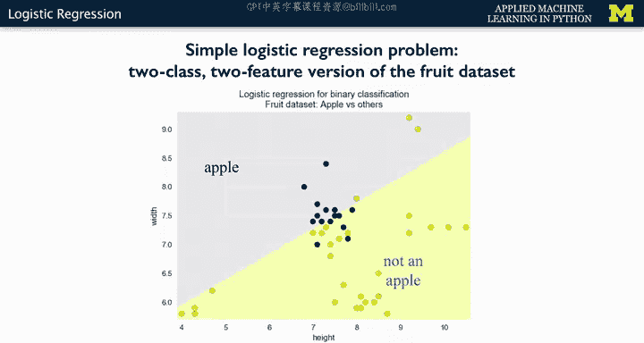

# 密歇根大学《Python用于数据科学实践（1-3课／共5课）｜Applied Data Science with Python 》deepseek翻译 - P68：13_逻辑回归算法.zh_en - GPT中英字幕课程资源 - BV1U64y1L7VJ

。We're now going to look at a second supervised learning method that。

 in spite of being called a regression method， is actually used for classification。

 and it's called logistic regression。Logistic regression can be seen as a kind of generalized linear model。

And like ordinary least squares and other regression methods。

 Lo regression takes a set of input variables， the features， and estimates a target value。However。

 unlike ordinary linear regression， in its most basic form。

 logistic regressions target value is a binary variable instead of a continuous value。

There are flavors of logistic regression that can also be used in cases where the target value to be predicted as a multi class categorical variable。

 not just binary。 But for now， we'll focus on the simple binary case of logistic regression。

Let's start by looking at linear regression， which we saw earlier。

Lininear regression predicts a real valued output Y based on a weighted sum of input variables or features X。

 I plus a constant B term。This diagram shows that formula in graphical form。

The square boxes on the left represent the input features X。

 and the values above the arrows represent the weights that each Xi is multiplied by。

The output variable Y in the box on the right is the sum of all the weighted inputs that are connected into it。

Note that we're adding B as a constant term by treating it as the product of a special constant feature with value 1。

 multiplied by a weight of value B。 This formula is summarized in equation form below the diagram。

The job of linear regression is to estimate values for the model coefficients， WI hat and B hat。

They give a model that best fit the training data with minimal squared error。

Logistic regression is similar to linear regression， but with one critical addition。

Here we show the same type of diagram that we showed for linear regression with the input variables。

 X I and the left boxes and the model coefficients， W， I and B above the arrows。

The logistic regression model still computes a weighted sum of the input features X I and the intercept term B。

But it runs this result through a special non linear function。 F， the logistic function。

Represented by this new box in the middle of the diagram to produce the output Y。

The logistic function itself is shown in more detail on the plot on the right。

It's an S shape function that gets closer and closer to one as the input value increases above 0 and closer and closer to 0 as the input value decreases far below 0。

The effect of applying the logistic function is to compress the output of the linear function。

So that it's limited to a range between 0 and 1。Below the diagram。

 you can see the formula for the predicted output Y hat。

 which first computes the same linear combination of the input's X I， model coefficient weights。

 W Y hat and intercept B hat。But runs it through the additional step of applying the logistic function to produce Y hat。

If we pick different values for B hat and the W hat coefficients。

 we'll get different variants of this S shaped logistic function， which again。

 is always between 0 and 1。Because the job of basic logistic regression is to predict a binary output value。

You can see how this might be used for binary classification。

We could identify data instances with a target value of 0 as belonging to the negative class and data instances with a target value of one as belonging to the positive class。

Then the value of Y hat that's the output from the logistic regression formula can be interpreted as the probability that the input data instance belongs to the positive class given its input features。

Let's look at a specific example of logistic regression with one input variable。

Suppose we want to predict whether or not a student will pass a final exam based on a single input variable that's the number of hours they spend studying for the exam。

Students who end up failing the exam are assigned to the negative class。

 which corresponds to a target value of0。And students who pass the exam are assigned to the positive class and associated with a target value of one。

This plot shows an example training set。 The X axis corresponds to the number of hours studied。

And the Y axis corresponds to the probability of passing the exam。

The red points to the left with a target value of0 represent points in the training set。

 which are examples of students who failed the exam。

 along with the number of hours they spent studying。Likewise。

 the blue points with target value1 on the right represent points in the training set corresponding to students who passed the exam with their X values representing the number of hours those students spent studying。

Using logistic regression， we can estimate model coefficients for W hat and B hat that produce a logistic curve that best fits these training points。

In this example， that logistic curve might look something like this。

Once the molecule coefficients have been estimated。

 we now have a formula that can use the resulting logistic function to estimate the probability that any given student will pass the exam。

 given the number of hours they've studied。Students whose estimated probability of passing the exam is greater than or equal to 50% are predicted to be in the positive class。

 otherwise they're predicted to be in the negative class。So in this example。

 we can see that students who study for more than three hours will be predicted to be in the positive class。

Let's look at an example that uses two input features now instead of one。Here。

 the plots show a training set with two classes。 Each data point has two features。

 feature 1 corresponds to the X axis， and feature 2 corresponds to the Y axis。

The data points in the red class on the left form a cluster with low feature1 value and high feature 2 value。

And the points in the blue class have intermediate feature  one value and low feature 2 value。

We can apply logistic regression to learn a binary classifier using this training set。

 using the same idea we saw in the previous exam example。To do this。

 we'll add a third dimension showed here as the vertical y axis。

Corresponding to the probability of belonging to the positive class。

We'll say that the red points are associated with a negative class and have a target value of 0。

And the blue points are associated with the positive class and have a target value of one。

Then just as we did in the exam studying example， we can estimate the W hat and B hat parameters of a logistic function that best fits this training data。

The only difference is that the logistic function is now a function of two input features and not just one。

So it forms something like a three dimensional S shaped sheet in this space。

Once this logistic function has been estimated from the training data。

 we can use it to predict the class membership for any point。

 given its feature one and feature 2 values， same way we did for the exam example。

Any data instances whose logistic probability estimate Y hat is greater than or equal to 0。

5 are predicted to be in the positive blue class。Otherwise， in the other red class。Now。

 if we imagine that there's a plane representing y equals 0。

5 as shown here that intersects this logistic function。

 it turns out that all the points that have a value of y equals 0。

5 when you intersect that with a logistic function， the points all lie along a straight line。

In other words， using logistic regression gives a linear decision boundary between the classes as shown here。

If you imagine looking straight down on the 3D logistic function on the left。

You get the view that looks something like something on the right here。

The points with y greater than are equal to 0。5 on the logistic function。

Ly in a region to the right of the straight line。Which is the dashed line on the right here。

And the points with y less than 0。5 on the logistic function would form a region to the left of that dashed line。

Let's look at an example with real data in Psyit Learn。To perform Lo regression in Psyit Learnn。

 you import the Lo regression class from the SK learnn dot linearar model module。

And then create the object and call the Fi method using the training data just as you did for other classifiers like K nearest neighbors。

Here， the code also sets a parameter C to 100， which we'll explain in a minute。

The data we're using here is a modified form of our fruits data set using only height and width as the features in the feature space。

And with the target class values modified into a binary classification problem。

 predicting whether an object is an apple， the positive class。Or something other than an apple。

 a negative class。Here's a graphical display of the results。

The X axis corresponds to the height feature and the Y axis corresponds to the width feature。

The black points represent the positive Apple class training points。

And the yellow points are instances of all the other fruits in the training set。

The gray decisionion region represents。That area of the height and width feature space where a fruit would have an estimated probability greater than 0。

5 of being an apple and thus classified as an apple， according to the logistic regression function。

The yellow decision region corresponds to the region of feature space。

For objects that have an estimated probability of less than 0。5 of being an apple。

You can see the linear decision boundary where the gray region meets the yellow region that results from applying logistic regression。

In fact， logistic regression results are often quite similar to those you might obtain from a linear support vector machine。

 another type of linear model we explore for classification。

Like Rige and Lassso regression， a regularization penalty on the molo coefficients can also be applied with logistic regression and is controlled with the parameter C。

In fact， the same L2 regularization penalty used for ridge regression is turned on by default for logistic regression。

 with a default value C equals 1。Note that for both support vector machines and logistic regression。

 higher values of C correspond to less regularization。With large values of C。

 logistic regression tries to fit the training data as well as possible。

 while with small values of C， the model tries harder to find model coefficients that are closer to0。

 even if that model fits the training data a little bit worse。

You can see the effect of changing the regularization parameter C for logistic regression in this visual。

Using the same Apple classifier， we now very see to take on values from 0。1 on the left to 1。

0 in the middle and 100。0 on the right。Although the real power of regularization doesn't become evident until we have。

Data that has higher dimensional feature spaces， you can get an idea of the trade off that's happening between relying on a simpler model。

 one that puts more emphasis on a single feature in this case out of the two features。

But has lower training set accuracy， and that's an example as shown on the left with C equal 。1。

Or better training data fit on the right with C equal 100。

You can find the code that created this example in the accompanying notebook。Finally。

 we show how logistic regression， again with L2 regularization turned on by default。

Can be applied to a real data set with many more features， the breast cancer data set。Here。

 logistic regressionion achieves both training and test set accuracy of 96%。

