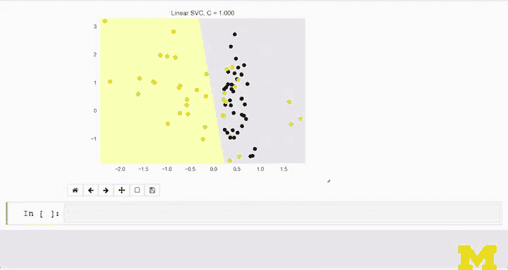

# 密歇根大学《Python用于数据科学实践（1-3课／共5课）｜Applied Data Science with Python 》deepseek翻译 - P69：14_线性分类器：支持向量机.zh_en - GPT中英字幕课程资源 - BV1U64y1L7VJ

Let's look at how linear models are also used for classification。Starting with binary classification。

This approach to prediction uses the same linear functional form as we saw for regression。

But instead of predicting a continuous target value。

 we take the output of the linear function and apply the sine function。

To produce a binary output with two possible values， corresponding to the two possible class labels。

If the target value is greater than0。The function returns plus 1。 And if it's less than 0。

 the function returns -1。Here's a specific example。

So let's take a look at a simple linear classification problem。

 a binary problem that has two different classes。And where each data instance is represented by two informative features。

So we're going to call these features x1。On the X axis and x 2。On the Y axis。Now， how do we get from。

Taking a data instance that's just described by。A particular combination of x1 x2。

To a class prediction。Well， in a linear classifier， what we do is。

We take the feature values assigned to a particular data point。 So in this case， it might be。2。1。2。

10。So that represents。The X1 and x2 feature values for this particular instance， let's say。And。

The that correspond to the input here。And then we take those two x1 x2 values and put them through a linear function F here。

And the output of this F needs to be a class value， so either。

We want it to return plus one if it's in one class and negative one， if it's in the other class。

So the linear classifier does that by computing a linear function of x1x2。

That's represented by this part of the equation here。So this W is a vector of weights。

 This x represents the vector of feature values， and then B。Is a bias term that gets added in。

 So this is a dot product。 This circle here is a dot product， which means that。

Let's say in the simple case where we had。Weight vector。2。😔，And a feature vector of x1x2。

The adopt product of those is simply the linear combination。OfW1， X1。Plus。W2， x 2。And then so we。

 we take the x values and。We have certain weights that are learned for the classifier。

So we compute x W1 x1 plus W2 x2， and then we feed that in then plus a bias term if there is one。And。

We feed the output of that through this sine function that converts。The value in here。

 if it's above 0， it will convert it to plus 1。 and if it's below 0， itll convert it to negative 1。

And that's what the。The equation represents here。 So that is the very simple rule that we use to convert。

A data instance with its input features to an output prediction。Okay。

 let's take a look using a specific linear function to see how this works in practice。

So what I've done here is。Draaw a straight line through this space that has iss defined by the equation x1 minus x2 equals 0。

In other words。Every point on this line satisfies this equation。 So you can see， for example， that。啊。

X equals x1 equals negative1， and x2 equals negative 1。 And if you subtract them， you get 0。

Essentially， it's just the line that represents all the points where x1 and x2 are equal。

So this corresponds to so we can sort of rewrite this x1 minus x2 equals 0 into a form that uses a dot product。

Of weights with the input vector x。So。In order to get x1 minus x2 equals 0。

That's equivalent to writing。A linear function where you have a weight vector of  one and negative one。

And a biased term of 0。So， for example， so if。We have weights， W1。W2。And that product of x1， x2。

Recall that。This is just the same as computing W1， X 1 plus。W2， x2。And so in this case。

 if W is one and negative one， that's equivalent to。X1。Minus x 2。

So all I've done here then is just convert the description of this， this line。

Into a form that can be used as a decision rule for a classifier。

So it might help to look at a specific point。 so suppose that we wanted to classify the point here that had coordinates negative075 and negative 2。

25。 So this point right here。So all we would do to have the classifier make a prediction with this decision boundary would be to。

Plug in those coordinates。Into。This part of the。Function。Apply。

The weights and the bias term that described the decision boundary。So， here。We're computing。

 so this expression here。Corresponds to。This part。Of the equation。And so， if we compute。

Weight 1 times x1 plus weight 2 times x 2 plus 0。We get a value of 0。

15 that's inside the sine function， and then the sine function will output one if this value is greater than 0。

 which it is。Or-1。 if the value is less than 0。 So in this case， because it's greater than 0。

 the output from the decision function would be plus 1。So this has classified this point as being。

Of class 1。If we look at a different point， let's take a look at the point negative 1。

75 and negative 0。25。So again， we're just gonna， So this is。Corresds to the value of x1 and x2。

And again， if we just take these values and plug them into。This part of the equation。Apply。

The weights and the bias term that describe。The decision boundaries that we did before。

 We do this computation。 We find out that， in fact。Classifier predicts。A class of -1 here。So。

 you see that。By applying a simple linear formula， we've been able to。Produce a class value for any。

Point in this two dimensional feature space。So one way to define a good classifier is to reward classifiers for the amount of separation they can provide between the two classes。

And to do this， we need to define the concept of classifier margin。

So informally for a given classifier。The margin is the width that the decision boundary can be increased before hitting a data point。

 So what we do is we， we take the decision boundary and we grow。

A region around it that sort of in this in perpendicular to the line this direction in that direction。

 And we grow this width until we hit a data point。 So in this case。

We were only able to grow the margin。A small amount here before hitting this data point。So。

This width here between the decision boundary and the nearest data point。

Represents the margin of this particular classifier。Now。

 you can imagine that for every classifier that we tried。

 we can do the same kind of calculation or simulation to find the margin。

And so among all possible classifiers it separate these two classes then。

We can define the best classifier as the classifier that has the maximum amount of margin。

Which corresponds to the one shown here。So you recall that the original classifier on the previous slide had a very small margin this one。

It manages to achieve a much larger margin。 So again， the margin is the distance。

 the width that we can go from the。Decision boundary， perpendicular to。The nearest data point。And so。

You can see that by defining this concept of margin。

 it sort of quantifies the degree to which the classifier can split the classes。

Into two regions that have some amount of separation between them。

We can actually do a search for the classifier that has the maximum margin。

And this maximum margin classifier is called a linear support vector machinech。

Also known as an LSVM or a support vector machine with linear kernel。

 I will explain more about what the concept of a kernel is and how you can define non nonlinear kernels。

 as well as kernels and why you'd want to do that。 We'll cover those shortly in a continuation of our support vector machine。

Lecture later in this。Particular week。Here's an example in the notebook on how to use the default Line support vector classifier in PsyitLn。

 which is defined in the S KLn S VM Library。The linear SVC class implements a linear support vector classifier and is trained in the same way as other classifiers namely by using the fit method on the training data。

Now， in the simple classification problem I just showed you。

 the two classes were perfectly separable with a linear classifier。In practice， though。

 we typically have noise or just more complexity in the data set that makes a perfect linear separation impossible。

But where most points can be separate without errors。By linear classifier。

And our simple binary classification data set here is an illustration of that。

So how tolerant the support vector machine is of misclassifying training points。

As compared to its objective of minimizing the margin between classes。

Is controlled by a regularization parameter called C。Which by default is set to 1。0 as we have here。

Larger values of C represent less regularization and will cause the model to fit the training set with as few errors as possible。

 even if it means using a smaller margin decision boundary。Very small values of C， on the other hand。

 Use more regularization that encourages the classifier to find a large margin decision boundary。

 Even if that decision boundary leads to more points being misclassified。

Here's an example in the notebook showing the effect of varying C on this basic classification problem。

On the right， when C is large， the decision boundary is adjusted so that more of the black training points are correctly classified。

 while on the left for small values of C， the classifier is more tolerant of these errors in favor of capturing the majority of data points correctly with a larger margin。

Finally， here's an example of applying the linear support vector machine to a real world data set。

 the breast cancer classification problem。 And here we can see it achieves reasonable accuracy without much parameter tuning。

On the positive side， linear models， in the case of linear and logistic regression。

 are simple and easy to train。And for all types of linear models。

 predictions very fast because of the linear nature of the prediction function。Linear models。

 including linear support vector machines， also perform effectively on high dimensional data set。

Especially in cases where the data instances are sparse。

Linear models scale well to very large data sets as well。

In the case of linear support vector machines， they only use a subset of training points and decision function。

These training points are called support vectors。So the algorithm can be implemented in a memory efficient way。

