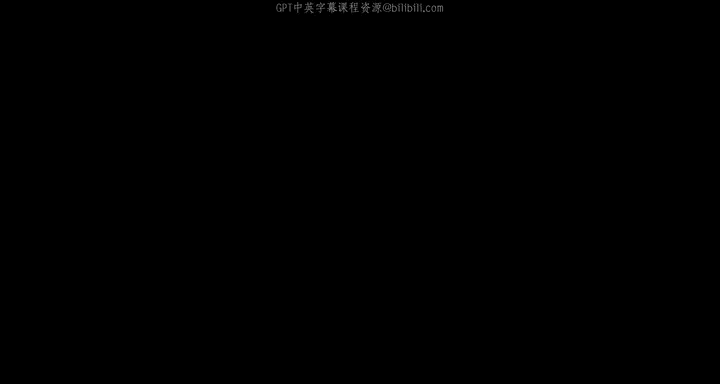
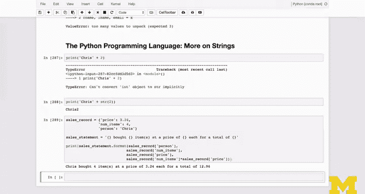

# 密歇根大学《Python用于数据科学实践（1-3课／共5课）｜Applied Data Science with Python 》deepseek翻译 - P6：5_Python字符串进阶.zh_en - GPT中英字幕课程资源 - BV1U64y1L7VJ

We talked about strings when we talked about lists and slicing。

 and you've seen ways to break up strings through the use of the split function and through direct indexing。

Stringings in Python can be a bit frustrating too， and I want to share some more details of how strings are handled so that you're aware of them。

In Python 3， strings are Uniicode based in early computing。

 characters of strings were limited to one of 256 different values。

 This was enough to get all of the upper lowercase Latin characters。

 as well as single digit numbers represented。 This language was called ASi and was fairly compact。

 But the world doesn't just run on Latin characters。

 And there's a need to support non English languages。

 as well as characters which are not commonly used in words， but are commonly used elsewhere。

 like mathematical operators。The Uniicode transformation format or UTF is an attempt to solve this。

 It can be used to represent over a million different characters。

 This includes not only human languages， like you might expect， but symbols like emojis， too。

Python 3 uses UniIcode by default， so there's no problem in dealing with international character sets。

In addition to Unicode， Python uses a special language for formatting the output of strings。

 One of the challenges with dynamic typing is that it's a bit unclear when you have to do type conversion yourself。

 We saw in the last lecture that if we wanted to print out a name and a number。

 that we can't use concatenation without calling the SR function to convert the number to a string first。

This creates a lot of nasty looking code where every operator you're looking to concatenate is wrapped in this STR function。

The Python string formatting mini language allows you to write a string statement indicating placeholders for variables to be evaluated。

 You then pass these variables in either as named or in order arguments。

 and Python handles the string manipulation for you。Here's an example。

 Imagine we have purchased order details in a dictionary， which includes a number of items， a price。

 and a person's name。We can write a sales statement string。

 which includes these items using curly brackets。We can then call the format method on that string and pass in the values that we want substituted as appropriate。

Now， the string formatting language allows you to do much more than this。

 You control a number of different things like decimal places for floating point numbers or whether you want to propend the positive numbers with a plus sign or set the alignment of strings to left or right justified or even enable the use of scientific notation。

I've linked the documentation page in the course resources。

 and being able to use the string library and formatting language will be an important part of your first assignment。

This has been a short lecture， but string manipulation is a big part of data cleaning。

 You're going to learn a lot more about string manipulation in this course through the assignments。

In the next video， though， our graduate student assistant is going to show you how to bring some basic data analysis together through the reading and writing of delimited data files。

