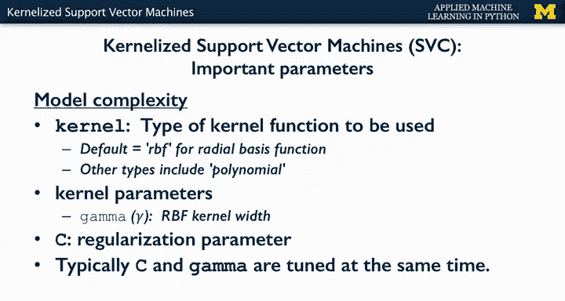

# 密歇根大学《Python用于数据科学实践（1-3课／共5课）｜Applied Data Science with Python 》deepseek翻译 - P71：16_核化支持向量机.zh_en - GPT中英字幕课程资源 - BV1U64y1L7VJ

We saw earlier how linear support vector machines served as effective classifiers for some data sets by finding a decision boundary with maximum margin between the classes。

Linear support vector machines worked well for simpler kinds of classification problems。

 where the classes were linearly separable or close to linearly separable。

 like this example on the left。But with real data， many classification problems aren't this easy with the different classes located in feature space in a way that a line or hyperplane can't act as an effective classifier。

Here's an example on the right。This data set is difficult or impossible for a linear model。

 a line or a hyperplane， to classify well。So to help address the situation。

 we're now going to turn to our next type of supervised learning model。

 a very powerful extension of linear support vector machines called kernelized support vector machines。

Basically， kernelized support vector machines， which I'll just call SVMs。

Can provide more complex models that go beyond linear decision boundaries。

As with other supervised machine learning methods， SVMs can be used for both classification and regression。

But due to time constraints we'll focus only on classification in this lecture。

We also won't go into the mathematical details of how SVMs operate。

 but we will give a high level overview that hopefully captures the most important elements of this method。

In essence， one way to think about what kernelized SVMs do is that they take the original input data space and transform it to a new higher dimensional feature space where it becomes much easier to classify the transformed data using a linear classifier。

Here's a simple one dimensional example of what I mean。Here's a binary classification problem。

In one dimension with a set of points that lie along the X axis。

 color black for one class and white for the second class。Each data point here has just one feature。

 its's positioned on the X axis。If we gave this problem to a linear support vector machine。

 it would have no problem finding the decision boundary that gives the maximumimal margin between points of different classes。

Here I've engineered the data points so that the maximum margin decision boundary happens to be at x equals0。

Now， suppose we gave the linear support vector machine a harder problem where the classes are no longer linearly separable。

A simple， linear decision boundary just doesn't have enough expressive power to classify all these points correctly。

So what can we do about this？One very powerful idea is to transform the input data from a one dimensional space to a two dimensional space。

We can do this， for example， by mapping each one dimensional input data instance X I。

To a corresponding two dimensional ordered pair X， I， X， I squared。

Whose new second feature is the squared value of the first feature。

We're not adding any new information in the sense that all we need to obtain this new two dimensional version。

Is already present in the original one dimensional data point。

This might remind you of a similar take technique that we saw when adding polynomial features to a linear regression problem earlier in the course。

We can now learn a linear support vector machine in this new two dimensional feature space。

 whose maximum margin and decision boundary might look like this here。

To correctly classify the points。Any future one dimensional points for which we'd like to predict the class。

 we can just create the two dimensional transformed version and predict the class of the two dimensional point using this two dimensional linear S VM。

If we took the inverse of the transformation we just applied to bring the data points back to our original input space。

We can see that the linear decision boundary in the two dimensional space。

Corresponds to the two points where a parabola crosses the X axis。Now。

 just so this very important idea is clear。Let's move from a one dimensional problem。

To a two dimensional classification problem。And see the same powerful idea in action here。

Here we have two classes represented by the black and the white points。

Each of which has two features， x 0 and x1。The points of both classes are scattered around the origin 0。

0 in a two dimensional plane。The white points form a cluster， right around 0，0。

That's completely surrounded by the black points。Again。

 this looks to be impossible for a linear classifier。

 which in two dimensional space is a straight line to separate the white points from the black points with any degree of accuracy。

But just as we did in the one dimensional case， we can map each two dimensional point， x 0， x 1。

To a new three dimensional point by adding a third feature。Mathematically。

1 minus x0 squared plus x1 squared。And this transformation acts to shape the points into a paraboloid。

Around0， zero。Now， the white points， since they're close to 0，0。

 get mapped to points with higher vertical Z values。 that new third feature that are close to one。

While the black points， which are farther from 0，0。

 get mapped to points with Z values that are either close to 0 or even negative。

With this transformation， it makes it possible to find a hyperplane。

 say Z equals 09 that now easily separates the white data points that are near Z equals1 from most or all of the black data points。

Finally， the decision boundary consists of the set of points in 3D space。

 where the paraboloid intersects the maximum margin hyperplane decision boundary。

This corresponds to an ellipse like decision boundary in 2D space that separates the white points from the black points in the original input space。

This idea of transforming the input data points to a new feature space where a linear classifier can be easily applied is a very general and powerful one。

There are lots of different possible transformations we could apply to data。

And the different kernels available for the kernelized SVM correspond to different transformations。

Here， we're going to focus mainly on what's called the radio basis function kernel。

 which will abbreviate as R B F。And also look briefly at something called a polynomial kernel that's also included with Psyt Learn's SVM module。

The kernel function in an S VM tells us， given two points in the original input space。

 what is their similarity in the new feature space。For the radio basis function kernel。

 the similarity between two points in the transformed feature space。

Is an exponentially decaying function of the distance between the vectors in the original input space。

 as shown by the formula here。So what does the radio basis function feature transformation look like。

While， this diagram should give an intuitive idea。 Here's another graphical illustration of a binary classification problem。

And again， this diagram is for illustration purposes only， and it's just an approximation。

 but essentially。You can think of it in a similar way to the 2D to 3D example we saw earlier。

So on the left， there's a set of samples in the input space。

 and the circles represent the training points of one class and the squares represent training points of a second class。

On the right， the same samples are shown in the transformed feature space。

Using the radio basis function kernel in effect， transforms all the points inside a certain distance of the circle class to one area of the transformed feature space and all the points in the square class outside a certain radius get moved to a different area of the feature space。

The dark circles and squares represent the points that might lie along the maximum margin for a support vector machine in the transformed feature space。

And also， it shows the corresponding points in the original input space。

So just as we saw with the simple 1 D and 2 D examples earlier。

The currenternized support vector machine tries to find the decision boundary with maximum margin between classes using a linear classifier in the transformed feature space。

 not the original input space。The linear decision boundary learned in feature space by a linear SVM。

Corsponds to a linear decision boundary in the original input space。 So in this example。

 an ellipse like closed region in the input space。Now。

 one of the mathematically remarkable things about kernelized support vector machines。

Something referred to as the kernel trick is that internally。

 the algorithm doesn't have to perform this actual transformation on the data points to the new high dimensional feature space。

Instead， the kernelized S VM can compute these more complex decision boundaries just in terms of similarity calculations between pairs of points in the high dimensional space。

 where the transformed feature representation is implicit。This similarity function。

 which mathematically is a kind of dot product。Is the kernel in kernelized SVM？

And for certain kinds of high dimensional spaces， the similarity calculation between points。

The kernel function can have a simple form， like we see with the radio basis function calculation。

This makes it practical to apply support vector machines when the underlying transformed feature space is complex or even infinite dimensional。

Even better， we can easily plug in a variety of different kernels。

 choosing one to suit the properties of our data。Again。

 different choices of kernel correspond to different types of transformations to that higher dimensional feature space。

Here's the result of using a support vector machine with RBF kernel on that more complex binary classification problem we saw earlier。

You can see that， unlike a linear classifier， the S VM with RB F kernel finds a more complex and very effective set of decision boundaries that are very good at separating one class from the other。

Note that the SVM classifier is still using a maximum margin principle to find these decision boundaries。

But because of the nonlinear transformation of the data。

 these boundaries may no longer always be equally distant from the margin edge points in the original input space。

Now let's look at an example of how we did this using Psyit learn in Python。To use SVMs。

 we simply import the SVC class from SKLn。 SVM。And use it just as we would and the other classifier。

 for example， by calling the fit method with the training data to train the model。

There is an SV parameter called kernel that allows us to set the kernel function used by the SVM。

By default， the SVM will use the radio basis function。But a number of other choices are supported。

Here in the second example and plot， we show the use of the polynomial kernel instead of the RBF kernel。

The polynomial kernel using the kernel poly setting。

Essentially represents a feature transformation similar to the earlier quadratic example。

In the lecture， this feature space represented in terms of features that are polynomial combinations。

Of the original input feature， as much as we saw， also for linear regression。

The polynomial kernel takes an additional parameter degree。

That controls the model complexity and the computational cost of this transformation。

You may have noticed that the RBF kernel has a parameter， gamma。

Gamut controls how far the influence of a single training example reaches。Which， in turn。

 affects how tightly the decision boundaries end up surrounding points in the input space。

Small gamma means a larger similarity radius， so that points farther apart。Are considered similar。

Which results in more points being grouped together and smoother decision boundaries。

On the other hand， for larger values of gamma， the kernel value decays more quickly。

 and points have to be very close to be considered similar。This results in more complex。

 tightly constrained decision boundaries。You can see the effect of increasing gamma that is sharpening the kernel in this example from the notebook book。

Small values of gamma give broader， smoother decision regions。

 While larger values of gamma give smaller， more complex decision regions。

You can set the gamma parameter when creating the SVC object to control the kernel width in this way。

 as shown in this code。You may recall from linear SVMs that SVMs also have a regularization parameter C that controls the trade off between satisfying the maximum margin criterion to find a simple decision boundary。

And avoiding misclassification errors on the training set。

The C parameter is also an important one for kernelized SVMs。

 and it interacts with the gamma parameter。This example from the notebook shows the effect of varying C and gamma together。

If gamma is large， then sea will have little to no effect。While if gamma is small。

 the model is much more constrained， and the effect of C will be similar to how it would affect a linear classifier。

Typically， gamma and C are tuned together with the optimal combination。

 typically in an intermediate range of values。 For example。

 gamma between 00001 and 10 and C between01 and 100。

Though the specific optimal values will depend on your application。

Clonnalized SVMs are pretty sensitive to settings of gamma。

The most important thing to remember when applying S Vms is that its important to normalize the input data so that all the features have comparable units that are on the same scale。

We saw this earlier with some other learning methods， like regularized regression。

Let's apply a support vector machine with RBF kernel to a real world data set to see why this normalization is important。

Here we'll apply a support vector machine with RBF kernel to the breast cancer dataset set。

Note that we're not touching the input data in any way。 We're simply passing in the raw values。

We can see the results with training set accuracy of 1。00 and the test set accuracy of 0。

63 that show that the support vector machine is overfitting。sing well on the training data。

 but very poorly on the test data。Now let's add a Min Max scalar transformation of the training data。

Remembering to also apply the same scalar to the test data。After this scalar has been applied。

 all the input features now lie in the same range，0 to 1。And looking at these new results。

 the test set accuracy is much， much higher at 96% cent。

This illustrates what a huge difference normalizing the features of the training data can have on SVM performance。

Let's review the strengths and weaknesses of support vector machines。On the positive side。

 support vector machines perform well on a range of data sets。

And have been successfully applied on data that ranges from text to images and many more types。

The support vector machines also potentially vary versatile due to its ability to specify different kernel functions。

 including possible custom kernel functions， depending on the data。

Support vector machines also typically work well for both low and high dimensional data。

 including data with hundreds， thousands or even millions of sparse dimensions。

This makes it well suited to text classification， for example。On the negative side。

 as the training set size increases， the runtime speed and memory usage in the SVM training phase also increases。

So for large data sets with hundreds of thousands or millions of instances。

 an SVM may become less practical。As we saw when applying a sport vector machine to a real world data set。

Using an SVM requires careful normalization of the input data， as well as parameter tuning。

The inputs should be normalized so that all features have comparable units and are on similar scales if they aren't already。

Support vector machines also don't provide direct probability estimates for predictions。

 which are needed for some applications。Now， there are ways to estimate these probabilities using techniques such as plat scaling。

Which transforms the output of the classifier to a probability distribution over classes by fitting a logistic regression model to the classifier scores。

Finally， it can be difficult to interpret the internal model parameters of a support vector machine。

Which means the applicability of support vector machines in scenarios where interpretation is important for people。

May be limited。When we want to understand why a particular prediction was made。As a reminder。

 there are three main parameters that control model complexity for kernelized SVMs。First。

 there's the kernel type， which defaults to RBF for radio basis function。

But several other common types are available in p Psychic Learns as PC C module。Second。

 each colonel has one or more kernel specific parameters that control aspects like the influence of training points。

 according to their distance。In the case of the RB F kernelel。

 SVM performance is very sensitive to the setting of the gamma parameter that controls the kernel width。

Finally。For any support vector machine， the C regularization parameter operates。

 as we've discussed before。And is typically tuned with a kernel parameter。

 such as gamma for optimal performance。

