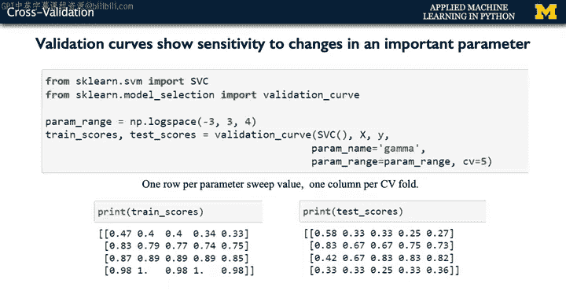

# 密歇根大学《Python用于数据科学实践（1-3课／共5课）｜Applied Data Science with Python 》deepseek翻译 - P72：17_交叉验证技术.zh_en - GPT中英字幕课程资源 - BV1U64y1L7VJ

So far， we've seen a number of supervised learning methods。And when applying each of these methods。

 we followed a consistent series of steps。First， partitioning the data set into training and test sets using the Tra test split function。

Then calling the fit method on the training set to estimate the model and finally applying the model by using the predict method to estimate a target value for the new data instances or by using the score method to evaluate the trained model's performance on the test set。

Let's remember that the reason we divided the original data into training and test sets was to use the test set as a way to estimate how well the model trained on the training data would generalize to new previously unseen data。

The test set represented data that had not been seen during training。

 but had the same general attributes as the original data set。Or in more technical language。

 was drawn from the same underlying distribution as the training set。

Cross validation is a method that goes beyond evaluating a single model using a single train test split of the data by using multiple train test splits。

 each of which is used to train and evaluate a separate model。

So why is this better than our original method of a single train test split。Well。

 you may have noticed， for example， by choosing different values for the random state seed parameter in the train test split function when you are working on some examples or assignments。

That the accuracy score you get from running a classifier can vary quite a bit just by chance。

 depending on the specific samples that happen to end up in the training set。

Cross validation basically gives more stable and reliable estimates of how the classifier is likely to perform。

 on average by running multiple different training test splits and then averaging the results instead of relying entirely on a single particular training set。

It's really important to understand how cross validation is used in practice。

 The main scenario where you'll need cross validation is when you have a particular classification task and you want to compare the accuracy of one type of model。

 let's say support vector machine with a different model， let's say naive basees。In this scenario。

 to do that comparison well， you don't want to rely on the accuracy numbers from just a single train test split。

Because it might be just by chance using that particular train test split that the naive Bay model happens to do better when in reality。

 it may actually be worse overall， So instead， you should compare the two approaches in a more reliable way by using cross validation to create multiple train test splits。

And then computing the overall mean evaluation metric across those folds。So for example。

 if you use tenfold cross validation。This will evaluate the two approaches using 10 different train test splits。

Instead of a single one， and this will give you a more stable estimate of how each model is likely to do compared to relying on just a single train test split。

Once you've made your final decision on which modeling approach to use。

 and there's no more tuning left to be done， then you can train a final production classifier using all the data you have。

One slightly confusing point here might be on how you use the multiple models that result from applying cross validation。

For example，10 fold cross validation will result in 10 trained models。

 each with its own set of estimated coefficients。When you apply cross validation。

 you're simply computing an evaluation measure like accuracy for each of the 10 models。

 and then just taking the mean over those 10 evaluation numbers。 That's it With cross validation。

 you're not producing a new hybrid model by merging together those 10 models in some way。

Now there are some special scenarios where you can do that。

 and that's a separate topic called model averaging， but we won't be going into that here。

The bottom line is that if you want to compare two different model types。

 use Kfold cross validation and don't rely on just a single train test split when computing your evaluation numbers。

It's also really important to understand the difference between using cross validation for model evaluation。

Versus using it for model tuning。If your task is to evaluate and compare different model types that have already been individually tuned and optimized。

 you use Kfold cross validation with train test splits。But your task is to attune a single model。

 such as when you want to find the best hyper parameters for a support vector machine， for example。

This uses a slightly different setup where instead of just a trained test split。

 we divide our data into three slices called training， validation and test splits。

We'll cover how to use Tra validate test splits in the model selection optimizing Classifiers lecture。

Here's a graphical illustration of how cross validation operates on the data。

The most common type of cross validation is Kfold cross validation。

Most commonly with K set to 5 or 10。For example， to do five fold cross validation。

 the original data set is partitioned into five parts of equal or close to equal size。

Each of these parts is called a fold。Then a series of five models is trained， one per fold。

The first model， Model1， is trained using folds 2 through5 as the training set and evaluated using F1 as the test set。

The second model， Model 2， is trained using folds 1，3，4。

 and 5 as the training set and evaluated using fold2 as the test set and so on。

When this process is done， we have five accuracy values， one per fold。In Psyit Learnarn。

 you can use the cross Val score function from the model selection module to do cross validation。

The parameters are first， the model you want to evaluate， and then the data set。

 and then the corresponding ground truth， target labels or values。By default。

 cross valve score does five fold cross validation。So it returns five accuracy scores。

 one for each of the five folds。If you want to change the number of fold。

 you can set the C V parameter。For example， C V equals 10 will perform tenfold cross validation。

It's typical to then compute the mean of all the accuracy scores across the folds。

And report the mean cross validation score as a measure of how accurate we can expect a model to be。

 on average。One benefit of computing the accuracy of a model on multiple splits is that instead of a single split。

It gives us potentially useful information about how sensitive the model is to the nature of the specific training set。

So we can look at the distribution of these multiple scores across all the cross validation folds to see how likely it is that by chance。

 the model will perform very badly or very well on any new data set。

So we can do a sort of worst case or best case performance estimate from these multiple scores。

This extra information does come with extra cost。 It does take more time and computation to do cross validation。

So， for example， if we perform K fold cross validation and we don't compute the fold results in parallel。

 it'll take about K times as long to get the accuracy scores as it would with just one train test split。

However， the gain in our knowledge of how the model is likely to perform on future data is usually well worth this cost。

In the default cross validation setup。To use， for example，5 folds。

 the first 20 per cent of the records are used as the first fold。

 the next 20 per cent for the second fold and so on。

One problem with this is that the data might have been created in such a way that the records are sorted or at least show some bias in the ordering by a class label。

For example， if you look at our fruit data set。It happens that all the labels for classes 1 and 2。

 the apples and the Mandarin oranges。Come before classes 3 and4 in the data file。

 So if we simply took the first 20% of records for fold one。

Which will be used as the test set to evaluate Model 1。

It would evaluate the classifier only on class1 and two examples and not at all on the other classes 3 and4。

 which would greatly reduce the informativeness of the evaluation。

So when you ask PsyCit learn to do cross validation for a classification task。

It actually does instead what's called stratified K fold cross validation。

The stratified cross validation means that when splitting the data。

The proportions of classes in each fold are made as close as possible to the actual proportion of the classes in the overall data set。

 as shown here。For regression， psycht Ln uses regular cafold cross validation。

 since the concept of preserving class proportions isn't something that's really relevant for everyday regression problems。

At one extreme， we can do something called leave one out cross validation。

 which is just K fold cross validation with K set to the number of data samples in the data set。

In other words， each fold consists of a single sample as the test set and the rest of the data as the training set。

Of course， this uses even more computation， but for small data sets in particular。

 it can provide proved estimates because it gives the maximum possible amount of training data to a model。

 and that may help the performance of the model when the training sets are small。

Sometimes we want to evaluate the effect that an important parameter a model has on the cross validation scores。

The very useful function validation curve makes it easy to run this type of experiment。

Like cross Fco validation curve will do five fold cross validation by default。

 But you can adjust this with the C V parameter as well。Unlike Cross F score。

 you can also specify a classifier， parameter name and set of parameter values you want to sweep across。

So you first pass in the estimator object， or that is the classifier or regression object to use。

Followed by the data set samples X and target values Y。

The name of the parameter you want to sweep and the array of parameter values that parameter should take on doing the sweep。

Validation curve will return two two dimensional arrays corresponding to evaluation on the training set and the test set。

Each array has one row per parameter value in the sweep。

 and the number of columns is the number of cross validation folds that are used。So for example。

 the code shown here will fit four models using a radio basis function support vector machine on different subsets of the data corresponding to the four different specified values of the kernel gamma parameter。

So that will return 2，4 by 5 arrays。 So four levels of gamma and five cross validation folds containing the scores for the training and test sets。

You can plot these results from validation curve， as shown here。

To get an idea of how sensitive the performance of the model is to changes in the given parameter。

The X axis corresponds to values of the parameter， and the y axis gives the evaluation score。

 for example， the accuracy， the classifier。Finally， as a reminder。

Cross validation is used to evaluate a model and not learn or tune a new model to do model tuning。

 We'll look at how to tune a model's parameters using something called grid search in a later lecture。

