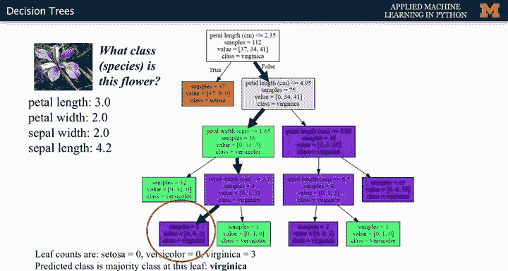
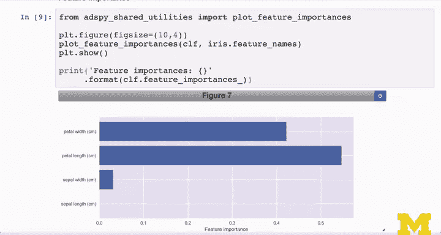
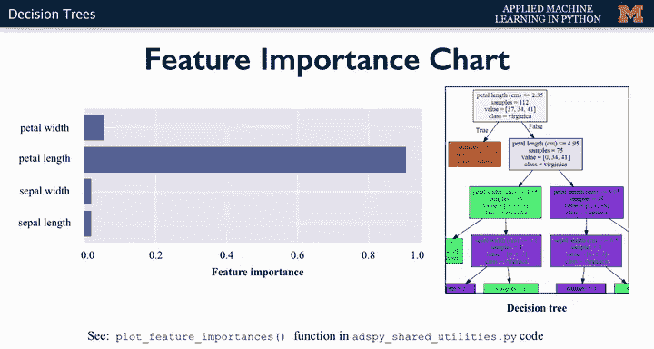
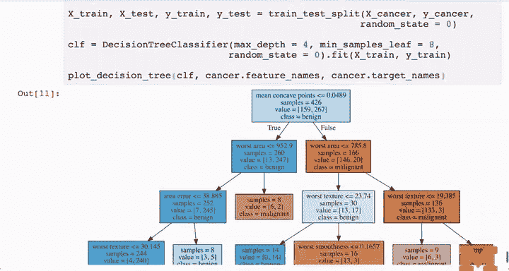
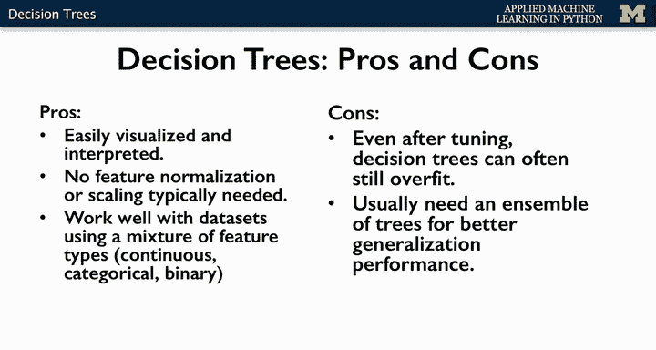

# 密歇根大学《Python用于数据科学实践（1-3课／共5课）｜Applied Data Science with Python 》deepseek翻译 - P73：18_决策树算法.zh_en - GPT中英字幕课程资源 - BV1U64y1L7VJ

Decision trees are a popular supervised learning method。That。

 like many other luring methods we've seen， can be used for both regression and classification。

Decision trees are easy to use and understand and are often a good exploratory method if you're interested in getting a better idea about what the influential features are in your data set。

Basically， decision trees learn a series of explicit if then rules on future values that result in a decision that predicts the target value。

Here's a simple example。Suppose we're playing a game where one person thinking of one of several possible objects。

 so let's say an automobile， a bus， an airplane， a bird， an elephant， and a dog。

A second person has to guess the identity of that thing by asking as few yes or no questions as possible。

 up to a limit of no more than， say，10 questions。Suppose the first person secretly thinks of an automobile。

So one of the first questions the second person might ask is。Is it alive？Intuitively。

 we know that this type of broad question is much more informative and helps eliminate a larger set of possibilities early on compared to asking a more specific question right away。

 like， does it have orange fur with black stripes？The more specific questions might be useful later once we've narrowed the class of things down to particular animals or vehicles。

 for example。If we think of the property of being alive as a binary feature of an object and the property of having orange fur with black stripes as another feature。

 we can say that the is a feature is more informative at an early stage of guessing and thus would appear higher in our tree of questions。

When the answer to the first question comes back as no， it's not alive。A second question might be。

 does it fly？When that answer comes back no， we can continue to narrow down the set of possible answers by asking more and more specific questions。

 such as can it carry more than 10 people？In this way。

 any given object can be categorized as either matching the target object the first person is thinking of or not。

 according to its features as determined by asking this series of yes or no questions。

We can form these questions into a tree with a node representing one question。

And the yes or no possible answers as the left and right branches from that node that connect the node to the next level of the tree。

One question being answered at each level。At the bottom of the tree are nodes called leaf nodes that represent actual objects as the possible answers。

For any object， there is a path from the root of the tree to that object that is determined by the answers to the specific yes or no questions at each level。

For example， a dog is alive， cannot fly and doesn't have a trunk。

You can view this as a kind of simple decision tree for predicting the class of an object。

We can generalize this idea of finding a set of rules that can learn to categorize an object into the correct category to many other classification tasks。

For example， we're going to look at a classification task next that involves finding rules that can predict what species a particular flower is。

Based on measurements of certain parts of the flower。

Rather than try to figure out these rules manually for every task。

 there are supervised algorithms that can learn them for us in a way that gets to an accurate decision quickly。

 which we'll look at now。Let's start by looking at a famous data set in machine learning called the IIS dataset。

This data set is included with PsyCit Learn in the datasets module。

Each instance in the data set represents one of three different species of iris， a type of flower。

There are four attributes or features for each instance that represent measurements of different parts of the flower。

The sepple length in centimeters， the sepel width in centimeters。

 petal length in centimeters and petal width in centimeters。 The three species are called Seosa。

 versicolor and Virginiaica。The data set has measurements for 150 flowers with 50 examples of each species。

The classification task is to predict which of the three species and instances given these measurements。

Unlike our simple example involving yes or no questions， which were binary features of the object。

The Iis data sets features are continuous values， so the rules to be learned will be of the form。

 for example， is petal length greater than 2。3 centimeters。

Let's take a look at how a decision tree is built on this data。

The goal when building a decision tree is to find the sequence of questions that has the best accuracy at classifying the data in the fewest steps。

Looking at a decision tree， each decision splits the data into two branches based on some feature value being above or below a threshold。

For example， whether the pedal width is greater than 1。

2 centimeters might be an example of a splitting rule。That threshold is called a split point。

An important concept is how informative a split of the data is。So intuitively。

 an informative split of the data is one that does an excellent job at separating one class from the others。

An example of an informative split might be to put all instances of the flowers with petal length。

 less than 2。35 cm into one bin and the rest in the other bin。

This is an informative split because at least for this training set。

Using that rule separates the Satosa class completely from the others and allows us to predict the Satosa class perfectly just based on this one measurement。

A less informative split。Like a rule like sepple width less than equal to three centimeters。

Would not produce as clear a separation of one class from the others。So for the best split。

 the results should produce as homogeneous a set of classes as possible。

There are a number of mathematical ways to compute the best split。

One criterion that's widely used for decision trees is called information gain， for example。

So to build the decision tree， the decision tree bit building algorithm starts by finding the feature that leads to the most informative split。

For any given split of the data on a particular feature value， even for the best split。

 it's likely that some examples will still be incorrectly classified or need further splitting。

In the Iis data set， if we look at all the flowers with petal length greater than 2。35 centimeters。

 for example。Using that split leaves a pool of instances that are a combination of Virginiaica and versa color that still need to be distinguished further。

So we can further improve the accuracy of the classification by continuing this process of finding the best split for the remaining subsets。

With the IIS data set， we can further split into flowers that have petal length less versus greater than 4。

95 centimeters， for example。This second split is informative because the resulting subsets are more homogeneous。

 that is split did a good job at dividing Virginiaica from versa color based on the second split test。

We can continue this process recursively until we're left with leaves in the decision tree that all have the same or at least a predominant majority of a target value。

Trees whose leaf nodes each have all the same target value are called pure。

As opposed to mixed where the leaf nodes are allowed to contain at least some mixture of their classes。

To predict the class of a new instance， given its feature measurements。Using the decision tree。

 we simply start at the root of the decision tree。And take the decision at each level based on the appropriate feature measurement until we get to a leaf node。

The prediction is then just the majority class of the instances in that leaf note。

So for the iris data， for example， a flower that has a petal length of three centimeters。

 a petal width of two centimeters， and a sepel width of two centimeters would end up at this leaf node whose instances are all of the progenica class。

 so the prediction would be Virginiaica。

Decision trees can also be used for regression using the same process of testing the feature values at each node and predicting the target value based on the contents of the leaf node。

For regression， the leaf node prediction would be the mean value of the target values for the training points in that leaf。

Inside KitLarn to build a decision tree， you import the Decion tree classifier class from the SKL tree module and fit it just as you would any classifier by creating the object and calling the fit method on the training data。

This code first loads the Iis data set and then computes the training and test accuracy in predicting the three classes。

Notice that the training data here is predicted perfectly with an accuracy of 1。0。

 while the test data is a little bit worse。This is an indication that the tree is likely overfitting。

 and in fact， this is a problem with building decision trees in general that keep adding rules until the leaf nodes are pure。

Typically， such trees are overly complex and essentially memorize the training data。

So when building decision trees， we need to use some additional strategy to prevent this overfitting。

One strategy to prevent overfitting is to prevent the tree from becoming really detailed and complex by stopping its growth early。

This is called pre pruning。Another strategy is to build a complete tree with pure leaves。

 but then to prune back the tree into a simpler form。

This is called post pruning or sometimes just pruning。

The decision tree implementation and Psyit learn only implements pre pruning。

We can control tree complexity via pruning by limiting either the maximum depth of the tree using the max depth parameter。

Or the maximum number of leaf nodes using the max leaf nodes parameter。

We could also set a threshold on the minimum number of instances that must be in a node to consider splitting it。

And this would be using the min samples leaf parameter。

We can see the effect of pre pruning by setting Mac depth to3 on the IIS data set。Now。

 the accuracy on the training data is slightly worse。

 but the accuracy on the test data is slightly better。One great advantage of decision trees。

 at least when they're not too big， is that they're easy to interpret。

Visualizing the entire tree can show you exactly how the decision tree is making its predictions。

 So let's take a look at an example。In the Sha U Python code for this course。

 we've provided a function call named plot decisionion tree that takes the classifier object。

 the feature names， and the class names as input。And uses the Gr Viz library to visualize the tree。

It works by calling the export graph is function in the S K learned tree module to create a dot file。

 which is a text file description of the tree。And then using the Graph Fz library to visualize the dot file。

 creating an image。Here's an example of how to call the plot decision tree function using the classifier we learned on the IIS dataset set。

Here's the resulting plot for the unpruned IIS data set tree。

The first line in a node indicates the decision rule being applied for that node。

The second line indicates the total number of data instances for that node。

The third line shows the class distribution among those instances。

 and the fourth line shows the majority class of that node's data instances。For example。

In the root node。The initial pool of data has 37 Sentosa examples， 34 versa color examples。

 and 41 Virginiaa examples。After the first split into subsets that have pal length less than or equal to 2。

35 on the left。And those that have pal length greater than 2。35 on the right。

We have a leaf note on the left that consists entirely of the 37 Sentosa examples。

And a decision note on the right that has 34 versa color and 41 Virginiaa examples。

This note on the right then makes a second split based on pal length using a threshold of 4。

95 centimeters， and that creates two subsets of 36 samples on the left containing 33 versa color examples。

And 39 samples on the right， 38 of which are Virginiaica examples。

We've used an option when plotting the decision tree to fill the nodes with colors that indicate the majority class of the data instances associated with that node。

The intensity of the color indicates the strength of the majority count for that class。

For larger trees that have， say， a depth of more than 5 or 10。

Instead of trying to analyze all the pads in the tree。

 it can be useful to see which paths most of the data takes。

This can be done by looking for the largest samples values in the nodes。For example。

 if we follow the largest sample values down this tree。

 we can see that a significant set of 35 Virginiaina examples are classified perfectly when their petal length is greater than 5。

05 centimeters。Another way of analyzing the tree instead of looking at the whole tree at once。

Is to do what's called a feature importance calculation。

And this is one of the most useful and widely used types of summary analysis you can perform on a supervised learning model。

Feture importance is typically a number between0 and 1 that's assigned to an individual feature。

 it indicates how important that feature is to the overall prediction accuracy。

A feature importance of zero means that the feature is not used at all in the prediction。

A feature importance of one means the feature perfectly predicts the target。Typically。

 feature importance numbers are always positive and they're normalized so that they sum to one。

In Psyit learn， future importance values are stored as a list in an estimator property called feature underscore Imances underscore。

 and note the underscore at the end of the name， which indicates it's a property of the object thats set as a result of fitting the model and not say as a user defined property。

The Sha U's Python file contains a function called plot feature Is that you can import and use to visualize feature importance。

It plots a horizontal bar chart with the features listed along the Y axis by name。

And feature importance along the X axis。

Here's the feature importance chart for the Iris decision tree。In this example。

 for this particular trained test split of the IIS dataset set。

The pedal length feature easily has the largest feature importance weight。

We can confirm this by looking at the decision tree that this indeed corresponds to that feature's position at the top of the decision tree。

Showing that this first level， just using the pedal length feature。

 does a good job splitting the training data into separate classes。

Note that if a feature has a low feature importance value。

 that doesn't necessarily mean that the feature is not important for prediction。

It simply means that the particular feature wasn't chosen at an early level of the tree。

 And this could be because the feature may be identical or highly correlated with another informative feature。

And so it doesn't provide any new additional signal for prediction。

Feature importance values don't tell us which specific classes a feature might be especially predictive for。

 and they also don't indicate more complex relationships between features that may influence prediction。

Even so， the feature importance values provide an easy to understand summary that can give useful insight about individual features in the learned model。

Because feature importance can vary， depending on the specific model。

 learn for a particular train test split， for example。

 it's common when computing feature importance to use an average over multiple train test splits。

 for example， when performing cross validation。Finally。

 let's apply decision trees to the breast cancer data set。

That we've been using across multiple supervised learning algorithms。

Here we're controlling the model complexity by setting the max depth and min samples leaf parameters。

And we've included the visualization of the resulting tree here。

 followed by a feature importance plot。As an exercise。

 try removing these two parameters to just use the default settings to see the effect on test set accuracy and the increase in overfitting that occurs。

For this training set， the mean concave points feature gives the most informative initial split。

 followed by the worst area parameter。

One of the major advantages of decision trees as a supervised learning method。

Is that the decision rules are easily visualized and interpreted by people。

 including users without machine learning expertise。

This makes decision trees a useful choice for getting an initial understanding of what some of the more important features are likely to be for a particular prediction task。

Another advantage of decision trees is that you can use them without having to do feature preprocessing or normalization。

Since each feature is processed independently and the splitting of the data doesn't depend on the absolute scale of the feature。

 the decision algorithm can operate on the original training data， pretty much as is。

So decision trees tend to work well with data sets that have a mixture of feature types， binary。

 categorical or continuous。And with features that are on very different scales。

One drawback of decision trees is that despite the use of pruning。

 they can still overfit on all our parts of the data and may not achieve the best generalization performance compared to other methods。

One way to overcome that problem is to create what's called an ensemble of decision trees。

 which combines multiple decision trees to make a prediction。

And we'll look at ensembles of decision trees in the following lecture。So to recap。

syitLar enables you to control the model complexity of your decision trees。With three key parameters。

First， max depth controls the maximum depth or the number of split points the decision can have。

And is probably the most common parameter used to reduce tree complexity and thus reduce overfitting。

The min samples leaf parameter is the threshold that controls what the minimum number of data instances has to be in a leaf to avoid splitting it further。

This setting also reduces tree complexity。Finally， max leaf nodes limits the total number of nodes that are leaves of the tree。

 and effect setting this parameter will indirectly influence the other two parameters and vice versa。

So in practice， adjusting only one of these threes typically enough to control most overfitting。

Although even with the most optimized parameter settings。

 individual decision trees will still tend to overfit。

