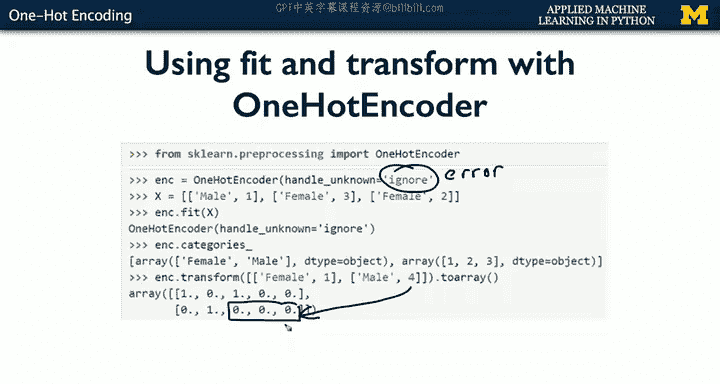

# 密歇根大学《Python用于数据科学实践（1-3课／共5课）｜Applied Data Science with Python 》deepseek翻译 - P74：19_独热编码（选修）.zh_en - GPT中英字幕课程资源 - BV1U64y1L7VJ

In this video， I'm going to talk about what to do when you have categorical values for features。

Or categorical values for labels。 So a lot of the introductory machine learning examples that you might have seen assume that all the features are numeric and you know。

 it's a very common situation， though， to have。Features that are a category of something or a mixture of categorical and numerical features。

We're going to discuss in this video how to handle that particular situation。Okay。

 so let's take a specific example of what might be a categorical variable that you could you might see in a particular problem。

 let's say we are looking at color。 So there's a color feature in your data and the color can be。

One of several possible values， it can be red， yellow， green， it can be。30 different values。

 depending on。WellYour application。 but in general， the idea is that it's a category。

 So the category。Is part of a set of possible values。 It's not an numerical value。

 And many predictors can't take categorical input like this directly。 So， for example， you can't。

Take your color feature with its red， yellow， and green values。And use it directly with。You know。

 linear regression。Or logistic regressiong， or support vector machines。

Some methods can take categorical variables directly。

 like decision trees and decision tree based predictors。

But you may be faced with a situation where you have to figure out what you need to do to use categorical variables with with a prediction method that can't deal with them directly。

 And by the way， some of these categories。Are encoded as numbers。

 even though they're not numerical data。The categories might get mapped to numbers。

 so red might equal 1， yellow might equal 2， for example。 So even if a column。

In your data looks like it's a numerical feature。It may actually be a category feature encoded using numbers。

 so just be aware of that。So one very widely used solution to deal with categorical variables is called one hot encoding。

And what that does is it takes a single categorical value and turns it into a vector of binary values。

The way the encoding works is you look at your categorical feature。

And you make a list of all the possible values that it could take。 So in this example。

 I've pretended that there are only three possible color values， red， yellow， and green。

So to get the one hot encoding。Of。The value red。We simply go through all the possible categories and we store one。

In the column that represents red and zero for all the other categories。

So in the one hot encoding scenario， it's called the one hot encoding because exactly one column is a one。

And that's the selected category。 and the rest of the columns are 0。Let's take another example。

Let's say we want to encode。The value green for this row。And that's the fourth row。

 So you can see that in the one hot encoding version of green。We have a 0 for red，0 for yellow。

 and a one for green。So a very simple idea， and it's very widely used in statistics， for example。

 it's called a dummy encoding or a one of K encoding or an indicator variable。

So that's how you convert categorical values into a vector of 01 values that something like linear regression can actually handle now。

Transforming categorical values into1 hot encodings。Is really easy in Python。

 whether you use pandas or psyic learn。In pandas， we have this function called get dummies。And again。

's namee that because 10 encoings are called dummy variables in statistics。

 So get dummies can convert these categorical variables to dummy indicator variables。

And you can see in this example， we created a list of values， ABCA。

And when we ask pandas to create one hot encoding for each of these。

What it does first is it goes through and makes a list of all the possible values， so A， B and C。

And then for each of the entries， it will go through and mark。

IfThe entry A will make a equals1 and then set the rest to 0 and so forth。

 So super easy to do in pandas。And in psychic Learn。

 its also very easy now there are two cases in psychic learn to think about。

One of them is if your categorical variable is a feature。In other words， it's in the X matrix。

In that case， you would use SKLn preprocessing one hot encoder。

To create the1 hot encoding vectors for each row for that feature。

And you do that using the fit method， which we'll go through and look to find what are all the unique values in that feature column。

And then once the one hot encoder has been fit and has found all the possible unique values in that feature column。

 then you call transform to actually create the one hot encoding vectors for that feature column。

And those one0 encoding vectors， by the way， by default are sparse。

 so they produce this method produces a sparse matrix by default。 You can change that if you want。

 you can set sparse equal to false， but by default， it's a sparse implementation。

The second case in PsycheL is where the thing that you're predicting。

 the label is a categorical variable。So it might be that you want to convert a multiclass label。

 like suppose you're trying to predict a color， you might want to predict a binary label。

 so convert that multiclass problem into a series of binary problems。And to do that。

 you use label binizer as the class that you。You apply that too。

It's similar to 10 encoder and the way that you fit and transform。By default， in this case。

 actually just a detail you should be aware of is that。By default。

 that it actually produces a dense matrix in the current implementation of secular。 so you can also。

 of course， turn that。Off and select sparse output if youia sparse set of binary labels。

But those are the two cases in Psyit Learn where you want to use 10 encoding either as a feature or as a label。

So here's a coding example that shows how fit and transform。Are used with the one hot encoder object。

So as usual in psychic learn， the first step is to create the object。In this case。

 I'm also passing it the handle unknown option。And。I'll talk about what that does in a minute。

But right now， let's assume that we have some initial data， which consists of。3 rows and two columns。

 So the first column is either male or female。 and the second column is。An integer， one。

 three or two。And when we call the fit method。Psyit learns 10 encoder object will analyze that。

And it will find the unique values in the first column and the unique values in the second column。

So the unique values in the first column would be female or male。

And the unique values in the second column would be 1，2， or3。And we can see that。

When we look at the categories underscore variable that is set as a result of calling the fit method。

 we ask it， okay， what categories did you find in our data that we use for fit？

Thes learn returns that。In the first column， it found female and male as the categories。

And the second column， it found。Unique values of one， two， and three。

Now with this knowledge about the unique values in each category， we can do a transform。

And we can ask Psychit learn。To create a。One hot encoding vector for the first column。

Followed by the one hot encoding vector for the second column。

 so if you have two successive columns that are categorical values。

And you ask secularar to do the transform。It will transform the first。

Value into a 1 hot encoding and then concatenate the1 hot encoding vector for the second value。

So let's ask it to transform a new little table which has female and the number one in the first row and male and number four in the second row。

And let's look at what the output is。 So the one hot encoding。 So first。

 it will create the one hot encoding for female。And you'll notice that the categories that it found originally were female and male。

 So the one hot， there are only two possible columns in the one hot encoding the the female column in the male column。

 And you'll see that because we have the categorical value of female。It set。

Coectly set the female column to one and the male column to zero。

 and you can see for the second row in this mini data set。

That male got mapped to the one hot encoding vector of 01 Okay。

 so it's setting the male category to  one。Second column。And you can see what it did for。

The one hot encoding of the numerical column。 So it's treating the numerical column here as if it were。

A set of numbered classes。And。When the second columns value is 1。

 that getss converted to a one hot encoding。Corresponding to this array。

 so it should create a 100con of vector 10，0。And you can see， indeed， it does。

But the second example is an interesting one。It's asking it to create a 10 encoding vector for。

A class or an image representing a class iss never seen before。 You can see that there's no four。

In the set of unique values that it found for those numbers。 So this is where the handle unknown。

Setting comes in。 If you set handle unknown to ignore what it will do is when it it sees the value for and it tries to create a one hot encoding for a value。

That it never saw And during the fit method， it will simply create。It'll put zero。

It'll put a zero in that entry。Okay。So what it did here is it converted the number four to a one hot encoding vector。

They actually didn't have a one， so it was all zeros。

And that's what happens if you see a class in your test set， for example。

 that was never seen during training。Using the handle unknown option of ignore。

It will create the10 and coning vector that's all zeros。The other option for the handle unknown。

Setting。You could also specify handle a known equals error。And if you do that。

 then instead of silently creating an all zeros vector。For an unknown class。Value。

 an unknown category value， it will actually create an error in the code。

 throw an error in the code and halt the code。

But that's the basic operation of one hot encoder。So， finally。

Here are some rules to make sure that you apply this one hot encoding step properly。First。

 like many other types of transformations in Psyit Learnar。

 you always split the training and test sets first before fitting the one hot encoder object。

You fit the one hot encoder object using the training data。 You don't pass in the entire data set。

 including the test set。 You must only do it after you split。So that the 10 encoder doesn't get。

Any knowledge of what is in the test set？And then once you fit the 10 encoder using the training data。

 you can use the transform function。To apply this same10 encoder， you just fit。

To both the training data and the test data。So you need to make sure you use the same1 hot encoder for training and test。

And you need to make sure that you've only trained it using the training data。

 and that makes sure that dummy variables match across the training and test data and that all categories are represented。

So a question that comes up is what happens if the test set has extra categories we didn't see during training。

 and this corresponds to the case I just showed you of where we're asked to create a 100 encoder for the number four when the data that was used to fit the 10 encoder only had values one to three。

So you have two options in that case， One of them is you can create a special other category。

To map any extra categories in the test set to other。Or you can ignore them and allow an all zero。

1 hot vector。For that particular category， for that item in the test set。

