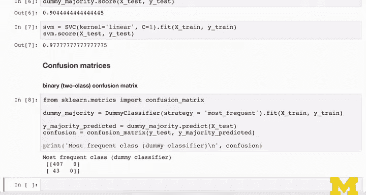

# 密歇根大学《Python用于数据科学实践（1-3课／共5课）｜Applied Data Science with Python 》deepseek翻译 - P75：20_模型评估与选择.zh_en - GPT中英字幕课程资源 - BV1U64y1L7VJ

When we began working with supervised machine learning methods。

We evaluated a classifier's performance， using its accuracy。Accuracy， as you might recall。

 is the fraction of samples that were classified correctly。

 that is where the classifier's predicted label matched the correct or true label。

We also evaluated a regression model's performance using the default R squared metric。In this module。

 you'll learn why measures lack accuracy。Which are simple and easy to understand also have drawbacks than that they don't give a complete enough picture。

Of a supervised learning model's performance and may not be the right metric for measuring success in your application。

So we're going to cover several additional evaluation metrics beyond accuracy。

 we'll see how they're defined what the motivation is for using them and how to use them in PsyK learn to get a better picture of how well a supervised model is doing on a given dataset set。

You'll also learn about how to choose the right evaluation metrics for your application that can help you select the best model or find the optimal parameters。

So let's return for a moment to this workflow diagram that we introduced earlier in the course。

You see that evaluation is a key part of this development cycle in applied machine learning。

Once a model is trained， the evaluation step provides critical feedback on the trained model's performance characteristics。

Particularly those that might be important for your application。The results of the evaluation step。

 for example， might help you understand which data instances are being classified or predicted incorrectly。

 which might in turn suggest better features or different kernel function or other refinements to your learning model in the feature and model refinement phase。

As we discussed earlier， the objective function that's optimized during the training phase may be a different what's called a surrogate metric that's easier to use in practice for optimization purposes than what's used for the evaluation metric。

For example， a commercial search engine might use a ranking algorithm that is trained to recommend relevant web pages that best match a query。

 In other words， trying to predict a relevant label for a page。

And that might be the objective in the training phase。

 but there are many evaluation methods in the evaluation phase that could be applied to measure aspects of that search engine's performance using that ranking algorithm that are important to the search company's business。

 for example。Such as how many unique users a system sees per day or how long a typical user search session is and so on。

So the evaluation measures are the ones that in the end are used to select between different trained models or settings。

Actually， commercial search applications typically use a scorecard of multiple evaluation metrics to make important business decisions or development decisions about what models have chosen for use。

So it's very important to choose evaluation methods that match the goal of your application。

For predicting the correct digit from a handwritten image， let's say。

 where each digit is equally likely， then accuracy may be a sufficient metric。However。

 there are other possible aspects of evaluation and model performance that are beyond average accuracy that may be critical to measure。

 For example， in a health application that uses a classifier to detect tumors in a medical image。

 We may want the classifier to err on the side of caution and flag anything that even has a small chance of being cancerous。

 even if it means sometimes incorrectly classifying healthy tissue as diseased。In this case。

 the classifier evaluation method with try to reduce what are called false negative predictions。

We'll look at this in more detail shortly。More generally。

 your application goal might be based on very different metrics such as user satisfaction。

 amount of revenue to your page， or increase in patient survival rates。So in the end。

 you'll be select model or parameter settings that optimize those and evaluation metrics that are important to your goal。

So in this module， we'll be focusing first on the widely used case of evaluating binary classification。

And then we'll look at evaluation for the more general case of multi class evaluation。

 as well as regression。Before we start defining and using some evaluation metrics for binary classification。

 let's start by looking at an example of why just looking at accuracy may not be enough to gain a good picture of what a classifier is doing。

It'll also show us how knowing more about the types of errors a learning algorithm makes can help us get a better picture of a model's predictive performance。

First， let's consider the case where we have a binary classification task where there are a lot of instances labeled with a negative class。

But only a few instances that belong to the positive class。For example。

 we might see this scenario in online search or recommender systems where the system has to predict whether or not to display an advertisement or product suggestion。

Or。Show a query suggestion or item on a page that's likely to be relevant given a user's query and what they clicked on in the past and so on。

 so those would be the positive examples。But of course， there are many， many irrelevant items。

That are in the negative class that don't make sense to show user。

And so this is called an imbalanced class scenario。

Another example might be data sets of credit card transactions where the vast majority of transactions are classified as normal and not fraud。

With a small minority of transactions that could be classified as fraudulent。These situations。

 which also apply to multi class classification problems。

 involve data sets that have imbalanced classes。Ibalanced classes are very common in machine learning scenarios。

 so it's important to understand how to work with them。In particular。

 let's assume that we have an e-commerce application where for every thousand randomly sampled product items。

 one of them is relevant to a user's need， and the other 999 are not relevant。

So recall that accuracy。Computed over a set of instances is just the number of instances where the classifier's label prediction was correct。

 divided by the total number of instances。Let's suppose you develop a classifier for predicting relevant e-commerce items。

And after you finish the development， you measure its accuracy on a test set to be 99。9%。At first。

 that might seem to be amazingly good， right， It's incredibly close to perfect。

But let's compare that to a dummy classifier that always just predicts the most likely class， namely。

 the not relevant class。In other words。No matter what the actual instance is。

 the dummy classifier will always predict that an item is not relevant。

So if we have a test set that has1 thousand0 items。On average。

999 of them will be not relevant anyway。 So our dummy classifier will correctly predict the not relevant label。

For all of those，999 items。And so the accuracy of the dummy classifier is also going to be 99。9%。

So in reality， our own classifier's performance isn't impressive at all。

 it's no better than just always predicting the majority class without even looking at the data。

Let's take a look at another example of classification with imbalanced classes on a real data set using our notebook。

I'll start here using the digits data set， which has images of handwritten digits labeled with 10 classes。

Representing the digits 0 through 9。As we can see by loading the data set。

And then computing the count of instances in each class using Nmpy's bin count method。

There are roughly the same number of instances in each class， so this data set has balanced classes。

However， with this digits data set。Now what we're going to do is create a new data set with two imbalanced classes by labeling all digits that are not the digit one as the negative class with label 0。

And digits that are one as the positive class， label 1。

So what I've done here is dump the first few entries from the original labels along with the new binary labels so you can see the imbalance visually。

Now， when we use bin count， we can see that there are about 1，600 negative examples。

 but only 182 positive examples。So indeed， we have a data set that is class imbalanced。

Or as expected， almost exactly a nine to one ratio。Of negative to positive examples。

Now let's create a train test partition on this imbalance set。

And then train a support vector machine classifier with these binary labels using the radial basis function as a kernel。

We get the accuracy using the score method。And we can see this is just over 90%。 Again。

 at first glance，90% accuracy for classifier seems pretty good。However。

 now let's create a dummy classifier that correctly reflects the class imbalance to see if 90% really is that impressive。

Siitt Learnn makes it easy to create a dummy classifier just by using the dummy classifier class as shown here。

Dummy classifiers， again， are called that because they don't even look at the data to make a prediction。

 They simply use the strategy or rule of thumb。That you instruct them to use when creating them。

In fact， when you create the classifier， you set the strategy argument to tell it what rule of thumb to use to make its predictions。

So here we set this to the most frequent strategy to predict the most frequent class。

The dummy classifier here is used just like a regular classifier。 So to prepare it for prediction。

 we call the fit method on the X train and Y train variables that hold the training set instances and labels。

Now， this dummy classifier won't actually be looking at the individual data instances in those variables。

But it does use the Y train variable to determine which class in the training data is most frequent。

Finally， just like a regular classifier。We can call the predict method to make predictions on the test set。

This example shows the output of the dummy classifier's predictions。 And as promised， you can see。

 it's always predicting 0 or the negative class for every instance in the test set。

Now we can call the usual score method to get the accuracy of the dummy classifier constant negative prediction。

And we can see it's also about 90%， the same as our earlier support vector machine classifier with raial basis function kernel。

So that support vector classifier was actually performing only very slightly better than the dummy classifier。

The dummy classifier provides what is called a null accuracy baseline。

That is the accuracy that can be achieved by always picking the most frequent class。

You should not use a dummy classifier for real classification problems。

 but it does provide a useful sanity check and point of comparison。

There are other types of dummy classifiers that provide null baselines corresponding to other choices of the strategy parameter as shown here。

Most frequent is the strategy we've just seen that always predicts the most frequent label。

The stratified strategy， unlike the constant most frequent prediction。

 is a random prediction that's based on the class distributions。For example。

 if the positive class occurs 90% of the time in the training set。

Then the stratified dummy classifier will output the positive class label with 90% probability。

 otherwise， it will output the negative class label。

This can help ensure that metrics that rely on having counts of both positive and negative class prediction outcomes can be computed。

The uniform strategy is another random prediction method that will generate class predictions uniformly at random。

That is， all classes have an equal chance of being output as opposed to being weighted by their frequency in the training set。

This strategy may be useful in gaining an accurate estimate of what are the most common types of prediction errors for each class。

Finally， the constant strategy can be useful when computing some metrics like F score。

 which we will cover in a few minutes。Well， why is that。

 well when we have a binary classification task where the most frequent class is the negative class。

Turns out that using the most frequent strategy will never predict the positive class and will never be able to count the number of positive instances that are correctly predicted。

And so the overall count of such positive， correct predictions will be0。So this in turn。

 as you'll see in a few minutes will cause some important metrics like F score to always be zero。

 so using the constant strategy， we can force a dummy classifier to always predict the positive class。

 even if it's the minority class in a set of classes。

 and this will lead to more meaningful computation of F score。

So what does it mean if we discover that our classifier has？

Close to the dummy classifiers performance。Well， typically it means that the features in our model may be ineffective or erroneously computed or missing for some reason。

It could also be caused by a po choice of kernel or hyperparameters in the model。For example。

 if we change the support vector classifier's kernel parameter to linear from RBF。

And recompute the accuracy on this retrain classifier。

 We see that this leads to much better performance of almost 98%。Compared to the most frequently。

 class baseline of 90 per cent。Finally， if you have accuracy that is close to that of a dummy classifier。

 it could be because there is indeed a large class imbalance and the accuracy gains produced by the classifier on the test set。

Simply applied to too few examples to produce a significant gain。In general。

 for imbalanced classification problems， you should use metrics other than accuracy。

 We'll look at one shortly called A U C， which is short for area under the curve。Dummy regressors。

 as you might guess， are the counterpart to dummy classifiers for regression。

 and they serve a similar role as a null outcome baseline and sanity check for regression models。

Since regression models have continuous valued prediction outputs。

 the strategy parameter for dummy regressors gives you a choice of function that you can apply to the distribution of target values found in the training set。

You can ask for the mean or median value of the training set targets。

The value corresponding to the quantile that you provide or a custom constant value。Now。

 let's look more carefully at the different types of outcomes we might see using a binary classifier。

This will give us some insight into why using just accuracy doesn't give a complete picture。

Of the classifier's performance and will motivate our definition and exploration of additional evaluation metrics。

With a positive and negative class， there are four possible outcomes that we can break into two cases corresponding to the first and second row of this matrix。

If the true label， for an instance， is negative， the classifier can predict either negative。

 which is correct and call the true negative。Or it can erroneously predict positive。

 which is an error and called a false positive。If the true label， for an instance， is positive。

The classifier can predict either negative， which is an error and call the false negative。

Or it can predict positive， which is correct。 And that's called a true positive。

So maybe a quick way to remember this is that the first word in these matrix cells is false。

 if it's a classifier error or true， if it's a classifier success。The second word is negative。

 If the true label is negative and positive， if the true label is positive。

Another name for a false positive that you might know from statistics is a typey1 error。

And another name for false negative is a type 2 error。

We're going to use these two letter combinations， TN， FN， FP， and TP。

As variable names when defining some new evaluation metrics shortly。

 we'll also use capital N here to denote the total number of instances of the sum of all the values in the matrix。

 the number of data points we're looking at。This matrix of all combinations of predicted label and true label is called the confusion matrix。

We can take any classifier prediction on a data instance and associate it with one of these matrix cells。

 depending on the true label of the instance and the classifier's predicted label。

This also applies to multi class classification， in addition to the special case of binary classification I've shown here in the multi class case with K classes。

 we simply have a K by K matrix instead of a 2 by two matrix。

syit learn makes it easy to compute a confusion matrix for your classifier。

 Let's take a look at the notebook。Here we import the confusion matrix class from SK learn metricstri。

We're going to use the same training set from the digits data set with the binary imbalanced labels that we created earlier。

To get the confusion matrix， we simply pass the Y test set of predicted labels and the Y predicted set of predicted labels and then print the output。

The order of the cells of the little matrix output here is the same as the one I just showed on the slide。

True， negative and false negative are in the first column， and true。

 positive and false positive are in the second column。In particular。

 the successful predictions of the classifier are on the diagonal where the true class matches the predicted class。

The cells off the diagonal represent errors of different types。Here。

 we compute the confusion matrices for different choices of classifier and the problem。

 so we can see how they shift slightly with different choices of model。

And this gives us some insight into the nature of the successes and failures observed for each type of classifier。

So first， we'll apply the most frequent class dummy classifier we saw earlier。

What we can see here is that the right column that represents cases where the classifier predicted the positive class is all zero。

 which makes sense for this dummy classifier because it's always predicting the negative class。

The most frequent one。We see that 407 instances are true negatives。

 and there are 43 errors that are false negatives。

Here we apply the stratified dummy classifier that gives random output in proportion to the ratio of labels in the training set。

Now， the right column is no longer all0 because this dummy classifier does occasionally predict the positive class。

If we add the numbers in the right column， we see that 32 plus 6 equals 38 times the number of times the classifier predicted the positive class。

Of those times， in six cases， the lower right diagonal， this was a true positive。In the next case。

 we'll apply a support vector classifier with linear kernel and C parameter equal to 1。

We note that looking along the diagonal compared to the stratified dummy classifier above。

Which had a total of 375 plus 6 or 381 correct predictions。

The support vector classifier has a total of 402 plus 38。

 which is 440 correct predictions on the same data set。Likewise。

 we can apply a logistic regression classifier and that obtains similar results to the support vector classifier。

And finally， we can apply decision tree classifier and look at the confusion matrix that results from that。

One thing we notice is that unlike the support vector or logistic regression classifier。

 which had balanced numbers of false negatives and false positives。

The decision tree makes more than twice as many false negative errors，17 of them， actually。As false。

 positive errors of which there are 7。Now that we've seen how a confusion matrix can give us a little more information about the types of errors a classifier makes。

We're ready to move ahead and define some new types of evaluation metrics that use information from the confusion matrix to give different perspectives on classifier performance。

