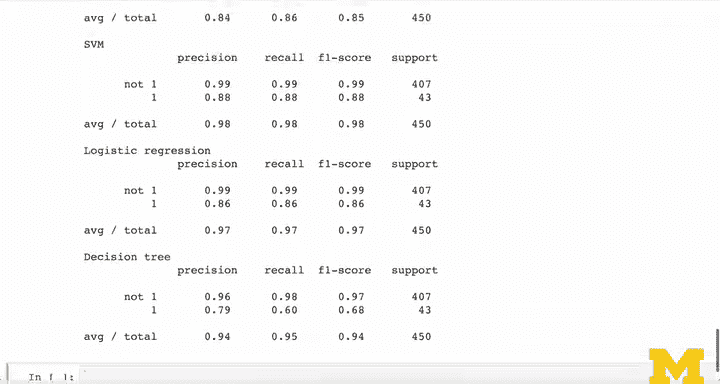

# 密歇根大学《Python用于数据科学实践（1-3课／共5课）｜Applied Data Science with Python 》deepseek翻译 - P76：21_混淆矩阵与基础评估指标.zh_en - GPT中英字幕课程资源 - BV1U64y1L7VJ

So let's go back to the matrix of possible binary classification outcomes。

This time filled out with the actual counts from the notebook's decision tree output。Remember。

 our original motivation for creating this matrix was to go beyond a single number accuracy。

To get more insight into the different types of prediction。

 successes and failures of a given classifier。Now we have these four numbers that we can examine and compare manually。

Let's look at this classification result visually to help us connect these four numbers to a classifier's performance。

What I've done here is plot the data instances by using two specific feature values out of the total 64 feature values that make up each instance in the digits dataset set。

The black points here are the instances with true class positive， namely the digit1。

And the white points have true class negative that is。They are all the other digits except for one。

The black line shows a hypothetical linear classifier's decision boundary for which any instance to the left of the decision boundary is predicted to be in the positive class。

And everything to the right of the decision boundaries predicted to be in the negative class。

The true positive points are those black points in the positive prediction region。

And false positives are those white points in the positive prediction region。Likewise。

 true negatives are the white points in the negative prediction region。

And false negatives are black points in the negative prediction region。

We've already seen one metric that can be derived from the confusion matrix counts， namely accuracy。

The successful predictions of the classifier。The ones where the predicted class matches the true class are along the diagonal of the confusion matrix。

So if we add up all count along the diagonal， that will give us the total number of correct predictions across all classes。

And dividing this sum by the total number of instances gives us accuracy。

But let's look at some other evaluation metrics we can compute from these four numbers。Well。

 a very simple related number that's sometimes used is classification error。

Which is the sum of the counts off the diagonal， namely all of the errors divided by total instance count。

 and numerically， this is equivalent to just one minus the accuracy。Now。

 for a more interesting example， let's suppose going back to our medical tumor detecting classifier。

That we wanted an evaluation metric that would give higher scores to classifiers that not only achieved a high number of true positives。

But also avoided false negatives。 that is that rarely failed to detect a true cancerous tumor。Recall。

 also known as the true positive rate， sensitivity or probability of detection。

Is such an evaluation metric， and it's obtained by dividing the number of true positives by the sum of true positives and false negatives。

You can see from this formula that there are two ways to get a larger recall number。First。

 by increasing the number of true positives， or by reducing the number of false negatives。

 since this will make the denominator smaller。In this example。

 there are 26 true positives and 17 false negatives， which gives a recall。Of 06。

Now suppose that we have a machine learning task where it's really important to avoid false positives。

In other words， we're fine with cases where not all true positive instances are detected。

 but when the classifier does predict the positive class。

 we want to be very confident that it's correct。A lot of customer facing prediction problems are like this。

 for example， predicting when to show a user a query suggestion in a web search interface might be one such scenario。

Users will often remember the failures of a machine learning prediction。

Even when the majority of predictions are successes。

One natural question that comes up when learning about precision and recall is when to apply them。

In deciding what metric to use， a key question to ask is。

Is it more important in your scenario to avoid false positives or false negatives？In general。

 precision is used as a metric when our objective is to minimize false positives。

And recall is used when the objective is to minimize false negatives。

One possible scenario that illustrates when it could be important to avoid too many false positives。

Is one where law enforcement is using a video recognition algorithm for finding likely criminals in a given area。

In this case， a false positive would mean arresting an innocent person。

And that may be considered a lot more damaging than a false negative。

 which would be letting a potential criminal walk free。

So this is a precision oriented task that should minimize false positives。On the other hand。

 a scenario where we might want to minimize false negatives。

Is one where a law firm is searching for every possible email mentioning a certain event or person as part of a lawsuit。

 let's say。If we consider the positive class for the classification problem to be finding emails that have critical information。

We want to avoid misclassification errors that incorrectly label an email as not containing critical information。

 in other words we want to avoid false negatives。This is because missing even one critical email could om valuable evidence。

So casting a wider net like this will find more false positives， in other words。

 emails that are actually not relevant， but that's okay in this scenario because we have experts who can filter them out later。

So this is a recall oriented task that should minimize false negatives。

So precision is an evaluation metric that reflects this situation。

And it's obtained by dividing the number of true positives by the sum of true positives and false positives。

So to increase precision， we must either increase the number of true positives the classifier predicts。

Or reduce the number of errors where the classifier incorrectly predicts that a negative instance is in the positive class。

Here， the classifier has made seven false positive errors， and so the precision is 0。79。

Another related evaluation metric that will be useful is called the false positive rate。

This gives a fraction of all negative instances the classifier incorrectly identifies as positive。

Here we have seven false positives， which out of a total of 407 negative instances。

 gives a false positive rate of 0。02。The statistic commonly known as specificity is just1 minus the false positive rate。

Going back to our classifier visualization。Let's look at how precision and recall can be interpreted。

The numbers that are in the confusion matrix here are derived from this classification scenario。

We can see that a precision of 0。68 means that about 68% of the points in the positive prediction region to the left of the decision boundary。

Or 13 out of the 19 instances are correctly labeled as positive。

A recall of 0 87 means that of all true positive instances。 So all black points in the figure。

The positive prediction region has， quote unquote， found about 87% of them or 13 out of 15。

If we wanted a classifier that was oriented towards higher levels of precision。

Like in the search engine query or suggestion task。

We might want a decision boundary instead that look like this。Now。

 all the points in the positive prediction region， 7 out of 7 are true positives。

 giving us a perfect precision of 1。0。Now this comes at a cost because out of the 15 total positive instances。

 eight of them are now false negatives， in other words they're incorrectly predicted as being negative。

And so recall drops to 7 divided by 15 or 0。47。On the other hand。

 if our classification task is like the tumor detection example。

We want to minimize false negatives and obtain high recall。

 in which case we would want the classifier's decision boundary to look more like this。Now。

 all 15 positive instances have been correctly predicted as being in the positive class。

 which means these tumors have all been detected。However。

 this also comes with a cost since the number of false positives。Things that the。

Deteectctor triggers as possible tumors， for example， that are actually not has gone up。

So recall is a perfect 1。0 score。But the precision has dropped to 15 out of 42 or 036。

These examples illustrate a classic trade off that often appears in machine learning applications。

Namely that you can often increase the precision of a classifier。

But the downside is that you may reduce recall。Or you could increase the recall of a classifier at the cost of reducing precision。

Recall oriented machine learning tasks include medical and legal applications where the consequences of not correctly identifying a positive example can be high。

Often in these scenarios， human experts are deployed to help filter out the false positives that almost inevitably increase with high recall applications。

Many customer facing machine learning tasks， as I just mentioned， are often precision oriented。

 since here the consequences of false positives can be high。For example。

 hurting the customer's experience on a website by providing incorrect or unhelpful information。

Examples include search engine ranking and classifying documents to annotate them with topic tags。

When evaluating classifiers， it's often convenient to computer quantity known as an F1 score。

That combines precision and recall into a single number。Mathematically。

This is based on the harmonic mean of precision and recall using this formula。

After a little bit of algebra， we can rewrite the F1 score in terms of the quantities that we saw in the confusion matrix。

True positives， false negatives and false positives。

This F1 score is a special case of a more general evaluation metric known as an F score。

That introduces a parameter beta。By adjusting beta。

 we can control how much emphasis in the evaluation is given to precision versus recall。For example。

 if we have precision oriented users， we might set beta equal to 0。5。

Since we want false positives to hurt performance more than false negatives。

For recall oriented situations， we might set beta to a number larger than one， say two。

 to emphasize that false negatives should hurt performance more than false positives。

The setting of beta equals 1 corresponds to the F1 score special case。

That we just saw that weights precision and recall equally。

Let's take a look now at how we can compute these evaluation metrics in Python using Psyit Learn。

PsyCit Learn metrics provides functions for computing accuracy， precision， recall。

 and F1 score as shown here in the notebook。The input to these functions is the same。

 the first argument。Here， why test。Is the array of true labels of the test set data instances。

And the second argument is the array of predicted labels for the test set data instances。

Here we're using a variable called treeree predicted。

 which are the predicted labels using the decision tree classifier in the previous notebook step。

It's often useful when analyzing classifier performance to compute all of these metrics at once。

So SKL metrics provides a handy classification report function。Like the previous score functions。

 classification report takes the true and predicted labels as the first two required arguments。

It also takes some optional arguments that control the format of the output。Here。

We use the target Na option to label the classes in the output table。

You can take a look at the Psyit Learnear documentation for more information on the other output options。

The last column support shows the number of instances in the test set that have that true label。

Here we show classification reports for four different classifiers on the binary digit classification problem。

The first set of results is from the dummy classifier， and we can see that， as expected。

 both precision and recall for the positive class are very low。

 since the dummy classifier is simply guessing randomly with low probability of predicting the positive class for the positive instances。

