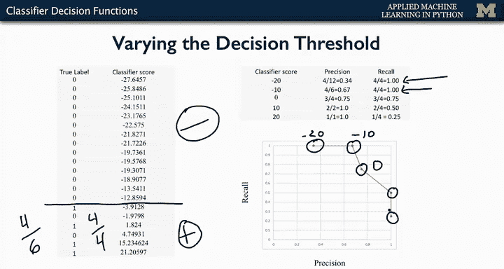

# 密歇根大学《Python用于数据科学实践（1-3课／共5课）｜Applied Data Science with Python 》deepseek翻译 - P77：22_分类器决策函数.zh_en - GPT中英字幕课程资源 - BV1U64y1L7VJ

Many classifiers in psychic Learn can provide information about the uncertainty associated with a particular prediction。

Either by using the decision function method or the predict ProA method。

When given a set of test points， the decision function method provides for each one a classifier score value that indicates how confidently classifier predicts the positive class。

So there will be large magnitude positive scores for those points。

 or if it predicts a negative class， there'll be large magnitude negative scores for negative points。

Here's an example in the notebook showing the first few instances from our classification problem using a logistic regression classifier。

We can see that instances in the negative class often have large magnitude negative scores。

And indeed， the instances in the positive class have positive scores from the logistic regressionion classifier。

Likewise， the predict pro function provides predicted probabilities of class membership。Typically。

 a classifier would choose the more likely class。That is in a binary classifier。

 the class with probability greater than 50%。Adjusting this decision threshold affects the predictions of the classifier。

A higher threshold means the classifier has to be more confident in predicting the class。For example。

 we might predict class1 only if the estimated probability of class1 was over 70%。

And this results in a more conservative classifier。

Here's an example of getting these prediction probabilities for the test instances for the same logistic regression classifier。

You can see that many entries with a positive label of one have a high probability like 0。995。

While many negative label instances have a very low prediction probability。

Note that not all models provide useful probability estimates of this type， for example。

 a model that was overfit to a training set might provide overly optimistic。

 high probabilities that were in fact not accurate。

Now we can use these decision scores or prediction probabilities for getting a more complete evaluation picture of a classifier's performance。

For a particular application， we might pick a specific decision threshold。

 depending on whether we want the classifier to be more or less conservative about making false。

 positive or false negative errors。 It might not be entirely clear when developing a new model what the right decision threshold will be and how that choice will affect evaluation metrics like precision and recall。

 So instead， what we'll do is look at how the classifier performs for all possible decision thresholds。

This example shows how that works。On the left here is a list of test instances with their true label and classifier score。

If we set a decision threshold， then all the instances above that line。For example。

 if we set the decision threshold to be minus 20。Here。

Then all the instances above the line are below the threshold of -20， so -20 or less。

And all the instances in this direction are above the threshold of minus 20。

And so the ones below the threshold will be predicted to be in the negative class。

And the ones above the threshold will be predicted to be in the positive class。So。

If we pick specific threshold， so in this case，-20。And we partitioned the test points in this way。

We can compute precision and recall for the points that are predicted to be in the positive class。

 so in this case。We have 12 instances。Here，12 total instances。They are being predicted as positive。

 and only four of them。This one。This one， this one and this one are actually positive。

 and so the precision here is 4 divided by 12。Or。Approximately 。34。The recall， on the other hand。

 there are four positive。Labeled instances in the whole set of test examples here。

 and we found all of them with this particular threshold setting。

 so the recall here is four out of four。 we found all four positive labeled examples。And so。

For this particular threshold of minus 20， we can obtain a precision and recall score for that threshold。

Let's pick a different threshold。 Let's look at what happens when the threshold is negative 10。

Right here。So， again。Anything below this line is treated。

 it has a higher value of than minus 10 here， so those would be treated as positive predictions。

Things above the line have a score below negative 10。 so these be predicted to be negative。And again。

 we can compute a precision and recall。For this decision threshold setting。

 and we can see here that there are。The total of six instances。In the positive prediction class。

 of which four are actually of the positive class。And so the precision here is four over six or about 。

67。And again， the recall here is going to be four out of  four。And it's going to be 1。0 again。

And so that corresponds to this point in the table over here。

And then as we're computing these different precisions and recalls for different thresholds。

 we can also plot them on this precision recall chart。

So the first pair of precision and recall numbers that I got， 。34。And 1。0， we can plot。

On this point in precision recall space， the second example。 So this was。

For the threshold of minus 20。When the threshold was -10， we got a precision of 0。

67 and a recall of one。Corsponding to this point that we can plot。

And so you can see that if we do this for a number of other thresholds。For example。

 the threshold of 0， we'll get a precision of 0。75 and a recall of 0。

75 that corresponds to this point。And that choice of decision threshold。And we can keep doing that。

For different thresholds。And we actually are plotting a series of points through the space。

 which can be connected as a curve。And so in this way。

 we can get a more complete picture by varying the threshold of how the precision and recall of the resulting classifier output changes as a function of the decision threshold。

And this resulting chart here is called a precision recall curve。And we'll look at it in more detail。

 next。

