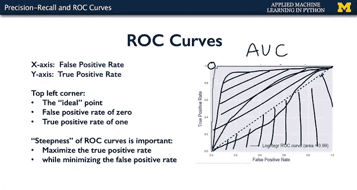

# 密歇根大学《Python用于数据科学实践（1-3课／共5课）｜Applied Data Science with Python 》deepseek翻译 - P78：23_精确率-召回率与ROC曲线.zh_en - GPT中英字幕课程资源 - BV1U64y1L7VJ

Precision recall curves are a very widely used evaluation method for machine learning。

As we just saw in the example， the x axis shows precision and the Y axis shows recall。Now。

 an ideal classifier would be able to achieve perfect precision of 1。0 and perfect recall of 1。0。

 So the optimal。Point would be up here in the top right。And in general， with precision recall curves。

The closer in some sense the curve is to the top right corner， the more preferable it is。

 the more beneficial the trade off it gives between precision and recall。

 and we saw some examples already of how there is a trade off between those two quantities between precision and recall with many classifiers。

This example here is an actual precision recall curve that we generated using the following notebook code。

The red circle indicates the precision and recall that's achieved when the decision threshold is 0。

So I created this curve using exactly the same method as we saw in the previous example by。

Looking at the decision function output from support vector classifier。

Applyinging varying decision boundary， and looking at how the precision you recall changed as the decision boundary changed。

Now， fortunately， psychitLn has a function that's built in。

That does all of that that can compute a precision and recall curve。

And that's what we've been using in the notebook here。

So you can see that in this particular application。There is a general downward trend。

 so as the precision of the classifier goes up， the recall tends to go down。In this particular case。

 you'll see also that it's not exactly a smooth curve， there are these sort of jaggy areas here。

 and in fact it gets sort of the jumps tend to get a little bigger as we approach。Maximum precision。

And this is a consequence of how the formulas for precision and recall are computed。

They use discrete counts that include the number of true positives。

 and so as the decision threshold increases。There are fewer and fewer points that remain as positive predictions。

 So the fractions that are computed for these smaller numbers can change pretty dramatically。

With small changes in the decision threshold。 And that's。

 that's why these sort of trailing edges of the。Precision we call curve can appear a bit。

Jagged when you plot them。R OC curves or receiver operating characteristic curves。

Are a very widely used visualization method that illustrate the performance of a binary classifier。

ROC curves on the X axis show a classifier's false positive rate so that would go from 0 to 1。0。

And on the Y axis， they show a classifier's true positive rate so that we also go from 0 to 1。0。

It's worth mentioning here that the y axis of the ROC curve plot。I's just the recall metric。

The ideal point in ROC space is one where the classifier achieves。0。

 a false pulse positive rate of 0 and a true positive rate of one。

That would be the upper left corner。So curves in ROC space represent different trade offs as the decision boundary。

decisionion threshold is varied for the classifier， so just as in the precision recall case。

As we vary a decision threshold， we'll get different numbers of false positives and true positives that we can plot on a chart。

So the dotted line here that I'm showing。Is。The classifier curve that results。

 the ROC curve that results from a classifier that simply randomly guesses。The label for a binary。

Class。So it's basically like flip flipping a coin。 So if you have two classes with equal numbers of positive and negative instances。

 then。Flipping a coin will get you。Randomly equal numbers of false positives and true positives for large。

Large data sets。So the dotted line here is used as a baseline。

So a bad classifier will have performance that is random or maybe even worse than random。

Or it be slightly better than random。A reasonably good classifier will give an ROC curve that is more that is consistently better than random。

Across all decision threshold choices。And then an excellent classifier would be one like I've shown here。

Which is way up。Ento the left。This particular example is an example of a logistic regression classifier using the notebook example that you've seen。

So。The shape of the curve can be important as well。 The steepness of the curve。

 we want classifiers that maximize the true positive rate。While minimizing the false positive rate。

Now， as we'll see next， we can quantify。The goodness of a classifier in some sense。

 by looking at how much area there is underneath the curve。So the area underneath。

The random classifier。Is going to be 0。5。But then the area， as we， as you can see the。The size。

 the bumpiness of the classifier as it approaches the top left corner。

 well the area underneath the curve will get larger and larger and it'll approach one。And so。

As we'll see in the next slide。We use something called area under the curve。You see。

 that's a single number that measures this。Total area underneath the RO C curve as a way to summarize。

A classifier as performance。

So。An AU of zero represents a very bad classifier， and an AU of1 will represent an optimal classifier。

Like any other evaluation metric， AUC has advantages and disadvantages。

Its advantages include the fact that AUC gives a single number。

 which makes it easy to compare classifiers。Another advantage is that AUC does not require specifying a particular decision threshold。

Instead， you can think of AUC as a summary of the performance of a classifier over all possible decision thresholds。

On the other hand， like any other single number metric。

 AUC loses information about classifier tradeoffs and the shape of the ROC curve。

It might be that two classifiers have similar AUC。But have overlapping ROC curves with different shapes in different areas。

For example， it might be important to achieve very low false positive rates for a specific range of true positive rates。

But using only AUC would not be able to necessarily detect those kinds of more subtle performance differences。

