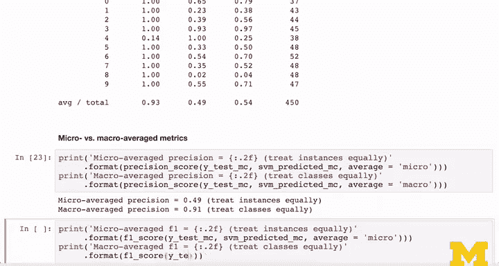

# 密歇根大学《Python用于数据科学实践（1-3课／共5课）｜Applied Data Science with Python 》deepseek翻译 - P79：24_多类别评估方法.zh_en - GPT中英字幕课程资源 - BV1U64y1L7VJ

Now that we've looked at evaluation of binary classifiers。

Let's take a look at how the more general case of multi class classification is handled in evaluation。

So in many respects， multi class evaluation is。A straightforward extension of the methods we use in binary evaluation。

Instead of two classes， we have multiple classes， so the results for a multi class evaluation amount to a collection of true versus predicted binary outcomes。

Per class。And just as we saw in the binary case， you can。

Generate confusion matrices in the multiclass case。 They're especially useful。

When you have multiple classes， because there are many different kinds of errors that result。

From one true class being predicted as a different class， so we'll look an example of that。

Classification reports that we saw in the binary case are easy to generate for the multi class case。

Now the one area which is。Worth a little more examination is how averaging across classes takes place。

There are different ways to average multiclass results that we'll cover shortly。And the support。

 the number of instances each class is important to consider。

 so just as we were interested in how to handle im balance classes in the binary case。It's important。

 as you will see to consider。Similar issue of how the support for classes might vary。

To a large or small extent， across multiple classes。

There is a case of multi label classification in which each instance could have multiple labels。

 for example， a web page might be labeled with different topics。That come from a predefined。Seet。

Areas of interest。We won't cover multila classification。In this lecture。

 instead we'll focus exclusively on multiclass evaluation。

The multi class confusion matrix is a straightforward extension of the binary classifier 2 by two confusion matrix。

For example， in our digits data set。There are 10 classes for the digits，0 through 9。

So the 10 class confusion matrix is a 10 by 10 matrix with the true digit class indexed by row。

And the predicted digit class indexed by column。As with the two by two case。

 the correct predictions by the classifier， where the true class matches the predicted class are all along the diagonal and misclassifications are off the diagonal。

In this example， which was created using the following notebook code。

Based on a support vector classifier with linear kernel。

We can see that most of the predictions are correct。

With only a few misclassifications here and there。The most frequent type of mistake here was apparently misclassifying the true digit 8 as a predicted digit 1。

 which happened three times。And indeed， the overall accuracy is high， about 97% cent， as shown here。

As an aside， it's sometimes useful to display a confusion matrix as a heat map in order to highlight the relative frequencies of different types of errors。

 so I've included the code to generate that here。For comparison。

 I've also included a second confusion matrix on the same data set。

For another support vector classifier that does much worse in a distinctive way。

The only change is to use。An RBF radio basis function kernel instead of a linear kernel。

While we can see from the accuracy number of about 49% below the confusion matrix that the classifier is doing much worse than with the linear kernel。

That single number doesn't give much insight into why。Looking at the confusion matrix， however。

 reveals that for every true digit class， a significant fraction of outcomes are to predict the digit 4。

That's rather surprising。 For example， of the 44 instances of the true digit2 in row 2。

17 are classified correctly， but 27 are classified as the digit 4。

Clearly something is broken with this model， and I picked this second example just to show an extreme example of what you might see when things go quite wrong。

This digits data set is well established and free of problems。

 but especially when developing with a new data set。

Seeing patterns like this in a confusion matrix could give you valuable clues about possible problems。

 say in the feature preprocessing， for example。So as a general rule of thumb as part of model evaluation。

 I suggest always looking at the confusion matrix for your classifier to get some insight into what kinds of errors it is making for each class。

 including whether some classes are much more prone to certain kinds of errors than others。Next。

 just as in the binary case， you can get a classification report that summarizes multiple evaluation metrics for a multi class classifier with an average metric computed for each class。

Now， what I'm about to describe also applies to the binary class case。

 but it's easier to see when looking at a multi class classification problem with several classes。

Let's look at a specific example of micro versus macro averaging using our fruit data。

So with macro averaging， we're treating each class as if it has equal weight in the overall calculation。

So what we need to do is we first compute a metric， so in this case。

 we're going to compute precision。with each class separately。

 and then once we've done that for each class， then we'll average the results across all the classes to get the final macro average precision number。

So what we do is we take a look at。For each of the classes。

 we look at all the cases where the classifier predicted。

That a particular piece of fruit was going to be an orange。

But then we look at the true class to see how many times in the since we're computing precision。

 how many times that。It was actually an orange so in this case。The classifier predicted orange。

Correctly， one time out of five。The rest of the time。

 it seemed to be very confused and predicted lemons and apples。So。So， the precision。

For the orange class was。1 fifth or 。2。We can do the same thing for the lemon class。

 So every time the classifier predicted lemons。We can see that it got one example correct and one example incorrect。

 So it had a precision。For the lemon class of one。Over 2 or 0。5。And similarly。For apples it。

It always predicted the correct， the true class， so it got perfect precision or 1。0。

So these are the precisions for each class and to compute the macro average precision。

 we then just average。The precisions that we got for the classes。And that turns out to be。

 in this case， 。57。When we compute micro averageages， on the other hand。

 we give each instance in the data set equal weight。So that classes with the most instances。

 the largest ones have the most influence in the final micro average number。

 So here we're going to compute micro average precision。And to do that。

 we don't need to consider each class separately anymore。

 we can simply aggregate all the outcomes across all the classes and compute precision across the aggregate outcomes。

So all that means is we just take all nine examples that we have here。

We look to see how many the predicted class match the true class， so in this case。We have four。

Correct predictions。Four correct predictions out of nine total instances。

And so that gives us a micro average precision of 0。44。

If the classes have about the same number of instances。

 macro and micro average will be about the same。If some classes are much larger。

 have more instances than others， and you want to weight your metric toward the largest ones。

 use micro averaging。If you want to weight your metric towards the smallest classes。

 use macro averaging。If the micro average is much lower than the macro average。

 then examine the larger classes for poor metric performance。

If the macro average is much lower than the micro average。

 then you should examine the smaller classes to see why they have poor metric performance。Here。

 we use the average parameter on the scoring function。In the first example。

 we use the precision metric and specify whether we want micro average precision。

 which is the first case or macro average precision in the second case。In the second example。

 we use the F1 metric and compute micro and macro average F1。

Now that we've seen how to compute these metrics， let's take a look at how to use them to do model selection。

