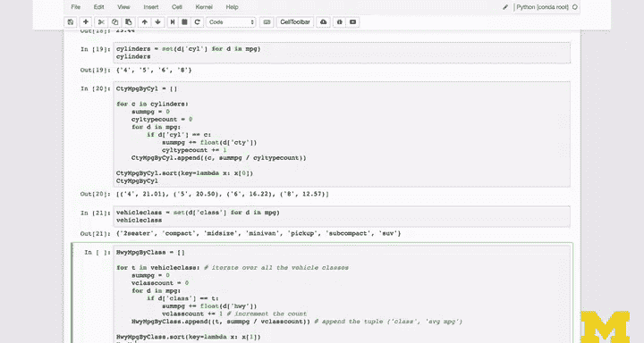

# 密歇根大学《Python用于数据科学实践（1-3课／共5课）｜Applied Data Science with Python 》deepseek翻译 - P7：6_Python演示：CSV文件读写.zh_en - GPT中英字幕课程资源 - BV1U64y1L7VJ

Welcome to today's tutorial， where we'll be learning the basics of iterating through a CSV file to create dictionaries and collect summary statistics。

First， let's import the CSV module which will assist us in reading in our CSV file。

Using some i Python magic， let's set the floating point precision for printing to two。

Now let's read in our MPG CSV using CSV diict Reader and convert it to a list of dictionaries。

Let's look at the first three elements of our list。

We can see that the dictionaries in the list have the column names of the CSVS keys。

And data for each specific car are the values。The length of our list is 234。

Meaning we have a dictionary for each of the 234 cars in the CSV file。

You can look at what the column names of the CSVR by using the key method。

Suppose we want to find the average city MPG across all cars in our CSV file。

We sum the city MPG entry， cross all the dictionaries in our list。

 and divide by the length of the list。Because the type for all the values in our dictionary are strings。

 we need to convert to float to perform mathematical operations。Similarly。

 we can find the average highway MPG across all the cars in our CSSV file。

It makes sense that the average highway fuel economy is higher than in the city。Now。

 let's look at a more complex example。So want to know what the average city MP PG is griped by the number of cylinders a car has。

Creating a set of the values in the cylinder entry of the dictionaries will give us the unique levels for a number of cylinders。

we see that we have cars in our data set with four five six and eight cylinders，First。

 we'll create an empty list where we'll store our calculations。Next。

 let's iterate over all the cylinder levels。And then we'll iterate over all the dictionaries。

If the cylinder level for the dictionary were on matches the cylinder level we're calculating the average for。

We add the MPG to our sum MPG variable and increment the account。

After going through all the dictionaries， we perform the average MPG calculation and append it to our list。

To make things clear， I'm going to sort the list from lowest number of cylinders to highest。

We can see that the city fuel economy appears to be decreasing as the number of cylinders increases。

Let's look at one more similar example。Suppose we're interested in finding the average highway MPG for the different vehicle classes。

Looking at the different vehicle classes， we have two seater， compact， mid sizeize， minivan， pickup。

 subcompact and SV。Similar to the last example， we iterate over all the vehicle classes。

 then iterate over all the dictionaries。If the vehicle class for the dictionary matches the vehicle class。

 we're computing the average highway MPG for。We add the value to our total and increment account。

Then we perform the average calculation and append it to our list。This time。

 let's sort our list from lowest MPG to highest。

Looks like the pickup had the worst fuel economy and the compact had the best。

So that was a look into how to summarize data through iteration。

 don't worry if this seems somewhat inefficient or tedious。

Next week we will be learning about Pandas， a Python library that allows for easier。

 more efficient and more powerful data analysis in Python。Thanks for watching。

 Hope to see you again soon。