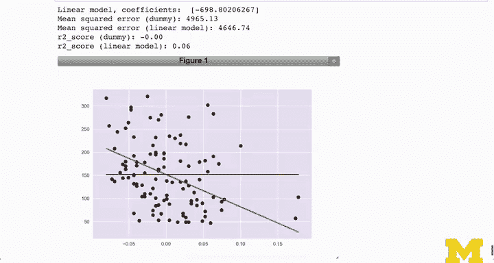

# 密歇根大学《Python用于数据科学实践（1-3课／共5课）｜Applied Data Science with Python 》deepseek翻译 - P80：25_回归模型评估.zh_en - GPT中英字幕课程资源 - BV1U64y1L7VJ

We saw that for classification， because there were some scenarios like medical diagnostic predictions or customer facing website features where the consequences of false positives were very different than false negatives。

 It made sense to distinguish these types of errors and do a more detailed analysis。

In evaluating classifiers， for example， we looked at plots like precision recall curves that could show the trade offs a classifier could achieve between making errors of those two types。

In theory， we could apply the same type of error analysis and more detailed evaluation to regression that we applied for classification。

For example， we could analyze the regression model's predictions and categorize errors of one type where the regression model's predicted value was much larger than the target value compared to a second error type where the predicted value was much smaller than the target value。

In practice， though， it turns out that for most applications of regression。

Distinguishing between these types of different errors is not as important。

This simplifies evaluation for regression quite a bit。In most cases， the default R squared score。

That's available for aggression and psychic learn， and that summarizes how well future instances will be predicted is adequate for most tasks。

As a reminder， the R squared score for a perfect predictor is 1。0。

And for a predictor that always outputs the same constant value， the R squared score 0。

The R squared score， despite the squared in the name that suggests it's always positive。

 does have the potential to go negative for bad model fits。

Such as when fitting nonlinear functions to data。There are a few alternative regression evaluation metrics you should be aware of that work a bit differently than the R squared score。

Mean， absolute error takes the mean absolute difference between the target and predicted values。

In machine learning terms， this corresponds to the expected value of the L1 norm loss。

This is sometimes used， for example， to assess forecast outcomes for regression in time series analysis。

Mean squared error takes the mean squared difference between the target and predicted values。

 And this corresponds to the expected value of the L2 norm loss。

This is widely used for any regression problems， and larger errors have correspondingly larger squared contributions to the mean error。

Like mean absolute error， mean squared error doesn't distinguish between over and under estimates。

Finally， one situation that does arise quite often is the existence of outliers in the data。

 which can have unwanted influence on the overall R squared or mean score value。So in those cases。

 when ignoring outliers is important。You can use the mean absolute error score。

 which is robust to the presence of outliers because it uses the median of the error distribution rather than the mean。

We saw how using dummy classifiers could give us simple but useful baseline to compare against when evaluating a classifier。

The same functionality exists for regression。There is a dummy regressor class that provides predictions using simple strategies that do not look at the input data。

This example， which is available as the regression example from this lecture's notebook。

 shows a scatter plot using data based on a single input variable， which is plotted along the X axis。

From the diabetes dataset set。The points are the data instances from the test split and form a cloud that looks like it may trend down slightly to the right。

The green line， which is also labeled fitted model。

 I the default linear regression that was fit to the training points。

We can see that it's not a particularly strong fit to the test data。The red line labeled， dummy。

 mean。Shows a linear model that uses the strategy of always predicting the mean of the training data。

So this is an example of a dummy regressor。You can look at the notebook to see that a dummy regressor is created and used just like a regular regression model。

You create。Fit with the training data and then call predictdic on the test data。Although again。

 like the dummy classifier， you should not use the dummy reggressor for actual problems。

 itss only use is to provide a baseline for comparison。

Looking at the regression metrics output from the linear model compared to the dummy model。

 we can see that， as expected， the dummy regressor achieves an R squared score of 0。

 since it always makes a constant prediction without looking at the output。In this instance。

 the linear model provides only slightly better fit than the dummy regressor。

 according to both mean squared error and the R squared score。

Aside from the strategy of always predicting the mean of the training target values。

You can also create some other flavors of dummy regressors that always predict the median of the training target values。

Or a particular quantile of those values。Or a specific custom constant value that you provide。

Although regression typically has simpler evaluation needs and classification。

It does pay to double check to make sure the evaluation metric you choose for a regression problem does penalize errors in a way that reflects the consequences of those errors for the business。

 organizational or user needs of your application。