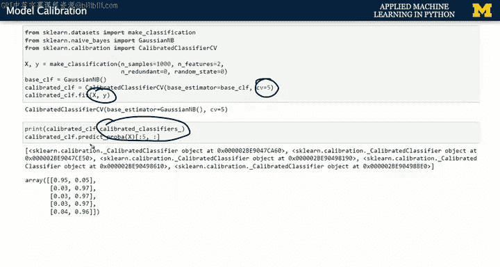

# 密歇根大学《Python用于数据科学实践（1-3课／共5课）｜Applied Data Science with Python 》deepseek翻译 - P82：27_模型校准（选修）.zh_en - GPT中英字幕课程资源 - BV1U64y1L7VJ

So you've probably seen already that many families of machine learning model make their predictions by outputting a probability。

For example， if we have a binary classification problem， we might use logistic regression。

 which is trained to output the probability that the input data point belongs to the positive class。

KNfe basease is another example that outputs a probability。

Having a model being able to make predictions in terms of probabilities is very useful。 For example。

 if the classifier is being used as part of some important decision making process。

 the prediction probability can be treated as a sort of confidence estimate that the classifier has in its prediction。

So if we're going to rely on those probability or confidence values。

 it's super important to make sure that these values are accurate in some sense。

 but what does it mean for probabilities to be accurate and if a classifier isn't generating accurate probabilities。

 how can we fix it so that it does。Making sure a model's prediction probabilities are accurate is known as model calibration。

So in this video， we'll look at what model calibration is in some detail， why it's super important。

 and how to implement model calibration to improve the accuracy of any classifier's output probabilities。

So let's start by looking at what model calibration is。What is a calibrated model。

 well a calibrated model outputs prediction probabilities that are close to real world observed probabilities。

 and there's a very familiar example that we can use to help understand this concept。

 and it comes from weather prediction。Suppose for all the days that a meteorologist predicted 100% chance of rain。

 it actually rained only 50% of the time。In this case。

 I think you'd agree that the meteorologist's probability estimate of 100% doesn't match the proportion that's actually observed in reality。

 which is 50%。So we would say that the meteorologist's predictions。

 their prediction probabilities are not calibrated。

AMeteorologist's predictions would be calibrated if across all the days where the weather person predicts it will rain with probability R percent。

It actually turns out that it does rain our percent of the time。So we have two quantities here。

 we have the predicted probability， that's the probability that the meteorologist actually predicts when they say it's going to rain。

 so they predicted our percent chance of rain。And then we have the empirical probability。

 which is the actual observed proportion of days that it actually rains。

When the meteorologist predicts an r percent chance of rain。So again。

 the meteorologist predictions are calibrated。If the probabilities they predict。

 their predicted probabilities are equal to their。Empirical probabilities。

The same concept that you can apply to a human making predictions。

 you can also apply to a machine learning model making predictions。

 so a machine learning model may also have calibration issues in exactly the same way。So for example。

 if we define a binary classification problem where we have an instance Xi that has a label Yi that can be 0 or1。

We say that a predictor F of X I is calibrated。And again。

 this is exactly the same as the weather example， if across all the data points where the predictor predicts that the point belongs to class1 with probability R percent。

The data point actually does belong to class1 exactly our percent of the time。

So it's the same as in the weather example。The predicted probability should match the empirical probability。

So mathematically， we can write this equivalency that we're looking for for a well calibrated model。

Using this notation。So for all the data points Xi。For which the classification function F。

Takes excise input and predicts some probability piece， so for example。

 in the binary classification problem， if the job of the classifier is predictive is going to rain tomorrow。

 that prediction might be 100%。And then we look at- so these are all the instances where the classifier predicts 100%。

And then of those days， so for all the days that are in that set。

We compute the average of the expectation。Over the actual labels。

 the labels of whether it actually did rain or not。 So that's the empirical probability。 So E here。

Is a symbol in mathematics that typically means expected value in this context。

 so it's essentially to think of it like an average in this case。What's the average label，0。

1 label for the days where the predictor。It was 100% of what was the average label？

Across all those days， was it 100%， in which case the classification probability is well calibrated or was it 50% or some other value？

So the requirement mathematically that the predicted probabilities from the predictor match the empirical probability。

Hiss。Contained in this statement。So why is it important for a predictive model's probabilities to match。

Reality why is it important that they be well calibrated？Well。

 there are a number of different scenarios that depend on having accurate prediction probabilities。

As I mentioned before， if the classifier is being used as part of some important decision process。

And this is typical in many scenarios， both in machine learning and in human decision making。

 that was a famous example of the risk assessments in the justice system that are done。

 that likelihood of a person reoffending。That's an example of a classifier being used in a human decision loop。

So we need to know if those probabilities， those confidence estimates。

 are accurate if they match reality。So it's important in any kind of decision making scenario。Also。

 there are a lot of situations in machine learning where we want to compute the expectation or an average of an important quantity。

Like。The expected number of clicks on a search result。

 the expected number of clicks on an advertisement， and so on。

So if you want your expectation of that quantity to be。Valid。

 you want to make sure that the probabilities that go into that calculation are accurate。And finally。

 it's quite common these days to have larger systems that are modular and probabilistic。

 So all the models in a large system that rely on each other。

Speaks the common language of probability， for example。

 on the right here I have a spam email detection scenario。

Where the input to the system is some email content。

And the goal is to predict if this email is a spam email or not。

That might involve more than one process， so you might have a separate classifier that predicts whether this email is urgent or important based on the content。

And then that estimate of being urgent or important。

Forms part of the feature set that goes into the final predictor， whether this is a spam email。

So I think you'll agree that if you have a large system where the input probability from at one level comes from an earlier system。

It's important for those probabilities to be accurate。

 it allows the system to adjust itself within each module。

 keeping the probabilities accurate without having to recalibrate the entire system。

In some scenarios， it may not be as important to do calibration， so for example。

 if your goal is to rank a set of things like ranking search results，Where the ordering is important。

 but raw the probability of relevance for those is not as important to explicitly calculate。

Then in some cases， you could rely on just the raw model prediction score。

 just making sure that the rankings were。We're accurate， but not necessarily caring about the。

Specific probability of relevance of each of the documents。

 So there may be some non probabilistic frameworks。Where calibration may not be as important。

 but given the prevalence of statistical methods in many systems。

 it's important to understand for the systems， parts of the system that do use probabilistic modules。

That those modules are producing well calibrated probabilities and miscalibrated models are very common in machine learning。

 so you shouldn't assume that a model is calibrated right out of the box。

 and this is especially true for more complex models that use ensembles or boosting， for example。

And finally， most estimators in a package like p Psychit Learn， for example。

Do provide output probabilities via the predict problem method。

But there are some classifiers that only implement， say， a decision score。

You can still get accurate output probabilities。From those raw decision scores by performing calibration。

 and we'll talk a bit more about that in a minute。So one of the first steps in looking at a prediction model and how well calibrated it is is to visualize。

The calibration situation， and we do this with something called calibration curves or reliability curves。

So remember， I said that being well calibrated means having predicted probabilities that were equal to empirical probabilities。

 So that's exactly what a reliability curve or calibration curve shows along the X axis。

We have the predicted probabilities。From a classifier。

 so we take all the instances for which it predicted a particular probability P， let's say， 0。4。

And put those into a bin。And then we compute the empirical probability and show that on the y axis。

 so again， this is of for all the the day in this case。

 all the days that were in the bin for which the classifier predicted a 0。4 chance of rain。Control。

Sort of straight line to indicate those days。The empirical probability is how many days it actually rained in that pool of days for which the classifier predicted a 40% chance of rain。

So。Perfect calibration on the classification。In the classification scenario on a calibration plot。

Is given by the line y equals x， So that line y equals x。

Is exactly the line where the predicted probability given by the classifier。

Exactly equals the empirical probability， the actual percentage of time that it rained that we observed。

So when we plot the predicted probability against the empirical probability。

 a perfectly calibrated classifier would give a calibration curve that was exactly a straight line along y equals x。

And the less calibrated a classifier is the more it will deviate from that line y equals x。

So a classifier in this case， like a support vector machine。Which is this green。

The topmost green line， we can see that。In some cases， the predicted probability of 0。6。

Actually understates the empirical probability。 So instead of being an empirical probability of 0。

6 what we actually observed with something closer to 0。8。And similarly。

 when the classifier predicted0。3。The empirical probability turned out to be close to zero。

In other words， when the classifier predicted 30% chance of rain。For all the days in that bucket。

 what we observed as the empirical probability was close to zero instead of being。

Instead of being 30%。So you can see that the support vector machine is quite poorly calibrated。

You can see that some other models， like logistic regression， for example。

 the blue line that tracks very closely， the line y equals x。Is already very well calibrated。

 So it predicted probabilities。Very similar to what we actually observe the empirical probabilities to be。

So a calibration curve is a great way to do a sort of a diagnostic on a classifier to understand how well calibrated it is。

 the more it deviates from the line y equals x， the less well calibrated it is。

 and the more closely it tracks the line y equals x。The better calibrated it is。

So I'll describe in a minute how you can create these kinds of calibration curves withsyit Learn。

But suppose for now that we've decided that the predictor is not well calibrated。

 what can we do about it， how can we fix these poorly calibrated probabilities？

Well one widely used approach is to treat the prediction model like a black box。In other words。

 we train a calibration function that learns to correct or improve the output prediction scores of an existing predictor and to turn it into a calibrated predictor。

So we might have a prediction function F of x that produces some raw output and the output could be a probability。

If the classifier supports the predict problem method or it could be。

A score that comes out of the model， in which case you could get it from the decision function method。

But in either case， let's assume that that raw prediction output is not calibrated。

So we have this original model we're going to do is then we're going to take the output from the original models。

 we're not going to modify the original model at all。

 We're simply going to take its output and learn a transformation function， let's call it G。

That can turn the raw prediction output from the original model into a calibrated prediction probability。

And we're going to learn this transformation function G。Using what's called a calibration set。

 So this is a set of data that must be different from the set of data that was used to train the original model。

 We'll talk about that more， in a minute。A good calibration function， is function G。

Ideally should be strictly monotonic should always be increasing in order to preserve the original prediction rankings。

 for example， if the raw score from the original model。

For item A is less than the raw score for item B。Then we would expect that the prediction probability for item A should be less than the prediction probability for item B。

 and here I'm talking about say a binary classification scenario。

So there are a couple widely used methods to learn this transformation function G。

The first method is called plat scaling or sigmoid calibration， where G is a sigmoid function。

And then the second more general method is called isoonic regression。

 and I'll explain what each of these is。In the next slides。

One simple but widely used method that's quite effective in some cases is called plat scaling or sigmoid calibration。

The original motivation for John Platt introducing this approach was that support vector machines typically give a raw prediction score so they don't give probabilities as outputs。

 They give a score that's related to a points position relative to the margin。

But if we're in a situation like in spam email detection， for example， where we need a probability。

We need a way to convert those raw prediction scores to class probabilities。

And so what sigmoid calibration does。Is it fits a sigmoid curve to the points that are formed by combining the SVM raw prediction score and the empirical probability。

So we can see in this example。In this chart， the X axis shows the raw prediction score。

Each of these points represents a data point thats。To be classified。And。

The X axis represents the raw prediction score that you get when you take an existing support vector machine。

And you ask it to give a score for a particular point。And then the class probability。

Is the actual empirical probability that the， the points。

With that prediction score belong to the class， the average class prediction in a binary classification scenario。

So if we plot the。These points for an SVM， we might get。A sort of。

Curve it looks somewhat like this and it's。Roughly sigmma in shape， so in this case。

 sigmmaoid calibration。Is a good way to approximate。That curve。So more specifically。

What we're doing with sigmoid calibration is we have the raw scores from some predictor F。

With input point x。And to learn the sigmoid function that best fits the observed relationship between the prediction score。

And the class probability。We just fit the sigma， which means finding the values for A and B。

That produce a sigmoid S shaped curve。That。Best approximates that set of observed points。

And we can tune A and B。To maximize the calibration accuracy。

 so getting the reliability curve as close as possible。To the line， y equals x in the plot。

So plate scaling is especially effective for maximum margin type methods such as support vector machines or boosted trees that already tend to have sigmoidal distortions in their predicted probabilities。

The second and more general form of calibration method is called isoonic regression。

So instead of assuming that the relationship between the predicted probability。

And the observed class。Fraction is sigmoid。Instead。

 we use something called isoonic regression to obtain this function G。In this plot on the right。

We can see the original data points， so the x axis is。The score， just like before。

The raw score from the say sport vector machine。And just like before the Y axis represents some kind of empirical estimate。

Between 0 and one of the， the true。Empirical probability for all the items that have that score。

In this plot， you can see that the。The dots， the red dots， are the data points。And the green。

 continuous line that is fit through the data points here。

That is sort of a step like function is the isoonic fit。

 So isoonic regression is a way to get a sort of step like。Regression function that。

Captures the relationship。In a way that guarantees a strictly increasing function。

And you can compare the isoonic fit to these data points with。A simple linear fit。

So like most regression situations， a linear fit is good at capturing certain kinds of global trends。

But isoonic regression can capture more complex structure。In the observed relationship between。

The classifier score and the empirical probabilities。So once we learn this function G。

That's the function that allows us to take a raw score in x。And。

 and convert it to a calibrated probability。So we can just take our original estimate that came from F of x。

We can pass it through the function G， the calibration function G that we learned。

To get our calibrated probability estimate。So to compare the two again。

 plat regression is restricted to using sigmoid。To capture this relationship。

 but isoonic regressionion can fit any bias shape， it's a more powerful method。

Although it's also prone to overfitting， if you have less than say  a000 data points。

Better to use it when you have。Larger data sets。So how is this all implemented in p Psyit Learn？Well。

 the main routine that you're going to want to use in PsyitL for calibration is called calibrated Classifier CV and the CV stands for cross validationid。

And the idea is you pass the base classifier you want to calibrate。

You set some parameters that indicate the method you want to use for calibration。

 as well as the number of cross validation folds to use for tuning。

And the result is a calibrated version of the input classifier that you gave it。

And calibrated classifier CV supports both of the methods that I just described， both the sigmoid。

Calibration and isoonic calibration。PsychitLarn also has routines to generate the calibration curve that I showed you。

 where you can pass it the array of the true target values and the corresponding probabilities with the positive class。

And then it will bin the given examples and compute the empirical and predictive probabilities for each bin of examples。

In newer versions of p Psychic Learnar， they have included a function called calibration display for plotting these curves。

So let's start with a scenario where you've already fitted a classifier like a logistic regression。

Glassifier or support vector machine， and you don't want to fit it。

 you just want to correct the output scores or probabilities so that they're well calibrated。

So in this case， there's a parameter to calibrate a class CV called CV that indicates the method you want to use for cross validation。

 if you set that to the value prefit。Then it won't actually do cross validation so it won't split the data。

 it'll take all the data you provide when you call the fit method for calibrated Classifier CV and use that to fit theor。

 the calibration regressor。So again， you have to ensure that the calibration data forfitting the calibration regressor。

Is completely disjoint from the data you used to train the underlying prediction model。

There's another setting called ensemble for calibrerated Classify CV。

I'll talk about that in a minute， but that setting is ignored if you specify prefit。

So here's an example of using calibrated classifier CV when you already have a classifier that you've trained and you just want to make sure that the output scores or probabilities are well calibrated。

 So here I've made a toy example where I've created a toy classification problem。

Using MA classification。We're calling train test split here and I'll note that in calling train test split。

We have the X train and Y train as usual。But then what we'd normally call the test split。

 we're calling x calib and Y calib。And the reason for that is， as I said， you want to。

Train the regressing function in the calibrated classifier using different data than you use to train the classifier。

We're going to fit this in this case， a Gaussian naive Bays model。

We're going to train it using the training data as usual。But then to calibrate it。

 we're going to pass in the Gaussian naive base classifier that we trained as the base estimator。

And we're going to set this。CV setting to prefit。And then when we ask the。

 in order to get the calibration going， we call the fit method on the calibrated classifier CV object。

And the data we give it to do the the calibration is the。

The calibration set that we split off initially。So you can see it's a very straightforward process to take an existing classifier and correct its outputs so that you get。

Better calibrated probabilities。Now let's look at the case where you have not yet trained the classifier where you want to do the fitting and the calibrating simultaneously。

So in this case， you set the CVV setting to the cross validation strategy you want。The default。

 if you don't specify any CV setting， is to use fivefold cross validation。

Which is stratified if the label that you're predicting is a binary or multi class label。

And you can set the ensemble parameter according to how you want to combine the results from each of these cross validation folds。

So I'm not going to go into too much detail here about all the different combinations of。

Scennas you can handle， you can see the psyit learn documentation。At the bottom of this slide。

 for more details。So here's a quick example of how to use the calibrated Classifier CV object。

To take a base classifier that has not yet been trained and to do the training and the calibration simultaneously using cross validation。

 So in this case。I haven't specified the CV setting， so by default。

It's going to do a stratified cross validation， I did actually specify here that I want five folds。

And the default behavior for the ensemble， I'll talk about in a minute。

 but basically the workflow is very similar。To the pretrain classifier except in this case。

You're passing in all of the data that you have。In order to fit that calibration regression model。

So internally， what it'll do is it it will do the five cross validation fold splits。

With the four out of five parts that are the training data， willll train the classifier with those。

And then。With the remaining part， it will do the calibration。

By default for each cross validation split。If it's a copy of the base estimator to the training set。

 and then it calibrates。The result using the test set。And by default for prediction。

 when the ensemble equals true flag is on。Then the predicted probabilities that come out of the calibrated classifier object。

Are the averages across the individual calibrated classifiers？

So you can see that when I call calibrated classifier CV。With this base Gaussian base model。

The result。If I look at the property， calibrated classifiers underscore。

Since I ask for five fold cross validation， it will provide me five calibrated classifiers。

And it's those five classifiers if the ensemble equals true flag is on。

It will combine the predicted probabilities across all those individual calibrated classifiers。

 Itll average those。To give the final calibrated predicted probability for the overall calibrated classifier CV model。

Okay， so just to wrap up on calibration， how do you integrate this calibration step into your workflow？

Well， the first step is to decide whether calibration matters for your application。

You should consider using a calibration if you have a probabilistic framework that you're working within。

If there are important consequences to the accuracy of the probabilistic outputs。

 if they're being used as confidence or risk estimates and decision making。

 or if you have important expected。Values of quantities that you want to compute。

You should always run the calibration step on a separate validation set that's different from the training set that was used originally to train the classifier。

 otherwise， if you don't do this， then adding the calibration step could simply worsen any overfitting problems you might have。

There are some other technical considerations that for the sake of time， I didn't go into。

The calibration function， in addition to ideally being strictly increasing。

 should also minimize what's called the strictly proper scoring rule。

And it should also ideally maximize what's called a sharpness property。

 and that it basically means that。It should make predictions that are far from just the global probability average。

So if you want more details， I provided a paper at the bottom of this slide that goes into more of those technical considerations。

But to make sure that you use calibration correctly in your workflow。It's not as important to。

To follow these last technical considerations， the most important things to remember。Or to always。

Run the calibration step on data that's different。From the training data。And to make sure that。

 you know。Caallibration is something that's appropriate for your。

Machine learning scenario in the first place。So that's my summary of model calibration， what it is。

 why it's important。And how to implement it。In psyit learn。As I said。

 it's an incredibly important aspect of probabilistic models。

And it's not something that you can take for granted for out of the box machine learning models。

 you can assume that they're well calibrated。So。I recommend using calibration reliability plots。

To get an initial estimate for how well your models are calibrated and to apply the methods I described in this talk。

To potentially increase the accuracy of the probability estimates that come out of your machine learning models。

