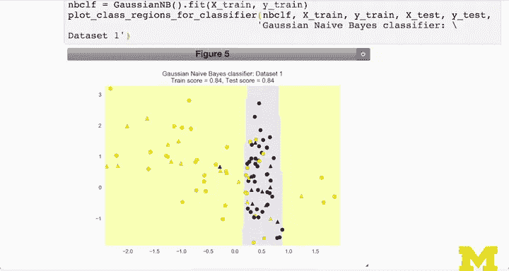

# 密歇根大学《Python用于数据科学实践（1-3课／共5课）｜Applied Data Science with Python 》deepseek翻译 - P83：28_朴素贝叶斯分类器.zh_en - GPT中英字幕课程资源 - BV1U64y1L7VJ

Another family of supervised learning models that's related to linear classification models is the Naive Bays family of classifiers。

Which are based on simple， probabilistic models of how the data in each class might have been generated。

Nive Bay's classifiers are called naive because informally。

 they make the simplifying assumption that each feature of an instance is independent of all the others。

 given the class。In practice， of course， this is not often the case。

 Features often are somewhat correlated。 for example。

 in predicting whether a house is likely to sell above the owner's asking price。

Some features such as the area of the interior rooms are likely to be correlated with other features。

 such as the size of the land that the house is built on or the number of bedrooms。

And these features， in turn， might be correlated with the location of the property and so on。

This naive， simplifying assumption means， on the one hand。

That learning a naive based classifier is very fast because only simple per class statistics need to be estimated for each feature and applied for each feature independently。

On the other hand， the penalty for this efficiency is that the generalization performance of naive Bays classifiers can often be a bit worse than other more sophisticated methods。

Or even linear models for classification。Even so， especially for high dimensional data sets。

 naive Bay classifiers can achieve performance that's often competitive to other more sophisticated methods like support vector machines for some tasks。

There are three flavors of naive Bay classifier that are available in psychic learn。

The Bernoulli naive Bayase model uses a set of binary occurrence features。

When classifying text documents， for example， the Bernoulli naive Bay model is quite handy because we could represent the presence or absence of a given word in the text with a binary feature。

Of course， this doesn't take into account how often the word occurs in the text。

So the multinoial naive based model。Uses a set of count based features。

 each of which does account for how many times a particular feature such as a word is observed in a training example like a document。

In this lecture， we won't have time to cover the Bernoulli or multinoial naive based models。However。

 those models are particularly well suited to textual data。

 where each feature corresponds to an observation for particular word。

 And so you'll see naive Bayes again， including the Bernoulli and btannoial models in more depth in the text mining part of the specialization。

This lecture will focus on Gaussian naive based classifiers。

 which assume features that are continuous or real valued。During training。

 the Gaussian naive Bay classifier estimates for each feature the mean and standard deviation of the feature value for each class。

For prediction， the classifier compares the features of the example data point to be predicted。

With the feature statistics for each class and selects a class that best matches the data point。

More specifically， the Gaussian naive Bay classifier assumes that the data for each class was generated by a simple class specific Gaussian distribution。

Predicting the class of a new data point corresponds mathematically to estimating the probability that each class's Gaussian distribution was most likely to have generated the data point。

Classifier then picks the class that has highest probability。

Without going into the mathematics involved， it can be shown that the decision boundary between classes in the two class Gaussian naive Bay classifier in general。

 is a parabolic curve between the classes。And in the special case。

 where the variance of each feature is the same for both classes。

 the decision boundary will be linear。Here's what that looks like typically on a simple binary classification data set。

The gray Ellipsies give an idea of the shape of the Gaussian distribution for each class as if we were looking down from above。

You can see the centers of the Gaussians correspond to the mean value of each feature for each class。

More specifically， the gray ellipses show the contour line of the Gaussian distribution for each class。

 that corresponds to about two standard deviations from the mean。

The line between the yellow and gray background areas represents the decision boundary。

And we can see that this is， indeed parabolic。To use the Gaussian naive base classifier in Python。

We just instantiate an instance of the Gaussian N B class。

And call the fit method on the training data just as we would with any other classifier。

It's worth noting that the Naive Bays models are among a few classifiers in psyit learnn that support a method called partial fit。

Which can be used instead of fit to train the classifier incrementally in case you're working with a huge data set that doesn't fit into memory。

More details on that are available in the psychit Learn documentation for naive B。

For the Gaussian NB class， there are no special parameters to control the model's complexity。

Looking at one example in the notebook from our synthetic to class data set。We can see that， in fact。

 the Gaussian Naive Bay Classifier achieves quite good performance on this simple classification example。

When the classes are no longer as easily separable as with this second more difficult binary example here。

Like linear models， naive Bayase does not perform as well。On a real world example。

 using the breast cancer data set， the Gaussian Naive Bayase classifier also does quite well。

 being quite competitive with other methods such as support vector classifiers。Typically。

 Gaussian Nive Bayase is used for high dimensional data when each data instance has hundreds。

 thousands， or maybe even more features。And likewise。

 the Bnoulli and multinoial flavors of naive bays are used for text classification。

 where there are very large number of distinct words as features and where the feature vectors are sparse。

 because any given document uses only a small fraction of the overall vocabulary。

There's more in depth material on the Berulli and multinomial knife based classifiers in the text mining portion of this specialization。

It can be shown that naive Bay's classifiers are related mathematically to linear models。

 and so many the pros and cons of linear models also apply to naive Bays。On the positive side。

Nive Bay' classifiers are fast to train and use for prediction。

 and thus are well suited to high dimensional data。

 including text and to applications involving very large data sets。

 where efficiency is critical and computational costs rule out other classification approaches。

On the negative side， when the conditional independent assumption about features doesn't hold。

In other words， for a given class， there's significant covariance among features。

As is the case with many real world data sets。Other more sophisticated classification methods that can account for these dependencies are likely to outperform naive base。

And on a side note， when getting confidence or probability estimates associated with predictions。

 Naive Bay classifiers produce unreliable estimates， typically。Still。

 naive based classifiers can perform very competitively on some tasks and are also often very useful as baseline models against which more sophisticated models can be compared。

