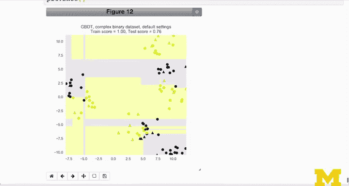

# 密歇根大学《Python用于数据科学实践（1-3课／共5课）｜Applied Data Science with Python 》deepseek翻译 - P85：30_梯度提升决策树.zh_en - GPT中英字幕课程资源 - BV1U64y1L7VJ

Another tree based ens soble method that's gained wide use in real world applications is gradient boosted decision trees。

Like random forests， gradient boosted trees use an ensemble of multiple trees to create more powerful prediction models for classification and regression。

😊，In this lecture， we'll provide a brief overview of gradient boosted decision trees。

 along with a discussion of their key parameters that control model of complexity。

Unlike the random forest method that builds and combines a forest of randomly different trees in parallel。

 the key idea of gradient boosted decision trees is that they build a series of trees where each tree is trained so that it attempts to correct the mistakes of the previous tree in the series。

Typically， gradient boosted tree ensembles use lots of shallow trees known in machine learning as weak learners。

 built in a non random way to create a model that makes fewer and fewer mistakes as more trees are added。

Once the model is built， making predictions with gradient boosted tree models is fast and doesn't use a lot of memory。

Like random forests， the number of estimators in a gradient boosted tree ensemble is an important parameter in controlling model complexity。

A new parameter that does not occur with random forest is something called the learning rate。

The learning rate controls how the gradient Boed tree algorithm builds the series of corrective trees。

When the learning rate is high， each successive tree puts strong emphasis on correcting the mistakes of its predecessor。

And thus may result in a more complex individual tree， and thus overall， a more complex model。

With smaller settings of the learning rate， there is less emphasis on thoroughly correcting the errors of the previous step。

Which tends to lead to simpler trees at each step。Here's an example showing how to use gradient boosted trees in psyit Learn on our sample fruit classification task。

Plooting the decision regions that result。The code is more or less the same as what we use for random forests。

But from the SKLn Ensemble module， we import the gradient boosting classifier class。

We then create the gradient boosting classifier object and fit it to the training data in the usual way。

By default， the learning rate parameter is set to 0。1。

 The n estimator parameter giving the number of trees to use is set to 100。

 and the max depth is set to 3。As with random forests。

 you can see the decision boundaries have that box like shape that's characteristic of decision trees or ensembles of trees。

Now let's apply gradient boosted decision trees to the breast cancer data set。

This code trains two different gradient boosted classifiers。 The first one uses the default settings。

We can see that the first result has perfect accuracy on the training set。

Which indicates the model is likely overfitting。Two ways to learn a less complex。

 gradient boosted tree model are to reduce the learning rate so that each tree doesn't try as hard to learn a more complex model that fixes the mistakes of its predecessor。

And to reduce the max depth parameter for the individual trees in the ensemble。

The second classifier example makes these changes in the parameters。

And you can see that the training set accuracy does decrease while the test set accuracy increases slightly。

Graient boosted decision trees are among the best off the shelf supervised learning methods available。

Achieving excellent accuracy with only modest memory and run time requirements to perform prediction once the model has been trained。

Some major commercial applications of machine learning have been based on gradient。

 boosted decision trees。Like other decision tree based learning methods。

 you don't need to apply feature scaling for the algorithm to do well。

 and the features can be a mix of binary， categorical and continuous types。

Boosted decision trees do have several downsides。 so like random forests。

 ensembles of trees are very difficult for people to interpret compared to individual decision trees。

However， this often may not matter for many applications where prediction accuracy is the most important goal。

Gradient boosted methods can require careful tuning of the learning rate and other parameters。

 and the training process can require a lot of computation。

And like the other tree based learning methods we saw。

 using gradient boosted methods for text classification or other scenarios where the feature space has thousands of features with sparse values is usually not a good choice for accuracy and computational cost reasons。

The key parameters controlling model complexity for gradient boosted tree models are and estimators which sets the number of small decision trees the weak learners to use in the ensemble。

And the learning rate。Typically these two parameters are tuned together。

 since making the learning rate smaller will require more trees to maintain model complexity。

Unlike random forests， increasing n estimators can lead to overfitting。So typically。

 the N estimator setting is chosen to best exploit the speed and memory capabilities of the system during the training。

And other parameters like the learning rate， are then adjusted。Given that fixed an estimator setting。

The max depth parameter can also have an effect on model complexity by controlling the depth and hence the complexity of the individual trees。

The gradient boosting method assumes that each tree is a weak learner。

 and so the max depth parameter is usually quite small on the order of three to 5 for most applications。

