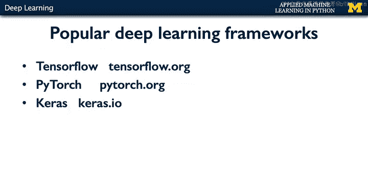

# 密歇根大学《Python用于数据科学实践（1-3课／共5课）｜Applied Data Science with Python 》deepseek翻译 - P87：32_深度学习（选修）.zh_en - GPT中英字幕课程资源 - BV1U64y1L7VJ

As we discussed in the first week of the course。One of the key challenges in machine learning is finding the right features to use as input to a learning model for a particular problem。

This is called feature engineering and can be part art and part science。

Can also be the single most important factor in doing well on a learning task。 Sometimes， fact。

 more often more important than the choice of the model itself。

We'll discuss this further in the last。Week of the course。

Because of the difficulty of feature engineering， there's been a lot of research on what's called feature learning or feature extraction algorithms that can find good features automatically。

This brings us to deep learning。At a high level， one of the advantages of deep learning is that it includes a sophisticated automatic feature learning phase as part of its supervised training。

Moreover， deep learning is called deep because this feature extraction typically doesn't use just one feature learning step。

 but a hierarchy of multiple feature learning layers each feeding into the next。

Here's one simplified example of what a deep learning architecture might look like in practice for an image recognition task。

 In this case， digit recognition。Recognizing a handwritten digit from 0 to 9， for example。

You can see the automatic feature extraction step made up of a hierarchy of feature layers。

 each of which is based on a network that does convolution。

 which can be thought of as a filter for a specific pattern。Followed by a subampling step。

 also known as pooling。That can detect a translated or rotated version of that feature anywhere in the image。

So that features are detected properly for the final classification step。

 which is implemented as a fully connected network。

The subsampling step also has the effect of reducing the computational complexity of the network。

Depending on the properties of the object we want to predict， for example。

 if we care only about the presence of an object in an image compared to its， say， specific location。

 the sub sampling part of the architecture may or may not be included。

And this is only one example of a deep learning architecture。 The size。

 structure and other properties may look very different depending on the specific learning problem。

This image from a paper by Hong La Lee and colleagues at the University of Michigan shows an illustration of multi layerer feature learning for face recognition。

Here there are three groups from left to right， corresponding to first。

 second and third stages of feature learning。The matrix at each stage shows a set of image features with one feature per square。

Each feature can be thought of as a detector or filter that lights up when that pattern is present in the underlying image。

The first layer of their deep learning architecture extracts the most primitive low level features。

 such as edges and different kinds of blobs。The second layer creates new features from combinations of those first layer features。

For faces， this might correspond to key elements that capture shapes of higher level features like noses or eyes。

The third layer， in turn， creates new features from combinations of the second layer features。

Forming still higher level features that capture capture typical face types and facial expressions。

Finally， all of these features are used as input to the final supervised learning step。

 namely the face classifier。Here are the feature layers that result from training on different types of objects。

 cars， elephants， chairs and a mixture of objects。These kinds of complex features can't be learned from a small number of layers。

Advances in both algorithms and computing power allow current deep learning systems to train architectures that can have dozens of layers of linear hierarchical features。

It turns out that the human brain does something quite related to this。

 when processing visual information。There are specific neural circuits that first do low level feature extraction。

 such as edge detection and finding frequency of repeated patterns。

Which are then used to compute more sophisticated features to help estimate things like simple shapes and their orientation。

 or whether a shape is in the foreground or background。

Followed by further layers of higher level visual processing that support more complex tasks。

 such as face recognition and interpreting the motion of multiple moving objects。

On the positive side， deep learning systems have achieved impressive gains。

And have achieved state of their performance on many difficult tasks。

Deep learning's automatic feature extraction mechanisms also reduce the need for human guesswork in finding good features。

Finally， with current software， deep learning architectures are quite flexible and could be adapted for different tasks and domains。

On the negative side， however， deep learning can require very large training sets and computing power。

 and that can limit its practicality in some scenarios。

The complexity of implementation could be considered as one of the negatives of deep learning。

 And this is the reason that a number of sophisticated high level software packages have been developed。

To assist in the development of deep learning architectures。Also。

 despite the faces example we saw earlier， which gave clear。

 easy to interpret features in most cases。Often， the features and weights of typical deep learning systems are not nearly so easy to interpret。

That is， it's not clear why or what features LED a deep learning system to make a particular prediction。

While PsyCit learned with the MLP classifier and MLLP Regressor classes provides a useful environment to learn about and apply simple neural networks。

If you're interested in getting a deep understanding of deep learning and the software tools required to use it。

 we've provided some links to additional resources。

Typical deep learning development is done with a multilayer software stack。Here's one example。

The higher level layer provides a high level programming interface that allows you to specify a deep learning architecture with only a few lines of code。

In this example， I've chosen Caras for my top level programming layer。

 and I'll show you an actual example of Kas in a minute。

The higher level programming layer calls into one or more low level services for things like defining a computation graph that describes the algorithmic workflow or manipulating data in the form of vectors。

 matrices， tensors， and so on。TensorFlow is an example of software that provides these kinds of core machine learning framework services。

Although TensorFlow has a high level programming layer as well。

The higher level kis layer makes use of TensorFlow2 core services。

The bottom layer is a hardware dependent layer that does the lowest level operations like multiplying matrices in a way that is usually optimized for a specific processor or computing architecture。

For example， graphics processing units or GPUs are a special kind of processor originally developed for video cards that can do extremely fast matrix operations。

This lowest layer can take advantage of this kind of specialized hardware to accelerate the training and running of deep learning models。

Let me just explain a few of the acronyms here。So BLAS stands for basic linear algebra sub programsgrams。

These are the de facto standard low level routines for linear algebra。

The BLSS specification is pretty general， but specific implementations are typically highly optimized for speed for a given processor。

CUDA KudDa stands for Compute Unified device Architecture。

And that's a parallel computing platform and application programming interface that allows software to use certain types of GPUs for general purpose processing。

We also have new forms of hardware optimized for machine learning called Tensor processing units or TPUs that are being deployed。

CUDNN is a GPU accelerated library that provides highly tuned implementations of routines arising frequently in deep neural network applications。

So working together， these three layers are all tremendously important in producing effective。

And efficient deep learning applications。TensorF， piechorch and Caris are currently among the most widely used deep learning frameworks。

TenssorFlow is an end to end open source platform for machine learning。It has a comprehensive。

 flexible ecosystem of tools， libraries， and community resources。

 and it supports both high level programming interfaces and low level core computational services。

Pytorrch was developed by Facebook's AI research Group and open source on GitHub in 2017。

It's used for a variety of sophisticated machine learning applications as well。

 especially natural language processing。Pytorrch has a reputation for simplicity， ease of use。

 flexibility， efficient memory usage， and dynamic computation graphs。

KIS is now part of the TensorFlow ecosystem and provides a simple。

 flexible top level programming interface for developing deep learning models。

So being able to develop deep learning frameworks。And machine learning has multiple benefits。

With deep learning， you can generate and iterate new models very quickly and you can debug relatively easily。

 which is of huge importance when building effective machine learning systems。

More specifically with these high level deep learning frameworks。You get the advantage of simplicity。

 so with deep learning， there's no need for feature engineering， the representation learning。

 and even the architecture iteration are done automatically。

You can build pipelines using only a few different vector matrix tensor operations。

These frameworks allow you to do things that are highly scalable。

So thanks to these multiple layers that we just discussed。

Your code is highly amenable to parallelization on。High performance computing。

Harvor like GPUs or TUs。And you can train these frameworks by irating over small batches of data。

 and that lets you handle data sets of arbitrary size。

Deep learning models using these frameworks are also very versatile and reusable。

They can be trained on additional data without starting from scratch。

 so it's easy to thaw an existing model， so to speak。

 add more training data to update the weights and then quote unquote， freezeze it again。

For use on your new task。So you can pretrain a model in one domain like image classification。

 and you can adjust its training for a different problem like video segmentation。

So I thought it would be fun to show you a specific example using Kais to define a simple digit recognizer。

This example is from Fois Chalet's book on deep learning with Python。

So a Kais script typically has four parts。 The first part。

 there are some lines of code that prepare the data。 So in this case。

 we're using the M Nist data set。 And so there are some。Some some code here to load the data set。

 There's a little bit of reshaping that has to happen to get it ready。

 put it in the right format for。For the neural network later on。In the second part。

 after you prepare the data， you define the model。So here we're going to implement this very simple model where we have an input as a digit。

We run it through a dense neural net layer that has 512 units。

We follow that with a second layer that has 10 units。And you can see that。

It's very nice that the CAIS program， the definition of the sequential model corresponds。

You can see very clearly the correspondence between a line of code that adds。

A layer to the model and the graphical description of the model over here。 So you can。

 it's very easy to create these models in Ke。 you， you define。What type of model you want？

You add these layers， so was one line of code to add each layer。And of course。

 you specify for each layer how many。How many hidden units it has。

 what activation function to use and so forth。Once you've defined the layers of the model。You。😔。

Do what's called compiling it。Where you specify some important parameters like which optimizer to use。

 which loss function is to be used， and so forth。So that prepares。The code internally for。

 for the next step， which is。The training step。 So that's where you fit the network using。

The training images with their labels， and here you can specify parameters like how many epics you want to run。

How many training images you want to to put in a batch as you're training through。

Multiple cycles and so forth。And then yeah， after the model training step。

 the final step is to evaluate the model so Ka has。So nice， simple ways to， where you can just。

Call this evaluate method on the network。Using the test data， and it will provide you。um。

The loss over the data as well as。Evaluation metric like accuracy。So。

This is a great illustration of just how easy it is to use a high level framework。um。To build。

A non trivialvi。Neural network that does something interesting。

